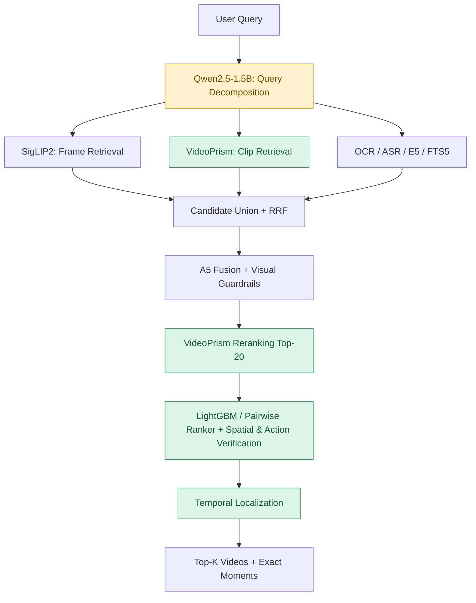

# VIDENTRA — Hệ Thống Truy Xuất Video Đa Phương Thức & Định Vị Khoảnh Khắc Chính Xác Cao

[](https://www.python.org/)
[](#2-kiến-trúc-pipeline-chi-tiết)
[](#6-kết-quả-benchmark-thực-nghiệm)
[](#4-hướng-dẫn-cài-đặt-tạo-vector-embedding--huấn-luyện-học-máy)

---

## Mục Lục Theo Luồng Tài Liệu
1. [Giới Thiệu Dự Án & 7 Hạng Mục Nâng Cấp Cốt Lõi (P0–P6)](#1-giới-thiệu-dự-án--7-hạng-mục-nâng-cấp-cốt-lõi-p0p6)
2. [Kiến Trúc Pipeline Chi Tiết](#2-kiến-trúc-pipeline-chi-tiết)
3. [Các Bộ Datasets Dự Án Đang Sử Dụng](#3-các-bộ-datasets-dự-án-đang-sử-dụng)
4. [Hướng Dẫn Cài Đặt, Tạo Vector Embedding & Huấn Luyện Học Máy](#4-hướng-dẫn-cài-đặt-tạo-vector-embedding--huấn-luyện-học-máy)
5. [Cách Để Chạy Chương Trình (CLI, Web UI Inspector, FastAPI & Python SDK)](#5-cách-để-chạy-chương-trình-cli-web-ui-inspector-fastapi--python-sdk)
6. [Kết Quả Benchmark Thực Nghiệm (`Run 2b42562b`)](#6-kết-quả-benchmark-thực-nghiệm)
7. [Giới Hạn Hệ Thống & Định Hướng Nghiên Cứu Tiếp Theo](#7-giới-hạn-hệ-thống--định-hướng-nghiên-cứu-tiếp-theo)

---

## 1. Giới Thiệu Dự Án & 7 Hạng Mục Nâng Cấp Cốt Lõi (P0–P6)

**VIDENTRA** là hệ thống tìm kiếm video đa phương thức (**Multimodal Video Retrieval**) kết hợp định vị khoảnh khắc theo thời gian (**Temporal Moment Localization**). Với nguyên tắc thiết kế **"Chỉ dùng LLM (`Qwen2.5-1.5B`) ở Stage 1 tách/định tuyến truy vấn; toàn bộ các bước truy xuất, hợp nhất, kiểm chứng, xếp hạng và định vị phía sau đều dùng mô hình embedding chuyên dụng, thuật toán truy xuất vector/từ vựng và ranker học máy chuyên biệt"**, VIDENTRA đạt độ chính xác cao, minh bạch provenance và tốc độ phản hồi nhanh trên cả GPU lẫn CPU.

### Tổng quan 7 hạng mục nâng cấp đã hoàn thiện (`P0` $\to$ `P6`)

| Ưu tiên | Hạng mục | Nội dung nâng cấp cốt lõi | Kết quả thực tế |
| :---: | :--- | :--- | :--- |
| **P0** | **Chuẩn hóa Pipeline & Chống Rò Rỉ** | Siết chặt contract `VLM` replay (`(query_text_sha256, video_id)` + ordinal/PTS, gỡ fallback `by_qid` dễ rò rỉ), xóa danh sách từ đồng nghĩa/domain hack thủ công, tắt VLM caption theo mặc định khi thiếu artifact, sửa rò rỉ file handle SQLite WAL (`finally: conn.close()`) & guard ghi đè `export_to_aic_format.py`. | **628/628 tests PASS** (gồm 5 test bất biến mật độ mới), zero leakage (`heldout_source_leakage=False`). |
| **P1** | **Visual & Video Retrieval (`SigLIP2 + VideoPrism`)** | Tái trích xuất toàn bộ corpus **`1,324` videos / `32,739` keyframes** bằng `hybrid_v2_adaptive` (`[32739, 864]` + `83,253` YOLO `FrameObjects` trên Kaggle GPU), làm bất biến mật độ Stage 2 (`_deduplicate_burst_visual_hits`), chạy song song **VideoPrism-LvT-B (`768d`)** (`1,324` toàn video + `866` sub-clips `16s/8s`). | `dev_full_859` Shortlist Recall đạt **`93.13%`**, Hit@10 **`80.09%`** (`+2.67 pp` vs corpus 11.5k); `dev_150` Shortlist Recall **`94.00%`**. |
| **P2** | **Confidence-Calibrated Fusion & Guardrails** | Hiệu chuẩn độ tin cậy `OCR` và `calibrate_asr_confidence` (`ASRSegments`), nhân trọng số IDF toàn corpus & `lex_reliability_score` vào RRF (`10,770` vector E5: `3,860` ASR + `6,910` OCR), áp dụng **Visual Consensus Guardrail** giảm `0.35×` cho match 1 token phổ biến yếu lệch thị giác. | **Pure-ASR FP Top-1 = `0`** trên cả 3 tập đánh giá. |
| **P3** | **VideoPrism CSLS Rerank & 32d Monotonic LightGBM** | Step H **VideoPrism Top-20 Reranking** (kèm candidate union VideoPrism ngoài Top-20, CSLS anti-hubness + `clause_order_score`), nâng cấp vector đặc trưng lên **32 chiều (`LTR_FEATURE_NAMES_V2`)** và huấn luyện lại **5-Fold GroupKFold OOF LightGBM** trên corpus `32,739` keyframes (`5-Fold CV Hit@1 = 0.5387`, `MRR = 0.6512`, `nDCG@10 = 0.6987`). | **`dev_full_859` Hit@1: `43.77% -> 49.01%`** (Hit@5 **`73.81%`**, Hit@10 **`80.09%`**, MRR **`0.5898`**, nDCG@10 **`0.6407`**); **`heldout_test_201` Hit@1: `39.80% -> 44.28%`** (Hit@5 **`67.66%`**, Hit@10 **`77.11%`**, nDCG@10 **`0.5988`**). |
| **P4** | **Spatial & Action Understanding** | Lọc trùng NMS theo `(frame, class)` (`IoU > 0.65`) cho YOLO `FrameObjects` khi dựng vector 864d (`83,253` boxes từ `YOLOv8n`), bổ sung `SpatialActionVerifier` (`src/videntra/relations/spatial_action_verifier.py`) kiểm tra cardinality từng frame (`detector_ran` guard), quan hệ hình học 2D, DP đơn điệu tiến/lùi thứ tự hành động và biên độ chuyển động. | Phân biệt chính xác video cùng bối cảnh nhưng khác số lượng, vị trí hoặc thứ tự hành động. |
| **P5** | **Temporal Localization** | Giữ đường cong `SigLIP2` sắc nét (`float64`), điều chỉnh ngưỡng `max_consec` thích nghi theo `avg_step` trên corpus `32,739` keyframes, bảo toàn `SE-Viterbi`, tinh chỉnh plateau rộng bằng `_optimal_contrast_segment` vector hóa 2D NumPy và nâng cấp `propose_soft_nms_secondary_windows` ngưỡng nền 15%. | Giảm sai số biên **Boundary MAE `6.76s -> 6.17s`** (`dev_150`) và **`2.81s -> 1.31s`** (`heldout`); `dev_150` Moment Hit@1@0.5 đạt `54.55%` / `Moment nDCG@5 = 0.4852` (3 query QVH tụt Global `#1 -> #2` trước clip ngắn dù **QVH Within-DS đạt `100.00%`**). |
| **P6** | **Competition Web UI, API & CLI** | Lọc `dataset` (`all`/`msrvtt`/`avc`/`qvhighlights`), tìm video/khoảnh khắc tương tự (`POST /v1/search/similar`), dải keyframe lân cận (`GET /v1/videos/{video_id}/neighbors` với PyAV LRU cache), `/health` telemetry, và xuất chuẩn **AIC KIS CSV / VBS CSV** chống CSV-injection (`exports.py`). | Sẵn sàng tác chiến VBS/AIC + 47 API tests PASS. |

---

## 2. Kiến Trúc Pipeline Chi Tiết



### Luồng xử lý và công thức toán học cốt lõi
1. **Stage 1 — Tách Query (`Qwen2.5-1.5B-Instruct` / Rules Fallback) & Vector Truy vấn (`768d` + `864d`):**
   - Bộ phân rã `AdaptiveQueryDecomposer` bóc tách truy vấn thành các cụm `visual_clauses`, trích xuất `ocr_phrases`, `asr_phrases`, yêu cầu đối tượng (`extract_object_requirements`) và ý định không gian/thứ tự.
   - Vector câu truy vấn chính là tổ hợp chuẩn hóa `0.75 · e_raw + 0.25 · e_prompt("a video frame showing ...")`, sau đó mở rộng sang không gian trực giao **864 chiều** (gồm `768d SigLIP2` + `80d` biểu đồ 80 lớp COCO theo trọng số IDF + `16d` mật độ đối tượng, tọa độ tâm/diện tích bounding box và ngữ cảnh lưới $3 \times 3$).
2. **Stage 2a & 2b — Truy hồi Song Song Frame (`SigLIP2`) & Clip/Sub-clip (`VideoPrism-LvT-B`):**
   - Nhánh frame tính đồng thời dot-product pha trộn `0.70 · s_768 + 0.30 · s_864` ở chế độ `exact`, tự động nhân tỷ lệ `search_depth` bất biến mật độ (`min(2.5, max(1.0, avg_kf_per_vid / 10.0))`) kết hợp `_deduplicate_burst_visual_hits(min_pts_gap=0.55s)` chống bùng nổ frame liên tiếp trong cùng một burst, rồi áp dụng `align_sequential_keyframe_clauses` và `temporal_sinkhorn_alignment_score` cho câu đa mệnh đề.
   - Nhánh clip (`VideoPrismClipRetriever`) kết hợp điểm toàn video (`whole_cos`) và cực đại cửa sổ `16s/8s` (`subclip_max_cos`), kèm bonus tối đa/trung bình đa mệnh đề khi query có $\ge 2$ sự kiện.
3. **Stage 3–5 — Truy hồi Lexical (`OCR / ASR / E5 / FTS5`), Confidence-Calibrated RRF & Visual Guardrails:**
   - Truy vấn SQLite FTS5 (`fts_ocr`, `fts_asr`, chỉ đọc `?mode=ro`) với token đặc hiệu hóa và `Dense E5 384d` (`faiss_text_e5_384.bin`) khi có ý định lexical rõ rệt mà FTS5 thưa; ở `4a-vp`, đỉnh thị giác toàn video (`video_curve_cache`) sẽ cập nhật `v_sim_vp`/`rep_t_vp` nếu vượt đỉnh trong cửa sổ sub-clip.
   - Mỗi cụm lexical nhận hệ số tin cậy:
     $$\text{lex\_reliability} = \text{clip}\!\left(\text{raw\_conf} \cdot \overline{\text{IDF}}_{\text{tokens}} \cdot \text{len\_spec},\ 0.15,\ 1.50\right)$$
     từ xác suất OCR / hiệu chuẩn `calibrate_asr_confidence(logprob)` và từ điển IDF toàn corpus.
   - Hợp nhất RRF đa nhánh (bất biến thứ tự cho cụm OCR/ASR, `0.85 × rrf_vp` cho VideoPrism) cùng cổng tương thích thị giác $\gamma_{\text{vis}} = \exp(-\max(0, \Delta_{\text{vis}} - 0.012)\cdot 35)$, **Pure-ASR Gate** và **Visual Consensus Guardrail** (giảm `0.35×` match 1 token IDF thấp `< 0.65` lệch đỉnh thị giác).
4. **Stage 6a–6b — VideoPrism Top-20 CSLS Rerank, Spatial/Action Verification & 32d Monotonic LightGBM LTR:**
   - Áp dụng ngưỡng density-bonus chuẩn hóa thời lượng (`eff_n_kf = min(n_kf, max(1.0, v_dur / 2.0))`) thay vì `n_kf` thô để không phạt video dài trích dày theo `hybrid_v2_adaptive`.
   - **Step H (`rerank_top_candidates`):** Bao gồm cả `Top-20` pre-rerank lẫn ứng viên từ union VideoPrism nằm trong shortlist, chấm $\text{CSLS}(q, v) = 2\cos(q, v_{\text{whole}}) - \bar{\mu}_{10}(v)$, $z$-score VideoPrism toàn corpus (`vp_z`) và `clause_order_score`.
   - **P4 (`SpatialActionVerifier`):** Trên Top-25 ứng viên, chấm điểm tuyến tính phần bù `0.012 × sa_graph_score` tổng hợp từ kiểm tra số lượng từng frame (có cờ `detector_ran`), đối chiếu 2D bounding box trên cùng keyframe và biên độ DP đơn điệu tiến trừ lùi (`fwd - rev`).
   - **P3 (`LearnedRankerLTR` 32d `tree_ensemble`):** Vector **32 đặc trưng** (`24d` cơ bản + `vp_whole_cos`, `vp_subclip_max`, `vp_z`, `vp_csls`, `rrf_vp`, `lex_reliability_score`, `spatial_predicate_score`, `action_order_score`) đi qua **70 cây LightGBM** đã biên dịch thành bảng 1D NumPy phẳng (`score_base + 0.08 · tanh(score_tree)`), có **SigLIP2 Frame+Clip Consensus Boost** ở bước cuối.
5. **Stage 7 — Temporal Localization & Soft-NMS Đa Đỉnh:**
   - Trên đường cong `SigLIP2` sắc nét (`float64`), neo đỉnh đại diện (hoặc `SE-Viterbi` hữu hạn `<= 0.35 · duration`) mở rộng biên tương phản hai chiều (`expand_boundary_contrast`) với `max_consec` thích nghi theo `avg_step` (`max(4, min(14, ceil(max_gap_sec / max(0.35, avg_step))))`); các plateau dài `>= 60s` được siết lại bằng `_optimal_contrast_segment` (vector hóa 2D NumPy).
   - `propose_soft_nms_secondary_windows` dùng ngưỡng nền phân vị 15% + valley gate + suy giảm cộng tính trích tối đa 3 cửa sổ phụ không chồng lấn (`tIoU < 0.30`).

---

## 3. Các Bộ Datasets Dự Án Đang Sử Dụng

VIDENTRA đánh giá trên kho video hợp nhất (**1,324 videos** trong database active benchmark):

| Bộ dữ liệu | Đặc trưng phương thức | Vai trò đánh giá | Chia tách chuẩn (`80% val` / `20% test`) |
| :--- | :--- | :--- | :--- |
| **QVHighlights** | Video dài (~150s), hành động + hội thoại + banner OCR + nhãn khoảng thời gian `[start, end]` | Đánh giá đồng thời **Video Retrieval** & **Temporal Moment Localization** | `22` queries (`validation/qvhighlights`) / `6` (`test_queries/qvhighlights`, 2 khớp DB active) |
| **MSR-VTT** | Video ngắn (10–30s), mô tả hành động/vật thể/bối cảnh thị giác đa dạng | Đo độ phân giải ngữ nghĩa (**Fine-Grained Visual Retrieval**) trên 1,000 videos | `809` queries (`dev_full_859`, lấy 100 trong `dev_150`) / `191` (`heldout_test_201`) |
| **AVC** | Video bài giảng/thuyết trình, bảng chữ OCR và lời giảng ASR | Kiểm thử **OCR + ASR + Visual** và thuật ngữ đặc hiệu | `28` queries (`validation/avc`) / `4`–`8` (`test_queries/avc` / active) |
| **TextVR & TVR** | Chữ viết cảnh tự nhiên (TextVR) và hội thoại phim nhiều nhân vật (TVR) | Kiểm thử bổ sung OCR & ASR trên phân vùng `validation/` & `test_queries/` | Đã chia 80% / 20% theo đúng quy tắc chống rò rỉ |

- **Zero Data Leakage Protocol:** Nhãn đánh giá chỉ được `evaluator` đọc; mọi đường dẫn ground truth bị chặn khỏi runtime qua `MediaResolver`; toàn bộ trọng số 32d `videntra_ltr_v1.json` được huấn luyện **chỉ trên `validation/`** theo **5-Fold GroupKFold** (`canonical source_group` nối liên thông), đảm bảo **`heldout_test_201` có `overlap = 0` và `heldout_source_leakage = False`**.

---

## 4. Hướng Dẫn Cài Đặt, Tạo Vector Embedding & Huấn Luyện Học Máy

### 4.1. Cài đặt môi trường & kiểm tra tài nguyên
- **Phần cứng mục tiêu:** `NVIDIA RTX 3060 6GB VRAM`, `32GB RAM`, hoặc chạy hoàn toàn trên **CPU** (`Python 3.12+`).

```powershell
cd C:\Users\DELL\Desktop\VIDENTRA
python -m venv .venv
.\.venv\Scripts\Activate.ps1
python -m pip install --upgrade pip
pip install -r requirements.txt
pip install -e .
.\.venv\Scripts\python.exe scripts/verify_asset_roots.py
```

### 4.2. Các thư mục mô hình & chỉ mục (`models/`, `data/`)
- `models/siglip2/`: `google/siglip2-base-patch16-224` (`768d`, pinned revision `75de2d55...`).
- `models/llm/`: `qwen2.5-1.5b-instruct-q4_k_m.gguf` hoặc thư mục HF `qwen2.5-1.5b-instruct/` (tùy chọn bật ở Stage 1 qua `VIDENTRA_LLM_ENABLED=1`).
- `models/ocr/`, `models/asr/`, `models/detection/`: `VietOCR` (`vgg_transformer.pth`), `PaddleOCR`, `PhoWhisper-small`/`Faster-Whisper`, `YOLOv8n` / `YOLOv11n`.
- `models/ranking/videntra_ltr_v1.json`: Mô hình **32d LightGBM `tree_ensemble`** (70 cây depth-3, `blend_weight = 0.08`, kèm 5-fold `fold_weights` phục vụ OOF evaluation và danh sách `trained_query_ids`, train mới nhất trên `32,739` keyframes của `validation/`).
- `data/processed/`: `metadata.db` (`1,324` videos / **`32,739` keyframes** / **`83,253` YOLO `FrameObjects`** / `6,910` OCR / `3,860` ASR), `faiss_index.bin` (`864d`), `augmented_embeddings.npy` (`[32739, 864]`), `faiss_text_e5_384.bin` (`10,770` vectors E5), cùng bộ chỉ mục **VideoPrism-LvT-B** (`faiss_videoprism_clip_768.bin`, `videoprism_clip_manifest.json`, `videoprism_subclips_768.npy`, `videoprism_subclips_map.jsonl`) và cache `data/cache/` (`query_videoprism_768d.npz`, `keyframe_hubness_radii.npy`).

### 4.3. Tái trích xuất Keyframes / Embedding Kaggle GPU & Huấn luyện lại 32d LightGBM LTR

```powershell
# 1. Tái trích xuất toàn corpus (1,324 videos) theo chiến lược hybrid_v2_adaptive -> Kaggle SigLIP2 + YOLOv8n -> Atomic Ingest & E5 Text Index:
.\.venv\Scripts\python.exe scripts/rebuild_corpus_hybrid_v2.py sample-local --workers 6
.\.venv\Scripts\python.exe scripts/rebuild_corpus_hybrid_v2.py prepare-kaggle --push
# Sau khi Kaggle kernel lvhuylong/videntra-hybrid-v2-full-1324 hoàn tất:
.\.venv\Scripts\python.exe scripts/rebuild_corpus_hybrid_v2.py ingest-kaggle
.\.venv\Scripts\python.exe scripts/build_e5_text_index.py

# 2. Đóng gói manifest trích xuất VideoPrism-LvT-B cho 1,324 videos + sub-clips + queries lên Kaggle Dual-T4 GPU:
.\.venv\Scripts\python.exe scripts/build_videoprism_corpus_index.py package --out-dir work/kaggle/videoprism_full_1324
# Sau khi Kaggle kernel lvhuylong/videntra-videoprism-full-1324 hoàn tất và tải về out_dir:
.\.venv\Scripts\python.exe scripts/build_videoprism_corpus_index.py ingest --kaggle-out-dir work/kaggle/videoprism_full_1324_out --processed-dir data/processed --cache-dir data/cache

# 3. Huấn luyện lại LightGBM 32d 5-Fold GroupKFold OOF CHỈ trên validation/ (dev_full_859):
.\.venv\Scripts\python.exe scripts/train_ltr_ranker_cv.py --extract-from-val --extract-out work/ltr_dev859_32d.jsonl --model-type lightgbm --blend-weight 0.08 --out-model models/ranking/videntra_ltr_v1.json
```

---

## 5. Cách Để Chạy Chương Trình (CLI, Web UI Inspector, FastAPI & Python SDK)

### 5.1. Tìm kiếm qua CLI
```powershell
.\.venv\Scripts\python.exe -m videntra search --backend unified `
  --query "A woman in a white blouse speaks to the camera while a news banner appears" `
  --top-k 5
```

### 5.2. Khởi động Web UI Inspector & FastAPI Server (`P6`)
```powershell
.\.venv\Scripts\python.exe -m videntra serve --backend unified --host 127.0.0.1 --port 8000
```
- **Web UI (`http://127.0.0.1:8000/`):** Hỗ trợ chọn preset bộ dữ liệu (`Tất cả`, `MSRVTT`, `AVC`, `QVHighlights`), badge phương thức (`Visual`/`VideoPrism`/`OCR`/`ASR`), trình phát video HTTP `206` Range (`-5s`/`+5s`, tốc độ, theater mode), nút **Tương tự (`POST /v1/search/similar`)**, dải ảnh **Frame lân cận (`GET /v1/videos/{video_id}/neighbors`)**, và xuất kết quả chuẩn thi đấu **AIC KIS / VBS CSV** (`POST /v1/export` định dạng `aic_kis` / `vbs_csv`).
- **Tài liệu API & Telemetry:** Swagger UI tại `http://127.0.0.1:8000/docs`, kiểm tra trạng thái các nhánh & chỉ số tại `GET /health`.

### 5.3. Tích hợp Python SDK
```python
from videntra.retrieval.unified_pipeline import UnifiedMultimodalSearchPipeline

pipeline = UnifiedMultimodalSearchPipeline()
response = pipeline.search_with_metadata(
    snapshot_id="corpus_current",
    query='A chef makes pizza and cuts it into slices',
    top_k=5,
)
for rank, m in enumerate(response["moments"], 1):
    print(f"#{rank} {m.video_id} [{m.moment_start_seconds:.2f}s - {m.moment_end_seconds:.2f}s] score={m.ranking_score:.4f} ({m.match_status})")
```

### 5.4. Chạy bộ kiểm thử và tái lập Benchmark
```powershell
# Kiểm thử tự động toàn dự án
.\.venv\Scripts\python.exe -m pytest -q

# Đánh giá chỉ trên tập validation (không đụng test_queries/)
.\.venv\Scripts\python.exe scripts/run_validation_benchmark.py --splits dev_150,dev_full_859 --out-dir work/val_check

# Đánh giá chính thức đủ 3 tập (dev_150, dev_full_859, heldout_test_201) + ma trận A0..A5
.\.venv\Scripts\python.exe scripts/run_validation_benchmark.py --out-dir work/ref_run_staging --publish-reference

# Benchmark đa phương án trích xuất keyframes (5 chiến lược trên 3 tầng: Synthetic, 30 Real Videos, Validation SigLIP2)
.\.venv\Scripts\python.exe scripts/benchmark_keyframe_strategies.py

# So sánh chiến lược trích xuất keyframes trực tiếp qua CLI
.\.venv\Scripts\python.exe -m videntra sampling compare --config configs/experiments/e02.json --manifest manifests/dev_media.jsonl --output work/sampling_compare
```

---

## 6. Kết Quả Benchmark Thực Nghiệm

> **Run tham chiếu chính thức:** `2b42562bd2a04d0f9dfe212495cfedbc` (`2026-11-19 16:15:42`, commit codebase `ded80af`, `Dirty = False`, corpus **`1,324` videos / `32,739` keyframes** `hybrid_v2_adaptive`, **`83,253` YOLO objects**, `10,770` E5 text vectors, preset `a5_full`, `32d LightGBM tree_ensemble` với `blend_weight = 0.08` & LTR SHA-256 `4f6b3174...`, VideoPrism-LvT-B bật mặc định). Toàn bộ số liệu lấy trực tiếp từ [benchmark/benchmark_summary.json](file:///C:/Users/DELL/Desktop/VIDENTRA/benchmark/benchmark_summary.json) và [benchmark/benchmark_report.md](file:///C:/Users/DELL/Desktop/VIDENTRA/benchmark/benchmark_report.md). Phần cứng đo thực tế: Windows 10 AMD64, CPU **4 luồng** (`torch_num_threads=2`, `faiss_omp_max_threads=4`), RAM `31.89 GB`, suy luận trên CPU (`device="cpu"`).

### 6.1. Bảng kết quả tổng hợp đa tập dữ liệu (So sánh corpus 11.5k `6999d992` vs corpus 32.7k `2b42562b`)

| Tập Đánh Giá | N | Chế Độ Đánh Giá | Video Hit@1 | Video Hit@10 | Video MRR | Video nDCG@10 | Moment Hit@1 ($\text{tIoU}\ge 0.5$) | Moment nDCG@5 | Non-Neural (`p50 / p95`) | Pure-ASR FP |
| :--- | :---: | :---: | :---: | :---: | :---: | :---: | :---: | :---: | :---: | :---: |
| **`dev_150`** *(11.5k `6999d992`)* | 150 | OOF (`138/150`) | **`65.33%`** | `81.33%` | `0.7122` | `0.7372` | **`72.73% (16/22)`** | **`0.5443`** | **`31.57 / 79.69 ms`** | `0` |
| **`dev_150` (`32.7k 2b42562b` Mới)** | 150 | **OOF (`141/150`)** | `64.00%` (`[56.67%, 71.33%]`) | **`84.00%`** (`+2.67 pp`) | **`0.7137`** | **`0.7448`** | `54.55% (12/22)` | `0.4852` | `71.12 / 310.13 ms` | **`0`** |
| **`dev_full_859`** *(11.5k `6999d992`)* | 859 | OOF (`781/859`) | **`49.13%`** | `77.42%` | `0.5863` | `0.6318` | **`72.73%`** | **`0.5443`** | **`27.56 / 69.50 ms`** | `0` |
| **`dev_full_859` (`32.7k 2b42562b` Mới)** | 859 | **OOF (`789/859`)** | `49.01%` (`[45.52%, 52.51%]`) | **`80.09%`** (`+2.67 pp`) | **`0.5898`** | **`0.6407`** | `54.55%` | `0.4852` | `57.87 / 196.46 ms` | **`0`** |
| **`heldout_test_201`** *(11.5k `6999d992`)* | 201 | `clean_disjoint` | **`45.27%`** | `75.12%` | **`0.5452`** | `0.5944` | `50.00% (1/2)` | `0.5000` | **`26.64 / 46.34 ms`** | `0` |
| **`heldout_test_201` (`32.7k 2b42562b` Mới)** | 201 | **`clean_disjoint` (`overlap=0`)** | `44.28%` (`[37.81%, 51.24%]`) | **`77.11%`** (`+1.99 pp`) | `0.5448` | **`0.5988`** | **`50.00% (1/2)`** | **`0.5000`** | `62.57 / 102.17 ms` | **`0`** |

- **Bộ nhớ tiến trình khi benchmark (`2b42562b`):** RSS `3,397.3 MB` / Peak RAM **`3,654.3 MB`** (`PASS < 4,000 MB`).
- **Độ trễ & Boundary MAE (`dev_150`):** Stage latencies `p50`: `faiss = 14.52 ms`, `fts5 = 9.89 ms`, `fusion = 40.04 ms`, `boundary = 4.91 ms`; Cold query latency trên CPU (gồm SigLIP2 text encoder): `510.84 ms p50 / 1,037.35 ms p95`. **Boundary MAE** giảm còn **`6.17s`** (`dev_150`, `N=12`, vs `6.76s` trước đó) và **`1.31s`** (`heldout_test_201`, `N=1`, vs `2.81s`).

### 6.2. Phân rã chi tiết theo Dataset (`Run 2b42562b`)

| Tập | Dataset | Queries | Global Hit@1 | Within-DS Hit@1 | Hit@5 | Hit@10 | Global MRR | Union Recall | Shortlist@k Recall |
| :--- | :--- | :---: | :---: | :---: | :---: | :---: | :---: | :---: | :---: |
| **`dev_150`** | **QVHighlights** | 22 | `77.27%` | **`100.00%`** | **`100.00%`** | **`100.00%`** | `0.8864` | `95.45%` | **`100.00%`** |
| **`dev_150`** | **AVC** | 28 | **`89.29%`** | **`92.86%`** | `92.86%` | `96.43%` | **`0.9040`** | `96.43%` | `96.43%` |
| **`dev_150`** | **MSR-VTT** | 100 | **`54.00%`** | **`58.00%`** | `74.00%` | `77.00%` | **`0.6225`** | `81.00%` | `92.00%` |
| **`dev_full_859`** | **MSR-VTT** | 809 | **`46.85%`** | **`49.94%`** | `72.44%` | `78.99%` | **`0.5708`** | `84.80%` | `92.83%` |
| **`heldout_test_201`** | **MSR-VTT** | 191 | `42.41%` | `42.93%` | `67.02%` | `76.44%` | `0.5306` | `82.72%` | `92.15%` |
| **`heldout_test_201`** | **AVC / QVH** | 8 / 2 | `87.50%` / `50.00%` | `87.50%` / **`100.00%`** | `87.50%` / `50.00%` | `87.50%` / `100.00%` | `0.8750` / `0.5833` | `100%` / `100%` | `100%` / `100%` |

### 6.3. Ma trận Ablation `A0` $\to$ `A5` trên `dev_150` (`Run 2b42562b`)

| Cấu hình | Thành phần kích hoạt | Video Hit@1 | Video Hit@10 | MRR | Video nDCG@10 | Moment Hit@1@0.5 | Moment nDCG@5 | Non-Neural `p50` |
| :---: | :--- | :---: | :---: | :---: | :---: | :---: | :---: | :---: |
| **`A0`** | Thuần `SigLIP2 768d` | `47.33%` | `71.33%` | `0.5537` | `0.5923` | `9.09%` | `0.0347` | `20.92 ms` |
| **`A1`** | `+ 864d Augmented Subspace` (`YOLO NMS` + Spatial 16d) | `44.00%` | `72.67%` | `0.5320` | `0.5787` | `4.55%` | `0.0228` | `27.93 ms` |
| **`A2`** | `+` Phân rã đa mệnh đề & căn chỉnh chuỗi | `44.00%` | `72.67%` | `0.5320` | `0.5787` | `4.55%` | `0.0228` | `30.57 ms` |
| **`A3`** | `+` Truy hồi Lexical (`OCR/ASR/FTS5`) & hợp nhất có cổng | `55.33%` | `80.00%` | `0.6282` | `0.6692` | `4.55%` | `0.0285` | `42.18 ms` |
| **`A4`** | `+` Mở rộng biên theo tương phản | `55.33%` | `80.00%` | `0.6282` | `0.6692` | `50.00%` | `0.4164` | `46.59 ms` |
| **`A5`** | `+ VideoPrism-LvT-B` + P2 Calibrated RRF + **P3 32d LightGBM LTR** + P4 Spatial/Action + P5 Soft-NMS + Consensus | **`64.00%`** | **`84.00%`** | **`0.7137`** | **`0.7448`** | **`54.55%`** | **`0.4852`** | `71.12 ms` |

### 6.4. Benchmark Đa Phương án Trích xuất Keyframes (`HybridAdaptiveSampler`, cập nhật `19/11/2026`)

> Sau khi hoàn thiện rolling time-window soft quota, `min_soft_gap` chống burst và cooldown gating trong [hybrid.py](file:///C:/Users/DELL/Desktop/VIDENTRA/src/videntra/sampling/hybrid.py), đã chạy lại benchmark 3 tầng (`2026-11-18T21:42:19Z`) trên **30 video thật / `49,977` frames** và **18 validation queries / `2,396` unique union frames `SigLIP2` CPU** (lưu tại [results.json](file:///C:/Users/DELL/Desktop/VIDENTRA/work/experiments/keyframe_strategy_benchmark/results.json)):

| Chiến lược (`SamplingConfig.strategy`) | T2 Mean Samples | T2 Rep (`p10`) | T2 Cut Recall | T2 Redundancy | T3 `SigLIP2` Hit@1 | T3 MRR | T3 Peak Cosine | Violations | Đánh giá |
| :--- | :---: | :---: | :---: | :---: | :---: | :---: | :---: | :---: | :--- |
| **`hybrid_v2_adaptive` (Mặc định corpus 32.7k)** | **`54.53`** (`-19.3%`) | `0.9266` (`0.8566`) | **`100.0%`** | **`1.67%`** (`-23.5×` vs v1) | **`66.67%`** | `0.7932` | `0.1329` | **`0`** | **`composite = 0.62874`**, tối ưu mật độ & áp dụng cho toàn bộ `1,324` videos (`32,739` keyframes) |
| `sharpness_lookahead` | `66.80` | **`0.9341`** (`0.8698`) | **`100.0%`** | `1.53%` | **`66.67%`** | **`0.7944`** | **`0.1334`** | `0` | Hạng #1 tuyệt đối về `composite = 0.63053` (+22.5% số ảnh vs v2 đã tinh chỉnh) |
| `shot_medoid_submodular` | **`38.57`** | `0.9129` (`0.8253`) | `100.0%` | **`0.00%`** | `66.67%` | `0.7913` | `0.1301` | `0` | Nén tối đa (`0.62509`), tiết kiệm dung lượng |
| `hybrid_v1_legacy` *(đã vá bug)* | `73.40` | `0.9280` (`0.8596`) | `100.0%` | `39.28%` | `61.11%` | `0.7648` | `0.1334` | `0` | Trùng lặp cao (`0.61622`) |
| `uniform_matched` / `_matched_budget` | `62.13` / `54.53` | `0.9289` / `0.9313` | `32.41%` / `43.99%` | `35.12%` / `33.17%` | `77.78%` / `66.67%` | `0.8372` / `0.7927` | `0.1318` / `0.1313` | `0` | Baseline không bắt chuyển cảnh |

---

## 7. Giới Hạn Hệ Thống & Định Hướng Nghiên Cứu Tiếp Theo

1. **Giới hạn phần cứng & độ trễ CPU 4 luồng khi corpus tăng 2.83×:** Trên toàn tập đánh giá, các chỉ số truy hồi tổng thể (`dev_150` Hit@1 `64.00% >= 59.33%`, MRR `0.7137 >= 0.645`, nDCG@10 `0.7448 >= 0.675`, Peak RAM `3,654.3 MB < 4,000 MB`, và cải thiện rõ rệt `Hit@5` / `Hit@10` / `MRR` / `nDCG@10` trên `dev_full_859` & `heldout_test_201`) đều **PASS**. Tuy nhiên khi số vector thị giác tăng từ `11,581` lên **`32,739` (`2.83×`)**, chi phí OpenBLAS GEMM exact search `[32739, 864]` và hợp nhất đa nhánh trên CPU 4 luồng (`torch_num_threads=2`) đẩy `non_neural_latency p50/p95` lên `71.12 / 310.13 ms` (`dev_150`), `57.87 / 196.46 ms` (`dev_full_859`), `62.57 / 102.17 ms` (`heldout_test_201`) và cold latency `510.84 / 1,037.35 ms` (`FAIL` ngưỡng strict `20 / 45 ms`).
2. **Đánh đổi QVHighlights Global Hit@1 & Moment@0.5 trước clip ngắn trích dày:** Dù **MSR-VTT `dev_full_859` tăng Hit@5 (`+20 net`), Hit@10 (`76.14% -> 78.99%`) và Hit@1 (`46.60% -> 46.85%`)**, và **QVHighlights Within-DS Hit@1 giữ vững `100.00%`**, có `3` query QVH (`qvh_10106`, `qvh_10117`, `qvh_8056`) tụt từ Global `#1 -> #2` sau clip MSR-VTT ngắn 10–13s do mật độ keyframes tăng trên clip ngắn đẩy điểm trung bình clip/cụm gần nhau (`adjacent_pairs`, `_apply_clip_consensus_boost`), làm `dev_150` `moment_hit_at_1_iou05` giảm từ `72.73%` xuống `54.55%` và `moment_ndcg_at_5` từ `0.5443` xuống `0.4852` (dù Boundary MAE giảm tốt còn `6.17s` / `1.31s`).
3. **Định hướng tối ưu tiếp theo:** Chuẩn hóa `adjacent_pairs` theo khoảng thời gian tối thiểu thay vì chỉ số lượng frame liền kề để tránh bias cho clip ngắn trích dày, bổ sung guard thời lượng ở `_apply_clip_consensus_boost`, và chạy phục vụ trên GPU CUDA (`RTX 3060 6GB`) hoặc chỉ mục FAISS IVF/PQ để kéo latency về mức real-time.
