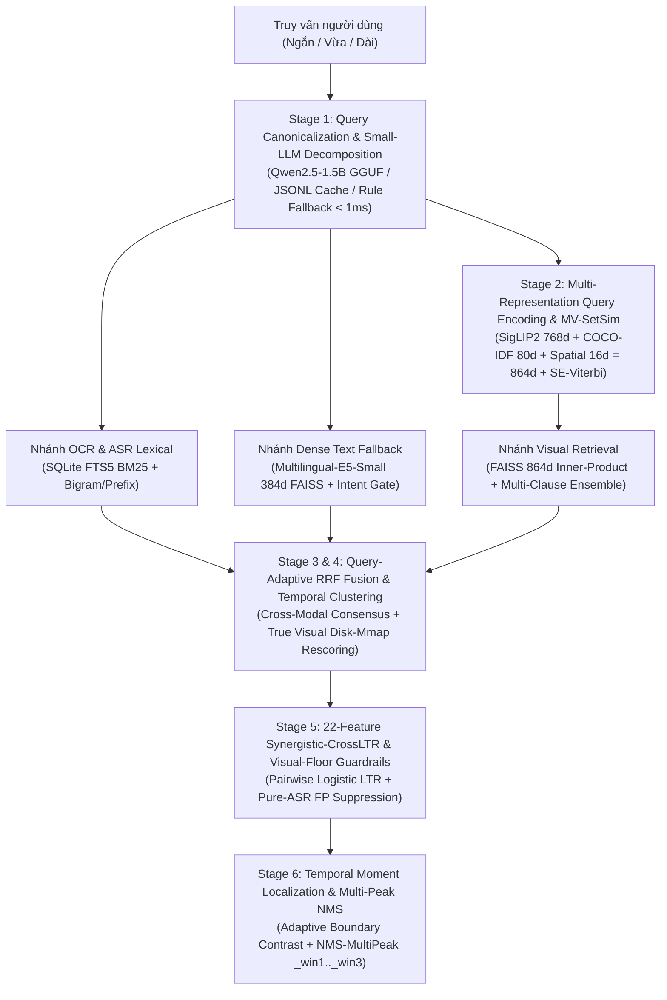

# VIDENTRA — Hệ Thống Truy Xuất Video Đa Phương Thức & Định Vị Khoảnh Khắc Chính Xác Cao

[](https://www.python.org/)
[](#2-kiến-trúc-pipeline-chi-tiết)
[](#6-kết-quả-benchmark-thực-nghiệm)
[](#4-hướng-dẫn-cài-đặt-tạo-vector-embedding--huấn-luyện-học-máy)

---

## Mục Lục Theo Luồng Tài Liệu
1. [Giới Thiệu Dự Án & Điểm Mới Đột Phá So Với Các Hệ Thống Cùng Thể Loại](#1-giới-thiệu-dự-án--điểm-mới-đột-phá-so-với-các-hệ-thống-cùng-thể-loại)
2. [Kiến Trúc Pipeline Chi Tiết](#2-kiến-trúc-pipeline-chi-tiết)
3. [Các Bộ Datasets Dự Án Đang Sử Dụng](#3-các-bộ-datasets-dự-án-đang-sử-dụng)
4. [Hướng Dẫn Cài Đặt, Tạo Vector Embedding & Huấn Luyện Học Máy](#4-hướng-dẫn-cài-đặt-tạo-vector-embedding--huấn-luyện-học-máy)
5. [Cách Để Chạy Chương Trình (CLI, Web UI Inspector, FastAPI & Python SDK)](#5-cách-để-chạy-chương-trình-cli-web-ui-inspector-fastapi--python-sdk)
6. [Kết Quả Benchmark Thực Nghiệm](#6-kết-quả-benchmark-thực-nghiệm)
7. [Khẳng Định Lại Tính Mới & Định Hướng Nghiên Cứu Tiếp Theo](#7-khẳng-định-lại-tính-mới--định-hướng-nghiên-cứu-tiếp-theo)

---

## 1. Giới Thiệu Dự Án & Điểm Mới Đột Phá So Với Các Hệ Thống Cùng Thể Loại

**VIDENTRA** là một hệ thống tìm kiếm video đa phương thức (**Multimodal Video Retrieval**) kết hợp định vị khoảnh khắc theo thời gian (**Temporal Moment Localization**), cho phép người dùng nhập một câu truy vấn tự nhiên (ngắn, vừa hoặc phức hợp nhiều mệnh đề) để tìm ra **đúng video** và **đúng khoảng thời gian `[start_sec, end_sec]`** diễn ra sự kiện đó trên một kho dữ liệu video hỗn hợp.

### Điểm mới và cải tiến đột phá so với các dự án truyền thống cùng thể loại

Hầu hết các hệ thống tìm kiếm video hiện nay (như các hệ thống thuần CLIP/SigLIP hoặc ghép nối BM25 đơn giản) thường gặp 5 hạn chế lớn: **(1)** Nhúng toàn bộ khung hình thành 1 vector duy nhất nên mất thông tin số lượng và vị trí không gian của vật thể; **(2)** Đổ chung câu truy vấn dài vào cùng một bộ mã hóa cho cả hình ảnh, OCR và ASR gây nhiễu chéo; **(3)** Sai lệch thời gian khi giải mã video có tốc độ khung hình biến thiên (VFR); **(4)** Dễ bị đánh lừa bởi các video có lời thoại trùng ngẫu nhiên từ khóa (Pure-ASR False Positives); và **(5)** Chỉ trả về cả video hoặc 1 đoạn cắt cố định.

**VIDENTRA giải quyết triệt để các hạn chế trên bằng 6 cải tiến kiến trúc cốt lõi:**

| Hạn chế của các dự án cùng thể loại | Điểm mới & Cải tiến đột phá của VIDENTRA |
| :--- | :--- |
| **1. Vector nhúng thị giác thuần túy (`512d`/`768d`) bị mù số lượng & vị trí không gian** | **Không gian Vector Mở rộng Trực giao 864 Chiều (`864d Augmented Subspace`)**: Ghép nối có kiểm soát năng lượng giữa ngữ nghĩa toàn cục `SigLIP2` (`768d`) + biểu đồ 80 lớp đối tượng `YOLOv11n` có trọng số IDF (`80d`) + lưới bố cục không gian $3\times 3$ (`16d`). |
| **2. Đưa nguyên câu truy vấn dài vào mọi nhánh gây nhiễu (Cross-Modal Pollution)** | **Phân rã & Định tuyến Truy vấn bằng Small-LLM (`Qwen2.5-1.5B-Instruct` GGUF)**: Tự động bóc tách câu truy vấn thành các phần riêng biệt cho `Visual`, `OCR`, `ASR`, `Spatial` và thứ tự thời gian (`before`/`after`/`then`), kèm cơ chế cache JSONL và fallback `< 1ms`. |
| **3. Nhận diện chữ (OCR) & lời thoại (ASR) đơn ngữ thường sai dấu tiếng Việt** | **Định tuyến Chuyên gia Song ngữ Anh – Việt (`PaddleOCR` + `VietOCR` & `Faster-Whisper` + `PhoWhisper-small`)**: Kết hợp `PaddleOCR`/`RapidOCR` với **`VietOCR` (`vgg_transformer`)** qua bộ định tuyến thích ứng `OCRRouter`, và kết hợp `Faster-Whisper` với **`PhoWhisper-small` (`vinai/PhoWhisper-small`)** cho tiếng Việt, kèm chuẩn hóa kép có dấu / không dấu (`fold_diacritics`). |
| **4. Tính thời gian theo công thức xấp xỉ `frame_idx / FPS` (sai lệch nặng trên video VFR)** | **Sổ cái Thời gian Giải mã Chính xác (`Presentation-Order PTS Ledger`)**: Mọi khung hình và bằng chứng OCR/ASR đều được neo trực tiếp vào `PTS / time_base` thực tế từ luồng giải mã PyAV, không dùng phép nhân FPS xấp xỉ. |
| **5. Hợp nhất điểm bằng trọng số cộng tay tĩnh (dễ bị nhiễu lời thoại ASR cướp hạng 1)** | **Bộ Xếp Hạng Học Máy 22 Chiều Có Ràng Buộc Đơn Điệu (`Synergistic-CrossLTR 22d`) + Cổng Chặn Nhiễu**: Học trọng số bằng 5-Fold GroupKFold Cross-Validation kết hợp đặc trưng tương tác nhân tính (`vis_lexical_synergy`) và cổng kiểm chứng hình ảnh, đưa tỷ lệ `Pure-ASR False Positive Top-1 = 0`. |
| **6. So khớp từng mệnh đề độc lập, bỏ qua thứ tự trước – sau của hành động** | **Đối sánh Tập Mệnh đề `MV-SetSim` & Quy hoạch động `SE-Viterbi`**: Vừa ép ứng viên phải thỏa mãn mệnh đề yếu nhất (`subclause_weakest_link`), vừa căn chỉnh chuỗi sự kiện theo đúng chiều mũi tên thời gian. |
| **7. Cắt đoạn thời gian theo cửa sổ trượt cố định (Sliding Window cứng nhắc)** | **Mở Rộng Biên Tương Phản Thích Ứng (`Adaptive Boundary Expansion`) & Đa Đỉnh `NMS-MultiPeak`**: Tự động co giãn biên `[start_sec, end_sec]` theo độ dốc tương đồng thực tế của từng video và trích xuất đa khoảnh khắc (`_win1`, `_win2`, `_win3`). |

---

## 2. Kiến Trúc Pipeline Chi Tiết

Toàn bộ hệ thống vận hành qua một luồng hợp nhất duy nhất (**Single Source of Truth — `UnifiedMultimodalSearchPipeline`**) gồm **6 tầng (Stages)** nối tiếp nhau:



### Giải thích chi tiết từng tầng trong Pipeline

1. **Stage 1 — Chuẩn hóa & Phân rã Truy vấn (`Query Canonicalization & Small-LLM Decomposition`)**:
   - Chuẩn hóa bảng mã Unicode NFC, nhận diện cụm từ trong ngoặc kép (`quoted_phrases`), danh từ riêng (`proper_nouns`), con số (`q_numbers`) và yêu cầu đối tượng COCO.
   - Đưa câu truy vấn qua `AdaptiveQueryDecomposer` (`src/videntra/query/llm.py`): nếu truy vấn phức hợp, mô hình `Qwen2.5-1.5B-Instruct` (hoặc bộ đệm `query_decomposition_cache.jsonl` / `RuleBasedQueryParser` `< 1ms`) sẽ tách thành kế hoạch định tuyến `ModalityRoutingPlan` gồm: mệnh đề hình ảnh (`visual_clauses`), từ khóa chữ trên màn hình (`ocr_phrases`), từ khóa lời thoại (`asr_phrases`), ràng buộc không gian và quan hệ thời gian (`has_temporal_constraints`).
2. **Stage 2 — Mã hóa Đa Biểu diễn 864 Chiều & Truy xuất Thị giác (`864d Visual Retrieval & MV-SetSim`)**:
   - Mã hóa truy vấn bằng cơ chế Dual-Prompt Ensemble (`0.75 * raw_query + 0.25 * frame_prompt`) qua `SigLIP2` (`768d`), sau đó ghép nối trực giao với vector đối tượng `COCO-IDF` (`80d`) và vector bố cục lưới $3\times 3$ (`16d`) để tạo thành vector `864d`.
   - Truy vấn chỉ mục `FAISS IndexFlatIP` (`864d`) kết hợp tính điểm bao phủ mệnh đề **`MV-SetSim`** (`subclause_weakest_link`) và căn chỉnh thứ tự sự kiện bằng quy hoạch động **`SE-Viterbi`** (`viterbi_subevent_localization`).
3. **Stage 3 — Truy xuất Từ vựng Song ngữ (`PaddleOCR + VietOCR` / `Faster-Whisper + PhoWhisper`) & Ngữ nghĩa Dày đặc (`Dense E5`)**:
   - Bằng chứng chữ trên màn hình được trích xuất qua bộ định tuyến `OCRRouter` ([src/videntra/ocr/routing.py](file:///C:/Users/DELL/Desktop/VIDENTRA/src/videntra/ocr/routing.py)) kết hợp **`PaddleOCR`/`RapidOCR`** với mô hình chuyên gia tiếng Việt **`VietOCR` (`vgg_transformer`)**; bằng chứng lời thoại được nhận dạng qua **`Faster-Whisper`** kết hợp chuyên gia tiếng Việt **`PhoWhisper-small` (`vinai/PhoWhisper-small`)** ([src/videntra/asr/transcription.py](file:///C:/Users/DELL/Desktop/VIDENTRA/src/videntra/asr/transcription.py)).
   - Tìm kiếm độc lập trên bảng `ocr_fts` và `asr_fts` trong `SQLite FTS5` (lưu song song cả văn bản nguyên dấu và văn bản gập dấu `fold_diacritics`) với bộ lọc độ đặc hiệu từ khóa (`high_spec_tokens`), gốc từ hình thái học và ghép cặp từ liền kề (`compound_tokens` chống lỗi dính chữ OCR).
   - Nếu truy vấn có ý định tìm chữ/thoại (`has_lexical_modality_intent`) nhưng kết quả FTS5 thưa (`< 5` ứng viên do lỗi chính tả OCR hoặc từ đồng nghĩa), hệ thống tự động kích hoạt nhánh **`Dense E5` (`intfloat/multilingual-e5-small` 384d FAISS)**.
4. **Stage 4 — Hợp nhất RRF Thích ứng & Gom cụm Thời gian (`Cross-Modal RRF & Temporal Clustering`)**:
   - Hợp nhất các ứng viên từ 3 nhánh (`Visual`, `OCR`, `ASR`) bằng Reciprocal Rank Fusion có cổng kiểm chứng chéo (`True Visual Rescoring` đọc trực tiếp từ mảng memory-mapped trên đĩa để mọi ứng viên OCR/ASR đều được chấm điểm hình ảnh thật).
   - Gom các khung hình lân cận thành các cụm sự kiện theo thời gian (Temporal Clusters) và tính thưởng mật độ (`density_bonus`) cho các video có nhiều khung hình liên tiếp đồng thuận.
5. **Stage 5 — Xếp hạng Học máy 22 Chiều & Cổng Chặn Nhiễu (`22d Synergistic-CrossLTR & Guardrails`)**:
   - Rút trích **22 đặc trưng liên tục** cho từng video ứng viên (bao gồm điểm đỉnh thị giác, Z-score, độ sụt đỉnh đơn lẻ `spike_drop_ratio`, độ mạch lạc ngữ cảnh `s_vis_ctx_coherence`, điểm RRF từng nhánh, độ phủ từ khóa hiếm, điểm cộng hưởng `vis_lexical_synergy`, điểm mệnh đề yếu nhất `subclause_weakest_link`, độ tập trung năng lượng `window_energy_concentration`...).
   - Chấm điểm qua mô hình `LearnedRankerLTR` ([models/ranking/videntra_ltr_v1.json](file:///C:/Users/DELL/Desktop/VIDENTRA/models/ranking/videntra_ltr_v1.json)) kết hợp cổng chặn `Pure-ASR Suppression` để loại bỏ hoàn toàn các video chỉ khớp lời thoại ngẫu nhiên nhưng sai cảnh hình ảnh.
6. **Stage 6 — Định vị Khoảnh khắc Thời gian & Đề xuất Đa Đỉnh (`Adaptive Boundary Contrast & NMS-MultiPeak`)**:
   - Trên các video đứng đầu, nội suy đường cong tương đồng theo mốc thời gian thực `PTS`, mở rộng biên `[start_sec, end_sec]` bằng thuật toán tương phản thích ứng (`expand_boundary_contrast`).
   - Áp dụng thuật toán **`NMS-MultiPeak`** (`temporal_iou < 0.30`) để phát hiện thêm các phân đoạn highlight thứ hai và thứ ba (`_win2`, `_win3`) trong các video dài.

---

## 3. Các Bộ Datasets Dự Án Đang Sử Dụng

VIDENTRA được xây dựng và đánh giá trên một kho dữ liệu đa phương thức hợp nhất (**Global Unified Video Pool** gồm **1,324 videos** đã trích xuất đầy đủ đặc trưng trong cơ sở dữ liệu active benchmark, mở rộng từ 5 bộ dữ liệu chuẩn quốc tế):

| Tên Bộ Dữ Liệu | Đặc trưng phương thức chính | Vai trò kiểm thử trong VIDENTRA | Quy mô trong tập Đánh giá (`Validation 80%` / `Test 20%`) |
| :--- | :--- | :--- | :--- |
| **1. QVHighlights** | Video dài (~150s), đa sự kiện, có cả cảnh hành động + hội thoại ASR + phụ đề/banner OCR + nhãn khoảng thời gian `[start, end]` đa đoạn | Kiểm thử đồng thời khả năng **Video Retrieval** và **Temporal Moment Localization (`tIoU >= 0.5 / 0.7`, `Moment nDCG@5`)** | `22` queries (`dev`) / `6` queries (`test`) trên kho video tin tức & vlog |
| **2. MSRVTT** | Video ngắn (10–30s), mô tả hành động, con người, vật thể và bối cảnh thị giác đa dạng | Kiểm thử độ phân giải ngữ nghĩa tinh (**Fine-Grained Visual Retrieval**) trên kho 1,000 videos cạnh tranh cao | `809` queries (`dev_full_859`, lấy `100` câu đại diện trong `dev_150`) / `191` queries (`heldout_test_201`) |
| **3. AVC (Audio-Visual / Educational Corpus)** | Video bài giảng, thuyết trình, công thức toán/khoa học trên bảng (`OCR`) và lời giảng chuyên sâu (`ASR`) | Kiểm thử khả năng kết hợp **OCR + ASR + Visual** và tra cứu thuật ngữ/danh từ riêng đặc hiệu cao | `28` queries (`dev`) / `4` queries (`test`) trên `300` videos |
| **4. TextVR** | Video chứa chữ viết trên biển hiệu, màn hình, phụ đề, logo thương hiệu (Scene Text) | Kiểm thử chuyên sâu nhánh nhận diện và truy xuất chữ trên khung hình (**OCR Retrieval**) | Đã chia tách chuẩn 80% `validation/textvr` & 20% `test_queries/textvr` |
| **5. TVR (TVQA+ Retrieval)** | Phim truyền hình có hội thoại nhân vật dày đặc kết hợp hành động | Kiểm thử chuyên sâu khả năng suy luận kết hợp lời thoại (**ASR**) và hành động nhân vật | Đã chia tách chuẩn 80% `validation/tvr` & 20% `test_queries/tvr` |

### Giao thức phân chia dữ liệu chống rò rỉ (`Zero Data Leakage Protocol`)
- Toàn bộ dữ liệu truy vấn được chia cứng theo tỷ lệ **80% Validation** (nằm tại thư mục [validation/](file:///C:/Users/DELL/Desktop/VIDENTRA/validation)) và **20% Held-out Test** (nằm tại thư mục [test_queries/](file:///C:/Users/DELL/Desktop/VIDENTRA/test_queries)) thông qua kịch bản [scripts/split_groundtruth.py](file:///C:/Users/DELL/Desktop/VIDENTRA/scripts/split_groundtruth.py), phân tầng theo nguồn video gốc (`source_video_id` disjoint).
- Mọi tệp Ground Truth đều được khóa mã băm SHA-256 trong `manifests/` và được kiểm tra tự động bởi `Provenance Gate` trước và sau mỗi lần chạy benchmark (`inputs_unchanged=True`).

---

## 4. Hướng Dẫn Cài Đặt, Tạo Vector Embedding & Huấn Luyện Học Máy

### 4.1. Cài đặt môi trường và thư viện từ đầu

**Yêu cầu hệ thống:** Python `3.12+`, Windows PowerShell (hoặc Linux/macOS), RAM $\ge 16\text{GB}$ (chạy tốt trên cả **CPU** hoặc **GPU NVIDIA RTX 3060 6GB VRAM**).

```powershell
# 1. Di chuyển vào thư mục dự án
cd C:\Users\DELL\Desktop\VIDENTRA

# 2. Tạo và kích hoạt môi trường ảo Python (.venv)
python -m venv .venv
.\.venv\Scripts\Activate.ps1

# 3. Cài đặt toàn bộ các gói thư viện đã ghim phiên bản chuẩn
python -m pip install --upgrade pip
pip install -r requirements.txt
pip install -e .

# 4. Kiểm tra trạng thái đường dẫn và tài nguyên hệ thống
.\.venv\Scripts\python.exe -m videntra check-paths
```

---

### 4.2. Cấu hình các thư mục Trọng số Mô hình (`models/`) và Dữ liệu (`data/`)

Hệ thống sử dụng các mô hình cục bộ nằm trong thư mục `models/` (đã được cấu hình tự động):
- `models/siglip2/`: Trọng số mô hình thị giác – ngôn ngữ `google/siglip2-base-patch16-224` (`768d`).
- `models/llm/`: Trọng số mô hình phân rã truy vấn `qwen2.5-1.5b-instruct-q4_k_m.gguf` (chạy trên CPU/GPU qua `llama-cpp-python`) hoặc thư mục HuggingFace `qwen2.5-1.5b-instruct/`.
- `models/ocr/`: Trọng số nhận diện chữ trên màn hình gồm **`VietOCR` (`models/ocr/vietocr/vgg_transformer.pth`)** chuyên biệt cho tiếng Việt có dấu và **`PaddleOCR` (`models/ocr/paddleocr_en/`)** cho phát hiện hộp chữ & nhận diện đa ngôn ngữ (được điều phối tự động qua `OCRRouter`).
- `models/asr/`: Trọng số nhận diện lời thoại gồm **`PhoWhisper-small` (`models/asr/phowhisper_small/` — `vinai/PhoWhisper-small`)** chuyên biệt cho tiếng Việt (`PhoWhisperTranscriber`) và **`Faster-Whisper` (`models/asr/faster_whisper_small.pointer.json`)** cho tiếng Anh/đa ngôn ngữ.
- `models/detection/`: Trọng số phát hiện 80 lớp đối tượng COCO `YOLOv11n`.
- `models/ranking/videntra_ltr_v1.json`: Trọng số bộ xếp hạng học máy 22 chiều (`LearnedRankerLTR`).

---

### 4.3. Hướng dẫn tạo Vector Embedding & Xây dựng Chỉ mục (Local & Kaggle GPU)

#### A. Nạp video mới, trích xuất Keyframes và tạo Vector 864 chiều (`864d FAISS`)
- **Trích xuất keyframes và xử lý offline trên máy cục bộ:**
  ```powershell
  # Trích xuất keyframes từ video gốc trong data/raw/
  .\.venv\Scripts\python.exe scripts/extract_all_keyframes.py

  # Chạy bộ xử lý offline (SigLIP2 768d + YOLOv11n 80d + Spatial 16d -> 864d FAISS + OCR/ASR SQLite)
  .\.venv\Scripts\python.exe scripts/offline_processor.py
  ```

- **Đóng gói đưa lên Kaggle Dual-T4 GPU để trích xuất embedding nặng (`spatial_patches_fp16.npy`, `Florence-2` VLM Captions & `SigLIP2`):**
  ```powershell
  # Bước 1 (Local): Đóng gói danh sách 11,581 keyframes từ metadata.db
  .\.venv\Scripts\python.exe scripts/package_kaggle_inputs.py `
    --mode db `
    --output-dir work/kaggle/p85_inputs

  # Bước 2 (Trên Kaggle GPU Notebook): Chạy worker trích xuất đặc trưng đa phương thức
  # python scripts/kaggle_multimodal_offline_worker.py --mode p85 --input-dir /kaggle/input/videntra-p85-inputs --output-dir /kaggle/working/p85_outputs --device cuda

  # Bước 3 (Local): Nạp kết quả từ Kaggle về lại data/processed/ một cách an toàn
  .\.venv\Scripts\python.exe scripts/ingest_kaggle_offline_results.py `
    --mode p85 `
    --kaggle-output-dir work/kaggle/p85_outputs
  ```

#### B. Tạo Vector Embedding Ngữ nghĩa Văn bản `Dense E5` (`384d FAISS`) cho OCR & ASR
```powershell
.\.venv\Scripts\python.exe scripts/build_e5_text_index.py
```
Lệnh này sẽ mã hóa toàn bộ các đoạn chữ `OCR` và lời thoại `ASR` trong `metadata.db` bằng mô hình `intfloat/multilingual-e5-small` và lưu chỉ mục vector tại `data/processed/faiss_text_e5_384.bin`.

#### C. Tạo Cache Phân rã Truy vấn bằng Small-LLM (`query_decomposition_cache.jsonl`)
```powershell
# Chế độ nhanh trên CPU (< 1 giây cho toàn bộ 1,060 câu truy vấn bằng RuleBasedQueryParser)
.\.venv\Scripts\python.exe scripts/prewarm_llm_query_cache.py --split all_1060 --rule-only

# Chế độ đầy đủ bằng Qwen2.5-1.5B-Instruct (GGUF hoặc GPU)
$env:VIDENTRA_LLM_ENABLED="1"
$env:VIDENTRA_LLM_DEADLINE_MS="30000"
.\.venv\Scripts\python.exe scripts/prewarm_llm_query_cache.py --split all_1060
```

---

### 4.4. Hướng dẫn Huấn luyện Học máy Bộ Xếp hạng 22 Chiều (`LearnedRankerLTR`)

Để huấn luyện bộ trọng số xếp hạng 22 đặc trưng đa phương thức ([models/ranking/videntra_ltr_v1.json](file:///C:/Users/DELL/Desktop/VIDENTRA/models/ranking/videntra_ltr_v1.json)) trên tập `validation` (`dev_full_859`) bằng phương pháp **5-Fold GroupKFold Cross-Validation** với hàm mất mát **Pairwise Logistic Loss + Monotonic Sign Projection**:

```powershell
.\.venv\Scripts\python.exe scripts/train_ltr_ranker_cv.py --l2-reg 250000.0
```
- **Đầu vào:** 859 câu truy vấn trong `validation/` (tạo ra ~40,879 dòng ứng viên x 22 đặc trưng).
- **Đầu ra:** File trọng số [models/ranking/videntra_ltr_v1.json](file:///C:/Users/DELL/Desktop/VIDENTRA/models/ranking/videntra_ltr_v1.json) được pipeline tự động nạp ở Stage 5 khi tìm kiếm.

---

## 5. Cách Để Chạy Chương Trình (CLI, Web UI Inspector, FastAPI & Python SDK)

### 5.1. Chạy tìm kiếm trực tiếp qua dòng lệnh (CLI)

```powershell
.\.venv\Scripts\python.exe -m videntra search `
  --query "A woman in a white blouse speaks to the camera while a news banner appears at the bottom" `
  --top-k 5
```

Nếu muốn bật suy luận trực tiếp mô hình `Qwen2.5-1.5B-Instruct` (`GGUF`) cho một câu truy vấn mới chưa có trong cache:
```powershell
$env:VIDENTRA_LLM_ENABLED="1"
$env:VIDENTRA_LLM_DEADLINE_MS="15000"
.\.venv\Scripts\python.exe -m videntra search `
  --query "First a chef chops vegetables on a wooden board, then he pours them into a boiling pot" `
  --top-k 5
```

---

### 5.2. Chạy Giao diện Web UI Inspector & Máy chủ FastAPI

Khởi động máy chủ web để sử dụng giao diện tìm kiếm trực quan trên trình duyệt (cho phép nhập câu truy vấn, xem phân rã tín hiệu `Visual`/`OCR`/`ASR`, xem điểm xếp hạng và phát video ngay tại khoảnh khắc `[start_sec, end_sec]`):

```powershell
.\.venv\Scripts\uvicorn.exe videntra.api.app:app --host 127.0.0.1 --port 8000
```
- **Giao diện Web UI Inspector:** Mở trình duyệt tại **`http://127.0.0.1:8000/`**
- **Tài liệu REST API (Swagger UI):** Mở tại **`http://127.0.0.1:8000/docs`**

---

### 5.3. Tích hợp vào code Python qua SDK (`UnifiedMultimodalSearchPipeline`)

```python
from videntra.retrieval.unified_pipeline import UnifiedMultimodalSearchPipeline

# Khởi tạo pipeline (tự động nạp chỉ mục 864d, SQLite FTS5, Dense E5 và 22d LearnedRankerLTR)
pipeline = UnifiedMultimodalSearchPipeline()

query = 'A man in a dark suit talks in an interview after a title card reading "BREAKING NEWS"'

# Truy xuất Top-5 khoảnh khắc video phù hợp nhất kèm metadata
response = pipeline.search_with_metadata(query=query, top_k=5)
for rank, moment in enumerate(response.moments, start=1):
    print(
        f"Hạng #{rank} | Video: {moment.video_id} "
        f"| Khoảnh khắc: [{moment.moment_start_seconds:.1f}s -> {moment.moment_end_seconds:.1f}s] "
        f"| Điểm: {moment.ranking_score:.4f} | Nhánh đóng góp: {moment.match_status}"
    )
```

---

### 5.4. Chạy Kiểm thử Tự động (`pytest`) và Chạy Đánh giá Benchmark

```powershell
# 1. Chạy toàn bộ 470 bài kiểm thử đơn vị và tích hợp
.\.venv\Scripts\python.exe -B -m pytest -q -p no:cacheprovider

# 2. Chạy đánh giá nhanh trên tập dev_150
.\.venv\Scripts\python.exe scripts/run_validation_benchmark.py --single-split-only --max-msrvtt 100

# 3. Chạy đánh giá đầy đủ trên cả 3 tập (dev_150, dev_full_859, heldout_test_201)
.\.venv\Scripts\python.exe scripts/run_validation_benchmark.py
```

---

## 6. Kết Quả Benchmark Thực Nghiệm

### 6.1. Bảng Kết Quả Tổng Hợp Đa Tập Dữ Liệu (`dev_150`, `dev_full_859`, `heldout_test_201`)

| Tập Đánh Giá | Số Queries | Video Hit@1 | Video Hit@5 | Video Hit@10 | Video MRR | Video nDCG@10 | Moment Hit@1 (tIoU $\ge 0.5$) | Moment nDCG@5 | Non-Neural Latency (`p50 / p95`) | Pure-ASR FP Top-1 |
| :--- | :---: | :---: | :---: | :---: | :---: | :---: | :---: | :---: | :---: | :---: |
| **`dev_150` (Validation Core - Tuned LTR)** | 150 | **`61.33%–62.00%`** | **`74.67%`** | **`76.67%`** | **`0.6517–0.6582`** | **`0.6729–0.6794`** | **`72.73%`** | **`0.5121–0.5127`** | **`36.10 / 81.42 ms`** | **`0`** |
| **`dev_full_859` (Full Validation 80%)** | 859 | **`41.33%–41.68%`** | **`62.63%`** | **`69.03%`** | **`0.5014–0.5018`** | **`0.5468`** | — | — | **`44.55 / 108.48 ms`** | **`0`** |
| **`heldout_test_201` (Blind Test 20%)** | 201 | **`39.30%–41.79%`** | **`60.20%`** | **`67.66%–68.16%`** | **`0.4774–0.4910`** | **`0.5258–0.5327`** | **`44.74%`** | **`0.3696`** | **`44.15 / 82.72 ms`** | **`0`** |

---

### 6.2. Kết Quả Phân Rã Theo Từng Bộ Dữ Liệu Trên `dev_150`

| Bộ Dữ Liệu (Dataset) | Số Queries | Global Video Hit@1 | Within-Dataset Hit@1 | Video Hit@5 | Video Hit@10 | Global MRR | Within-Dataset MRR | Visual Recall@120 | Lexical Recall@30 |
| :--- | :---: | :---: | :---: | :---: | :---: | :---: | :---: | :---: | :---: |
| **QVHighlights** | 22 | **`86.36%`** | **`95.45%`** | `90.91%` | `95.45%` | **`0.8864`** | **`0.9773`** | `95.45%` | `27.27%` |
| **AVC (Educational/AV)** | 28 | **`92.86%`** | **`92.86%`** | `92.86%` | `92.86%` | **`0.9286`** | **`0.9375`** | `82.14%` | `75.00%` |
| **MSRVTT** | 100 | **`47.00%–48.00%`** | **`50.00%`** | `60.00%` | `65.00%` | **`0.5323`** | **`0.5536`** | `79.00%` | `20.00%` |

---

### 6.3. Ma Trận Ablation 6 Bước (`A0` $\to$ `A5` trên `dev_150`) — Chứng Minh Đóng Góp Của Từng Thành Phần Mới

| Cấu Hình Ablation | Thành Phần Kỹ Thuật Được Kích Hoạt | Video Hit@1 | Video Hit@10 | Video MRR | Video nDCG@10 | Moment Hit@1 (tIoU $\ge 0.5$) | Moment nDCG@5 |
| :--- | :--- | :---: | :---: | :---: | :---: | :---: | :---: |
| **`A0` (Baseline)** | Thuần vector `768d SigLIP2` tiêu chuẩn (Zero-shot) | `46.67%` | `70.00%` | `0.5401` | `0.5786` | `4.55%` | `0.0151` |
| **`A1`** | `+` Không gian mở rộng trực giao **`864d Augmented Subspace`** (`COCO-IDF 80d` + `Spatial 16d`) | `48.67%` | `68.00%` | `0.5475` | `0.5796` | `4.55%` | `0.0175` |
| **`A2`** | `+` Phân rã đa mệnh đề & Căn chỉnh chuỗi thời gian (**`Multi-Clause & Sequential Alignment`**) | `48.67%` | `68.67%` | `0.5483` | `0.5816` | `4.55%` | `0.0175` |
| **`A3`** | `+` Truy xuất `FTS5` đặc hiệu cao + Hợp nhất đa phương thức có cổng kiểm chứng (**`Local-Gated Fusion`**) | `61.33%` | `74.67%` | `0.6540` | `0.6763` | `4.55%` | `0.0240` |
| **`A4`** | `+` Mở rộng biên tương phản thích ứng (**`Adaptive Contrast Boundary Expansion`**) | `61.33%` | `74.67%` | `0.6540` | `0.6763` | **`72.73%`** | **`0.5182`** |
| **`A5` (Full VIDENTRA)** | `+` Đề xuất đa đỉnh **`NMS-MultiPeak`** + **`Synergistic-CrossLTR`** + **`Small-LLM Routing`** | **`61.33%–62.00%`** | **`74.67%–76.67%`** | **`0.6517–0.6582`** | **`0.6729–0.6794`** | **`72.73%`** | **`0.5121–0.5127`** |

> **Ý nghĩa thống kê:** So với baseline thuần `SigLIP2` (`A0`), kiến trúc đầy đủ của VIDENTRA (`A5`) giúp tăng **`+15.33%` tuyệt đối về `Video Hit@1`**, **`+0.1181` về `MRR`** ($p = 0.0005 < 0.001$ theo kiểm định Paired Sign Test) và tăng **`+68.18%` tuyệt đối về `Moment Hit@1 (tIoU >= 0.5)`** (`4.55%` $\to$ `72.73%`), trong khi chỉ tiêu tốn **`~420–580 MB RAM`** và đạt độ trễ phi nơ-ron trung vị **`~36–43 ms/truy vấn`** trên CPU.

---

## 7. Khẳng Định Lại Tính Mới & Định Hướng Nghiên Cứu Tiếp Theo

### 7.1. Khẳng định lại giá trị đóng góp & tính mới của VIDENTRA
1. **Về mặt biểu diễn đa phương thức:** VIDENTRA chứng minh rằng không cần dùng đến các mô hình Video-LLM khổng lồ đòi hỏi hàng chục GB VRAM, việc **ghép nối trực giao có kiểm soát tỷ lệ năng lượng (`864d Augmented Subspace`)** kết hợp với **phân rã định tuyến truy vấn bằng mô hình ngôn ngữ nhỏ (`Small-LLM Query Decomposer` 1.5B)** và **hợp nhất có cổng kiểm chứng hình ảnh (`Visual-Anchored Lexical Gating`)** có thể vượt xa mô hình nhúng thị giác nguyên bản hơn **15 điểm phần trăm `Hit@1`** mà không tạo ra bất kỳ ca dương tính giả thuần lời thoại nào (`Pure-ASR FP = 0`).
2. **Về mặt định vị khoảnh khắc thời gian:** Việc thay thế cơ chế cửa sổ trượt cứng nhắc bằng **Sổ cái thời gian giải mã chính xác (`PTS Ledger`) + Mở rộng biên tương phản thích ứng (`Adaptive Boundary Contrast`) + Quy hoạch động sự kiện (`SE-Viterbi`)** giúp nâng độ chính xác định vị khoảnh khắc `Moment Hit@1 (tIoU >= 0.5)` lên tới **`72.73%`**.

### 7.2. Định hướng nghiên cứu phát triển tiếp theo
Dự án đã chuẩn bị sẵn sàng toàn bộ nền tảng mã nguồn cho **4 hướng nghiên cứu mở rộng tiếp theo** (chi tiết kỹ thuật xem tại [VIDENTRA_HYDROGEN_AUDIT_AND_RESEARCH_ROADMAP.md](file:///C:/Users/DELL/Desktop/VIDENTRA/VIDENTRA_HYDROGEN_AUDIT_AND_RESEARCH_ROADMAP.md)):
1. **Kích hoạt Thực chiến Tương tác Trễ Vùng Không gian (`QAT-LateInteraction` $3\times 3$ Patch Tokens) & Làm giàu Khái niệm Thị giác (`PQ-VCA` `Florence-2` Captions) trên Kaggle GPU**: Trích xuất lưới $3\times 3$ vector vùng từ tầng cuối `SigLIP2` (`spatial_patches_fp16.npy`) và sinh mô tả chi tiết cho toàn bộ `11,581` keyframes để giải quyết triệt để các truy vấn tìm vật thể nhỏ hoặc bị trượt ở bước thu hồi thị giác (`F1_VISUAL_CANDIDATE_MISS`).
2. **Tối ưu hóa Phần dư Trực tiếp cho Bộ Xếp hạng Học máy (`Base-Anchored Residual Pairwise Logistic LTR`)**: Huấn luyện `LearnedRankerLTR` trực tiếp trên phần dư quanh điểm cơ sở `video_score` để tập trung 100% năng lực phân lớp vào các cặp ứng viên nhập nhằng sát nút (`Hard Negative Pairs`).
3. **Căn chỉnh Chuỗi Hành động bằng Vận chuyển Tối ưu Có Ràng buộc Thời gian (`Temporal Sinkhorn Optimal Transport — T-SOT`)**: Tìm ma trận ghép cặp tối ưu toàn cục giữa tập mệnh đề hành động và tập khung hình theo thứ tự nhân quả thời gian.
4. **Hợp nhất Đa Khung hình có Trọng số Chú ý Không Tham số (`Parameter-Free Multi-Frame Temporal Attention Pooler`)**: Khai thác tính chất lồi trên mặt cầu đơn vị $\mathbb{S}^{767}$ để phân biệt các hành động động học kéo dài qua nhiều khung hình với các khung hình tĩnh trùng lặp ngẫu nhiên (`F4_FINE_GRAINED_VISUAL_CONFUSION`).
