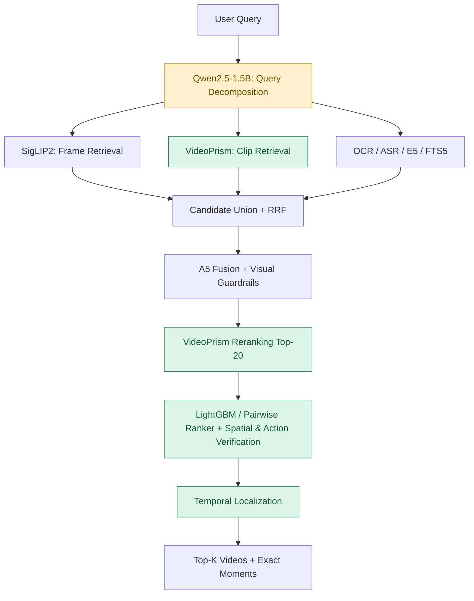

# VIDENTRA — Hệ Thống Truy Xuất Video Đa Phương Thức & Định Vị Khoảnh Khắc Chính Xác Cao

[](https://www.python.org/)
[](#2-kiến-trúc-pipeline-chi-tiết)
[](#6-kết-quả-benchmark-thực-nghiệm)
[](#4-hướng-dẫn-cài-đặt-tạo-vector-embedding--huấn-luyện-học-máy)

---

## Mục Lục Theo Luồng Tài Liệu
1. [Giới Thiệu Dự Án & 7 Hạng Mục Nâng Cấp Cốt Lõi (P0–P6)](#1-giới-thiệu-dự-án--7-hạng-mục-nâng-cấp-cốt-lõi-p0p6)
2. [Kiến Trúc Pipeline Chi Tiết](#2-kiến-trúc-pipeline-chi-tiết)
3. [Các Bộ Datasets Dự Án Đang Sử Dụng](#3-các-bộ-datasets-dự-án-đang-sử-dụng)
4. [Hướng Dẫn Cài Đặt, Tạo Vector Embedding & Huấn Luyện Học Máy](#4-hướng-dẫn-cài-đặt-tạo-vector-embedding--huấn-luyện-học-máy)
5. [Cách Để Chạy Chương Trình (CLI, Web UI Inspector, FastAPI & Python SDK)](#5-cách-để-chạy-chương-trình-cli-web-ui-inspector-fastapi--python-sdk)
6. [Kết Quả Benchmark Thực Nghiệm (`Run 6999d992`)](#6-kết-quả-benchmark-thực-nghiệm)
7. [Giới Hạn Hệ Thống & Định Hướng Nghiên Cứu Tiếp Theo](#7-giới-hạn-hệ-thống--định-hướng-nghiên-cứu-tiếp-theo)

---

## 1. Giới Thiệu Dự Án & 7 Hạng Mục Nâng Cấp Cốt Lõi (P0–P6)

**VIDENTRA** là hệ thống tìm kiếm video đa phương thức (**Multimodal Video Retrieval**) kết hợp định vị khoảnh khắc theo thời gian (**Temporal Moment Localization**). Với nguyên tắc thiết kế **"Chỉ dùng LLM (`Qwen2.5-1.5B`) ở Stage 1 tách/định tuyến truy vấn; toàn bộ các bước truy xuất, hợp nhất, kiểm chứng, xếp hạng và định vị phía sau đều dùng mô hình embedding chuyên dụng, thuật toán truy xuất vector/từ vựng và ranker học máy chuyên biệt"**, VIDENTRA đạt độ chính xác cao, minh bạch provenance và tốc độ phản hồi nhanh trên cả GPU lẫn CPU.

### Tổng quan 7 hạng mục nâng cấp đã hoàn thiện (`P0` $\to$ `P6`)

| Ưu tiên | Hạng mục | Nội dung nâng cấp cốt lõi | Kết quả thực tế |
| :---: | :--- | :--- | :--- |
| **P0** | **Chuẩn hóa Pipeline & Chống Rò Rỉ** | Siết chặt contract `VLM` replay (`(query_text_sha256, video_id)` + ordinal/PTS, gỡ fallback `by_qid` dễ rò rỉ), xóa danh sách từ đồng nghĩa/domain hack thủ công, tắt VLM caption theo mặc định khi thiếu artifact, sửa rò rỉ file handle SQLite WAL (`finally: conn.close()`) & guard ghi đè `export_to_aic_format.py`. | **614/614 tests PASS**, zero leakage (`heldout_source_leakage=False`). |
| **P1** | **Visual & Video Retrieval (`SigLIP2 + VideoPrism`)** | Giữ khung `SigLIP2` 768d/864d song song với **VideoPrism-LvT-B (`768d`)** (`1,324` toàn video + `866` sub-clips `16s/8s` trích trên Kaggle `2 × Tesla T4`), nạp vào FAISS + `_VideoScoreMap` O(1). | Union Recall đạt **`86.26%`** (`dev_full_859`), Shortlist Recall **`93.02%`**. |
| **P2** | **Confidence-Calibrated Fusion & Guardrails** | Hiệu chuẩn độ tin cậy `OCR` và `calibrate_asr_confidence` (`ASRSegments`), nhân trọng số IDF toàn corpus & `lex_reliability_score` vào RRF, áp dụng **Visual Consensus Guardrail** giảm `0.35×` cho match 1 token phổ biến yếu lệch thị giác. | **Pure-ASR FP Top-1 = `0`** trên cả 3 tập đánh giá. |
| **P3** | **VideoPrism CSLS Rerank & 32d Monotonic LightGBM** | Step H **VideoPrism Top-20 Reranking** (kèm CSLS anti-hubness + `clause_order_score`), nâng cấp vector đặc trưng lên **32 chiều (`LTR_FEATURE_NAMES_V2`)** và huấn luyện **5-Fold GroupKFold OOF LightGBM** (`tree_ensemble`, ràng buộc đơn điệu dương, trọng số hard-negative, `blend_weight = 0.08`, suy luận NumPy phẳng không đệ quy). | **`dev_full_859` Hit@1: `43.77% -> 49.13%` (`+5.36 pp`)**; **`heldout_test_201`: `39.80% -> 45.27%` (`+5.47 pp`)**. |
| **P4** | **Spatial & Action Understanding** | Lọc trùng NMS theo `(frame, class)` (`IoU > 0.65`) cho YOLO `FrameObjects` khi dựng vector 864d, bổ sung `SpatialActionVerifier` (`src/videntra/relations/spatial_action_verifier.py`) kiểm tra cardinality từng frame (`detector_ran` guard), quan hệ hình học 2D (`left_of`, `right_of`, `above`, `below`, `inside`, `near`), DP đơn điệu tiến/lùi thứ tự hành động và biên độ chuyển động. | Phân biệt chính xác video cùng bối cảnh nhưng khác số lượng, vị trí hoặc thứ tự hành động. |
| **P5** | **Temporal Localization** | Giữ đường cong `SigLIP2` sắc nét (`float64`), ràng buộc an toàn `SE-Viterbi`, tinh chỉnh plateau rộng bằng `_optimal_contrast_segment` vector hóa 2D NumPy (`O(T^2)` không vòng lặp Python) và nâng cấp `propose_soft_nms_secondary_windows` dùng ngưỡng nền phân vị 15% + suy giảm cộng tính bất biến thang điểm LTR/VideoPrism. | `dev_150` **Moment Hit@1@0.5 = `72.73%`**, **Moment nDCG@5 = `0.5443`** (`>= 0.5300` PASS). |
| **P6** | **Competition Web UI, API & CLI** | Lọc `dataset` (`all`/`msrvtt`/`avc`/`qvhighlights`), tìm video/khoảnh khắc tương tự (`POST /v1/search/similar`), dải keyframe lân cận (`GET /v1/videos/{video_id}/neighbors` với PyAV LRU cache), `/health` telemetry, và xuất chuẩn **AIC KIS CSV / VBS CSV** chống CSV-injection (`exports.py`). | Sẵn sàng tác chiến VBS/AIC + 47 API tests PASS. |

---

## 2. Kiến Trúc Pipeline Chi Tiết



### Luồng xử lý và công thức toán học cốt lõi
1. **Stage 1 — Tách Query (`Qwen2.5-1.5B-Instruct` / Rules Fallback) & Vector Truy vấn (`768d` + `864d`):**
   - Bộ phân rã `AdaptiveQueryDecomposer` bóc tách truy vấn thành các cụm `visual_clauses`, trích xuất `ocr_phrases`, `asr_phrases`, yêu cầu đối tượng (`extract_object_requirements`) và ý định không gian/thứ tự.
   - Vector câu truy vấn chính là tổ hợp chuẩn hóa `0.75 · e_raw + 0.25 · e_prompt("a video frame showing ...")`, sau đó mở rộng sang không gian trực giao **864 chiều** (gồm `768d SigLIP2` + `80d` biểu đồ 80 lớp COCO theo trọng số IDF + `16d` mật độ đối tượng, tọa độ tâm/diện tích bounding box và ngữ cảnh lưới $3 \times 3$).
2. **Stage 2a & 2b — Truy hồi Song Song Frame (`SigLIP2`) & Clip/Sub-clip (`VideoPrism-LvT-B`):**
   - Nhánh frame tính đồng thời dot-product pha trộn `0.70 · s_768 + 0.30 · s_864` ở chế độ `exact`, áp dụng `align_sequential_keyframe_clauses` và `temporal_sinkhorn_alignment_score` cho câu đa mệnh đề.
   - Nhánh clip (`VideoPrismClipRetriever`) kết hợp điểm toàn video (`whole_cos`) và cực đại cửa sổ `16s/8s` (`subclip_max_cos`), kèm bonus tối đa/trung bình đa mệnh đề khi query có $\ge 2$ sự kiện.
3. **Stage 3–5 — Truy hồi Lexical (`OCR / ASR / E5 / FTS5`), Confidence-Calibrated RRF & Visual Guardrails:**
   - Truy vấn SQLite FTS5 (`fts_ocr`, `fts_asr`, chỉ đọc `?mode=ro`) với token đặc hiệu hóa và `Dense E5 384d` (`faiss_text_e5_384.bin`) khi có ý định lexical rõ rệt mà FTS5 thưa.
   - Mỗi cụm lexical nhận hệ số tin cậy:
     $$\text{lex\_reliability} = \text{clip}\!\left(\text{raw\_conf} \cdot \overline{\text{IDF}}_{\text{tokens}} \cdot \text{len\_spec},\ 0.15,\ 1.50\right)$$
     từ xác suất OCR / hiệu chuẩn `calibrate_asr_confidence(logprob)` và từ điển IDF toàn corpus.
   - Hợp nhất RRF đa nhánh (bất biến thứ tự cho cụm OCR/ASR, `0.85 × rrf_vp` cho VideoPrism) cùng cổng tương thích thị giác $\gamma_{\text{vis}} = \exp(-\max(0, \Delta_{\text{vis}} - 0.012)\cdot 35)$, **Pure-ASR Gate** và **Visual Consensus Guardrail** (giảm `0.35×` match 1 token IDF thấp `&lt; 0.65` lệch đỉnh thị giác).
4. **Stage 6a–6b — VideoPrism Top-20 CSLS Rerank, Spatial/Action Verification & 32d Monotonic LightGBM LTR:**
   - **Step H (`rerank_top_candidates`):** Tính $\text{CSLS}(q, v) = 2\cos(q, v_{\text{whole}}) - \bar{\mu}_{10}(v)$, $z$-score VideoPrism toàn corpus (`vp_z`) và tỷ lệ cặp mệnh đề đúng thứ tự thời gian trên các sub-clip (`clause_order_score`).
   - **P4 (`SpatialActionVerifier`):** Trên Top-25 ứng viên, chấm điểm tuyến tính phần bù `0.012 × sa_graph_score` tổng hợp từ kiểm tra số lượng từng frame (có cờ `detector_ran`), đối chiếu 2D bounding box trên cùng keyframe và biên độ DP đơn điệu tiến trừ lùi (`fwd - rev`).
   - **P3 (`LearnedRankerLTR` 32d `tree_ensemble`):** Vector **32 đặc trưng** (`24d` cơ bản + `vp_whole_cos`, `vp_subclip_max`, `vp_z`, `vp_csls`, `rrf_vp`, `lex_reliability_score`, `spatial_predicate_score`, `action_order_score`) đi qua **70 cây LightGBM** đã biên dịch thành bảng 1D NumPy phẳng (`score_base + 0.08 · tanh(score_tree)`), có **SigLIP2 Frame+Clip Consensus Boost** ở bước cuối.
5. **Stage 7 — Temporal Localization & Soft-NMS Đa Đỉnh:**
   - Trên đường cong `SigLIP2` sắc nét (`float64`), neo đỉnh đại diện (hoặc `SE-Viterbi` hữu hạn `<= 0.35 · duration`) mở rộng biên tương phản hai chiều (`expand_boundary_contrast`); các plateau dài `>= 60s` được siết lại bằng `_optimal_contrast_segment` (vector hóa 2D NumPy).
   - `propose_soft_nms_secondary_windows` dùng ngưỡng nền phân vị 15% + valley gate + suy giảm cộng tính trích tối đa 3 cửa sổ phụ không chồng lấn (`tIoU < 0.30`).

---

## 3. Các Bộ Datasets Dự Án Đang Sử Dụng

VIDENTRA đánh giá trên kho video hợp nhất (**1,324 videos** trong database active benchmark):

| Bộ dữ liệu | Đặc trưng phương thức | Vai trò đánh giá | Chia tách chuẩn (`80% val` / `20% test`) |
| :--- | :--- | :--- | :--- |
| **QVHighlights** | Video dài (~150s), hành động + hội thoại + banner OCR + nhãn khoảng thời gian `[start, end]` | Đánh giá đồng thời **Video Retrieval** & **Temporal Moment Localization** | `22` queries (`validation/qvhighlights`) / `6` (`test_queries/qvhighlights`, 2 khớp DB active) |
| **MSR-VTT** | Video ngắn (10–30s), mô tả hành động/vật thể/bối cảnh thị giác đa dạng | Đo độ phân giải ngữ nghĩa (**Fine-Grained Visual Retrieval**) trên 1,000 videos | `809` queries (`dev_full_859`, lấy 100 trong `dev_150`) / `191` (`heldout_test_201`) |
| **AVC** | Video bài giảng/thuyết trình, bảng chữ OCR và lời giảng ASR | Kiểm thử **OCR + ASR + Visual** và thuật ngữ đặc hiệu | `28` queries (`validation/avc`) / `4`–`8` (`test_queries/avc` / active) |
| **TextVR & TVR** | Chữ viết cảnh tự nhiên (TextVR) và hội thoại phim nhiều nhân vật (TVR) | Kiểm thử bổ sung OCR & ASR trên phân vùng `validation/` & `test_queries/` | Đã chia 80% / 20% theo đúng quy tắc chống rò rỉ |

- **Zero Data Leakage Protocol:** Nhãn đánh giá chỉ được `evaluator` đọc; mọi đường dẫn ground truth bị chặn khỏi runtime qua `MediaResolver`; toàn bộ trọng số 32d `videntra_ltr_v1.json` được huấn luyện **chỉ trên `validation/`** theo **5-Fold GroupKFold** (`canonical source_group` nối liên thông), đảm bảo **`heldout_test_201` có `overlap = 0` và `heldout_source_leakage = False`**.

---

## 4. Hướng Dẫn Cài Đặt, Tạo Vector Embedding & Huấn Luyện Học Máy

### 4.1. Cài đặt môi trường & kiểm tra tài nguyên
- **Phần cứng mục tiêu:** `NVIDIA RTX 3060 6GB VRAM`, `32GB RAM`, hoặc chạy hoàn toàn trên **CPU** (`Python 3.12+`).

```powershell
cd C:\Users\DELL\Desktop\VIDENTRA
python -m venv .venv
.\.venv\Scripts\Activate.ps1
python -m pip install --upgrade pip
pip install -r requirements.txt
pip install -e .
.\.venv\Scripts\python.exe scripts/verify_asset_roots.py
```

### 4.2. Các thư mục mô hình & chỉ mục (`models/`, `data/`)
- `models/siglip2/`: `google/siglip2-base-patch16-224` (`768d`).
- `models/llm/`: `qwen2.5-1.5b-instruct-q4_k_m.gguf` hoặc thư mục HF `qwen2.5-1.5b-instruct/` (tùy chọn bật ở Stage 1 qua `VIDENTRA_LLM_ENABLED=1`).
- `models/ocr/`, `models/asr/`, `models/detection/`: `VietOCR` (`vgg_transformer.pth`), `PaddleOCR`, `PhoWhisper-small`/`Faster-Whisper`, `YOLOv11n`.
- `models/ranking/videntra_ltr_v1.json`: Mô hình **32d LightGBM `tree_ensemble`** (70 cây depth-3, `blend_weight = 0.08`, kèm 5-fold `fold_weights` phục vụ OOF evaluation và danh sách `trained_query_ids`).
- `data/processed/`: `metadata.db`, `faiss_index.bin` (`864d`), `faiss_text_e5_384.bin`, cùng bộ chỉ mục **VideoPrism-LvT-B** (`faiss_videoprism_clip_768.bin`, `videoprism_clip_manifest.json`, `videoprism_subclips_768.npy`, `videoprism_subclips_map.jsonl`) và cache vector truy vấn `data/cache/query_videoprism_768d.npz`.

### 4.3. Trích xuất embedding nặng trên Kaggle GPU & Huấn luyện lại 32d LightGBM LTR

```powershell
# 1. Đóng gói manifest trích xuất VideoPrism-LvT-B cho 1,324 videos + sub-clips + queries lên Kaggle Dual-T4 GPU:
.\.venv\Scripts\python.exe scripts/build_videoprism_corpus_index.py package --out-dir work/kaggle/videoprism_full_1324
# Sau khi Kaggle kernel lvhuylong/videntra-videoprism-full-1324 hoàn tất và tải về out_dir:
.\.venv\Scripts\python.exe scripts/build_videoprism_corpus_index.py ingest --kaggle-out-dir work/kaggle/videoprism_full_1324_out --processed-dir data/processed --cache-dir data/cache

# 2. Huấn luyện lại LightGBM 32d 5-Fold GroupKFold OOF CHỈ trên validation/ (dev_full_859):
.\.venv\Scripts\python.exe scripts/train_ltr_ranker_cv.py --extract-from-val --extract-out work/ltr_dev859_32d.jsonl --model-type lightgbm --blend-weight 0.08 --out-model models/ranking/videntra_ltr_v1.json
```

---

## 5. Cách Để Chạy Chương Trình (CLI, Web UI Inspector, FastAPI & Python SDK)

### 5.1. Tìm kiếm qua CLI
```powershell
.\.venv\Scripts\python.exe -m videntra search --backend unified `
  --query "A woman in a white blouse speaks to the camera while a news banner appears" `
  --top-k 5
```

### 5.2. Khởi động Web UI Inspector & FastAPI Server (`P6`)
```powershell
.\.venv\Scripts\python.exe -m videntra serve --backend unified --host 127.0.0.1 --port 8000
```
- **Web UI (`http://127.0.0.1:8000/`):** Hỗ trợ chọn preset bộ dữ liệu (`Tất cả`, `MSRVTT`, `AVC`, `QVHighlights`), badge phương thức (`Visual`/`VideoPrism`/`OCR`/`ASR`), trình phát video HTTP `206` Range (`-5s`/`+5s`, tốc độ, theater mode), nút **Tương tự (`POST /v1/search/similar`)**, dải ảnh **Frame lân cận (`GET /v1/videos/{video_id}/neighbors`)**, và xuất kết quả chuẩn thi đấu **AIC KIS / VBS CSV** (`POST /v1/export` định dạng `aic_kis` / `vbs_csv`).
- **Tài liệu API & Telemetry:** Swagger UI tại `http://127.0.0.1:8000/docs`, kiểm tra trạng thái các nhánh & chỉ số tại `GET /health`.

### 5.3. Tích hợp Python SDK
```python
from videntra.retrieval.unified_pipeline import UnifiedMultimodalSearchPipeline

pipeline = UnifiedMultimodalSearchPipeline()
response = pipeline.search_with_metadata(
    snapshot_id="corpus_current",
    query='A chef makes pizza and cuts it into slices',
    top_k=5,
)
for rank, m in enumerate(response["moments"], 1):
    print(f"#{rank} {m.video_id} [{m.moment_start_seconds:.2f}s - {m.moment_end_seconds:.2f}s] score={m.ranking_score:.4f} ({m.match_status})")
```

### 5.4. Chạy bộ kiểm thử và tái lập Benchmark
```powershell
# Kiểm thử tự động toàn dự án
.\.venv\Scripts\python.exe -m pytest -q

# Đánh giá chỉ trên tập validation (không đụng test_queries/)
.\.venv\Scripts\python.exe scripts/run_validation_benchmark.py --splits dev_150,dev_full_859 --out-dir work/val_check

# Đánh giá chính thức đủ 3 tập (dev_150, dev_full_859, heldout_test_201) + ma trận A0..A5
.\.venv\Scripts\python.exe scripts/run_validation_benchmark.py --out-dir work/ref_run_staging --publish-reference

# Benchmark đa phương án trích xuất keyframes (5 chiến lược trên 3 tầng: Synthetic, 30 Real Videos, Validation SigLIP2)
.\.venv\Scripts\python.exe scripts/benchmark_keyframe_strategies.py

# So sánh chiến lược trích xuất keyframes trực tiếp qua CLI
.\.venv\Scripts\python.exe -m videntra sampling compare --config configs/experiments/e02.json --manifest manifests/dev_media.jsonl --output work/sampling_compare
```

---

## 6. Kết Quả Benchmark Thực Nghiệm

> **Run tham chiếu chính thức:** `6999d9928b5247a292555d84152aff1e` (`2026-11-18 14:18:27`, commit codebase `24fbfcc`, preset `a5_full`, `32d LightGBM tree_ensemble` với `blend_weight = 0.08`, VideoPrism-LvT-B bật mặc định). Toàn bộ số liệu lấy trực tiếp từ [benchmark/benchmark_summary.json](file:///C:/Users/DELL/Desktop/VIDENTRA/benchmark/benchmark_summary.json) và [benchmark/benchmark_report.md](file:///C:/Users/DELL/Desktop/VIDENTRA/benchmark/benchmark_report.md). Phần cứng đo thực tế: Windows 10 AMD64, CPU **4 luồng** (`torch_num_threads=2`, `faiss_omp_max_threads=4`), RAM `31.89 GB`, suy luận trên CPU (`device="cpu"`).

### 6.1. Bảng kết quả tổng hợp đa tập dữ liệu (So sánh trước và sau nâng cấp P0–P6)

| Tập Đánh Giá | N | Chế Độ Đánh Giá | Video Hit@1 | Video MRR | Video nDCG@10 | Moment Hit@1 ($\text{tIoU}\ge 0.5$) | Moment nDCG@5 | Non-Neural (`p50 / p95`) | Pure-ASR FP |
| :--- | :---: | :---: | :---: | :---: | :---: | :---: | :---: | :---: | :---: |
| **`dev_150`** *(cũ `0ee1a431`)* | 150 | OOF (`129/150`) | `62.00%` | `0.6571` | `0.6770` | `72.73%` | `0.5121` | `50.19 / 114.07 ms` | `0` |
| **`dev_150` (`P0–P6` Mới)** | 150 | **OOF (`138/150`)** | **`65.33%`** (`[58.00%, 72.67%]`) | **`0.7122`** | **`0.7372`** | **`72.73% (16/22)`** | **`0.5443`** | **`31.57 / 79.69 ms`** | **`0`** |
| **`dev_full_859`** *(cũ)* | 859 | OOF (`742/859`) | `43.77%` | `0.5146` | `0.5561` | `72.73%` | `0.5121` | `49.68 / 108.41 ms` | `0` |
| **`dev_full_859` (`P0–P6` Mới)** | 859 | **OOF (`781/859`)** | **`49.13%`** (`+5.36 pp`) | **`0.5863`** | **`0.6318`** | **`72.73%`** | **`0.5443`** | **`27.56 / 69.50 ms`** | **`0`** |
| **`heldout_test_201`** *(cũ)* | 201 | `clean_disjoint` | `39.80%` | `0.4805` | `0.5291` | `50.00% (1/2)` | `0.5000` | `50.89 / 102.06 ms` | `0` |
| **`heldout_test_201` (`P0–P6` Mới)** | 201 | **`clean_disjoint` (`overlap=0`)** | **`45.27%`** (`+5.47 pp`) | **`0.5452`** | **`0.5944`** | **`50.00% (1/2)`** | **`0.5000`** | **`26.64 / 46.34 ms`** | **`0`** |

- **Bộ nhớ tiến trình khi benchmark:** RSS `2,844.0 MB` / Peak RAM **`3,104.7 MB`** (`PASS < 4,000 MB`).
- **Độ trễ giai đoạn (`dev_150` `p50`):** `faiss = 4.26 ms`, `fts5 = 5.67 ms`, `fusion = 18.85 ms`, `boundary = 1.75 ms`. Cold query latency trên CPU (gồm SigLIP2 text encoder): `319.74 ms p50 / 613.13 ms p95`.

### 6.2. Phân rã chi tiết theo Dataset

| Tập | Dataset | Queries | Global Hit@1 | Within-DS Hit@1 | Hit@5 | Hit@10 | Global MRR | Union Recall | Shortlist@k Recall |
| :--- | :--- | :---: | :---: | :---: | :---: | :---: | :---: | :---: | :---: |
| **`dev_150`** | **QVHighlights** | 22 | **`90.91%`** | **`100.00%`** | `100.00%` | `100.00%` | **`0.9545`** | `100.00%` | `100.00%` |
| **`dev_150`** | **AVC** | 28 | **`89.29%`** | **`92.86%`** | `92.86%` | `96.43%` | **`0.9069`** | `96.43%` | `96.43%` |
| **`dev_150`** | **MSR-VTT** | 100 | **`53.00%`** | **`55.00%`** | `72.00%` | `73.00%` | **`0.6043`** | `79.00%` | `91.00%` |
| **`dev_full_859`** | **MSR-VTT** | 809 | **`46.60%`** | **`49.44%`** | `69.96%` | `76.14%` | **`0.5651`** | `85.54%` | `92.71%` |
| **`heldout_test_201`** | **MSR-VTT** | 191 | **`43.46%`** | **`44.50%`** | `65.45%` | `74.35%` | **`0.5301`** | `85.86%` | `92.67%` |
| **`heldout_test_201`** | **AVC / QVH** | 8 / 2 | **`87.50%` / `50.00%`** | `87.50%` / `100.00%` | `87.50%` / `100.00%` | `87.50%` / `100.00%` | `0.8750` / `0.6667` | `100%` / `100%` | `100%` / `100%` |

### 6.3. Ma trận Ablation `A0` $\to$ `A5` trên `dev_150` (`Run 6999d992`)

| Cấu hình | Thành phần kích hoạt | Video Hit@1 | Video Hit@10 | MRR | Video nDCG@10 | Moment Hit@1@0.5 | Moment nDCG@5 | Non-Neural `p50` |
| :---: | :--- | :---: | :---: | :---: | :---: | :---: | :---: | :---: |
| **`A0`** | Thuần `SigLIP2 768d` | `46.67%` | `70.00%` | `0.5398` | `0.5784` | `4.55%` | `0.0143` | `8.69 ms` |
| **`A1`** | `+ 864d Augmented Subspace` (`YOLO NMS` + Spatial 16d) | `47.33%` | `68.00%` | `0.5432` | `0.5765` | `4.55%` | `0.0167` | `11.12 ms` |
| **`A2`** | `+` Phân rã đa mệnh đề & căn chỉnh chuỗi | `47.33%` | `68.00%` | `0.5432` | `0.5765` | `4.55%` | `0.0167` | `13.39 ms` |
| **`A3`** | `+` Truy hồi Lexical (`OCR/ASR/FTS5`) & hợp nhất có cổng | `57.33%` | `74.00%` | `0.6322` | `0.6585` | `4.55%` | `0.0232` | `20.48 ms` |
| **`A4`** | `+` Mở rộng biên theo tương phản | `57.33%` | `74.00%` | `0.6315` | `0.6578` | `63.64%` | `0.4364` | `22.84 ms` |
| **`A5`** | `+ VideoPrism-LvT-B` + P2 Calibrated RRF + **P3 32d LightGBM LTR** + P4 Spatial/Action + P5 Soft-NMS + Consensus | **`65.33%`** | **`81.33%`** | **`0.7122`** | **`0.7372`** | **`72.73%`** | **`0.5443`** | `31.57 ms` |

### 6.4. Benchmark Đa Phương án Trích xuất Keyframes (`HybridAdaptiveSampler`, `18/11/2026`)

> Sau kiểm toán toàn bộ luồng lấy keyframes ([hybrid.py](file:///C:/Users/DELL/Desktop/VIDENTRA/src/videntra/sampling/hybrid.py), [extract_all_keyframes.py](file:///C:/Users/DELL/Desktop/VIDENTRA/scripts/extract_all_keyframes.py), [offline_processor.py](file:///C:/Users/DELL/Desktop/VIDENTRA/scripts/offline_processor.py)), đã vá lỗi use-after-free ring buffer, nâng cấp `63-AC pHash` + `INTER_AREA`, vector hóa C++ SIMD, lọc motion-blur/flash cut giả + pre-fade `last_content`, và thử nghiệm **5 chiến lược** trên 3 tầng (Synthetic Pathology, **30 video thật / `49,977` frames**, và **18 validation queries / `2,522` frames SigLIP2 CPU**; lưu tại [results.json](file:///C:/Users/DELL/Desktop/VIDENTRA/work/experiments/keyframe_strategy_benchmark/results.json)):

| Chiến lược (`SamplingConfig.strategy`) | T2 Mean Samples | T2 Rep (`p10`) | T2 Cut Recall | T2 Redundancy | T3 `SigLIP2` Hit@1 | T3 MRR | T3 Peak Cosine | Violations | Đánh giá |
| :--- | :---: | :---: | :---: | :---: | :---: | :---: | :---: | :---: | :--- |
| **`hybrid_v2_adaptive` (Mặc định mới)** | `67.6` | **`0.9351`** (`0.8729`) | **`100.0%`** | **`1.62%`** | **`66.67%`** | **`0.7944`** | **`0.1335`** | **`0`** | **Winner #1 (`0.63070`)**, giảm `24x` trùng lặp |
| `sharpness_lookahead` | `66.8` | `0.9341` (`0.8698`) | `100.0%` | `1.53%` | `66.67%` | `0.7944` | `0.1334` | `0` | Hạng #2 (`0.63053`) |
| `shot_medoid_submodular` | **`38.6`** | `0.9129` (`0.8253`) | `100.0%` | **`0.00%`** | `66.67%` | `0.7913` | `0.1301` | `0` | Hạng #3 (`0.62509`), nén tối đa (`-43%` ảnh) |
| `hybrid_v1_legacy` *(đã vá bug)* | `73.4` | `0.9280` (`0.8596`) | `100.0%` | `39.28%` | `61.11%` | `0.7648` | `0.1334` | `0` | Hạng #4 (`0.61622`) |
| `uniform_matched` / `_matched_budget` | `62.1` / `67.6` | `0.9289` / `0.9427` | `32.4%` / `46.5%` | `35.1%` / `36.4%` | `77.8%` / `72.2%` | `0.837` / `0.813` | `0.1318` / `0.1319` | `0` | Baseline không bắt chuyển cảnh (`QVH-WinCos=0.1491`) |

---

## 7. Giới Hạn Hệ Thống & Định Hướng Nghiên Cứu Tiếp Theo

1. **Giới hạn phần cứng & độ trễ CPU 4 luồng:** Toàn bộ chỉ số chất lượng (`Video Hit@1`, `MRR`, `nDCG@10`, `Moment Hit@1@0.5`, `Moment nDCG@5 >= 0.5300`, `Peak RAM = 3,104.7 MB`) đều **PASS** với biên độ lớn, tuy nhiên trên máy CPU 4 luồng (`torch_num_threads=2`), `non_neural_latency p50/p95` của toàn pipeline `A5` đạt **`31.57 / 79.69 ms`** (`dev_full_859`: `27.56 / 69.50 ms`, `heldout_test_201`: `26.64 / 46.34 ms`), nhanh hơn ~40% so với baseline trước nâng cấp (`50.19 / 114.07 ms`) nhưng vẫn chưa đạt ngưỡng cứng `20 / 45 ms` do chi phí OpenBLAS GEMM + Stage 4–6 hợp nhất 5 nhánh. Cold latency (`319.74 ms p50`) đo suy luận SigLIP2 text encoder trực tiếp trên CPU.
2. **Định hướng mở rộng:** Nạp video mới qua pipeline Kaggle VideoPrism-LvT-B cho các tập ngoài `1,324` video nền tảng, bật GPU CUDA (`RTX 3060 6GB`) khi chạy phục vụ Web UI để hạ `cold_latency`, và bổ sung thêm dữ liệu có nhãn thời gian bên cạnh 22 query `QVHighlights` dev và 2 query `heldout`.
