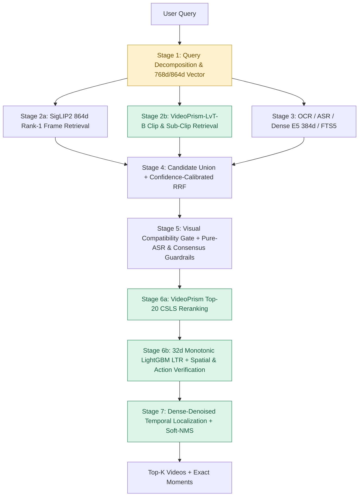

# VIDENTRA — Multimodal Video Retrieval & Temporal Moment Localization Engine

[](https://www.python.org/downloads/release/python-3120/)
[](#3-kiến-trúc-pipeline-7-giai-đoạn)
[-0b7a53.svg)](#72-benchmark-chính-thức-msr-vtt-1k-a-jsfusion--vượt-mốc-50-hit1-5560)
[](#8-kiểm-thử--tái-lập-đánh-giá)
[](#4-phần-cứng-mục-tiêu--ngân-sách-vram-6gb)
[](.github/workflows/ci.yml)

**VIDENTRA** là hệ thống truy xuất video đa phương thức (**Multimodal Video Retrieval**) và định vị khoảnh khắc theo dấu thời gian thực (**Temporal Moment Localization**) được thiết kế cho độ chính xác cao, kiểm chứng ngữ nghĩa–không gian chặt chẽ và vận hành gọn nhẹ trên một máy trạm đơn (**NVIDIA RTX 3060 6GB VRAM / 32GB RAM** hoặc thuần **CPU**).

> **Nguyên tắc thiết kế cốt lõi:** Chỉ sử dụng Small-LLM (`Qwen2.5-1.5B-Instruct`, mặc định tắt — dùng rule-based parser `< 1 ms` và chỉ bật qua `VIDENTRA_LLM_ENABLED=1`) ở Stage 1 cho bước tách truy vấn. Toàn bộ các bước truy xuất, hợp nhất đa nhánh, lọc nhiễu thị giác, kiểm chứng quan hệ, xếp hạng và định vị biên thời gian phía sau đều dùng **mô hình embedding chuyên dụng** (`SigLIP2`, `VideoPrism-LvT-B`, `multilingual-e5-small`), **thuật toán truy xuất vector/từ vựng** (`FAISS`, `SQLite FTS5`, `RRF`, `CSLS`, `DP`) và **LightGBM ranker 32 chiều**.

---

## Mục Lục

1. [Năng Lực Cốt Lõi](#1-năng-lực-cốt-lõi)
2. [Cấu Trúc Dự Án](#2-cấu-trúc-dự-án)
3. [Kiến Trúc Pipeline 7 Giai Đoạn](#3-kiến-trúc-pipeline-7-giai-đoạn)
4. [Phần Cứng Mục Tiêu & Ngân Sách VRAM 6GB](#4-phần-cứng-mục-tiêu--ngân-sách-vram-6gb)
5. [Hướng Dẫn Cài Đặt & Di Chuyển Sang Máy Mới (RTX 3060 6GB / CPU)](#5-hướng-dẫn-cài-đặt--di-chuyển-sang-máy-mới-rtx-3060-6gb--cpu)
6. [Hướng Dẫn Vận Hành (CLI, Web UI Inspector, REST API & Python SDK)](#6-hướng-dẫn-vận-hành-cli-web-ui-inspector-rest-api--python-sdk)
7. [Tập Dữ Liệu, Chống Rò Rỉ & Kết Quả Benchmark Thực Nghiệm](#7-tập-dữ-liệu-chống-rò-rỉ--kết-quả-benchmark-thực-nghiệm)
8. [Kiểm Thử & Tái Lập Đánh Giá](#8-kiểm-thử--tái-lập-đánh-giá)

---

## 1. Năng Lực Cốt Lõi

- **Trích xuất Keyframes Thích nghi Chống Trùng Lặp (`hybrid_v2_adaptive`):** Giải mã video bằng PyAV theo đúng presentation-order (`PTS / time_base`, không nhân `timestamp × FPS` với VFR), kết hợp `63-AC pHash`, lookahead chọn nét và kiểm soát burst bằng cửa sổ trượt thời gian (`100%` cut recall, `1.67%` redundancy, `0` vi phạm max-gap).
- **Truy hồi Song Song Frame (`SigLIP2 864d`) & Clip (`VideoPrism-LvT-B 768d`):** Không gian vector tăng cường **864 chiều** (`768d` ngữ nghĩa thị giác + `80d` biểu đồ COCO theo IDF + `16d` tọa độ/mật độ lưới $3\times3$ sau NMS YOLO) tính nhanh bằng **hằng đẳng thức Rank-1 đại số**, chạy song song với vector toàn video và cửa sổ con `16s/8s` từ `VideoPrism-LvT-B`.
- **Hợp nhất Đa Phương Thức Hiệu Chuẩn Tin Cậy (`OCR / ASR / E5 / FTS5`):** Kết hợp truy vấn từ vựng SQLite FTS5 (`?mode=ro`) với truy xuất ngữ nghĩa dày `multilingual-e5-small` (`384d`), nhân độ tin cậy từ OCR probability, `calibrate_asr_confidence` và IDF toàn corpus, đồng thời chặn dương tính giả bởi **Pure-ASR Gate** và **Visual Consensus Guardrail**.
- **Rerank Hai Tầng & Kiểm Chứng Không Gian–Hành Động:** Kết hợp **VideoPrism Top-20 CSLS Rerank** (chống hubness), bộ kiểm chứng **Spatial & Action Verification** (đếm số lượng đối tượng có `detector_ran` guard, quan hệ 2D cùng keyframe, DP đơn điệu tiến–lùi) và **32-feature Monotonic LightGBM** (70 cây depth-3 biên dịch thành mảng NumPy 1D).
- **Định Vị Khoảnh Khắc & Tác Chiến Competition (VBS / AIC):** Tinh chỉnh biên tương phản hai chiều với làm mượt `[0.20, 0.60, 0.20]` cho đường cong dày + Soft-NMS trích đỉnh phụ; cung cấp giao diện Web Inspector (`HTTP 206` Range scrubbing, duyệt frame lân cận, tìm tương tự, xuất CSV chuẩn `aic_kis` / `vbs_csv` chống formula injection).
- **Tương Thích Chéo Môi Trường (`auto` GPU / CPU):** Tự động phát hiện CUDA qua `resolve_device("auto")`, cắt tháp ảnh `vision_model` trước khi đẩy text encoder lên GPU và dùng `FP16` mặc định trên CUDA để vừa vặn ngân sách **6GB VRAM** của RTX 3060.

---

## 2. Cấu Trúc Dự Án

Chi tiết thiết kế từng module xem thêm tại [PROJECT.md](PROJECT.md).

```text
VIDENTRA/
├── .github/workflows/ci.yml      # GitHub Actions CI: doctor preflight + pytest (Python 3.12)
├── .env.example                  # Mẫu biến môi trường VIDENTRA_* cho RTX 3060 / CPU
├── pyproject.toml                # Khai báo package videntra, dependencies & optional extras
├── requirements.txt              # Danh sách gói cố định phiên bản cho runtime & extraction
├── configs/
│   ├── ingestion/m1_default.json # Cấu hình ingest, timeline & hybrid_v2_adaptive mặc định
│   └── local/asset_roots.example.json  # Mẫu ánh xạ đường dẫn media cục bộ & denied roots
├── manifests/                    # Manifest dataset & media chuẩn JSON schema
├── benchmark/                    # Báo cáo benchmark tham chiếu bất biến (summary, report, provenance)
├── models/
│   ├── ranking/videntra_ltr_v1.json    # Trọng số 32d Monotonic LightGBM (tracked)
│   └── {siglip2,ocr,asr,detection,llm}/ # Thư mục chứa weights cục bộ (gitignored)
├── data/
│   ├── datasets/                 # Tổ chức tách biệt từng dataset (<id>/{media,keyframes,annotations,provenance,snapshots})
│   │   └── msrvtt/               # Dataset MSR-VTT hiện hành (1,000 .mp4, 30,970 .jpg, annotations, provenance, snapshots)
│   ├── datasets.json             # Registry chỉ mục các dataset đang quản lý (local, gitignored)
│   ├── processed/                # SQLite metadata.db, FAISS 864d/E5/VideoPrism & .npy (gitignored)
│   └── cache/                    # Embedding cache truy vấn & hubness radii (gitignored)
├── src/videntra/
│   ├── api/                      # FastAPI server, HTTP 206 streaming, Web UI Inspector, CSV export
│   ├── asr/                      # VAD, PhoWhisper / Faster-Whisper, timeline alignment
│   ├── config/                   # Device auto-resolution (device.py), sampling & ingestion configs
│   ├── contracts/                # JSON Schemas & validators
│   ├── encoders/                 # SigLIP2 vision-language encoder (auto CUDA FP16 / CPU FP32)
│   ├── evaluation/               # Evaluator, provenance SHA-256, OOF GroupKFold & leakage gate
│   ├── evidence/                 # Store đọc/ghi & chuẩn hóa OCR/ASR
│   ├── indexing/                 # Vector 864d, YOLO NMS, FTS5 text store, snapshot builder
│   ├── ingestion/                # PyAV probe, presentation-order decode & atomic job manager
│   ├── localization/             # Contrast boundary refinement, DP localization & Soft-NMS
│   ├── ocr/                      # PaddleOCR / VietOCR routing & tracking
│   ├── query/                    # Rule parser, object requirements & optional Qwen2.5-1.5B adapter
│   ├── ranking/                  # 32d feature builder, compiled 1D LightGBM LTR, VEDJE reranker & provenance cache
│   ├── registry/                 # MediaResolver isolation & DatasetRegistryManager (`videntra dataset`)
│   ├── relations/                # SpatialActionVerifier (2D geometry + forward-backward action DP) & Kalman tracker (SORT/ByteTrack)
│   ├── retrieval/                # UnifiedMultimodalSearchPipeline (SSOT), MSR-VTT 1K-A R8 matrix/X-Pool/CSLS, VideoPrism, ClipBranch & DP alignment
│   ├── sampling/                 # HybridAdaptiveSampler (5 chiến lược) & benchmark quality metrics
│   ├── storage/                  # SQLite WAL-safe reader & Parquet adapters
│   └── cli.py                    # CLI (`videntra doctor|dataset|search|serve|index|evaluate|sampling`)
├── scripts/                      # Tiện ích đánh giá, retrain LTR 5-fold CV, MSR-VTT 1K-A Kaggle pipeline/matrix/eval & cleanup audit
├── tests/                        # Suite kiểm thử tự động (651 tests, chạy không cần GPU)
├── docs/audit/                   # Manifest & receipt kiểm toán dọn dẹp dữ liệu ngoài MSR-VTT (SHA-256)
├── validation/ & test_queries/   # Tập query đánh giá 80% / 20% tách biệt hoàn toàn (gitignored JSONL)
├── PROJECT.md                    # Kiến trúc kỹ thuật chi tiết theo module & lịch sử cột mốc
└── docs/PROGRESS.md              # Nhật ký triển khai kỹ thuật
```

---

## 3. Kiến Trúc Pipeline 7 Giai Đoạn



### Chi tiết xử lý từng giai đoạn

1. **Stage 1 — Tách Query & Biểu diễn Truy vấn (`768d` + `864d`):**
   - `AdaptiveQueryDecomposer` tách `visual_clauses`, trích `ocr_phrases`, `asr_phrases`, yêu cầu vật thể COCO và ý định không gian/thứ tự. Mặc định dùng rule parser `< 1 ms`; tùy chọn bật `Qwen2.5-1.5B-Instruct` qua `VIDENTRA_LLM_ENABLED=1`.
   - Vector câu truy vấn chính: chuẩn hóa $0.75 \cdot e_{\text{raw}} + 0.25 \cdot e_{\text{prompt}}$ (`"a video frame showing ..."`), sau đó mở rộng sang không gian **864d** (`768d` SigLIP2 + `80d` IDF COCO + `16d` thông số bounding box & lưới $3\times 3$).
2. **Stage 2a & 2b — Truy hồi Song Song Frame (`SigLIP2`) & Clip (`VideoPrism-LvT-B`):**
   - **Frame (`SigLIP2`):** Chấm điểm pha trộn $0.70 \cdot s_{768} + 0.30 \cdot s_{864}$ qua hằng đẳng thức **Rank-1 đại số** (`_compute_768_and_864_sims`, sai số `< 2e-7` giúp loại bỏ phép nhân ma trận `864d` đầy đủ), scaling `search_depth` bất biến mật độ (`min(2.5, max(1.0, avg_kf_per_vid / 10.0))`), chống burst `_deduplicate_burst_visual_hits(min_pts_gap=0.55s)` và căn chỉnh đa mệnh đề bằng $O(K_v)$ deque / DP vector hóa + Sinkhorn alignment.
   - **Clip (`VideoPrismClipRetriever`):** Đối chiếu vector toàn video (`768d`) và cực đại cửa sổ `16s/8s` (`subclip_max_cos`).
3. **Stage 3 — Truy hồi Lexical (`OCR / ASR / E5 / FTS5`) & Calibration:**
   - Truy vấn SQLite FTS5 (`fts_ocr`, `fts_asr`, chỉ đọc `?mode=ro`) với token đặc hiệu hóa và `Dense E5 384d` (`faiss_text_e5_384.bin`).
   - Hệ số tin cậy lexical:
     $$\text{lex\_reliability} = \text{clip}\!\left(\text{raw\_conf} \cdot \overline{\text{IDF}}_{\text{tokens}} \cdot \text{len\_spec},\ 0.15,\ 1.50\right)$$
4. **Stage 4 & 5 — Candidate Union, Calibrated RRF & Visual Guardrails:**
   - Hợp nhất ứng viên từ SigLIP2, VideoPrism (`4a-vp` kèm `video_curve_cache`), OCR và ASR bằng RRF bất biến thứ tự, nhân `lex_reliability` và cổng thị giác $\gamma_{\text{vis}} = \exp(-\max(0, \Delta_{\text{vis}} - 0.012)\cdot 35)$.
   - **Pure-ASR Gate** và **Visual Consensus Guardrail** giảm `0.35×` với match 1 token IDF thấp (`< 0.65`) lệch đỉnh thị giác.
5. **Stage 6a & 6b — VideoPrism CSLS Rerank, Spatial/Action Verifier & 32d Monotonic LightGBM:**
   - Chống thiên lệch mật độ bằng `_count_spaced_adjacent_pairs(min_spacing_sec=1.5s)` và `eff_n_kf = min(n_kf, max(1.0, dur / 2.0))`, tính batch `temporal_context_768` trong một phép nhân ma trận.
   - **VideoPrism Rerank (`rerank_top_candidates`):** Bao gồm Top-20 pre-rerank và ứng viên VideoPrism union trong shortlist, tính $\text{CSLS}(q, v) = 2\cos(q, v_{\text{whole}}) - \bar{\mu}_{10}(v)$, `vp_z` và `clause_order_score`.
   - **Spatial & Action Verification (`SpatialActionVerifier`):** Chấm `0.012 × sa_graph_score` trên Top-25 ứng viên (kiểm tra cardinality theo từng frame với cờ `detector_ran`, quan hệ 2D giữa cặp đối tượng và biên độ DP đơn điệu tiến trừ lùi).
   - **32d Monotonic LightGBM (`LearnedRankerLTR`):** Vector 32 đặc trưng (`LTR_FEATURE_NAMES_V2`) chạy qua 70 cây depth-3 biên dịch thành mảng 1D NumPy phẳng (`score_base + 0.08 · tanh(score_tree)`), kết hợp **SigLIP2 Frame+Clip Consensus Boost** có `duration_mismatch_guard`.
6. **Stage 7 — Temporal Localization & Soft-NMS:**
   - Đường cong dày (`n >= 100`, `avg_step <= 1.6s`) được lọc nhiễu nhẹ `[0.20, 0.60, 0.20]` trước khi tìm biên bằng `expand_boundary_contrast` và `_optimal_contrast_segment` (vector hóa 2D NumPy cho plateau `>= 60s`).
   - `propose_soft_nms_secondary_windows` trích tối đa 3 khoảnh khắc phụ không chồng lấn (`tIoU < 0.30`).

---

## 4. Phần Cứng Mục Tiêu & Ngân Sách VRAM 6GB

Hệ thống mặc định chạy ở chế độ `VIDENTRA_DEVICE=auto` và `VIDENTRA_DTYPE=auto`, tự động tối ưu cho cấu hình máy trạm đơn:

| Thành Phần Runtime | Nơi Lưu Trữ | Dung Lượng Ước Tính | Hành Vi Tối Ưu Cho RTX 3060 6GB VRAM |
| :--- | :---: | :---: | :--- |
| **SigLIP2 Text Encoder (`768d`)** | GPU VRAM | ~`0.45 GB` (FP16) | Cắt bỏ `vision_model` (~`1.0 GB`) ngay trên CPU trước khi `.to("cuda", torch.float16)` trong `_ensure_text_encoder()` |
| **Multilingual-E5-small (`384d`)** | GPU VRAM | ~`0.24 GB` (FP16) | Lazy-load chỉ khi query có ý định lexical và cache đĩa miss; pooling tự ép `float32` trước chuẩn hóa L2 |
| **SigLIP2 Full Vision+Text** *(khi `index build`)* | GPU VRAM | ~`0.95 GB` (FP16) | Xử lý theo batch với `torch.inference_mode()`, đầu vào float ép sang `float16` khớp weight và chuẩn hóa L2 ở `float32` |
| **Qwen2.5-1.5B-Instruct** *(tùy chọn)* | GPU VRAM / CPU | ~`1.1–1.8 GB` | Mặc định **TẮT** (`VIDENTRA_LLM_ENABLED=0`); chỉ nạp nếu người dùng bật tường minh |
| **FAISS Index (`864d/384d/768d`) + SQLite + Maps** | System RAM | ~`3.4–3.7 GB` RSS | Dùng `faiss-cpu` AVX2 + `OpenMP` trên **32GB RAM**, giữ tốc độ tìm vector ở mức vài mili-giây mà không chiếm VRAM |

> Tổng VRAM tiêu thụ khi phục vụ tìm kiếm chuẩn (`SigLIP2 Text + E5`, `VIDENTRA_LLM_ENABLED=0`) luôn giữ ở mức **< 1.0 GB / 6.0 GB VRAM**, an toàn tuyệt đối ngay cả khi dùng song song desktop UI hoặc trích xuất video nền.

---

## 5. Hướng Dẫn Cài Đặt & Di Chuyển Sang Máy Mới (RTX 3060 6GB / CPU)

### Bước 1: Clone mã nguồn và tạo môi trường Python 3.12

```powershell
git clone https://github.com/LongLeVuHuy/VIDENTRA.git
cd VIDENTRA
python -m venv .venv
.\.venv\Scripts\Activate.ps1        # Linux/macOS: source .venv/bin/activate
python -m pip install --upgrade pip
```

### Bước 2: Cài đặt PyTorch CUDA (cho RTX 3060) và các gói dự án

> Cài PyTorch bản CUDA **trước** `requirements.txt` để pip không ghi đè bản CPU-only:

```powershell
# A. Trên máy có NVIDIA RTX 3060 (CUDA 12.x):
pip install torch torchvision --index-url https://download.pytorch.org/whl/cu126
pip install -r requirements.txt
pip install --no-build-isolation --no-deps -e .

# B. Hoặc chỉ chạy CPU:
# pip install -r requirements.txt && pip install --no-build-isolation --no-deps -e .
```

*(Tùy chọn)* Nếu muốn bật Stage 1 `Qwen2.5-1.5B` GGUF, cài thêm prebuilt wheel `llama-cpp-python` theo hướng dẫn ở comment trong [requirements.txt](requirements.txt).

### Bước 3: Tạo cấu hình môi trường cục bộ

```powershell
copy .env.example .env
copy configs\local\asset_roots.example.json configs\local\asset_roots.json
```

Chỉnh `.env` nếu bạn lưu dữ liệu ở ổ đĩa khác (hoặc giữ nguyên mặc định `VIDENTRA_DEVICE=auto` và `VIDENTRA_DTYPE=auto`).

### Bước 4: Chuyển Dữ Liệu & Trọng Số Không Lưu Trên Git Sang Máy Mới

Vì repository GitHub không chứa file nhị phân lớn (raw video, weights, chỉ mục FAISS/SQLite), khi chuyển sang máy tính mới bạn có thể **copy trực tiếp các thư mục dưới đây** từ máy cũ sang cùng vị trí trong `VIDENTRA/`, hoặc **tái tạo lại từ đầu**:

| Thư mục / Tệp | Dung lượng tham chiếu | Bắt buộc để chạy Web UI / Search? | Ghi chú |
| :--- | :---: | :---: | :--- |
| `data/processed/` | ~`201 MB` | **Có** | Chứa `metadata.db`, `faiss_index.bin`, `augmented_embeddings.npy`, `faiss_text_e5_384.bin`, `faiss_videoprism_clip_768.bin`, `videoprism_subclips_768.npy` |
| `models/siglip2/` | ~`1.47 GB` | **Có** | Weights `google/siglip2-base-patch16-224` (`model.safetensors`, tokenizer, config) |
| `data/cache/` | ~`12.6 MB` | Khuyến nghị | Cache embedding query & `keyframe_hubness_radii.npy` (giúp tăng tốc warm/cold lookup) |
| `data/datasets/<id>/` | ~`1.26 GB` (`msrvtt`) | Khi cần xem video/frame | Mỗi dataset độc lập gồm `media/`, `keyframes/`, `annotations/`, `provenance/`, `snapshots/`, `dataset.json` |
| `models/ocr`, `asr`, `detection` | ~`1.09 GB` | Chỉ khi tái ingest | `VietOCR`, `PaddleOCR`, `PhoWhisper-small`, `YOLOv8n` cho bước trích xuất offline |
| `validation/` & `test_queries/` | ~`12.8 MB` | Chỉ khi benchmark/train | Bộ câu hỏi & nhãn đánh giá tách riêng (`80% val / 20% test`) |
| `models/llm/` | ~`4.02 GB` | Tùy chọn | Chỉ cần nếu đặt `VIDENTRA_LLM_ENABLED=1` |
| `models/ranking/videntra_ltr_v1.json` | `0.66 MB` | **Đã có sẵn trong Git** | Trọng số 32d Monotonic LightGBM mặc định |

<details>
<summary>Tùy chọn: Tải lại trọng số chuẩn hoặc tái trích xuất toàn corpus từ đầu (Kaggle GPU / Local)</summary>

```powershell
# 1. Tải SigLIP2 Base-224 (cùng revision pin) nếu không copy models/siglip2/
python -c "from huggingface_hub import snapshot_download; snapshot_download('google/siglip2-base-patch16-224', local_dir='models/siglip2')"

# 2. Tái trích xuất keyframes hybrid_v2_adaptive + SigLIP2/YOLO trên Kaggle GPU & build E5 index:
.\.venv\Scripts\python.exe scripts/rebuild_corpus_hybrid_v2.py sample-local --workers 6
.\.venv\Scripts\python.exe scripts/rebuild_corpus_hybrid_v2.py prepare-kaggle --push
.\.venv\Scripts\python.exe scripts/rebuild_corpus_hybrid_v2.py ingest-kaggle
.\.venv\Scripts\python.exe scripts/build_e5_text_index.py

# 3. Đóng gói & nạp vector VideoPrism-LvT-B cho 1,324 videos + sub-clips:
.\.venv\Scripts\python.exe scripts/build_videoprism_corpus_index.py package --out-dir work/kaggle/videoprism_full_1324
.\.venv\Scripts\python.exe scripts/build_videoprism_corpus_index.py ingest --kaggle-out-dir work/kaggle/videoprism_full_1324_out --processed-dir data/processed --cache-dir data/cache

# 4. Huấn luyện lại 32d LightGBM 5-Fold GroupKFold OOF CHỈ trên validation/:
.\.venv\Scripts\python.exe scripts/train_ltr_ranker_cv.py --extract-from-val --backend lightgbm --feature-dim 32 --blend-weight 0.08 --output models/ranking/videntra_ltr_v1.json
```

</details>

### Bước 5: Kiểm Tra Sẵn Sàng Hệ Thống Trước Khi Chạy (`videntra doctor`)

```powershell
.\.venv\Scripts\python.exe -m videntra doctor --strict
```

Trên máy RTX 3060 đã cài đúng PyTorch CUDA và đầy đủ dữ liệu, đầu ra JSON sẽ báo `"cuda_available": true`, `"resolved_device": "cuda"`, `"gpu_name": "NVIDIA GeForce RTX 3060"`, `"ready_for_serving": true` và exit code `0`.

---

## 6. Hướng Dẫn Vận Hành (CLI, Web UI Inspector, REST API & Python SDK)

### 6.1. Quản lý Dataset Vòng đời Độc lập (`videntra dataset`)

Hệ thống quản lý dữ liệu theo từng thư mục `data/datasets/<dataset_id>/` tự động đồng bộ `data/datasets.json` và `configs/local/asset_roots.json`:

```powershell
# Liệt kê danh sách dataset và dung lượng từng phân vùng
.\.venv\Scripts\python.exe -m videntra dataset list

# Khởi tạo khung thư mục chuẩn & đăng ký một dataset mới (media, keyframes, annotations, provenance, snapshots)
.\.venv\Scripts\python.exe -m videntra dataset add --name new_dataset --description "Custom corpus"

# Kiểm tra tính nhất quán đường dẫn giữa dataset.json, asset_roots.json, ổ đĩa và SQLite metadata.db
.\.venv\Scripts\python.exe -m videntra dataset verify

# Xem trước tác động xóa (dry-run an toàn) hoặc xóa hoàn toàn kèm dọn DB/FAISS
.\.venv\Scripts\python.exe -m videntra dataset remove --name new_dataset
.\.venv\Scripts\python.exe -m videntra dataset remove --name new_dataset --yes --prune-processed
```

### 6.2. Tìm kiếm nhanh qua CLI

```powershell
# Mặc định tự chọn GPU CUDA nếu có (--device auto)
.\.venv\Scripts\python.exe -m videntra search --backend unified `
  --query "A woman in a white blouse speaks to the camera while a news banner appears" `
  --mode accurate --top-k 5
```

### 6.3. Khởi chạy Web UI Inspector & FastAPI Server

```powershell
.\.venv\Scripts\python.exe -m videntra serve --backend unified --host 127.0.0.1 --port 8000
```

- **Web UI Inspector:** `http://127.0.0.1:8000/` (hỗ trợ lọc preset dataset `Tất cả / MSRVTT` hoặc nhập tên dataset bất kỳ, badge phương thức, tua video `HTTP 206 Range`, nút tìm tương tự, dải keyframe lân cận và xuất CSV chuẩn AIC/VBS).
- **Swagger / OpenAPI Docs:** `http://127.0.0.1:8000/docs`

| Endpoint | Method | Chức Năng |
| :--- | :---: | :--- |
| `/` | `GET` | Giao diện Web UI VIDENTRA Inspector |
| `/health` | `GET` | Telemetry hệ thống (`backend`, `device`, `cuda_available`, `indexed_vectors`, `videoprism_status`, `ltr_loaded`) |
| `/v1/search` | `POST` | Tìm kiếm khoảnh khắc đa phương thức (`mode: fast\|accurate`, `ranking_mode`, `filters.dataset`) |
| `/v1/search/similar` | `POST` | Tìm video / khoảnh khắc tương đồng thị giác theo `video_id` & `timestamp_seconds` |
| `/v1/query/parse` | `GET` | Phân tích truy vấn thành `QueryGraph` JSON |
| `/v1/videos/{video_id}/neighbors` | `GET` | Lấy danh sách keyframes lân cận quanh timestamp mục tiêu |
| `/v1/frames/{video_id}/{index}` | `GET` | Giải mã/trả JPEG frame theo presentation-order `source_frame_index` |
| `/v1/media/{video_id}` | `GET / HEAD` | Stream video gốc hỗ trợ `HTTP 206 Partial Content` |
| `/v1/exports` | `POST` | Xuất kết quả dạng `aic_kis`, `vbs_csv`, `csv`, `json` (chống CSV formula injection) |

### 6.4. Tích hợp Python SDK

```python
from videntra.retrieval.unified_pipeline import UnifiedMultimodalSearchPipeline

# device=None (hoặc "auto") tự dùng CUDA FP16 nếu sẵn sàng, ngược lại fallback CPU FP32
with UnifiedMultimodalSearchPipeline() as pipeline:
    response = pipeline.search_with_metadata(
        snapshot_id="corpus_current",
        query="A chef makes pizza and cuts it into slices",
        top_k=5,
        mode="accurate",
    )
    for rank, moment in enumerate(response["moments"], 1):
        print(
            f"#{rank} {moment.video_id} "
            f"[{moment.moment_start_seconds:.2f}s - {moment.moment_end_seconds:.2f}s] "
            f"score={moment.ranking_score:.4f} ({moment.match_status})"
        )
```

---

## 7. Tập Dữ Liệu, Chống Rò Rỉ & Kết Quả Benchmark Thực Nghiệm

### 7.1. Kho Video & Dọn Dẹp Chuẩn Hóa Tập MSR-VTT (`22/11/2026`)

- **Dọn dẹp toàn bộ asset ngoài MSR-VTT (`scripts/audit_non_msrvtt_cleanup.py`) & tái cấu trúc `data/datasets/msrvtt/`:** Theo quyết định tối ưu dung lượng, toàn bộ raw video, keyframe, cache và dòng DB thuộc AVC, QVHighlights, TextVR, TVR và Blender đã được kiểm toán & xóa sạch (`356` mục / `15,848` files, giải phóng `1.92 GB` dung lượng đĩa, đối soát trong [deletion_receipt_non_msrvtt_20261122.json](docs/audit/deletion_receipt_non_msrvtt_20261122.json)). Kho local hiện tổ chức gọn theo từng dataset tại `data/datasets/msrvtt/` (`1,000` video `.mp4`, `30,970` keyframes `.jpg`, `annotations/`, `provenance/`, `snapshots/msrvtt_1ka/`) và kiểm tra toàn vẹn qua `videntra dataset verify` (`0` file thiếu trên đĩa).
- **Kho lưu trữ MSR-VTT 1K-A Protocol (`scripts/prepare_msrvtt_1ka_protocol.py`):** Tách chặt chẽ **`4,585`** video Train-9K sạch (đã loại bỏ overlap & liên kết nguồn), **`4,000`** video Validation (`Tune` 2,000 + `Confirm` 2,000 queries tách rời hoàn toàn theo `source_group`) và tập niêm phong **`test_1ka`** (`1,000` videos / `1,000` queries chuẩn JSFusion — chỉ giải niêm và chấm **một lần duy nhất** sau khi khóa Champion trên `Confirm`).

### 7.2. Benchmark Chính Thức MSR-VTT 1K-A (JSFusion) — Vượt Mốc 50% Hit@1 (`55.60%`)

> **Nguồn số liệu chính thức:** [benchmark/msrvtt_1ka_benchmark_report.md](benchmark/msrvtt_1ka_benchmark_report.md), [benchmark/msrvtt_1ka_benchmark_results.json](benchmark/msrvtt_1ka_benchmark_results.json) (đánh giá single-shot `test_1ka` lúc `2026-11-22T17:56:38Z`, Seed `20261122`, Peak RAM `2,219.4 MB`).
> **Kiến trúc Champion `R8_videntra_champion_candidate` (`src/videntra/retrieval/msrvtt_matrix.py`):** Hợp nhất 4 visual backbones (`google/videoprism-lvt-base-f16r288`, `timm/PE-Core-L-14-336`, `google/siglip2-so400m-patch14-384`, `google/siglip2-base-patch16-224` — trích 12 frames theo `PTS/time_base` trình tự hiển thị) cùng Gram-matrix L2-normalized **X-Pool** (`mean_xpool_top3` / `mean_plus_xpool`), **Query-Bank CSLS** (`r8_csls_weights = [0.3, 0.0, 0.0, 0.2]`), **Multi-Prompt**, **Boltzmann `exp(z/2.0)` Fusion** (`r8_s1_weights = [0.95, 1.35, 0.7, 0.12]`) và **ASR BM25** (`Faster-Whisper small`, `r8_w_asr = 0.12`), không rò rỉ nhãn kiểm thử.

| Tập Đánh Giá | Cấu Hình | Hits / N | Video Hit@1 | Hit@5 | Hit@10 | Stage-1 R@20 | MRR@10 | Delta vs B1 (`95% CI`) | `+W/-L` |
| :--- | :--- | :---: | :---: | :---: | :---: | :---: | :---: | :---: | :---: |
| **`Tune` (`2,000`)** | `B1_videoprism_standalone` | 880/2000 | 44.00% | 71.40% | 79.35% | 86.70% | 0.5558 | +0.00 | +0/-0 |
| **`Tune` (`2,000`)** | **`R8_videntra_champion_candidate`** | **985/2000** | **49.25%** | **75.60%** | **83.40%** | **89.15%** | **0.6057** | **+5.25 pp** `[+3.63, +6.89]` | +195/-90 |
| **`Confirm` (`2,000`)** | `B0_siglip2_standalone` | 731/2000 | 36.55% | 64.20% | 73.50% | 81.20% | 0.4852 | -7.40 pp `[-9.46, -5.26]` | +186/-334 |
| **`Confirm` (`2,000`)** | `B1_videoprism_standalone` | 879/2000 | 43.95% | 73.35% | 80.45% | 86.70% | 0.5645 | +0.00 | +0/-0 |
| **`Confirm` (`2,000`)** | **`R8_videntra_champion_candidate` (Locked)** | **1004/2000** | **50.20%** | **77.15%** | **84.80%** | **89.85%** | **0.6189** | **+6.25 pp** `[+4.59, +7.93]` | +216/-91 |
| **`test_1ka` (`1,000`)** | `B0_siglip2_standalone` | 423/1000 | **42.30%** | 65.10% | 74.10% | 82.50% | 0.5207 | -6.40 pp `[-9.36, -3.44]` | +81/-145 |
| **`test_1ka` (`1,000`)** | `B1_videoprism_standalone` | 487/1000 | **48.70%** | 75.30% | 82.50% | 88.60% | 0.5972 | +0.00 | +0/-0 |
| **`test_1ka` (`1,000`)** | **`R8_videntra_champion_candidate` (Official)** | **556/1000** | **55.60%** | **79.00%** | **86.80%** | **91.40%** | **0.6549** | **+6.90 pp** **`[+4.68, +9.13]`** | **+101/-32** |

- **Mục tiêu `>= 501 / 1,000` (> 50% Video Hit@1) trên `test_1ka`:** **ĐẠT VƯỢT MỤC TIÊU (`556 / 1,000 = 55.60%`)**, vượt `+6.90 pp` so với `VideoPrism-LvT-B` độc lập (`48.70%`) và `+13.30 pp` so với `SigLIP2-Base` (`42.30%`), độ trễ scoring `p50/p95 = 0.11 / 0.18 ms`.

### 7.3. Tham Chiếu Lịch Sử Multi-Corpus (`Run 1d90b8f9`, trước đợt dọn ngoài MSR-VTT 22/11/2026)

> **Lưu ý:** Bảng lịch sử dưới đây lưu tại [benchmark/benchmark_summary.json](benchmark/benchmark_summary.json) từ mốc `1,324` videos hỗn hợp (`MSR-VTT + AVC + QVHighlights`, `20/11/2026`) để đối chiếu quá trình tối ưu hóa pipeline 7 giai đoạn trước khi thu gọn về tập MSR-VTT 1K-A.

> **Nguồn số liệu:** [benchmark/benchmark_summary.json](benchmark/benchmark_summary.json), [benchmark/benchmark_report.md](benchmark/benchmark_report.md) và [benchmark/provenance.json](benchmark/provenance.json) (`Run 1d90b8f9f09f41629f9a500229a47626`, commit `7ead8e0`, `Dirty = False`).  
> **Môi trường đo thực tế:** Windows 10 AMD64, CPU **4 luồng** (`torch_num_threads=2`, `faiss_omp_max_threads=4`), RAM `31.89 GB`, suy luận trên CPU (`device="cpu"`).

| Tập Đánh Giá | N | Chế Độ Đánh Giá | Video Hit@1 | Video Hit@10 | Video MRR | Video nDCG@10 | Moment Hit@1 ($\text{tIoU}\ge 0.5$) | Moment nDCG@5 | Non-Neural (`p50 / p95`) | Pure-ASR FP |
| :--- | :---: | :---: | :---: | :---: | :---: | :---: | :---: | :---: | :---: | :---: |
| **`dev_150`** | 150 | OOF (`141/150`) | **`64.00%`** `[56.67%, 71.33%]` | **`84.67%`** | **`0.7129`** | **`0.7455`** | **`59.09%`** `(13/22)` | **`0.5176`** | `38.23 / 93.50 ms` | **`0`** |
| **`dev_full_859`** | 859 | OOF (`789/859`) | **`49.01%`** `[45.63%, 52.39%]` | **`80.21%`** | **`0.5915`** | **`0.6423`** | **`59.09%`** | **`0.5176`** | `32.89 / 80.77 ms` | **`0`** |
| **`heldout_test_201`** | 201 | **`clean_disjoint` (`overlap=0`)** | **`45.77%`** `[39.30%, 52.75%]` | **`77.61%`** | **`0.5532`** | **`0.6061`** | **`50.00%`** `(1/2)` | **`0.5000`** | `32.29 / 47.56 ms` | **`0`** |

- **Hồ sơ hiệu năng đo được trên CPU (`dev_150`):** Stage `p50` chi tiết: `faiss = 7.91 ms`, `fts5 = 6.04 ms`, `fusion = 20.55 ms`, `boundary = 2.76 ms`; End-to-End Online: `352.84 ms p50 / 700.69 ms p95`; Cold query latency: `291.09 ms p50 / 582.84 ms p95`; Bộ nhớ tiến trình: RSS `3,414.1 MB` / Peak RAM **`3,672.1 MB`** (`< 4,000 MB`).
- **Định vị khoảnh khắc bổ sung (`dev_150`):** `Moment Hit@1@0.3 = 81.82%`, `Moment Hit@1@0.7 = 40.91%`, `mAP@[0.5:0.95] = 0.3383`, Boundary MAE `6.99s` (`dev_150`, `N=13`) và `1.31s` (`heldout_test_201`, `N=1`).

### 7.4. Phân Rã Theo Từng Dataset (`Run 1d90b8f9`)

| Tập | Dataset | Queries | Global Hit@1 | Within-DS Hit@1 | Hit@5 | Hit@10 | Global MRR | Union Recall | Shortlist@k Recall |
| :--- | :--- | :---: | :---: | :---: | :---: | :---: | :---: | :---: | :---: |
| **`dev_150`** | **QVHighlights** | 22 | **`86.36%`** | **`100.00%`** | **`100.00%`** | **`100.00%`** | **`0.9318`** | `95.45%` | **`100.00%`** |
| **`dev_150`** | **AVC** | 28 | **`89.29%`** | **`92.86%`** | `92.86%` | `96.43%` | **`0.9051`** | `96.43%` | `96.43%` |
| **`dev_150`** | **MSR-VTT** | 100 | `52.00%` | `55.00%` | `74.00%` | `78.00%` | `0.6109` | `81.00%` | `92.00%` |
| **`dev_full_859`** | **MSR-VTT** | 809 | `46.60%` | `49.81%` | `71.82%` | **`79.11%`** | **`0.5714`** | `84.80%` | `92.83%` |
| **`heldout_test_201`** | **MSR-VTT** | 191 | **`43.98%`** | **`45.55%`** | `67.02%` | **`76.96%`** | **`0.5394`** | `82.72%` | `92.15%` |
| **`heldout_test_201`** | **AVC / QVHighlights** | 8 / 2 | `87.50%` / `50.00%` | `87.50%` / **`100.00%`** | `87.50%` / `50.00%` | `87.50%` / `100.00%` | `0.8750` / `0.5833` | `100%` / `100%` | `100%` / `100%` |

### 7.5. Ma Trận Ablation `A0` $\to$ `A5` (`dev_150`)

| Cấu Hình | Thành Phần Kích Hoạt | Video Hit@1 | Video Hit@10 | MRR | Video nDCG@10 | Moment Hit@1@0.5 | Moment nDCG@5 | Non-Neural `p50` |
| :---: | :--- | :---: | :---: | :---: | :---: | :---: | :---: | :---: |
| **`A0`** | Thuần `SigLIP2 768d` | `48.00%` | `72.00%` | `0.5567` | `0.5962` | `9.09%` | `0.0347` | `12.07 ms` |
| **`A1`** | `+ 864d Augmented Subspace` (`YOLO NMS` + Spatial 16d) | `44.67%` | `72.67%` | `0.5391` | `0.5845` | `4.55%` | `0.0228` | `13.17 ms` |
| **`A2`** | `+` Phân rã đa mệnh đề & căn chỉnh chuỗi ($O(K_v)$) | `43.33%` | `72.67%` | `0.5322` | `0.5794` | `4.55%` | `0.0228` | `15.54 ms` |
| **`A3`** | `+` Truy hồi Lexical (`OCR/ASR/FTS5`) & hợp nhất có cổng | `54.67%` | `79.33%` | `0.6274` | `0.6677` | `4.55%` | `0.0285` | `22.51 ms` |
| **`A4`** | `+` Mở rộng biên theo tương phản | `54.67%` | `79.33%` | `0.6274` | `0.6677` | `50.00%` | `0.4164` | `25.96 ms` |
| **`A5`** | `+ VideoPrism-LvT-B` + Calibrated RRF + `32d LTR` + Spatial/Action + Dense Denoise + Consensus | **`64.00%`** | **`84.67%`** | **`0.7129`** | **`0.7455`** | **`59.09%`** | **`0.5176`** | `38.23 ms` |

### 7.6. Benchmark 5 Chiến Lược Trích Xuất Keyframes (`HybridAdaptiveSampler`)

Đo 3 tầng (`2026-11-18T21:42:19Z`, lưu cục bộ tại `work/experiments/keyframe_strategy_benchmark/results.json`) trên **30 video thật / `49,977` frames** và **18 validation queries / `2,396` unique union frames `SigLIP2` CPU**:

| Chiến Lược (`SamplingConfig.strategy`) | T2 Mean Samples | T2 Rep (`p10`) | T2 Cut Recall | T2 Redundancy | T3 `SigLIP2` Hit@1 | T3 MRR | T3 Peak Cosine | Violations | Đánh Giá |
| :--- | :---: | :---: | :---: | :---: | :---: | :---: | :---: | :---: | :--- |
| **`hybrid_v2_adaptive` (Mặc định corpus)** | **`54.53`** | `0.9266` (`0.8566`) | **`100.0%`** | **`1.67%`** | `66.67%` | `0.7932` | `0.1329` | **`0`** | `composite = 0.62874`, cân bằng tối ưu mật độ & chất lượng cho toàn bộ 1,324 videos |
| `sharpness_lookahead` | `66.80` | **`0.9341`** (`0.8698`) | **`100.0%`** | `1.53%` | `66.67%` | **`0.7944`** | **`0.1334`** | `0` | Hạng #1 tuyệt đối về `composite = 0.63053` (+22.5% số frame so với v2) |
| `shot_medoid_submodular` | **`38.57`** | `0.9129` (`0.8253`) | `100.0%` | **`0.00%`** | `66.67%` | `0.7913` | `0.1301` | `0` | Nén tối đa (`0.62509`), tiết kiệm dung lượng |
| `hybrid_v1_legacy` | `73.40` | `0.9280` (`0.8596`) | `100.0%` | `39.28%` | `61.11%` | `0.7648` | `0.1334` | `0` | Trùng lặp cao (`0.61622`) |
| `uniform_matched` / `_matched_budget` | `62.13` / `54.53` | `0.9289` / `0.9313` | `32.41%` / `43.99%` | `35.12%` / `33.17%` | **`77.78%`** / `66.67%` | **`0.8372`** / `0.7927` | `0.1318` / `0.1313` | `0` | Baseline đều theo thời gian, bỏ lỡ chuyển cảnh |

---

## 8. Kiểm Thử & Tái Lập Đánh Giá

```powershell
# 1. Kiểm tra cấu hình Python, GPU/CUDA, gói và dữ liệu cục bộ
.\.venv\Scripts\python.exe -m videntra doctor --strict

# 2. Chạy toàn bộ 651 unit & integration tests
.\.venv\Scripts\python.exe -B -m pytest -q

# 3. Đánh giá ma trận Validation MSR-VTT 1K-A (B0–B4 & R0–R8) và chốt Champion
.\.venv\Scripts\python.exe -u -B scripts/run_msrvtt_validation_matrix.py

# 4. Chấm single-shot tập niêm phong test_1ka sau khi khóa Champion
.\.venv\Scripts\python.exe -u -B scripts/evaluate_msrvtt_1ka_test.py

# 5. Đánh giá nhanh trên validation splits legacy (nếu cần đối chiếu)
.\.venv\Scripts\python.exe scripts/run_validation_benchmark.py --splits dev_150,dev_full_859 --device auto --out-dir work/val_check

# 6. So sánh đa phương án trích xuất keyframes
.\.venv\Scripts\python.exe scripts/benchmark_keyframe_strategies.py
.\.venv\Scripts\python.exe -m videntra sampling compare --config configs/ingestion/m1_default.json --manifest manifests/benchmark/smoke/benchmark_smoke.media.json --output work/sampling_compare
```
