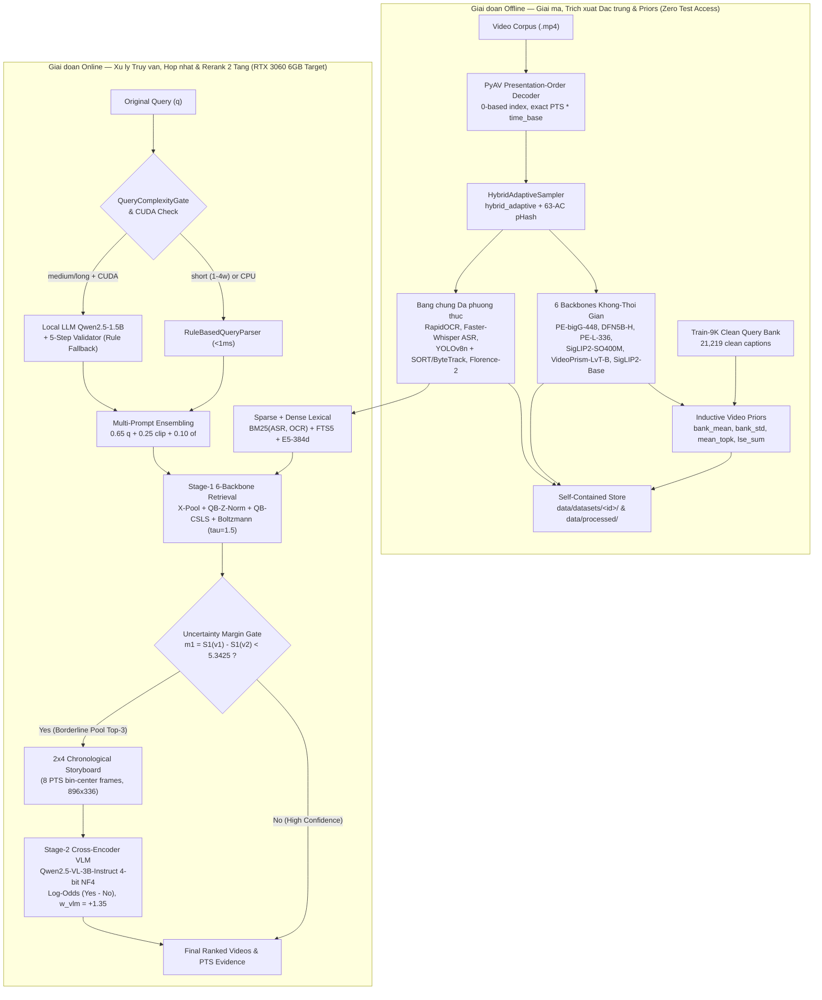

<div align="center">

# VIDENTRA

**Video Intelligence, Evidence & Temporal Retrieval Architecture**

*Hệ thống truy xuất và định vị khoảnh khắc video đa phương thức, chống rò rỉ dữ liệu 3 phân vùng, tối ưu cho **RTX 3060 6GB VRAM***

[](pyproject.toml)
[](benchmark/msrvtt_1ka_benchmark_report.md)
[](benchmark/msrvtt_1ka_benchmark_results.json)
[](src/videntra/ranking/vlm_reranker.py)
[](AGENTS.md)

</div>

---

> **Điểm nhấn VIDENTRA (6 Backbones + Stage-2 `Qwen2.5-VL-3B` NF4):** Chấm đơn lần trên tập niêm phong **MSR-VTT 1K-A** (`1.000` video / `1.000` truy vấn / `885` source groups), cấu hình mục tiêu 6GB VRAM đạt **`57.20%` Hit@1 (`572/1.000`)**, **`0.6693` MRR@10**, **`79.90%` R@5**, **`87.40%` R@10** và **`91.80%` Stage-1 R@20** — vượt baseline `SigLIP2-Base` (`42.30%`) thêm **`+14.90 pp`**, vượt `VideoPrism-LvT-B` (`48.70%`) thêm **`+8.50 pp`** (`95% Bootstrap CI [+6.21, +10.87] pp`, cứu đúng `+120` câu / mất `-35`, ròng `+85`), và thậm chí nhỉnh hơn cấu hình Cloud tham chiếu `Qwen2.5-VL-7B NF4` (`57.10%` Hit@1 / `0.6670` MRR@10) với mức **peak VRAM đo thực tế chỉ `2,792.7 MB` (`2.73 GB`)** trên `test_1ka`.

---

## Mục Lục

1. [Tính Mới & Đóng Góp Kiến Trúc](#1-tính-mới--đóng-góp-kiến-trúc)
2. [Kiến Trúc Pipeline (Offline & Online Workflow)](#2-kiến-trúc-pipeline-offline--online-workflow)
3. [Công Thức Toán Học & Trọng Số Khóa](#3-công-thức-toán-học--trọng-số-khóa)
4. [Ngân Sách VRAM RTX 3060 6GB & Tự Động CUDA/CPU](#4-ngân-sách-vram-rtx-3060-6gb--tự-động-cudacpu)
5. [Cấu Trúc Dự Án & Quy Tắc Zero Leakage 3 Phân Vùng](#5-cấu-trúc-dự-án--quy-tắc-zero-leakage-3-phân-vùng)
6. [Kết Quả Benchmark Chính Thức](#6-kết-quả-benchmark-chính-thức)
   - [6.1. MSR-VTT 1K-A Sealed Test (3B 6GB Champion vs 7B Cloud Ref & Baselines)](#61-msr-vtt-1k-a-sealed-test-3b-6gb-champion-vs-7b-cloud-ref--baselines)
   - [6.2. Ablation Tách Query Chunks bằng Local LLM (Qwen2.5-1.5B) vs Rule-Based](#62-ablation-tách-query-chunks-bằng-local-llm-qwen25-15b-vs-rule-based)
   - [6.3. Benchmark 5 Chiến Lược Trích Xuất Keyframes](#63-benchmark-5-chiến-lược-trích-xuất-keyframes)
7. [Cài Đặt, Vận Hành CLI & Quản Lý Dataset](#7-cài-đặt-vận-hành-cli--quản-lý-dataset)
8. [Tài Liệu Tham Khảo (References & Prior Work)](#8-tài-liệu-tham-khảo-references--prior-work)

---

## 1. Tính Mới & Đóng Góp Kiến Trúc

Khác với nhiều mã nguồn truy xuất video chỉ so khớp cosine từ một mô hình CLIP đơn lẻ trên vài frame lấy mẫu đều hoặc dùng chuẩn hóa *transductive* (nhìn trước toàn bộ ma trận câu truy vấn test — không khả dụng khi phục vụ thực tế từng câu hỏi), VIDENTRA giải quyết đồng bộ 5 bài toán cốt lõi:

1. **Hợp đồng thời gian chính xác cho Video VFR (`0-based Presentation-Order PTS Ledger`):**
   - Giải mã trực tiếp bằng `PyAV`, đánh chỉ mục frame 0-based theo đúng thứ tự hiển thị và quy đổi mốc thời gian từ `PTS × time_base` thực, tuyệt đối không dùng phép tính xấp xỉ `frame_idx / FPS` vốn trôi lệch trên video *Variable Frame Rate*.
2. **Trích xuất keyframe thích ứng `hybrid_adaptive` dùng `63-AC pHash` C++ SIMD:**
   - Thay thế lấy mẫu đều (*uniform sampling*, vốn bỏ lỡ 67.6% điểm cắt cảnh và trùng lặp 35.1%) bằng thuật toán kết hợp phát hiện chuyển cảnh, bộ lọc chớp sáng/motion blur, chọn đỉnh sắc nét cục bộ (*Composite Sharpness Lookahead*) và giới hạn khoảng cách tối đa: đạt **`100.0%` Cut Recall**, **`1.67%` Redundancy**, **`0` vi phạm max-gap**.
3. **Khử Hubness quy nạp không rò rỉ (`Inductive Train-9K Query-Bank Normalization`):**
   - Tiền tính thống kê độ phổ biến (*hubness*) của từng video trên **`21.219` câu truy vấn sạch thuộc `train_9k_clean`** (đã lọc bỏ mọi `source_group` trùng lặp với Valid/Test). Khi có truy vấn đơn lẻ đến ở runtime, điểm số được chuẩn hóa ngay lập tức bằng **`QB-Z-Norm` + `QB-CSLS` + `QB-DIS`** với độ trễ $O(N_v)$ không phụ thuộc kích thước batch test.
4. **Stage-2 Margin-Gated VLM Cross-Encoder vừa khít RTX 3060 6GB (`Qwen2.5-VL-3B-Instruct` 4-bit NF4):**
   - Chỉ kích hoạt kiểm chứng sâu bằng VLM cho các truy vấn còn nhập nhằng sau Stage-1 ($m_1(q) < \gamma$), ghép **8 khung hình theo trình tự thời gian thành lưới ảnh $2\times 4$** để VLM đánh giá ngữ cảnh hành động liên tiếp chỉ trong 1 lần suy luận mỗi ứng viên.
   - Vá triệt để lỗi ghép trọng số `tie_word_embeddings` thông qua hàm `ensure_vlm_lm_head_tied` trong [src/videntra/ranking/vlm_reranker.py](src/videntra/ranking/vlm_reranker.py): bảo toàn `lm_head` rời trên 7B và liên kết đúng `lm_head` trên 3B, nâng tỷ lệ thắng cặp (*pairwise win rate*) trên `Valid-Tune` lên **`69.53%`** (`5.065` thắng / `2.220` thua) và đưa trọng số Stage-2 về dương chuẩn **`w_vlm = +1.35`**.
5. **Tách mệnh đề thích ứng CUDA/CPU có 5 tầng chống ảo giác (`SemanticDecomposerValidator`):**
   - Khi phát hiện CUDA + weights cục bộ (`VIDENTRA_LLM_ENABLED=auto`), `AdaptiveQueryDecomposer` tự động bật `Qwen2.5-1.5B-Instruct` tách câu trung bình/dài theo prompt `extractive-v2` và kiểm định chặt bằng 5 tầng (grounding OCR/ASR, bảo toàn phủ định, đồ thị DAG thời gian, khử nhập nhằng thuộc tính, JSON Schema); nếu CPU hoặc vượt ngân sách thời gian thì fallback tức thì về rule parser `< 1 ms`.

---

## 2. Kiến Trúc Pipeline (Offline & Online Workflow)



---

## 3. Công Thức Toán Học & Trọng Số Khóa

Toàn bộ trọng số dưới đây được **tối ưu hoàn toàn trên `Valid-Tune` (`2.000` truy vấn)** và kiểm chứng khóa một lần trên `Valid-Confirm` (`2.000` truy vấn) trước khi chấm `test_1ka`.

### 3.1. Multi-Prompt Query Ensembling ([`msrvtt_matrix.py`](src/videntra/retrieval/msrvtt_matrix.py))
Với hàm chuẩn hóa L2 $\mathrm{norm}_2(\mathbf{x}) = \mathbf{x} / \max(\|\mathbf{x}\|_2, 10^{-12})$ và vector truy vấn chuẩn hóa $\hat{\mathbf{q}}(\cdot)$:

$$\mathbf{q}_{\mathrm{MP}}(q) = \mathrm{norm}_2\!\Big(0.65\,\hat{\mathbf{q}}(q) + 0.25\,\hat{\mathbf{q}}(\text{a video clip showing } q) + 0.10\,\hat{\mathbf{q}}(\text{a video of } q)\Big)$$

### 3.2. Gộp Không–Thời Gian Cấp Khung Hình & X-Pool ([`msrvtt_matrix.py`](src/videntra/retrieval/msrvtt_matrix.py))
Với một video $v$ gồm $F=12$ khung hình (ma trận tương đồng giữa các khung $G_{v,fs} = \hat{\mathbf{f}}_{v,f}^\top \hat{\mathbf{f}}_{v,s}$ và cosine từng khung $s_f = \mathbf{q}_{\mathrm{MP}}^\top \hat{\mathbf{f}}_{v,f}$):

$$\alpha_f = \frac{\exp\!\big((s_f - \max_k s_k)/\tau_X\big)}{\sum_{j=1}^F \exp\!\big((s_j - \max_k s_k)/\tau_X\big)}, \qquad s_{\mathrm{xpool}}(q, v) = \frac{\sum_{f=1}^F \alpha_f s_f}{\sqrt{\max\!\big(10^{-12},\, \boldsymbol{\alpha}^\top G_v \boldsymbol{\alpha}\big)}} \qquad (\tau_X = 0.05)$$

Điểm thô của từng nhóm backbone $b$:
- **`PE-Core-bigG-14-448`, `DFN5B-CLIP-ViT-H-14-378`, `PE-Core-L-14-336`**: $s_b = 0.20\,s_{\mathrm{mean}} + 0.55\,s_{\mathrm{xpool}} + 0.25\,s_{\mathrm{top3}}$
- **`SigLIP2-SO400M-384`**: $s_{\mathrm{s4}} = 0.30\,s_{\mathrm{mean}} + 0.70\,s_{\mathrm{xpool}}$
- **`VideoPrism-LvT-B`**: $s_{\mathrm{vp}} = 0.45\,s_{\mathrm{whole}} + 0.55\,\max_{w} s_{\mathrm{win}}(q, v_w)$
- **`SigLIP2-Base-384`**: $s_{\mathrm{sig}} = 0.65\,\max_{k} s_{\mathrm{kf}}(q, v_k) + 0.35\,s_{\mathrm{mean}}$

### 3.3. Khử Hubness Qui Nạp qua Train-9K Query Bank ([`vedje_reranker.py`](src/videntra/ranking/vedje_reranker.py))
Từ tập ngân hàng truy vấn sạch $\mathcal{Q}_{\mathrm{bank}}$ ($|\mathcal{Q}_{\mathrm{bank}}| = 21.219$), mỗi video $v$ có thống kê cột tiền tính offline:

$$\tilde{s}_{\mathrm{znorm}}(q, v) = \frac{s(q, v) - \mu_{\mathcal{Q}_{\mathrm{bank}}}(v)}{\max\!\big(\sigma_{\mathcal{Q}_{\mathrm{bank}}}(v),\, 10^{-4}\big)}, \qquad \tilde{s}_{\mathrm{csls}}(q, v) = s(q, v) - 0.45 \cdot \frac{1}{K}\sum_{r \in \mathrm{Top}_{20}(\mathcal{Q}_{\mathrm{bank}}, v)} s(r, v)$$

Ngoài ra module cũng hỗ trợ `QB-DIS` ($\tilde{s}_{\mathrm{dis}}(q,v) = \frac{s}{\tau} - \mathrm{logaddexp}(\frac{s}{\tau}, \log\sum_{r \in \mathcal{Q}_{\mathrm{bank}}} e^{s(r,v)/\tau})$). Trên từng backbone $b$, với $\mathcal{Z}_{\mathrm{row}}(\cdot)$ là chuẩn hóa z-score theo từng hàng truy vấn:

$$\tilde{s}_b(q, \cdot) = 0.50\,\mathcal{Z}_{\mathrm{row}}(s_b) + 0.30\,\mathcal{Z}_{\mathrm{row}}(\tilde{s}_{b,\mathrm{znorm}}) + 0.20\,\mathcal{Z}_{\mathrm{row}}(\tilde{s}_{b,\mathrm{csls}})$$

### 3.4. Hợp Nhất Stage-1 (Boltzmann 6 Backbones + ASR/OCR) & Stage-2 VLM Có Cổng Biên ([`vlm_reranker.py`](src/videntra/ranking/vlm_reranker.py))
Giai đoạn Stage-1 kết hợp xác suất Boltzmann ($\tau_B = 1.5$) trên 6 backbone cùng bằng chứng văn bản `ASR` / `OCR`:

$$S_1(q, \cdot) = \mathcal{Z}_{\mathrm{row}}\!\left(\sum_{b \in \mathcal{B}} w_b\,\mathrm{softmax}\!\left(\frac{\mathcal{Z}_{\mathrm{row}}(\tilde{s}_b(q, \cdot))}{\tau_B}\right)\right) + w_{\mathrm{ASR}}\,\log\!\big(1 + \max(0, \mathrm{BM25}_{\mathrm{ASR}})\big) + w_{\mathrm{OCR}}\,\log\!\big(1 + \max(0, \mathrm{BM25}_{\mathrm{OCR}})\big)$$

Với các truy vấn có biên phân tách top-1/top-2 chưa đủ chắc chắn ($m_1(q) = S_1(q, v_{(1)}) - S_1(q, v_{(2)}) < \gamma$), Stage-2 đưa lưới ảnh storyboard $2\times 4$ của `Top-K` ứng viên ($\mathcal{P}_K$) qua **Qwen2.5-VL-3B-Instruct (4-bit NF4)** lấy hiệu log-odds `"Yes"` và `"No"`, sau đó cộng hợp `margin_raw`:

$$\ell_{\mathrm{VLM}}(q, v) = \mathrm{logsumexp}_{t \in \{\mathrm{Yes}, \mathrm{yes}\}} \log P(t \mid I_{2\times 4}(v), q) - \mathrm{logsumexp}_{t \in \{\mathrm{No}, \mathrm{no}\}} \log P(t \mid I_{2\times 4}(v), q)$$

$$S_2(q, v) = \begin{cases} S_1(q, v) + w_{\mathrm{VLM}} \cdot \Big(\ell_{\mathrm{VLM}}(q, v) - \frac{1}{|\mathcal{P}_K|}\sum_{u \in \mathcal{P}_K} \ell_{\mathrm{VLM}}(q, u)\Big), & \text{nếu } m_1(q) < \gamma \text{ và } v \in \mathcal{P}_K, \\ S_1(q, v), & \text{ngược lại.} \end{cases}$$

### 3.5. Bảng Trọng Số Đã Khóa (`champion_lock_receipt_v2.json`)

| Giai đoạn | Tham số / Thành phần | Ký hiệu | Giá trị khóa (6GB Champion) | Ghi chú |
| :--- | :--- | :---: | :---: | :--- |
| **Stage-1** | `PE-Core-bigG-14-448` (1280d) | $w_{\mathrm{pe\_bigG}}$ | **`1.40`** | Trọng số lớn nhất, X-Pool 12 frames |
| **Stage-1** | `PE-Core-L-14-336` (1024d) | $w_{\mathrm{pe\_L}}$ | **`1.10`** | Bổ trợ biểu diễn vùng cận chi tiết |
| **Stage-1** | `VideoPrism-LvT-B` (768d) | $w_{\mathrm{vp}}$ | **`1.00`** | Backbone chuyển động không–thời gian |
| **Stage-1** | `SigLIP2-SO400M-384` (1152d) | $w_{\mathrm{s4}}$ | **`0.75`** | ViT sigmoid phân giải cao 384px |
| **Stage-1** | `DFN5B-CLIP-ViT-H-14-378` (1024d) | $w_{\mathrm{dfn}}$ | **`0.65`** | Dữ liệu tiền huấn luyện DFN-5B |
| **Stage-1** | `SigLIP2-Base-384` (768d) | $w_{\mathrm{sig}}$ | **`0.40`** | Khớp dense index `hybrid_adaptive` |
| **Calibration** | Hubness mix (`raw` / `znorm` / `csls` / `dis`) | $(w_{\mathrm{raw}}, w_{\mathrm{zn}}, w_{\mathrm{csls}}, w_{\mathrm{dis}})$ | **`(0.50, 0.30, 0.20, 0.00)`** | Kèm Boltzmann softmax $\tau_B = 1.50$ |
| **Multimodal** | `ASR BM25` / `OCR BM25` / `LLM Chunks` | $(w_{\mathrm{ASR}}, w_{\mathrm{OCR}}, w_{\mathrm{chunk}})$ | **`(0.18, 0.06, 0.00)`** | `w_chunk=0` cho MSR-VTT sau ablation |
| **Stage-2 VLM** | `Qwen2.5-VL-3B-Instruct` (4-bit NF4) | $(w_{\mathrm{VLM}}, K, \gamma, \alpha)$ | **`(+1.35, 3, 5.342474, 0.0)`** | `mode="margin_raw"`, Top-3 storyboard |

---

## 4. Ngân Sách VRAM RTX 3060 6GB & Tự Động CUDA/CPU

Mọi mô hình nặng trong VIDENTRA được thiết kế để có thể chạy **tuần tự** trong giới hạn **RTX 3060 `6.144 MB` (6GB VRAM)**:

| Thành phần GPU Online | Định dạng / Cấu hình | Peak VRAM đo thực tế (Kaggle T4) | Ghi chú vận hành cục bộ (`VIDENTRA_*`) |
| :--- | :--- | :---: | :--- |
| **Query Decomposer LLM** (`Qwen2.5-1.5B-Instruct`) | `float16` trên CUDA | **`3,796.6 MB`** (`3.71 GB`) | `VIDENTRA_LLM_ENABLED=auto` tự bật khi có CUDA + weights cục bộ; CPU fallback `<1ms` về rule |
| **Stage-2 VLM Reranker** (`Qwen2.5-VL-3B-Instruct`) | `bitsandbytes` 4-bit **NF4** (`float16` compute, double quant) | **`2,792.7 MB`** (`test_1ka` Top-3) / **`3,594.0–3,704.5 MB`** (Tune/Confirm Top-8) | Nằm gọn trong 6GB VRAM (`Qwen25VLReranker.unload()` giải phóng cache trước/sau khi đổi pha) |
| **Stage-1 Vector Search & Calibration** | FAISS CPU/NumPy + SQLite WAL | `0 MB` GPU (RAM hệ thống) | Tiền tính vectors corpus offline; online chỉ nhân ma trận / truy vấn FAISS |

> **Lưu ý:** Máy trạm phát triển cục bộ không gắn GPU NVIDIA (`cuda_available=false`, `32GB RAM`), do đó toàn bộ phép đo GPU (`llm_chunk_val_4000`, `vlm3b_val_tune`, `vlm3b_val_confirm`, `vlm3b_test_1ka`) đã được thực thi tuần tự và kiểm chứng SHA-256 trên **Kaggle 2 × Tesla T4 (16GB VRAM/card)**.

---

## 5. Cấu Trúc Dự Án & Quy Tắc Zero Leakage 3 Phân Vùng

Toàn bộ cây thư mục tuân thủ quy ước **self-documenting** và phân tách rạch ròi theo [`AGENTS.md`](AGENTS.md):

```text
VIDENTRA/
├── benchmark/                           # Báo cáo & JSON benchmark chính thức (MSR-VTT 1K-A, ActivityNet Captions & VideoComp)
├── configs/local/                       # Cấu hình asset_roots cục bộ (chỉ track file mẫu .example.json)
├── data/
│   ├── datasets/                        # Gói dataset khép kín quản lý bởi `videntra dataset`
│   │   ├── msrvtt/                      #   MSR-VTT 1K-A gallery (1.000 videos, keyframes, DB, metadata)
│   │   ├── msrvtt_val_tune/             #   Valid-Tuning (2.000 videos khép kín: DB, embeddings, evidence)
│   │   └── msrvtt_val_confirm/          #   Valid-Confirm (2.000 videos khép kín: DB, embeddings, evidence)
│   ├── processed/                       # Chỉ mục phục vụ runtime theo miền chức năng
│   │   ├── catalog/                     #   corpus_metadata.db (SQLite WAL + FTS5)
│   │   ├── visual_keyframes/            #   siglip2_keyframes_768d.faiss & siglip2_yolo_augmented_864d.npy
│   │   ├── visual_clips/                #   VideoPrism 768d whole & sub-clip vectors
│   │   └── text_evidence/               #   e5_ocr_asr_384d.faiss & manifest
│   └── cache/
│       ├── query_embeddings/            #   Cache vector truy vấn (SigLIP2, VideoPrism, E5)
│       ├── query_plans/                 #   Cache kế hoạch phân rã câu truy vấn
│       └── calibration/                 #   siglip2_keyframe_hubness_radii.npy
├── validation/msrvtt/                   # Chỉ chứa nhãn & truy vấn validation (tuyệt đối tách khỏi test)
│   ├── valid_tuning/                    #   2.000 videos (tune_g1 + tune_g2) — DUY NHẤT dùng tune siêu tham số
│   └── valid_confirm/                   #   2.000 videos (confirm_g1 + confirm_g2) — kiểm chứng mù & khóa Champion
├── test_queries/msrvtt/
│   └── test_1ka_benchmark/              # 1.000 videos MSR-VTT 1K-A niêm phong — CHỈ chấm benchmark cuối 1 lần
├── src/videntra/
│   ├── query/                           # QueryComplexityGate, AdaptiveQueryDecomposer (llm.py, rules.py)
│   ├── sampling/ & timeline/            # HybridAdaptiveSampler (5 strategies), 0-based PTS ledger
│   ├── indexing/ & retrieval/           # Augmented 864d, unified_pipeline.py (SSOT + DP đa sự kiện), msrvtt_matrix.py
│   ├── ranking/                         # vlm_reranker.py (3B/7B NF4, pair cache, low-RAM storyboard), cross_modal_adapter.py
│   ├── registry/ & evaluation/          # DatasetRegistryManager, MediaResolver, multievent_evaluator.py (Full-chain & VideoComp)
│   └── api/ & cli.py                    # FastAPI REST, Web Inspector UI, CLI `videntra`
├── scripts/                             # Điều phối Kaggle/Modal GPU (`run_activitynet_videocomp_pipeline.py`), split-lock & benchmark keyframes
└── tests/                               # 644 unit/integration tests (cô lập hoàn toàn khỏi Ground Truth)
```

---

## 6. Kết Quả Benchmark Chính Thức

### 6.1. MSR-VTT 1K-A Sealed Test (3B 6GB Champion vs 7B Cloud Ref & Baselines)

Số liệu ghi nhận trực tiếp từ [benchmark/msrvtt_1ka_benchmark_report.md](benchmark/msrvtt_1ka_benchmark_report.md), [benchmark/msrvtt_1ka_benchmark_results.json](benchmark/msrvtt_1ka_benchmark_results.json) và [v2_stage1_state.json](work/msrvtt_protocol_20261122/v2_run/v2_stage1_state.json) (`evaluated_at_utc = 2026-11-23T12:45:20Z`, `seed = 20261123`, `885` source groups trên `test_1ka`):

| Phương pháp | Thành Phần Kết Hợp | Tune Hit@1 (`2.000` q) | Confirm Hit@1 (`2.000` q) | Sealed Test **Hit@1** (`1.000` q) | Sealed Test **R@5** | Sealed Test **R@10** | Sealed Test **MRR@10** | Δ Hit@1 vs VideoPrism (95% CI) |
| :--- | :--- | :---: | :---: | :---: | :---: | :---: | :---: | :---: |
| **`SigLIP2-Base-384`** | Baseline đơn lẻ (frame 384px, 768d) | — | 36.55% | 42.30% | 65.10% | 74.10% | 0.5207 | -6.40 pp `[-9.42, -3.44]` |
| **`DFN5B-CLIP-ViT-H-14-378`** | Backbone đơn lẻ (378px, 1024d) | 37.95% | 37.70% | 41.60% | 66.70% | 75.50% | 0.5244 | -7.10 pp `[-10.00, -4.25]` |
| **`VideoPrism-LvT-B`** | Baseline chuyển động (whole clip + sub-clips, 768d) | — | 43.95% | 48.70% | 75.30% | 82.50% | 0.5972 | +0.00 pp (Baseline) |
| **`PE-Core-bigG-14-448` (X-Pool)** | Backbone đơn lẻ (448px, 1280d + X-Pool 12 frames) | 47.15% | 48.45% | 53.60% | 77.40% | 84.60% | 0.6386 | +4.90 pp `[+2.04, +7.73]` |
| **3 Backbones + `QB-CSLS` + Multi-Prompt** | `VideoPrism-LvT-B` + `PE-Core-L-336` + `SigLIP2-SO400M` + ASR BM25 | 48.20% | 50.20% | 55.60% | 79.00% | 86.80% | 0.6549 | +6.90 pp `[+4.68, +9.13]` |
| **6 Backbones (Hợp nhất thô)** | Cộng trọng số 6 backbones (`PE-bigG`, `PE-L`, `VideoPrism`, `SigLIP2-SO400M`, `DFN5B-H`, `SigLIP2-Base`) | 49.35% | 49.75% | 54.30% | 79.10% | 86.50% | 0.6467 | +5.60 pp `[+3.19, +7.97]` |
| **6 Backbones + Query-Bank + Multi-Prompt** | 6 Backbones + 21.2K `QB-Z-Norm`/`CSLS` + Multi-Prompt Ensembling | 49.85% | 51.15% | 55.90% | 79.70% | 87.40% | 0.6593 | +7.20 pp `[+4.82, +9.58]` |
| **Stage-1 Đầy đủ (6 Backbones + `ASR`/`OCR`)** | 6 Backbones + `QB-Z-Norm`/`CSLS` + Multi-Prompt + `ASR` (`0.18`) + `OCR` (`0.06`) | 49.85% | 51.55% | 56.00% | **79.90%** | **87.40%** | 0.6603 | +7.30 pp `[+4.92, +9.71]` |
| **VIDENTRA + `Qwen2.5-VL-7B` (NF4)** | Stage-1 Đầy đủ + Stage-2 VLM Storyboard `2×4` Top-3 *(Cloud Ref)* | 50.95% | 51.45% | 57.10% | **79.90%** | **87.40%** | 0.6670 | +8.40 pp `[+6.02, +10.80]` |
| **VIDENTRA + `Qwen2.5-VL-3B` (NF4, 6GB Champion)** | **Stage-1 Đầy đủ + Stage-2 `Qwen2.5-VL-3B-Instruct` NF4 *(RTX 3060 6GB)*** | **51.20%** | **51.75%** | **57.20%** | **79.90%** | **87.40%** | **0.6693** | **+8.50 pp `[+6.21, +10.87]`** |

> *Ghi chú truy vết:* Các mã cấu hình nội bộ dùng cho script kiểm định tự động được lưu giữ nguyên vẹn trong tệp receipt [benchmark/msrvtt_1ka_benchmark_results.json](benchmark/msrvtt_1ka_benchmark_results.json) và [benchmark/msrvtt_1ka_benchmark_report.md](benchmark/msrvtt_1ka_benchmark_report.md).

### 6.2. Ablation Tách Query Chunks bằng Local LLM (`Qwen2.5-1.5B`) vs Rule-Based

Chạy thực nghiệm có kiểm soát trên Kaggle Dual-T4 với `3.885` truy vấn duy nhất thuộc `Valid-4000` (`Qwen/Qwen2.5-1.5B-Instruct` FP16, `extractive-v2` + `SemanticDecomposerValidator`, mã hóa toàn bộ chunk duy nhất `4.150` bằng cả 4 VL text encoders: `PE-bigG`, `DFN5B-H`, `PE-L`, `SigLIP2-SO400M`):

- **Thống kê phân tuyến:** `252` truy vấn ngắn (`short`, 1–4 từ) qua rule `<1ms`; trong `3.633` truy vấn trung bình/dài có **`288` (`7.93%`)** đạt chuẩn 5 tầng chống ảo giác của `extractive-v2`, còn **`3.345` (`92.07%`)** tự động fallback an toàn về rule parser (`peak_vram_mb = 3,796.6 MB`).

| Cấu hình Stage-1 (`Valid-Confirm`, `2.000` q) | Trọng số $w_{\mathrm{chunk}}$ | Confirm **Hit@1** | Med/Long Subset (`1.865` q) | Confirm **MRR@10** | Stage-1 **R@20** |
| :--- | :---: | :---: | :---: | :---: | :---: |
| **Stage-1 Đầy đủ (không tách chunk)** | `0.00` | **51.55%** (`1.031/2.000`) | **53.78%** | **0.6286** | 90.20% |
| Rule-Based Chunks (`tuned on Valid-Tune`) | `0.03` | 51.50% (`1.030/2.000`) | 53.73% | 0.6283 | 90.25% |
| Local LLM `Qwen2.5-1.5B` Chunks (`tuned on Valid-Tune`) | `0.03` | 51.50% (`1.030/2.000`) | 53.73% | 0.6283 | 90.25% |
| Local LLM `Qwen2.5-1.5B` Chunks (`fixed w=0.08`) | `0.08` | 51.50% (`1.030/2.000`) | 53.73% | 0.6282 | **90.35%** |

*Kết luận thực nghiệm:* Truy vấn MSR-VTT đa phần mô tả đơn sự kiện (`>99%` chỉ gồm 1 mệnh đề thị giác chính) nên vector nguyên câu Multi-Prompt đã bao quát tốt ngữ cảnh; tách chunk cộng thêm chỉ nâng nhẹ `R@20` (`90.20% → 90.35%`) nhưng giảm nhẹ `Hit@1` (`-0.05 pp`). Do đó VIDENTRA khóa `w_llm_chunk = 0.0` cho MSR-VTT và chỉ kích hoạt tách chunk `AdaptiveQueryDecomposer` cho truy vấn đa sự kiện nối tiếp.

### 6.3. Benchmark 5 Chiến Lược Trích Xuất Keyframes

Đánh giá đa tầng chất lượng đại diện (**Tier 2 Corpus**) và hiệu quả truy xuất **SigLIP2** (**Tier 3**) trên [work/experiments/keyframe_strategy_benchmark/results.json](work/experiments/keyframe_strategy_benchmark/results.json):

| Chiến Lược (`Strategy`) | T3 Hit@1 | T3 MRR | T3 Peak Cosine | T2 Rep Score | T2 Cut Recall | T2 Blank Rate | T2 Redundancy | Vi Phạm Max-Gap | Composite Score | Đủ ĐK Mặc Định |
| :--- | :---: | :---: | :---: | :---: | :---: | :---: | :---: | :---: | :---: | :---: |
| **`hybrid_adaptive` (Mặc định)** | 66.7% | 0.7932 | 0.1329 | 0.9266 | **100.0%** | 0.83% | **1.67%** | **0** | 0.62874 | **Có** |
| `sharpness_lookahead` | 66.7% | **0.7944** | **0.1334** | **0.9341** | **100.0%** | 0.83% | **1.53%** | **0** | **0.63053** | Có |
| `shot_medoid_submodular` | 66.7% | 0.7913 | 0.1301 | 0.9129 | **100.0%** | 0.91% | **0.00%** | **0** | 0.62509 | Có |
| `hybrid_legacy` | 61.1% | 0.7648 | 0.1334 | 0.9280 | 100.0% | 0.98% | 39.28% | 0 | 0.61622 | Có |
| `uniform_matched` | 77.8% | 0.8372 | 0.1318 | 0.9289 | 32.4% | 0.18% | 35.12% | 0 | 0.58135 | Không |
| `uniform_matched_budget` | 66.7% | 0.7927 | 0.1313 | 0.9313 | 44.0% | 0.02% | 33.17% | 0 | 0.57322 | Không |

### 6.4. ActivityNet Captions (`≥2` Events) & VideoComp Sealed Test (Phase B)

Đánh giá đa sự kiện (full-chain temporal grounding trên toàn gallery) và hiểu cấu trúc/thứ tự hành động trên phân vùng `40 / 40 / 20` tách tuyệt đối theo `source_group_id` (`seed = 20261124`, `0` trùng lặp cặp split, `0` lỗi decode khi trích `48` frames `PTS` × `3` backbone trên Modal `NVIDIA L40S`): `Tune` (`400` ANet + `200` YC2 groups → `1.066` videos / `51.168` frames), `Valid-Confirm` (`400` ANet + `200` YC2 groups → `1.078` videos / `51.744` frames) và `Test` niêm phong (`200` ANet + `100` YC2 groups → `530` videos / `25.440` frames). Chi tiết lưu tại [benchmark/activitynet_videocomp_benchmark_results.md](benchmark/activitynet_videocomp_benchmark_results.md) và [benchmark/activitynet_videocomp_benchmark_results.json](benchmark/activitynet_videocomp_benchmark_results.json).

#### ActivityNet Captions Sealed Test (`200` truy vấn đa sự kiện / `200` video duy nhất)

| Phương pháp | Full-Chain Hit@1 (`tIoU ≥ 0.5`) | Full-Chain Hit@5 | Given-Video Hit@1 | Video Recall@20 | Per-Event `tIoU ≥ 0.5` |
| :--- | :---: | :---: | :---: | :---: | :---: |
| **Whole-Paragraph Global (`PE-bigG` + `PE-L` + `SigLIP2-400M`)** | 1.00% (`2/200`) | 1.00% | 1.00% | 100.00% | 14.11% |
| **Viterbi Forward DP (Unified Span Baseline)** | 0.50% (`1/200`) | 0.50% | 0.50% | 100.00% | 13.48% |
| **Independent Clause Contrast (No Order DP)** | 2.50% (`5/200`) | 3.00% | 3.00% | 100.00% | 27.58% |
| **Exact 2D Semi-Markov Segment DP + Order Margin** | 19.50% (`39/200`) | 22.00% | 22.50% | 100.00% | **42.19%** |
| **Exact 2D Semi-Markov DP + Tuned Clause Alignment & Length Penalty** | **24.50%** (`49/200`) | **26.00%** | **26.50%** | **100.00%** | 39.67% |

- **Đúng video và đúng toàn chuỗi.** Trong 200 dự đoán Test đã lưu, Champion chọn đúng video ở hạng 1 cho 188 câu (94%). Trong số đó, 49 câu khớp toàn chuỗi và 139 câu có ít nhất một sự kiện không đạt tIoU 0,5. Trên Tune, giữ nguyên video hạng 1 rồi chia đều thời lượng theo số câu đạt 80/400, so với 81/400 của Champion. [Phân tích prior độ dài và giới hạn của lưới PTS](docs/PROGRESS.md#chan-doan-hit1-activitynet)
- **Theo độ dài chuỗi (Champion Sealed Test):** chuỗi `2` sự kiện đạt **65.38%** Full-Chain Hit@1 (`75.00%` Per-Event); chuỗi `3` sự kiện đạt **32.05%** (`47.86%` Per-Event); chuỗi `≥4` sự kiện đạt **7.29%** (`32.28%` Per-Event).
- **Bootstrap 95% CI theo `source_group_id`:** Champion vượt `Whole-Paragraph Global` **+23.50 pp** `[+18.00, +29.50]` (`48` rescued / `1` lost) và vượt `Viterbi Forward DP` **+24.00 pp** `[+18.00, +30.00]` (`49` rescued / `1` lost). Trên `Valid-Confirm` (`400` q) trước khi mở `Test`, Champion đạt **21.50%** (`86/400`, `95% CI = [+17.50, +25.50]` pp, `86` rescued / `0` lost).

#### VideoComp Sealed Test (`628` cặp = `350` ActivityNet-Comp + `278` YouCook2-Comp)

| Phương pháp | Miền dữ liệu | Temporal Reordering | Action Replacement | Segment Mismatch | `All` (Tích 3 loại) |
| :--- | :--- | :---: | :---: | :---: | :---: |
| **Global Mean Cosine (`PE-bigG` + `PE-L` + `SigLIP2-400M`)** | Tổng hợp (`628` cặp) | 45.62% | 60.77% | 70.43% | 19.53% |
| **Viterbi Forward DP** | Tổng hợp (`628` cặp) | **71.89%** | **78.45%** | 79.13% | 44.63% |
| **3-Axis Compositional Scorer (Semi-Markov Order + CoM + Min-Clause + Coverage)** | **Tổng hợp (`628` cặp)** | **71.89%** | 77.90% | **85.65%** | **47.97%** |
| **3-Axis Compositional Scorer (Semi-Markov Order + CoM + Min-Clause + Coverage)** | `ActivityNet-Comp` (`350` cặp) | 61.86% | 73.00% | 81.06% | 36.61% |
| **3-Axis Compositional Scorer (Semi-Markov Order + CoM + Min-Clause + Coverage)** | `YouCook2-Comp` (`278` cặp) | **83.84%** | **83.95%** | **91.84%** | **64.64%** |

- **Bootstrap 95% CI trên `Test` (`300` source groups):** `3-Axis Compositional Scorer` vượt `Global Mean Cosine` **+19.59 pp** `[+15.02, +24.09]` (`175` rescued / `52` lost). Trên `Valid-Confirm` (`1.630` cặp / `600` groups), cấu hình khóa đạt **54.44%** (`ActivityNet-Comp = 47.43%`, `YouCook2-Comp = 69.37%`, `95% CI = [+18.32, +23.50]` pp).
- **Telemetry 6 GiB & Ablation Stage-2 VLM:** Đo `Qwen2.5-VL-3B-Instruct` 4-bit NF4 `batch_size=1` trên Modal đạt NVML peak **3.985,81 MiB** (`NVIDIA A10` pilot) và **4.163–4.940 MiB** trên cold shards (`NVIDIA A10G` / `A10` / `L40S`), đều `≤ 6.144 MiB` (`0` OOM); đồng thời đã vá lỗi tích lũy `Params4bit` trong `Qwen25VLReranker.unload()` (`gc.collect()` + `torch.cuda.synchronize()`/`empty_cache()`/`ipc_collect()`). Tuy nhiên, ablation trên `Valid-Confirm` cho thấy cộng VLM storyboard trên video dài làm giảm VideoComp **-5.95 pp** (`48.48%` vs `54.44%`) và không vượt ngưỡng thăng hạng `+1.0 pp` trên Captions, nên Champion khóa nhánh Stage-1+Semi-Markov/3-Axis thuần CPU (`config_sha256 = 11b95014...`).

---

## 7. Cài Đặt, Vận Hành CLI & Quản Lý Dataset

### Cài đặt (Python 3.12)
```powershell
python -m venv .venv
.\.venv\Scripts\Activate.ps1

# 1. Cài PyTorch CUDA 12.6 (nếu có NVIDIA GPU, ví dụ RTX 3060 6GB)
pip install torch torchvision --index-url https://download.pytorch.org/whl/cu126

# 2. Cài toàn bộ dependencies & VIDENTRA
pip install -r requirements.txt
pip install --no-build-isolation --no-deps -e .
```

### Kiểm tra hệ thống, quản lý Dataset & chạy Web Inspector
```powershell
# Preflight kiểm tra phần cứng, CUDA, đường dẫn processed/cache
.\.venv\Scripts\python.exe -B -m videntra doctor --strict

# Liệt kê & kiểm tra toàn vẹn từng dataset tự chứa
.\.venv\Scripts\python.exe -B -m videntra dataset list
.\.venv\Scripts\python.exe -B -m videntra dataset verify

# Chạy toàn bộ bộ kiểm thử tự động
.\.venv\Scripts\python.exe -B -m pytest -q

# Khởi động FastAPI & Web Inspector UI
.\.venv\Scripts\python.exe -B -m videntra serve
```

### Tái lập Benchmark (Kaggle GPU + CPU Matrix)
```powershell
# Stage-1 & xuất candidate pool zero-GT
.\.venv\Scripts\python.exe -B scripts/run_msrvtt_matrix.py stage1-and-export

# Ablation tách query chunks với Qwen2.5-1.5B trên Kaggle
.\.venv\Scripts\python.exe -B scripts/run_msrvtt_kaggle_pipeline.py llm-chunk-shard --target val_4000 --push
.\.venv\Scripts\python.exe -B scripts/run_msrvtt_matrix.py ablate-llm-chunks

# Stage-2 Qwen2.5-VL-3B NF4 (mặc định 6GB VRAM) trên Tune -> Confirm -> Sealed Test
.\.venv\Scripts\python.exe -B scripts/run_msrvtt_kaggle_pipeline.py vlm-rerank-shard --target-label val_tune_3b --model-variant 3b_nf4 --candidates-file work/msrvtt_protocol_20261122/v2_run/vlm_candidates_tune.jsonl --push
.\.venv\Scripts\python.exe -B scripts/run_msrvtt_matrix.py fuse-vlm-and-lock
.\.venv\Scripts\python.exe -B scripts/run_msrvtt_matrix.py eval-sealed-test --vlm-dir work/msrvtt_protocol_20261122/kaggle_out/vlm3b_test_1ka
```

---

## 8. Tài Liệu Tham Khảo (References & Prior Work)

VIDENTRA kế thừa và tổng hợp nhiều công trình nghiên cứu và kho mã nguồn mở tiêu biểu trong cộng đồng truy xuất video đa phương thức:

### Vision-Language & Spatio-Temporal Backbones
- **Perception Encoder (`PE-Core`)** — Bolya, D., Huang, P.-Y., Feichtenhofer, C., et al. *"Perception Encoder: The best visual embeddings are not at the output of the network"* (NeurIPS 2025 / [arXiv:2504.13181](https://arxiv.org/abs/2504.13181) · [PE-Core-bigG-14-448](https://huggingface.co/timm/PE-Core-bigG-14-448) · [PE-Core-L-14-336](https://huggingface.co/timm/PE-Core-L-14-336)).
- **VideoPrism** — Zhao, L., Sirotenko, M., Gong, B., Liu, T., et al. *"VideoPrism: A Foundational Visual Encoder for Video Understanding"* (ICML 2024 / [arXiv:2402.13217](https://arxiv.org/abs/2402.13217) · [google-deepmind/videoprism](https://github.com/google-deepmind/videoprism)).
- **SigLIP 2** — Tschannen, M., Gritsenko, A., Wang, X., et al. *"SigLIP 2: Multilingual Vision-Language Encoders with Improved Semantic Understanding, Localization, and Dense Features"* (2025 / [google/siglip2-so400m-patch14-384](https://huggingface.co/google/siglip2-so400m-patch14-384) · [google/siglip2-base-patch16-384](https://huggingface.co/google/siglip2-base-patch16-384)).
- **DFN-5B CLIP** — Fang, A., Jose, A. M., Jain, A., Schmidt, L., Toshev, A., Shankar, V. *"Data Filtering Networks"* (ICLR 2024 / [apple/DFN5B-CLIP-ViT-H-14-378](https://huggingface.co/apple/DFN5B-CLIP-ViT-H-14-378)).

### Reranking VLMs, Query Decomposition & Multimodal Evidence
- **Qwen2.5-VL** — Alibaba Qwen Team. *"Qwen2.5-VL Technical Report"* (2025 / [Qwen/Qwen2.5-VL-3B-Instruct](https://huggingface.co/Qwen/Qwen2.5-VL-3B-Instruct) · [Qwen/Qwen2.5-VL-7B-Instruct](https://huggingface.co/Qwen/Qwen2.5-VL-7B-Instruct)).
- **Qwen2.5** — Alibaba Qwen Team. *"Qwen2.5 Technical Report"* (2024 / [Qwen/Qwen2.5-1.5B-Instruct](https://huggingface.co/Qwen/Qwen2.5-1.5B-Instruct)).
- **Florence-2** — Xiao, B., Wu, H., Xu, W., et al. *"Florence-2: Advancing a Unified Representation for a Variety of Vision Tasks"* (CVPR 2024).
- **Multimodal & Retrieval Toolkits:** `Faster-Whisper` (SYSTRAN), `Silero VAD`, `RapidOCR`, `Ultralytics YOLOv8n`, `FAISS` (Douze et al., 2024), `PyAV`, `OpenCLIP`.

### Retrieval Calibration, Temporal Pooling & Benchmark Protocols
- **QB-Norm (Dynamic Inverted Softmax)** — Bogolin, S.-V., Croitoru, I., Jin, H., Liu, Y., Albanie, S. *"Cross Modal Retrieval with Querybank Normalisation"* (CVPR 2022 / [qb-norm](https://github.com/albanie/qb-norm)).
- **X-Pool** — Gorti, S. K., Vouitsis, N., Ma, J., Golestan, K., Volkovs, M., Garg, A., Yu, G. *"X-Pool: Cross-Modal Language-Video Attention for Text-Video Retrieval"* (CVPR 2022 / [Layer6AI-labs/xpool](https://github.com/layer6ai-labs/xpool)).
- **CSLS (Cross-Domain Similarity Local Scaling)** — Lample, G., Conneau, A., Ranzato, M., Denoyer, L., Jégou, H. *"Word Translation Without Parallel Data"* (ICLR 2018).
- **Okapi BM25** — Robertson, S., Zaragoza, H. *"The Probabilistic Relevance Framework: BM25 and Beyond"* (Foundations and Trends in IR, 2009).
- **MSR-VTT & JSFusion 1K-A Protocol** — Xu, J., Mei, T., Yao, T., Rui, Y. *"MSR-VTT: A Large Video Description Dataset for Bridging Video and Language"* (CVPR 2016) & Yu, Y., Kim, J., Kim, G. *"A Joint Sequence Fusion Model for Video Question Answering and Retrieval"* (ECCV 2018).

---

### Tài Liệu Dự Án Liên Quan
- [PROJECT.md](PROJECT.md) — Danh mục kiến trúc module `src/videntra/`, công cụ `scripts/` và lịch sử phát triển.
- [AGENTS.md](AGENTS.md) — Quy tắc Zero Leakage 3 phân vùng, tiêu chuẩn mã nguồn và thiết kế thư mục tự mô tả.
- [docs/PROGRESS.md](docs/PROGRESS.md) — Nhật ký chi tiết quá trình triển khai, sửa lỗi và số liệu thực nghiệm.
