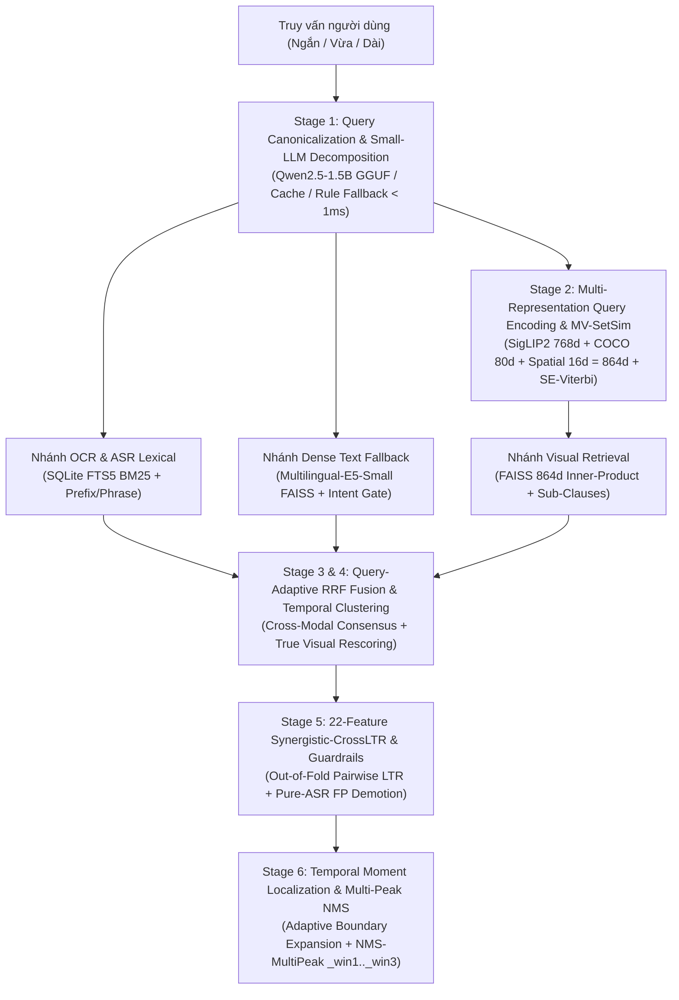

# VIDENTRA — Unified Multimodal Video Retrieval & Moment Localization Engine

[](https://www.python.org/)
[](#1-kiến-trúc-pipeline-6-tầng-phase-8)
[](#7-kiểm-thử--kết-quả-benchmark-thực-nghiệm)

**VIDENTRA** là hệ thống tìm kiếm video đa phương thức (**Multimodal Video Retrieval**) và định vị khoảnh khắc theo thời gian thực (**Temporal Moment Localization**) được thiết kế tối ưu cho phần cứng phổ thông (**RTX 3060 6GB VRAM / 32GB RAM** hoặc chạy suy luận trực tiếp trên **CPU** nhờ cơ chế Memory-Mapped Vector Store và GGUF Quantized Small-LLM).

Hệ thống kết hợp **6 luồng tín hiệu độc lập** trên một trục thời gian chuẩn hóa (`Presentation-Order Decoded Ledger`):
1. **Biểu diễn Thị giác – Không gian 864 chiều (`864d Augmented Subspace`)**: Ghép nối trực giao giữa `SigLIP2` (`768d` ngữ nghĩa toàn cục) + `YOLOv11n COCO` (`80d` IDF-weighted object counts) + `Spatial Grid 3×3` (`16d` bố cục không gian).
2. **Phân rã Truy vấn bằng Small-LLM (`SmallLLMQueryDecomposer`)**: Sử dụng mô hình nhẹ `Qwen2.5-1.5B-Instruct` (hỗ trợ cả `GGUF Q4_K_M` qua `llama-cpp-python` và `Transformers`) kèm bộ nhớ đệm `query_decomposition_cache.jsonl` và cơ chế fallback `< 1ms` sang `RuleBasedQueryParser`.
3. **Truy xuất Văn bản Đa tầng (`SQLite FTS5 BM25` + `Dense E5 Semantic Index` + `VLM Captions`)**: Tìm kiếm độc lập trên chữ trong khung hình (**OCR - PaddleOCR**), lời thoại (**ASR - Faster-Whisper**) và mô tả cảnh quay (**VLM Keyframe Captions - Florence-2**) thông qua kết hợp từ vựng chính xác (FTS5) và ngữ nghĩa dày đặc (`multilingual-e5-small`).
4. **Hợp nhất RRF Động & Xếp hạng Học máy 22 Chiều (`Synergistic-CrossLTR` 22d)**: Xếp hạng ứng viên bằng mô hình 5-Fold Out-of-Fold Pairwise Logistic LTR có ràng buộc dấu đơn điệu (`Monotonic Sign Constraints`), tích hợp 4 đặc trưng tương tác nhân tính chéo (`vis_lexical_synergy`, `unverified_lexical_hazard`, `subclause_weakest_link`, `window_energy_concentration`).
5. **Đối sánh Tập Mệnh đề (`MV-SetSim`), Khử Nhiễu Hubness (`QAC-CSLS`) & Định vị Đa Đỉnh (`NMS-MultiPeak` + `SE-Viterbi`)**: Mở rộng biên thích ứng (`Adaptive Boundary Contrast`), bắt dính điểm cắt cảnh (`Shot-Snapped Boundary`), trích xuất đa khoảnh khắc không chồng lấp (`_win1`, `_win2`, `_win3`) và căn chỉnh thứ tự sự kiện (`before` / `after` / `then`) bằng quy hoạch động Viterbi.

---

## Mục Lục
1. [Kiến Trúc Pipeline 6 Tầng (Phase 8)](#1-kiến-trúc-pipeline-6-tầng-phase-8)
2. [Yêu Cầu Hệ Thống & Cài Đặt Nhanh](#2-yêu-cầu-hệ-thống--cài-đặt-nhanh)
3. [Cấu Trúc Thư Mục Dự Án](#3-cấu-trúc-thư-mục-dự-án)
4. [Cấu Hình Biến Môi Trường (`.env`)](#4-cấu-hình-biến-môi-trường-env)
5. [Hướng Dẫn Sử Dụng Nhanh (CLI, Python SDK & Web UI)](#5-hướng-dẫn-sử-dụng-nhanh-cli-python-sdk--web-ui)
6. [Quản Lý Dữ Liệu, Chỉ Mục, Kaggle GPU Offload & Huấn Luyện LTR](#6-quản-lý-dữ-liệu-chỉ-mục-kaggle-gpu-offload--huấn-luyện-ltr)
7. [Kiểm Thử & Kết Quả Benchmark Thực Nghiệm](#7-kiểm-thử--kết-quả-benchmark-thực-nghiệm)

---

## 1. Kiến Trúc Pipeline 6 Tầng (Phase 8)



### Không Gian Vector 864 Chiều (`864d Augmented Subspace`)
Mỗi keyframe và mỗi câu truy vấn đều được ánh xạ vào không gian vector `864d` chuẩn hóa:

$$\mathbf{v}_{864} = \left[\, \alpha_{\text{vis}}\hat{\mathbf{v}}_{\text{SigLIP2}}^{(768)} \;\middle\|\; \alpha_{\text{obj}}\hat{\mathbf{v}}_{\text{COCO-IDF}}^{(80)} \;\middle\|\; \alpha_{\text{sp}}\hat{\mathbf{v}}_{\text{Spatial-3x3}}^{(16)} \,\right] \in \mathbb{R}^{864}$$

- **Chiều `0..767` (`768d`)**: Vector ngữ nghĩa thị giác từ `google/siglip2-base-patch16-224` (kèm nhánh `temporal_context_768` trượt dọc theo cửa sổ thời gian).
- **Chiều `768..847` (`80d`)**: Histogram 80 lớp đối tượng COCO từ `YOLOv11n` có trọng số nghịch đảo tần suất (`IDF-weighted`), giúp phân biệt chính xác số lượng và loại thực thể.
- **Chiều `848..863` (`16d`)**: Bố cục lưới không gian $3\times 3$ (`top-left`, `center`, `bottom-right`, diện tích, mật độ, độ phân tán), giúp bắt trúng vị trí đối tượng trong khung hình.

---

## 2. Yêu Cầu Hệ Thống & Cài Đặt Nhanh

### Yêu cầu phần cứng & phần mềm
- **Hệ điều hành**: Windows 10/11 (PowerShell) hoặc Linux / macOS.
- **Python**: `3.12+` (khuyến nghị dùng môi trường ảo `.venv`).
- **FFmpeg / PyAV**: Để giải mã video chính xác theo `PTS/time_base` (hỗ trợ cả video CFR và VFR).
- **Phần cứng mục tiêu**:
  - **Chế độ GPU**: NVIDIA GPU $\ge 6\text{GB}$ VRAM (ví dụ RTX 3060) + RAM $\ge 16\text{GB}$.
  - **Chế độ CPU**: Chạy hoàn toàn trên CPU nhờ cơ chế đọc đĩa `mmap_mode='r'`, bộ đệm `SQLite` và mô hình `GGUF Q4_K_M`.

### Các bước cài đặt từ đầu

**Bước 1: Clone kho mã nguồn và tạo môi trường ảo**
```powershell
git clone <repository-url> VIDENTRA
cd VIDENTRA

# Tạo môi trường ảo Python
python -m venv .venv

# Kích hoạt môi trường ảo (Windows PowerShell)
.\.venv\Scripts\Activate.ps1
```

**Bước 2: Cài đặt các gói thư viện phụ thuộc**
```powershell
python -m pip install --upgrade pip
pip install -r requirements.txt
pip install -e .
```

**Bước 3: Kiểm tra cài đặt và chạy bộ kiểm thử tự động**
```powershell
# Kiểm tra toàn bộ đường dẫn tài nguyên và chỉ mục
.\.venv\Scripts\python.exe -m videntra check-paths

# Chạy 470 bài kiểm thử đơn vị và tích hợp
.\.venv\Scripts\python.exe -B -m pytest -q -p no:cacheprovider
```

---

## 3. Cấu Trúc Thư Mục Dự Án

```text
VIDENTRA/
├── benchmark/                  # Báo cáo kết quả đánh giá (benchmark_report.md, benchmark_summary.json)
├── configs/                    # Cấu hình đường dẫn cục bộ (asset_roots.example.json)
├── data/
│   ├── raw/                    # Video gốc theo bộ dữ liệu (qvhighlights, msrvtt, textvr, tvr, avc) & keyframes
│   ├── processed/              # Chỉ mục đã trích xuất:
│   │   ├── siglip2/            # Keyframe vectors (864d, 768d, temporal_context_768, spatial_patches_fp16)
│   │   ├── text_e5/            # Chỉ mục ngữ nghĩa dày đặc (Multilingual-E5-Small FAISS + metadata)
│   │   └── metadata.db         # Cơ sở dữ liệu SQLite FTS5 (BM25) cho OCR, ASR, KeyframeCaptions & YOLO tags
│   └── cache/                  # Bộ đệm embedding truy vấn, keyframe_hubness_radii.npy & query_decomposition_cache.jsonl
├── docs/                       # Tài liệu kiến trúc (docs/blueprint/) và nhật ký tiến độ (docs/PROGRESS.md)
├── manifests/                  # Manifest khóa SHA-256 cho splits và lịch sử thực nghiệm
├── models/                     # Trọng số mô hình cục bộ:
│   ├── siglip2/                # google/siglip2-base-patch16-224
│   ├── llm/                    # Qwen2.5-1.5B-Instruct (GGUF Q4_K_M & HF weights)
│   ├── ranking/                # Trọng số bộ xếp hạng học máy 22d (videntra_ltr_v1.json)
│   ├── ocr/ & asr/             # PaddleOCR & Faster-Whisper weights
│   └── detection/              # YOLOv11n weights
├── scripts/                    # Các kịch bản huấn luyện LTR, xây dựng chỉ mục, đánh giá benchmark & Kaggle worker
├── src/videntra/               # Mã nguồn chính của gói thư viện VIDENTRA
│   ├── api/                    # FastAPI Server & giao diện Web UI Inspector
│   ├── config/                 # Quản lý cấu hình và biến môi trường VIDENTRA_*
│   ├── contracts/              # Hợp đồng dữ liệu và kiểm định mốc thời gian (PTS/time_base)
│   ├── encoders/               # Bộ mã hóa văn bản/hình ảnh SigLIP2
│   ├── evaluation/             # Bộ tính toán chỉ số (Hit@K, MRR, nDCG@K, Moment IoU) & Provenance Gate
│   ├── evidence/               # Chuẩn hóa và lưu trữ bằng chứng OCR / ASR / Visual
│   ├── indexing/               # Xây dựng vector 864d, FAISS store, SQLite FTS5 & Structured Event Synopsis
│   ├── ingestion/              # Giải mã video (PyAV), lấy mẫu khung hình và trích xuất đặc trưng
│   ├── localization/           # Tạo đề xuất đoạn (Proposals), Adaptive Boundary, Shot-Snapped & SE-Viterbi
│   ├── query/                  # Canonicalization, RuleBasedQueryParser, SmallLLMQueryDecomposer & JSONL Cache
│   ├── ranking/                # Trích xuất 22 đặc trưng Synergistic-CrossLTR, LearnedRankerLTR & Calibration
│   ├── registry/               # Quản lý định danh video (media_id SHA-256)
│   ├── relations/              # Phân tích thực thể, vị ngữ không gian và quan hệ thời gian (before/after)
│   ├── retrieval/              # Pipeline truy xuất hợp nhất 6 tầng (unified_pipeline.py), RRF Fusion & QAC-CSLS
│   └── timeline/               # Sổ cái thời gian (Presentation-Order Frame Ledger)
├── tests/                      # 470 bài kiểm thử đơn vị (Unit) và tích hợp (Integration)
├── validation/                 # Tập truy vấn phát triển (80% - dev_150 & dev_full_859)
├── test_queries/               # Tập truy vấn kiểm thử độc lập (20% - heldout_test_201)
├── PROJECT.md                  # Tài liệu chi tiết cấu trúc các module trong chương trình
├── VIDENTRA_HYDROGEN_AUDIT_AND_RESEARCH_ROADMAP.md # Báo cáo kiểm định kỹ thuật & lộ trình nghiên cứu
└── README.md                   # Tài liệu hướng dẫn cài đặt và sử dụng
```

---

## 4. Cấu Hình Biến Môi Trường (`.env`)

Hệ thống tự động nhận diện cấu trúc thư mục mặc định tại gốc dự án. Bạn có thể tùy chỉnh linh hoạt thông qua các biến môi trường sau (hoặc tạo file `.env` ở thư mục gốc):

| Biến môi trường | Mặc định | Mô tả chi tiết |
| :--- | :--- | :--- |
| `VIDENTRA_DB_PATH` | `data/processed/metadata.db` | Đường dẫn tới cơ sở dữ liệu SQLite FTS5 (`OCR`, `ASR`, `KeyframeCaptions`, `YOLO`) |
| `VIDENTRA_FAISS_PATH` | `data/processed/faiss_index.bin` | Đường dẫn tới chỉ mục FAISS `864d` |
| `VIDENTRA_MODEL_DIR` | `models/siglip2` | Thư mục chứa trọng số mô hình `SigLIP2` |
| `VIDENTRA_DEVICE` | `cpu` | Thiết bị suy luận (`cpu` hoặc `cuda`) |
| `VIDENTRA_LLM_ENABLED` | Tự động bật khi có CUDA | Đặt `1` để bật suy luận trực tiếp `Qwen2.5-1.5B-Instruct` (GGUF/HF); đặt `0` để chỉ dùng Cache + Rule Parser (`< 1ms`) |
| `VIDENTRA_LLM_MODEL_PATH` | `models/llm/qwen2.5-1.5b-instruct-q4_k_m.gguf` | Đường dẫn tới file `.gguf` hoặc thư mục HuggingFace của Small-LLM |
| `VIDENTRA_LLM_DEADLINE_MS` | `5000.0` (ms) | Ngưỡng thời gian tối đa cho phép Small-LLM suy luận trước khi tự động chuyển về `RuleBasedQueryParser` |

---

## 5. Hướng Dẫn Sử Dụng Nhanh (CLI, Python SDK & Web UI)

### 5.1. Tìm kiếm video trực tiếp từ dòng lệnh (CLI)

Sử dụng lệnh `videntra search` để tìm kiếm video và định vị khoảnh khắc `(start_sec, end_sec)` cho bất kỳ câu truy vấn nào:

```powershell
.\.venv\Scripts\python.exe -m videntra search `
  --query "A woman in a white blouse speaks to the camera while a news banner appears at the bottom" `
  --top-k 5
```

**Bật trực tiếp Small-LLM (`Qwen2.5-1.5B-Instruct` GGUF) khi tìm kiếm câu truy vấn mới:**
```powershell
$env:VIDENTRA_LLM_ENABLED="1"
$env:VIDENTRA_LLM_DEADLINE_MS="15000"
.\.venv\Scripts\python.exe -m videntra search `
  --query "First a chef chops vegetables on a wooden board, then he pours them into a boiling pot" `
  --top-k 5
```

### 5.2. Khởi chạy Giao diện Web UI Inspector & FastAPI Server

VIDENTRA cung cấp sẵn máy chủ API cùng giao diện **Web UI Inspector** trực quan để tra cứu video, xem điểm thành phần của từng nhánh (`Visual`, `OCR`, `ASR`, `Spatial`), xem kết quả phân rã truy vấn và phát trực tiếp đúng khoảnh khắc video tìm được:

```powershell
.\.venv\Scripts\uvicorn.exe videntra.api.app:app --host 127.0.0.1 --port 8000
```
- Mở trình duyệt tại: **`http://127.0.0.1:8000/`** để sử dụng giao diện tìm kiếm trực quan.
- Tài liệu OpenAPI (Swagger UI): **`http://127.0.0.1:8000/docs`**.

**Ví dụ gọi REST API (`POST /api/search`):**
```powershell
Invoke-RestMethod -Uri "http://127.0.0.1:8000/api/search" `
  -Method Post `
  -ContentType "application/json" `
  -Body '{"query": "a man playing guitar on stage", "top_k": 5}'
```

### 5.3. Sử dụng trực tiếp trong Python SDK (`UnifiedMultimodalSearchPipeline`)

```python
from videntra.retrieval.unified_pipeline import UnifiedMultimodalSearchPipeline

# Khởi tạo pipeline (tự động nạp chỉ mục 864d, SQLite FTS5, Dense E5 và 22d LearnedRankerLTR)
pipeline = UnifiedMultimodalSearchPipeline()

query = 'A man in a dark suit talks in an interview after a title card reading "BREAKING NEWS"'

# Thực hiện truy xuất video và định vị khoảnh khắc kèm metadata chẩn đoán
response = pipeline.search_with_metadata(query=query, top_k=5)
for rank, moment in enumerate(response.moments, start=1):
    print(
        f"#{rank} | Video: {moment.video_id} "
        f"| Moment: [{moment.moment_start_seconds:.1f}s - {moment.moment_end_seconds:.1f}s] "
        f"| Score: {moment.ranking_score:.4f} | Branch: {moment.match_status}"
    )
```

---

## 6. Quản Lý Dữ Liệu, Chỉ Mục, Kaggle GPU Offload & Huấn Luyện LTR

### 6.1. Xây dựng chỉ mục ngữ nghĩa dày đặc `Dense E5` cho OCR & ASR
```powershell
.\.venv\Scripts\python.exe scripts/build_e5_text_index.py
```

### 6.2. Pre-warm bộ nhớ đệm phân rã truy vấn (`query_decomposition_cache.jsonl`)
```powershell
# Chế độ nhanh trên CPU (Rule-based < 1 giây cho toàn bộ 1,060 câu truy vấn)
.\.venv\Scripts\python.exe scripts/prewarm_llm_query_cache.py --split all_1060 --rule-only

# Xuất 1,060 câu truy vấn sạch (không chứa nhãn Ground Truth) để mang lên Kaggle GPU
.\.venv\Scripts\python.exe scripts/prewarm_llm_query_cache.py `
  --split all_1060 `
  --export-queries-only work/kaggle/queries_all_1060.jsonl

# Hợp nhất file cache đã sinh từ Kaggle GPU vào data/cache/query_decomposition_cache.jsonl
.\.venv\Scripts\python.exe scripts/prewarm_llm_query_cache.py `
  --merge-only `
  --merge-from work/kaggle/query_decomposition_cache_llm.jsonl
```

### 6.3. Đóng gói & Trích xuất đặc trưng nặng trên Kaggle Dual-T4 GPU (`P8-5`)
```powershell
# 1. Đóng gói 11,581 keyframes từ metadata.db để tải lên Kaggle
.\.venv\Scripts\python.exe scripts/package_kaggle_inputs.py `
  --mode db `
  --output-dir work/kaggle/p85_inputs

# 2. (Chạy trên Kaggle GPU) Trích xuất Spatial Patches 3x3 (SigLIP2) + Florence-2 Captions + E5 Index
# python scripts/kaggle_multimodal_offline_worker.py --mode p85 --input-dir /kaggle/input/videntra-p85-inputs --output-dir /kaggle/working/p85_outputs --device cuda

# 3. Nạp kết quả từ Kaggle về máy Local (tạo bảng KeyframeCaptions + fts_vlm_caption FTS5 an toàn)
.\.venv\Scripts\python.exe scripts/ingest_kaggle_offline_results.py `
  --mode p85 `
  --kaggle-output-dir work/kaggle/p85_outputs
```

### 6.4. Huấn luyện lại bộ xếp hạng học máy 22 Chiều `Synergistic-CrossLTR` (5-Fold GroupKFold CV)
```powershell
.\.venv\Scripts\python.exe scripts/train_ltr_ranker_cv.py
```
Kịch bản sẽ trích xuất 22 đặc trưng đa phương thức trên tập `dev_full_859` (bảo đảm tách biệt 100% theo `source_video_id` và không đụng tới `heldout_test_201`), tối ưu hóa hàm mất mát Pairwise Logistic Loss với ràng buộc dấu vật lý (`MONOTONIC_DIRECTIONS`) và xuất trọng số ra `models/ranking/videntra_ltr_v1.json`.

---

## 7. Kiểm Thử & Kết Quả Benchmark Thực Nghiệm

### 7.1. Chạy bộ kiểm thử tự động (`pytest`)
```powershell
.\.venv\Scripts\python.exe -B -m pytest -q -p no:cacheprovider
```
- **Trạng thái hiện tại**: **`470 passed`** (bao gồm kiểm thử đơn vị và tích hợp cho toàn bộ các module: `timeline`, `indexing`, `query/llm`, `ranking/learned_ranker`, `localization/refine`, `retrieval/unified_pipeline`, `evaluation/provenance`, `test_kaggle_offline_pipeline`).

### 7.2. Chạy đánh giá Benchmark chính thức (Có cổng kiểm định chống rò rỉ dữ liệu)
```powershell
# Đánh giá nhanh trên tập dev_150
.\.venv\Scripts\python.exe scripts/run_validation_benchmark.py --single-split-only --max-msrvtt 100

# Đánh giá toàn diện trên cả 3 tập (dev_150, dev_full_859, heldout_test_201)
.\.venv\Scripts\python.exe scripts/run_validation_benchmark.py
```
Kịch bản đánh giá tự động kiểm tra chữ ký SHA-256 của toàn bộ tệp Ground Truth trước và sau khi chạy (`inputs_unchanged=True`, `outputs_verified=True`), tuyệt đối không cho phép pipeline đọc nhãn Ground Truth trong quá trình tìm kiếm.

### 7.3. Bảng kết quả thực nghiệm hiện tại (Phase 8)

| Tập Đánh Giá | Số Truy Vấn | Video Hit@1 | Video Hit@5 | Video Hit@10 | Video MRR | Video nDCG@10 | Moment Hit@1 (IoU $\ge 0.5$) | Moment nDCG@5 | Non-Neural p50 / p95 | Pure-ASR FP Top-1 |
| :--- | :---: | :---: | :---: | :---: | :---: | :---: | :---: | :---: | :---: | :---: |
| **`dev_150` (`8210881` - `l2_reg=1.5M`)** | 150 | **`61.33%`** | **`74.67%`** | **`76.67%`** | **`0.6517`** | **`0.6729`** | **`72.73%`** | **`0.5121`** | **`36.10 / 81.42 ms`** | **`0`** |
| **`dev_150` (`f80740b` - `l2_reg=3000`)** | 150 | `60.00%` | `70.67%` | `74.00%` | `0.6457` | `0.6686` | `68.18%` | `0.5077` | `43.27 / 72.05 ms` | **`0`** |
| **`dev_full_859` (Full Dev 80%)** | 859 | **`41.33%`** | **`62.63%`** | **`69.03%`** | **`0.5014`** | **`0.5468`** | — | — | `44.55 / 108.48 ms` | **`0`** |
| **`heldout_test_201` (Blind Test 20%)** | 201 | **`38.81%–41.79%`** | **`60.20%`** | **`67.66%`** | **`0.4744–0.4910`** | **`0.5225–0.5327`** | **`44.74%`** | **`0.3696`** | `44.15 / 82.72 ms` | **`0`** |

> Xem phân tích kiểm định chi tiết sau bản nâng cấp Phase 8 của Hydrogen và hướng dẫn tinh chỉnh cuối tại: [VIDENTRA_HYDROGEN_AUDIT_AND_RESEARCH_ROADMAP.md](file:///C:/Users/DELL/Desktop/VIDENTRA/VIDENTRA_HYDROGEN_AUDIT_AND_RESEARCH_ROADMAP.md).
