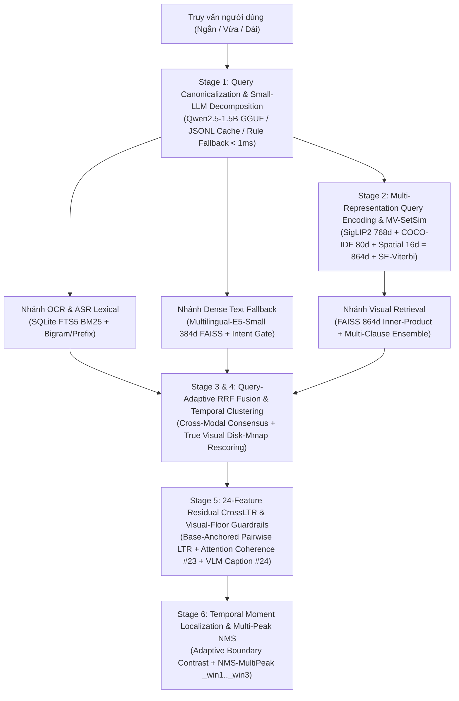

# VIDENTRA — Hệ Thống Truy Xuất Video Đa Phương Thức & Định Vị Khoảnh Khắc Chính Xác Cao

[](https://www.python.org/)
[](#2-kiến-trúc-pipeline-chi-tiết)
[](#6-kết-quả-benchmark-thực-nghiệm)
[](#4-hướng-dẫn-cài-đặt-tạo-vector-embedding--huấn-luyện-học-máy)

---

## Mục Lục Theo Luồng Tài Liệu
1. [Giới Thiệu Dự Án & Điểm Mới Đột Phá So Với Các Hệ Thống Cùng Thể Loại](#1-giới-thiệu-dự-án--điểm-mới-đột-phá-so-với-các-hệ-thống-cùng-thể-loại)
2. [Kiến Trúc Pipeline Chi Tiết](#2-kiến-trúc-pipeline-chi-tiết)
3. [Các Bộ Datasets Dự Án Đang Sử Dụng](#3-các-bộ-datasets-dự-án-đang-sử-dụng)
4. [Hướng Dẫn Cài Đặt, Tạo Vector Embedding & Huấn Luyện Học Máy](#4-hướng-dẫn-cài-đặt-tạo-vector-embedding--huấn-luyện-học-máy)
5. [Cách Để Chạy Chương Trình (CLI, Web UI Inspector, FastAPI & Python SDK)](#5-cách-để-chạy-chương-trình-cli-web-ui-inspector-fastapi--python-sdk)
6. [Kết Quả Benchmark Thực Nghiệm](#6-kết-quả-benchmark-thực-nghiệm)
7. [Khẳng Định Lại Tính Mới & Định Hướng Nghiên Cứu Tiếp Theo](#7-khẳng-định-lại-tính-mới--định-hướng-nghiên-cứu-tiếp-theo)

---

## 1. Giới Thiệu Dự Án & Điểm Mới Đột Phá So Với Các Hệ Thống Cùng Thể Loại

**VIDENTRA** là một hệ thống tìm kiếm video đa phương thức (**Multimodal Video Retrieval**) kết hợp định vị khoảnh khắc theo thời gian (**Temporal Moment Localization**), cho phép người dùng nhập một câu truy vấn tự nhiên (ngắn, vừa hoặc phức hợp nhiều mệnh đề) để tìm ra **đúng video** và **đúng khoảng thời gian `[start_sec, end_sec]`** diễn ra sự kiện đó trên một kho dữ liệu video hỗn hợp.

### Điểm mới và cải tiến đột phá so với các dự án truyền thống cùng thể loại

Hầu hết các hệ thống tìm kiếm video hiện nay (như các hệ thống thuần CLIP/SigLIP hoặc ghép nối BM25 đơn giản) thường gặp 5 hạn chế lớn: **(1)** Nhúng toàn bộ khung hình thành 1 vector duy nhất nên mất thông tin số lượng và vị trí không gian của vật thể; **(2)** Đổ chung câu truy vấn dài vào cùng một bộ mã hóa cho cả hình ảnh, OCR và ASR gây nhiễu chéo; **(3)** Sai lệch thời gian khi giải mã video có tốc độ khung hình biến thiên (VFR); **(4)** Dễ bị đánh lừa bởi các video có lời thoại trùng ngẫu nhiên từ khóa (Pure-ASR False Positives); và **(5)** Chỉ trả về cả video hoặc 1 đoạn cắt cố định.

**VIDENTRA giải quyết triệt để các hạn chế trên bằng 6 cải tiến kiến trúc cốt lõi:**

| Hạn chế của các dự án cùng thể loại | Điểm mới & Cải tiến đột phá của VIDENTRA |
| :--- | :--- |
| **1. Vector nhúng thị giác thuần túy (`512d`/`768d`) bị mù số lượng & vị trí không gian** | **Không gian Vector Mở rộng Trực giao 864 Chiều (`864d Augmented Subspace`)**: Ghép nối có kiểm soát năng lượng giữa ngữ nghĩa toàn cục `SigLIP2` (`768d`) + biểu đồ 80 lớp đối tượng `YOLOv11n` có trọng số IDF (`80d`) + lưới bố cục không gian $3\times 3$ (`16d`). |
| **2. Đưa nguyên câu truy vấn dài vào mọi nhánh gây nhiễu (Cross-Modal Pollution)** | **Phân rã & Định tuyến Truy vấn bằng Small-LLM (`Qwen2.5-1.5B-Instruct` GGUF)**: Tự động bóc tách câu truy vấn thành các phần riêng biệt cho `Visual`, `OCR`, `ASR`, `Spatial` và thứ tự thời gian (`before`/`after`/`then`), kèm cơ chế cache JSONL và fallback `< 1ms`. |
| **3. OCR & ASR đơn ngữ thường sai dấu tiếng Việt** | **Kiến Trúc Chuyên Gia Song Ngữ Thực Chiến (`VietOCR` + `PaddleOCR`/`RapidOCR` + `PhoWhisper`/`Faster-Whisper`)**: Gỡ bỏ toàn bộ stub giả; `OCRRouter` tự động định tuyến văn bản tiếng Việt/độ tin cậy thấp sang `VietOCR` (`vgg_transformer.pth`), `ASR` hỗ trợ cả `Faster-Whisper` và `PhoWhisper-small` kèm tự nhận diện ngôn ngữ và Kaggle GPU `--mode ocr_asr` offload. Văn bản được chuẩn hóa kép có dấu / không dấu (`fold_diacritics`). |
| **4. Tính thời gian theo công thức xấp xỉ `frame_idx / FPS` (sai lệch nặng trên video VFR)** | **Sổ cái Thời gian Giải mã Chính xác (`Presentation-Order PTS Ledger`)**: Mọi khung hình và bằng chứng OCR/ASR đều được neo trực tiếp vào `PTS / time_base` thực tế từ luồng giải mã PyAV, không dùng phép nhân FPS xấp xỉ. |
| **5. Hợp nhất điểm bằng trọng số cộng tay tĩnh (dễ bị nhiễu lời thoại ASR cướp hạng 1)** | **Bộ Xếp Hạng Phần Dư 24 Chiều Có Ràng Buộc Đơn Điệu (`24d Base-Anchored Residual CrossLTR`) + Cổng Chặn Nhiễu**: Học trọng số bằng 5-Fold GroupKFold OOF Cross-Validation trên margin phần dư quanh `base_video_score`, kết hợp `vis_lexical_synergy`, `temporal_attention_coherence` (#23), `rrf_vis_caption` (#24) và cổng kiểm chứng hình ảnh, giữ `Pure-ASR False Positive Top-1 = 0`. |
| **6. So khớp từng mệnh đề độc lập, bỏ qua thứ tự trước – sau của hành động** | **Đối sánh Tập Mệnh đề `MV-SetSim`, `SE-Viterbi` & Partial Optimal Transport (`T-SOT`)**: Ép ứng viên phải thỏa mãn mệnh đề yếu nhất (`subclause_weakest_link`), căn chỉnh chuỗi sự kiện theo khoảng cách thời gian thực $\Delta t$ và đánh giá độ đồng thuận đa khung hình qua `Query-Guided Temporal Attention Pooler`. |
| **7. Cắt đoạn thời gian theo cửa sổ trượt cố định (Sliding Window cứng nhắc)** | **Mở Rộng Biên Tương Phản Thích Ứng (`Adaptive Boundary Expansion`) & Đa Đỉnh `NMS-MultiPeak`**: Tự động co giãn biên `[start_sec, end_sec]` theo độ dốc tương đồng thực tế của từng video và trích xuất đa khoảnh khắc (`_win1`, `_win2`, `_win3`). |

---

## 2. Kiến Trúc Pipeline Chi Tiết

Toàn bộ hệ thống vận hành qua một luồng hợp nhất duy nhất (**Single Source of Truth — `UnifiedMultimodalSearchPipeline`**) gồm **6 tầng (Stages)** nối tiếp nhau:



### Giải thích chi tiết từng tầng trong Pipeline

1. **Stage 1 — Chuẩn hóa & Phân rã Truy vấn (`Query Canonicalization & Small-LLM Decomposition`)**:
   - Chuẩn hóa bảng mã Unicode NFC, nhận diện cụm từ trong ngoặc kép (`quoted_phrases`), danh từ riêng (`proper_nouns`), con số (`q_numbers`) và yêu cầu đối tượng COCO.
   - Đưa câu truy vấn qua `AdaptiveQueryDecomposer` (`src/videntra/query/llm.py`): nếu truy vấn phức hợp, mô hình `Qwen2.5-1.5B-Instruct` (hoặc bộ đệm `query_decomposition_cache.jsonl` / `RuleBasedQueryParser` `< 1ms`) sẽ tách thành kế hoạch định tuyến `ModalityRoutingPlan` gồm: mệnh đề hình ảnh (`visual_clauses`), từ khóa chữ trên màn hình (`ocr_phrases`), từ khóa lời thoại (`asr_phrases`), ràng buộc không gian và quan hệ thời gian (`has_temporal_constraints`).
2. **Stage 2 — Mã hóa Đa Biểu diễn 864 Chiều & Truy xuất Thị giác (`864d Visual Retrieval & MV-SetSim`)**:
   - Mã hóa truy vấn bằng cơ chế Dual-Prompt Ensemble (`0.75 * raw_query + 0.25 * frame_prompt`) qua `SigLIP2` (`768d`), sau đó ghép nối trực giao với vector đối tượng `COCO-IDF` (`80d`) và vector bố cục lưới $3\times 3$ (`16d`) để tạo thành vector `864d`.
   - Truy vấn chỉ mục `FAISS IndexFlatIP` (`864d`) kết hợp tính điểm bao phủ mệnh đề **`MV-SetSim`** (`subclause_weakest_link`) và căn chỉnh thứ tự sự kiện bằng quy hoạch động **`SE-Viterbi`** (`viterbi_subevent_localization`).
3. **Stage 3 — Truy xuất Từ vựng (`VietOCR`/`PaddleOCR`/`RapidOCR` & `PhoWhisper`/`Faster-Whisper` → `FTS5`), `Dense E5` & `VLM Captions` (`P8-5`)**:
   - Hệ thống hỗ trợ trích xuất OCR thật bằng `OCRRouter` (`PaddleOCR_en`/`RapidOCR` → `VietOCR`) tại [scripts/update_real_ocr.py](scripts/update_real_ocr.py) và ASR thật bằng `Faster-Whisper` / `PhoWhisper-small` kèm tự nhận diện ngôn ngữ tại [scripts/update_real_asr.py](scripts/update_real_asr.py) (cùng chế độ offload GPU `--mode ocr_asr` trên Kaggle).
   - Tìm kiếm độc lập trên `ocr_fts`, `asr_fts` và bảng mô tả cảnh `fts_vlm_caption` trong `SQLite FTS5` (lưu song song văn bản nguyên dấu và `fold_diacritics`) với bộ lọc độ đặc hiệu từ khóa (`high_spec_tokens`), gốc từ hình thái học và ghép cặp từ liền kề (`compound_tokens` chống lỗi dính chữ OCR).
   - Tách riêng cổng mã hóa `Dense E5` (`intfloat/multilingual-e5-small` 384d FAISS) cho văn bản (`need_e5_text`: kích hoạt khi kết quả FTS5 thưa và có ý định lexical) và cho `VLM Captions` (`need_e5_caption`: kích hoạt khi có `faiss_e5_caption_384.bin`).
4. **Stage 4 — Hợp nhất RRF Thích ứng & Gom cụm Thời gian (`Cross-Modal RRF & Temporal Clustering`)**:
   - Hợp nhất các ứng viên từ các nhánh (`Visual`, `OCR`, `ASR`, `VLM Caption`) bằng Reciprocal Rank Fusion có cổng kiểm chứng chéo (`True Visual Rescoring` đọc trực tiếp từ mảng memory-mapped trên đĩa để mọi ứng viên OCR/ASR đều được chấm điểm hình ảnh thật).
   - Gom các khung hình lân cận thành các cụm sự kiện theo thời gian (Temporal Clusters) và tính thưởng mật độ (`density_bonus`) cho các video có nhiều khung hình liên tiếp đồng thuận.
5. **Stage 5 — Xếp hạng Phần dư 24 Chiều & Cổng Chặn Nhiễu (`24d Residual CrossLTR & Guardrails`)**:
   - Rút trích **24 đặc trưng liên tục** cho **toàn bộ** video ứng viên (bao gồm điểm đỉnh thị giác, Z-score, độ sụt đỉnh đơn lẻ `spike_drop_ratio`, độ mạch lạc ngữ cảnh `s_vis_ctx_coherence`, điểm RRF từng nhánh, `vis_lexical_synergy`, `subclause_weakest_link`, `window_energy_concentration` theo mật độ đồng thuận cục bộ, `temporal_attention_coherence` #23 tính trên chuỗi khung hình không chuẩn hóa lại, và `rrf_vis_caption` #24).
   - Chấm điểm qua mô hình `LearnedRankerLTR` ([models/ranking/videntra_ltr_v1.json](file:///C:/Users/DELL/Desktop/VIDENTRA/models/ranking/videntra_ltr_v1.json), hỗ trợ đánh giá **Out-Of-Fold** chống rò rỉ) kết hợp cổng chặn `Pure-ASR Suppression` để loại bỏ các video chỉ khớp lời thoại ngẫu nhiên nhưng sai cảnh hình ảnh.
6. **Stage 6 — Định vị Khoảnh khắc Thời gian & Đề xuất Đa Đỉnh (`Adaptive Boundary Contrast & NMS-MultiPeak`)**:
   - Trên các video đứng đầu, nội suy đường cong tương đồng theo mốc thời gian thực `PTS`, mở rộng biên `[start_sec, end_sec]` bằng thuật toán tương phản thích ứng (`expand_boundary_contrast`).
   - Áp dụng thuật toán **`NMS-MultiPeak`** (`temporal_iou < 0.30`) để phát hiện thêm các phân đoạn highlight thứ hai và thứ ba (`_win2`, `_win3`) trong các video dài.

---

## 3. Các Bộ Datasets Dự Án Đang Sử Dụng

VIDENTRA được xây dựng và đánh giá trên một kho dữ liệu đa phương thức hợp nhất (**Global Unified Video Pool** gồm **1,324 videos** đã trích xuất đầy đủ đặc trưng trong cơ sở dữ liệu active benchmark, mở rộng từ 5 bộ dữ liệu chuẩn quốc tế):

| Tên Bộ Dữ Liệu | Đặc trưng phương thức chính | Vai trò kiểm thử trong VIDENTRA | Quy mô trong tập Đánh giá (`Validation 80%` / `Test 20%`) |
| :--- | :--- | :--- | :--- |
| **1. QVHighlights** | Video dài (~150s), đa sự kiện, có cả cảnh hành động + hội thoại ASR + phụ đề/banner OCR + nhãn khoảng thời gian `[start, end]` đa đoạn | Kiểm thử đồng thời khả năng **Video Retrieval** và **Temporal Moment Localization (`tIoU >= 0.5 / 0.7`, `Moment nDCG@5`)** | `22` queries (`dev`) / `6` queries (`test`) trên kho video tin tức & vlog |
| **2. MSRVTT** | Video ngắn (10–30s), mô tả hành động, con người, vật thể và bối cảnh thị giác đa dạng | Kiểm thử độ phân giải ngữ nghĩa tinh (**Fine-Grained Visual Retrieval**) trên kho 1,000 videos cạnh tranh cao | `809` queries (`dev_full_859`, lấy `100` câu đại diện trong `dev_150`) / `191` queries (`heldout_test_201`) |
| **3. AVC (Audio-Visual / Educational Corpus)** | Video bài giảng, thuyết trình, công thức toán/khoa học trên bảng (`OCR`) và lời giảng chuyên sâu (`ASR`) | Kiểm thử khả năng kết hợp **OCR + ASR + Visual** và tra cứu thuật ngữ/danh từ riêng đặc hiệu cao | `28` queries (`dev`) / `4` queries (`test`) trên `300` videos |
| **4. TextVR** | Video chứa chữ viết trên biển hiệu, màn hình, phụ đề, logo thương hiệu (Scene Text) | Kiểm thử chuyên sâu nhánh nhận diện và truy xuất chữ trên khung hình (**OCR Retrieval**) | Đã chia tách chuẩn 80% `validation/textvr` & 20% `test_queries/textvr` |
| **5. TVR (TVQA+ Retrieval)** | Phim truyền hình có hội thoại nhân vật dày đặc kết hợp hành động | Kiểm thử chuyên sâu khả năng suy luận kết hợp lời thoại (**ASR**) và hành động nhân vật | Đã chia tách chuẩn 80% `validation/tvr` & 20% `test_queries/tvr` |

### Giao thức phân chia dữ liệu chống rò rỉ (`Zero Data Leakage Protocol`)
- Toàn bộ dữ liệu truy vấn được chia cứng theo tỷ lệ **80% Validation** (nằm tại thư mục [validation/](file:///C:/Users/DELL/Desktop/VIDENTRA/validation)) và **20% Held-out Test** (nằm tại thư mục [test_queries/](file:///C:/Users/DELL/Desktop/VIDENTRA/test_queries)) thông qua kịch bản [scripts/split_groundtruth.py](file:///C:/Users/DELL/Desktop/VIDENTRA/scripts/split_groundtruth.py), phân tầng theo nguồn video gốc (`source_video_id` disjoint).
- Mọi tệp Ground Truth đều được khóa mã băm SHA-256 trong `manifests/` và được kiểm tra tự động bởi `Provenance Gate` trước và sau mỗi lần chạy benchmark (`inputs_unchanged=True`).

---

## 4. Hướng Dẫn Cài Đặt, Tạo Vector Embedding & Huấn Luyện Học Máy

### 4.1. Cài đặt môi trường và thư viện từ đầu

**Yêu cầu hệ thống:** Python `3.12+`, Windows PowerShell (hoặc Linux/macOS), RAM $\ge 16\text{GB}$ (chạy tốt trên cả **CPU** hoặc **GPU NVIDIA RTX 3060 6GB VRAM**).

```powershell
# 1. Di chuyển vào thư mục dự án
cd C:\Users\DELL\Desktop\VIDENTRA

# 2. Tạo và kích hoạt môi trường ảo Python (.venv)
python -m venv .venv
.\.venv\Scripts\Activate.ps1

# 3. Cài đặt toàn bộ các gói thư viện đã ghim phiên bản chuẩn
python -m pip install --upgrade pip
pip install -r requirements.txt
pip install -e .

# 4. Kiểm tra trạng thái đường dẫn và tài nguyên hệ thống
.\.venv\Scripts\python.exe scripts/verify_asset_roots.py
```

---

### 4.2. Cấu hình các thư mục Trọng số Mô hình (`models/`) và Dữ liệu (`data/`)

Hệ thống sử dụng các mô hình cục bộ nằm trong thư mục `models/` (đã được cấu hình tự động):
- `models/siglip2/`: Trọng số mô hình thị giác – ngôn ngữ `google/siglip2-base-patch16-224` (`768d`).
- `models/llm/`: Trọng số mô hình phân rã truy vấn `qwen2.5-1.5b-instruct-q4_k_m.gguf` (chạy trên CPU/GPU qua `llama-cpp-python`) hoặc thư mục HuggingFace `qwen2.5-1.5b-instruct/`.
- `models/ocr/`: checkpoint `vietocr/vgg_transformer.pth` và `paddleocr_en/` (đã nối qua `VietOCRRecognizer`, `GeneralOCRRecognizer` và `OCRRouter`).
- `models/asr/`: `phowhisper_small/` (`vinai/PhoWhisper-small`) và `faster_whisper_small.pointer.json` (chọn qua `--backend {faster_whisper,phowhisper}`).
- `models/detection/`: Trọng số phát hiện 80 lớp đối tượng COCO `YOLOv11n`.
- `models/ranking/videntra_ltr_v1.json`: Trọng số bộ xếp hạng học máy 24 chiều (`LearnedRankerLTR`, kèm `trained_query_ids` và 5-fold `fold_weights` phục vụ OOF evaluation).

---

### 4.3. Hướng dẫn tạo Vector Embedding & Xây dựng Chỉ mục (Local & Kaggle GPU)

#### A. Nạp video mới, trích xuất Keyframes và tạo Vector 864 chiều (`864d FAISS`)
- **Trích xuất keyframes và xử lý offline trên máy cục bộ:**
  ```powershell
  # Trích xuất keyframes từ video gốc trong data/raw/
  .\.venv\Scripts\python.exe scripts/extract_all_keyframes.py

  # Chỉ mục thị giác thật được tạo bằng worker SigLIP2 trên Kaggle (xem bước Kaggle bên dưới).
  # scripts/offline_processor.py đã được khóa an toàn (mặc định ghi ra work/offline_scratch/faiss_index.bin,
  # chặn ghi đè file thật nếu thiếu --i-understand-overwrite).
  # OCR/ASR thật trên local hoặc offload lên Kaggle GPU (--mode ocr_asr):
  .\.venv\Scripts\python.exe scripts/update_real_ocr.py
  .\.venv\Scripts\python.exe scripts/update_real_asr.py --backend faster_whisper --model-size small
  ```

- **Đóng gói đưa lên Kaggle Dual-T4 GPU để trích xuất OCR/ASR & embedding nặng (`--mode ocr_asr` cho `VietOCR`/`PaddleOCR_en`/`PhoWhisper-small`/`Faster-Whisper`; `--mode p85` cho `spatial_patches_fp16.npy`, `Florence-2` Captions & `SigLIP2`):**
  ```powershell
  # Bước 1 (Local): Đóng gói danh sách 11,581 keyframes từ metadata.db
  .\.venv\Scripts\python.exe scripts/package_kaggle_inputs.py `
    --mode db `
    --output-dir work/kaggle/p85_inputs

  # Bước 2a (Kaggle GPU): Cào OCR/ASR thật trên GPU
  # python scripts/kaggle_multimodal_offline_worker.py --mode ocr_asr --keyframes-manifest /kaggle/input/videntra-p85-inputs/keyframes_manifest.jsonl --out-dir /kaggle/working/ocr_asr_outputs --device cuda

  # Bước 2b (Kaggle GPU): Trích xuất Spatial Patches 3x3 + Florence-2 Captions + E5 Caption FAISS
  # python scripts/kaggle_multimodal_offline_worker.py --mode p85 --input-dir /kaggle/input/videntra-p85-inputs --output-dir /kaggle/working/p85_outputs --device cuda

  # Bước 3 (Local): Nạp kết quả từ Kaggle về metadata.db & data/processed/ một cách an toàn
  .\.venv\Scripts\python.exe scripts/ingest_kaggle_offline_results.py `
    --mode ocr_asr `
    --outputs-dir work/kaggle/ocr_asr_outputs `
    --db-path data/processed/metadata.db

  .\.venv\Scripts\python.exe scripts/ingest_kaggle_offline_results.py `
    --mode p85 `
    --kaggle-output-dir work/kaggle/p85_outputs
  ```

#### B. Tạo Vector Embedding Ngữ nghĩa Văn bản `Dense E5` (`384d FAISS`) cho OCR & ASR
```powershell
.\.venv\Scripts\python.exe scripts/build_e5_text_index.py
```
Lệnh này sẽ mã hóa toàn bộ các đoạn chữ `OCR` và lời thoại `ASR` trong `metadata.db` bằng mô hình `intfloat/multilingual-e5-small` và lưu chỉ mục vector tại `data/processed/faiss_text_e5_384.bin`.

#### C. Tạo Cache Phân rã Truy vấn bằng Small-LLM (`query_decomposition_cache.jsonl`)
```powershell
# Chế độ nhanh trên CPU (< 1 giây cho toàn bộ 1,060 câu truy vấn bằng RuleBasedQueryParser)
.\.venv\Scripts\python.exe scripts/prewarm_llm_query_cache.py --split all_1060 --rule-only

# Chế độ đầy đủ bằng Qwen2.5-1.5B-Instruct (GGUF hoặc GPU)
$env:VIDENTRA_LLM_ENABLED="1"
$env:VIDENTRA_LLM_DEADLINE_MS="30000"
.\.venv\Scripts\python.exe scripts/prewarm_llm_query_cache.py --split all_1060
```

---

### 4.4. Hướng dẫn Huấn luyện Học máy Bộ Xếp hạng Phần Dư 24 Chiều (`LearnedRankerLTR`)

Để huấn luyện bộ trọng số xếp hạng **24 đặc trưng** đa phương thức ([models/ranking/videntra_ltr_v1.json](file:///C:/Users/DELL/Desktop/VIDENTRA/models/ranking/videntra_ltr_v1.json)) trên tập `validation` (`dev_full_859`) bằng phương pháp **5-Fold GroupKFold Cross-Validation** với hàm mất mát **Base-Anchored Residual Pairwise Logistic Loss + Monotonic Sign Projection**:

```powershell
.\.venv\Scripts\python.exe scripts/train_ltr_ranker_cv.py --extract-from-val --l2-reg 250000.0 --blend-weight 0.015
```
- **Đầu vào:** 859 câu truy vấn trong `validation/` (tạo ra ~40,877 dòng ứng viên x 24 đặc trưng kèm `base_video_score` ở Stage 5).
- **Đầu ra:** File trọng số [models/ranking/videntra_ltr_v1.json](file:///C:/Users/DELL/Desktop/VIDENTRA/models/ranking/videntra_ltr_v1.json) (lưu kèm `trained_query_ids` và 5-fold `fold_weights` để hỗ trợ đánh giá Out-Of-Fold chống rò rỉ).

---

## 5. Cách Để Chạy Chương Trình (CLI, Web UI Inspector, FastAPI & Python SDK)

### 5.1. Chạy tìm kiếm trực tiếp qua dòng lệnh (CLI)

```powershell
.\.venv\Scripts\python.exe -m videntra search --backend unified `
  --query "A woman in a white blouse speaks to the camera while a news banner appears at the bottom" `
  --top-k 5
```

Nếu muốn bật suy luận trực tiếp mô hình `Qwen2.5-1.5B-Instruct` (`GGUF`) cho một câu truy vấn mới chưa có trong cache:
```powershell
$env:VIDENTRA_LLM_ENABLED="1"
$env:VIDENTRA_LLM_DEADLINE_MS="15000"
.\.venv\Scripts\python.exe -m videntra search --backend unified `
  --query "First a chef chops vegetables on a wooden board, then he pours them into a boiling pot" `
  --top-k 5
```

---

### 5.2. Chạy Giao diện Web UI Inspector & Máy chủ FastAPI

Khởi động máy chủ web để sử dụng giao diện tìm kiếm trực quan trên trình duyệt (nhập truy vấn, lọc dataset/backend, xem cảnh báo `degradedBanner`, badge bằng chứng `Visual`/`OCR`/`ASR`, trình phát video HTTP `206` Range streaming mượt mà kèm nút tua `-5s`/`+5s`, chỉnh tốc độ `0.75x–1.5x` và phím tắt `Space`/`←`/`→`/`R`/`Esc`):

```powershell
.\.venv\Scripts\python.exe -m videntra serve --backend unified --host 127.0.0.1 --port 8000
```
- **Giao diện Web UI Inspector:** Mở trình duyệt tại **`http://127.0.0.1:8000/`**
- **Tài liệu REST API (Swagger UI):** Mở tại **`http://127.0.0.1:8000/docs` (endpoint tìm kiếm: `POST /v1/search`, media streaming HTTP 206: `GET/HEAD /v1/media/{video_id}`)**

---

### 5.3. Tích hợp vào code Python qua SDK (`UnifiedMultimodalSearchPipeline`)

```python
from videntra.retrieval.unified_pipeline import UnifiedMultimodalSearchPipeline

# Khởi tạo pipeline (tự động nạp chỉ mục 864d, SQLite FTS5, Dense E5, VLM Captions và 24d LearnedRankerLTR)
pipeline = UnifiedMultimodalSearchPipeline()

query = 'A man in a dark suit talks in an interview after a title card reading "BREAKING NEWS"'

# Truy xuất Top-5 khoảnh khắc video phù hợp nhất kèm metadata
response = pipeline.search_with_metadata(snapshot_id="corpus_current", query=query, top_k=5)
for rank, moment in enumerate(response["moments"], start=1):
    print(
        f"Hạng #{rank} | Video: {moment.video_id} "
        f"| Khoảnh khắc: [{moment.moment_start_seconds:.1f}s -> {moment.moment_end_seconds:.1f}s] "
        f"| Điểm: {moment.ranking_score:.4f} | Nhánh đóng góp: {moment.match_status}"
    )
```

---

### 5.4. Chạy Kiểm thử Tự động (`pytest`) và Chạy Đánh giá Benchmark

```powershell
# 1. Chạy toàn bộ 507 bài kiểm thử đơn vị và tích hợp
.\.venv\Scripts\python.exe -B -m pytest -q -p no:cacheprovider

# 2. Chạy đánh giá nhanh trên tập dev_150
.\.venv\Scripts\python.exe scripts/run_validation_benchmark.py --single-split-only --max-msrvtt 100

# 3. Chạy đánh giá đầy đủ trên cả 3 tập (dev_150, dev_full_859, heldout_test_201)
.\.venv\Scripts\python.exe scripts/run_validation_benchmark.py
```

---

## 6. Kết Quả Benchmark Thực Nghiệm

> **Run tham chiếu** `08626d79ef744e3080c2fb24c4761cad`. Dev dùng OOF theo canonical `source_group` cho các query thuộc tập train LTR. Kênh dense caption và spatial patches thiếu artifact trong run này. [Báo cáo benchmark](benchmark/benchmark_report.md) · [Số liệu JSON](benchmark/benchmark_summary.json)

### 6.1. Bảng Kết Quả Tổng Hợp Đa Tập Dữ Liệu (`dev_150`, `dev_full_859`, `heldout_test_201`)

| Tập Đánh Giá | Số Queries | Chế Độ Đánh Giá | Video Hit@1 | Video MRR | Video nDCG@10 | Moment Hit@1 (tIoU $\ge 0.5$) | Moment nDCG@5 | Non-Neural Latency (`p50 / p95`) | Pure-ASR FP Top-1 |
| :--- | :---: | :---: | :---: | :---: | :---: | :---: | :---: | :---: | :---: |
| **`dev_150` (Validation Core)** | 150 | **OOF** (129/150) | **`61.33%`** (`[53.33%, 68.67%]`) | **`0.6515`** (`[0.5792, 0.7204]`) | **`0.6727`** | **`72.73% (16/22)`** | **`0.5121`** | **`40.47 / 122.49 ms`** | **`0/2`** |
| **`dev_full_859` (Full Validation)** | 859 | **OOF** (742/859) | **`41.56%`** | **`0.5010`** | **`0.5459`** | **`72.73% (16/22)`** | **`0.5121`** | **`41.45 / 117.53 ms`** | **`0/2`** |
| **`heldout_test_201` (held-out lịch sử)** | 201 | **`clean_disjoint`** (0 query ID trùng train LTR) | **`38.81%`** | **`0.4755`** | **`0.5255`** | **`0.00% (0/2)`** | **`0.3155`** | **`39.87 / 76.51 ms`** | **`0/1`** |

---

### 6.2. Kết Quả Phân Rã Theo Từng Bộ Dữ Liệu Trên `dev_150`

| Bộ Dữ Liệu (Dataset) | Số Queries | Global Video Hit@1 | Within-Dataset Hit@1 | Video Hit@5 | Video Hit@10 | Global MRR | Within-Dataset MRR | Visual Recall@120 | Lexical Recall@30 |
| :--- | :---: | :---: | :---: | :---: | :---: | :---: | :---: | :---: | :---: |
| **QVHighlights** | 22 | **`86.36%`** | **`95.45%`** | `90.91%` | `95.45%` | **`0.8864`** | **`0.9773`** | `95.45%` | `27.27%` |
| **AVC (Educational/AV)** | 28 | **`92.86%`** | **`92.86%`** | `92.86%` | `92.86%` | **`0.9286`** | **`0.9375`** | `82.14%` | `75.00%` |
| **MSR-VTT** | 100 | **`47.00%`** | **`49.00%`** | `59.00%` | `64.00%` | **`0.5223`** | **`0.5436`** | `79.00%` | `20.00%` |

Khi tìm trên toàn corpus, MSR-VTT đạt **38,57% Hit@1 (312/809)** ở dev đầy đủ và **37,17% (71/191)** ở held-out. Ở held-out, video có nhãn đúng nằm trong hạng 2–5 ở 37 query, hạng 6–10 ở 21 query và ngoài top 10 ở 62 query. [Số liệu theo dataset](benchmark/benchmark_summary.json)

---

### 6.3. Ma trận ablation 6 bước (`A0` $\to$ `A5` trên `dev_150`)

| Cấu Hình Ablation | Thành Phần Kỹ Thuật Được Kích Hoạt | Video Hit@1 | Video Hit@10 | Video MRR | Video nDCG@10 | Moment Hit@1 (tIoU $\ge 0.5$) | Moment nDCG@5 |
| :--- | :--- | :---: | :---: | :---: | :---: | :---: | :---: |
| **`A0` (Baseline)** | Thuần vector `768d SigLIP2` tiêu chuẩn (Zero-shot) | `46.67%` | `70.00%` | `0.5394` | `0.5781` | `4.55%` | `0.0143` |
| **`A1`** | `+` Không gian mở rộng trực giao **`864d Augmented Subspace`** (`COCO-IDF 80d` + `Spatial 16d`) | `49.33%` | `68.00%` | `0.5523` | `0.5832` | `4.55%` | `0.0175` |
| **`A2`** | `+` Phân rã đa mệnh đề và căn chỉnh chuỗi thời gian | `49.33%` | `68.00%` | `0.5523` | `0.5832` | `4.55%` | `0.0175` |
| **`A3`** | `+` Truy hồi lexical và hợp nhất đa phương thức có cổng | `61.33%` | `74.00%` | `0.6517` | `0.6729` | `4.55%` | `0.0240` |
| **`A4`** | `+` Mở rộng biên theo tương phản | `61.33%` | `74.00%` | `0.6517` | `0.6729` | **`72.73%`** | **`0.4986`** |
| **`A5` (cấu hình đầy đủ)** | `+` Đề xuất đa đỉnh và residual LTR 24d | **`61.33%`** | `74.00%` | **`0.6515`** | **`0.6727`** | **`72.73%`** | **`0.5121`** |

> Trên `dev_150`, A0 → A5 tăng Video Hit@1 từ **70 lên 92/150** và MRR tăng **0,1121**. Bước A3 → A4 tăng Moment Hit@1 từ **1 lên 16/22** ở `tIoU ≥ 0,5`. Ma trận so các cấu hình cộng dồn, nên cần ablation riêng để đo đóng góp của T-SOT, temporal attention và từng đặc trưng LTR.

---

## 7. Khẳng Định Lại Tính Mới & Định Hướng Nghiên Cứu Tiếp Theo

### 7.1. Khẳng định lại giá trị đóng góp & tính mới của VIDENTRA
1. **Truy hồi đa phương thức.** Nhánh visual và các nhánh OCR/ASR tìm ứng viên độc lập. `Visual-Anchored Lexical Gating` điều chỉnh phần tăng điểm do tín hiệu chữ hoặc lời thoại tùy truy vấn. Bước A2 → A3 tăng Hit@1 từ 74 lên 92/150 trên `dev_150`.
2. **Định vị khoảnh khắc.** Pipeline dựa trên timestamp từ ledger và mở rộng biên theo tương phản. Kết quả định vị hiện có 22 query dev và 2 query held-out có nhãn thời gian.

### 7.2. Định hướng nghiên cứu phát triển tiếp theo
1. **Rerank thị giác trên shortlist MSR-VTT.** Giữ cùng tập ứng viên. So A5 hiện tại với context pooling nhiều frame, spatial patches và caption trong các run riêng. Dùng Kaggle `--mode p85` để tạo patches và captions. Đo Hit@1, Hit@5 và p95 trên dev đầy đủ.
2. **Đo độ phủ ứng viên theo từng bước.** Ghi Recall@K của visual, union và shortlist thực tế theo dataset. Nếu video đúng còn nằm ngoài shortlist, thử thêm embedding theo clip hoặc lấy mẫu dày hơn quanh chuyển cảnh. Đối chiếu ở cùng số ứng viên để tách hiệu quả coverage khỏi reranking.
3. **Thử OCR/ASR và LTR theo lát cắt.** Dùng `--mode ocr_asr` cho pilot truy vấn tiếng Việt có nhãn riêng. So có/không LTR khi cùng snapshot. Chọn cấu hình trên dev khóa theo nguồn và đánh giá cấu hình đã chốt trên split mới. [Kế hoạch thí nghiệm](docs/audit/PHASE9_REMEDIATION_AND_ACCURACY_ROADMAP.md)

