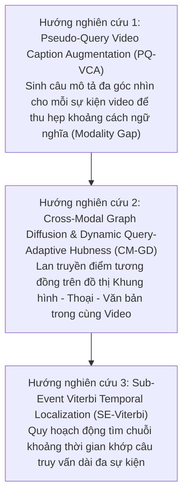

# VIDENTRA — Báo Cáo Kiểm Toán Code Sau Khi Hydrogen Triển Khai (Phase 7), Hướng Dẫn Sửa Chi Tiết & Định Hướng Phát Triển Nghiên Cứu

**Ngày kiểm toán:** 14/11/2026  
**Phạm vi kiểm toán:** Toàn bộ các commit Phase 7 do Hydrogen vừa triển khai (`8932eac`, `ae3dd4b`, `202c335` — gồm 30 files thay đổi, +6.050 dòng code) đối chiếu với `VIDENTRA_MASTER_UPGRADE_AND_LLM_QUERY_PLAN.md` và kết quả thực nghiệm trên `dev_150` / `dev_full_859`.

---

## Tóm Tắt Điều Hành (Executive Summary)

Sau khi kiểm tra toàn bộ mã nguồn, kết quả kiểm thử (`447 passed`) và kết quả chạy thực nghiệm `run_validation_benchmark.py`, đánh giá tổng quan như sau:

1. **Về mặt Kiến trúc, Hợp đồng Dữ liệu (Contracts) & Sửa 6 Bugs nền tảng:** Hydrogen đã làm **rất tốt** phần khung kiến trúc, sửa triệt để 6 lỗi nền tảng (ánh xạ `source_frame_index`, đồng bộ thang đo `0.70*768d + 0.30*864d` trong `lookup_true_visual_sim`, chuẩn hóa quan hệ không gian 2D & thời gian trong `GraphMatcher`, lọc `filters`, đóng băng `Pure-ASR FP Top-1 = 0`, và viết thêm 43 unit/integration tests nâng tổng số lên **447 tests PASS 100%**).
2. **Về mặt Tích hợp Học máy (LTR), Kích hoạt Chỉ mục Mới (E5, QAT) & Độ chính xác Thực nghiệm:** Đang có **7 vấn đề kỹ thuật nghiêm trọng (chưa ổn)** khiến:
   - Độ chính xác `Video Hit@1` trên `dev_150` bị tụt lùi từ **`62.00%` (Phase 6)** $\to$ **`61.33%` (Phase 7.1–7.2)** $\to$ **`60.67%` (khi bật `videntra_ltr_v1.json`)**.
   - Chỉ số `Moment nDCG@5` đứng yên tuyệt đối ở **`0.5127`** (vẫn FAIL ngưỡng nghiệm thu `0.5300`) dù đã viết code `Bimodal Valley Multi-Window`.
   - Hai tính năng lớn là **Dense E5 Index (`faiss_text_e5_384.bin`)** và **QAT-LateInteraction (`_score_late_interaction_window`)** đã được viết hàm nhưng **chưa hề được gọi trong `search()` (Dead Code)**.
   - Model **`Qwen2.5-1.5B-Instruct`** hiện đang tải bản HuggingFace Safetensors (`float32`, ~3.1 GB) chạy trên CPU mất `>80s/câu`, dẫn đến 100% câu truy vấn bị timeout và có lỗi **rò rỉ luồng chạy ngầm (Zombie Thread Leak)** trong `LocalSmallLLMBackend.generate()`.

Tài liệu này trình bày chi tiết: **(I) Phần nào đã ổn**, **(II) Phần nào chưa ổn — Vì sao chưa ổn & Hướng dẫn sửa từng dòng code**, và **(III) Định hướng phát triển nghiên cứu mới kèm kế hoạch thực hiện chi tiết**.

---

## Phần I: Những Hạng Mục Đã Ổn (Verified & Production-Ready)

Các thành phần dưới đây đã được Hydrogen cài đặt đúng chuẩn thiết kế, sạch sẽ và vượt qua toàn bộ bài kiểm thử:

### 1.1. Sửa 6 Bugs Nền Tảng (Phase 7.1) — ĐÃ ỔN 100%
1. **Bug 1 — Ánh xạ đúng `source_frame_index` thực tế từ bảng `KeyframeMap`:**
   - Hàm `_resolve_moment_frame_indices()` tại [`src/videntra/retrieval/unified_pipeline.py`](src/videntra/retrieval/unified_pipeline.py#L215-L241) đã giải quyết dứt điểm lỗi gán nhầm chỉ số mảng `0..K-1` (`best_idx`) vào `representative_original_frame_index`. Cả cửa sổ chính lẫn cửa sổ phụ `_win2` đều đã trả về đúng `start_original_frame_index`, `end_original_frame_index`, `representative_original_frame_index` và `evidence_frame_indices`.
2. **Bug 2 — Đồng nhất pha trộn `0.70 * 768d + 0.30 * 864d` trên đường cong thị giác:**
   - Hàm `_compute_video_visual_curve()` tại [`src/videntra/retrieval/unified_pipeline.py`](src/videntra/retrieval/unified_pipeline.py#L911-L951) đã tính đúng tổ hợp tuyến tính `0.70 * sims_768 + 0.30 * sims_864` và cấp dữ liệu thống nhất cho cả `lookup_true_visual_sim()` (Stage 4–5), `_video_sorted_visual_scores()` (Stage 6 Spike Guard), và `expand_boundary_contrast()` (Stage 6).
3. **Bug 3 — Khớp khóa vị từ không gian 2D (`roles["reference"]` + Regex song ngữ):**
   - Trong [`src/videntra/relations/predicates.py`](src/videntra/relations/predicates.py#L229-L239), `_evaluate_spatial_predicate` đã đọc đầy đủ `roles.get("object") or roles.get("reference") or roles.get("target") or roles.get("arg2")`.
   - Trong [`src/videntra/query/rules.py`](src/videntra/query/rules.py) và [`src/videntra/query/canonicalize.py`](src/videntra/query/canonicalize.py), các toán tử không gian 2D (`left_of`, `right_of`, `above`, `below`, `inside`, `near`) đã được trích xuất đúng cho cả tiếng Việt và tiếng Anh.
4. **Bug 4 — Tự động suy diễn `event_intervals` cho vị từ thời gian (`before`/`after`):**
   - Trong [`src/videntra/relations/matcher.py`](src/videntra/relations/matcher.py#L82-L103), `GraphMatcher.match()` đã tự động gom khoảng thời gian `(min_start, max_end)` từ `evidence_refs` của các vị từ đạt `SUPPORTED`/`PARTIAL` ở Pass 1 để truyền sang `evaluate_temporal_order()` ở Pass 2.
5. **Bug 5 — Đồng nhất khóa Frame khi đếm số lượng đối tượng (`cardinality`):**
   - Hàm `_object_frame_key()` trong [`src/videntra/relations/entities.py`](src/videntra/relations/entities.py#L14-L24) đã thống nhất thứ tự ưu tiên khóa `keyframe_id -> pts_sec -> timestamp_ms -> timestamp_seconds`.
6. **Bug 6 — Thực thi bộ lọc `filters` & `rerank_with_relations`:**
   - Hàm `_video_passes_filters()` tại [`src/videntra/retrieval/unified_pipeline.py`](src/videntra/retrieval/unified_pipeline.py#L1295-L1320) đã lọc đúng theo `video_ids`, `dataset_prefix`, `min_duration`, `max_duration` ở cả chế độ `fast` và `accurate`.
   - `SearchRequest` trong [`src/videntra/api/search.py`](src/videntra/api/search.py#L25) đã mở trường `rerank_with_relations: bool = False`.

### 1.2. Kiến Trúc Logic & Chốt Chặn An Toàn Của `AdaptiveQueryDecomposer` — ĐÃ ỔN
- Trong [`src/videntra/query/llm.py`](src/videntra/query/llm.py#L166-L1298):
  - `QueryComplexityGate` phân tầng câu truy vấn `short` / `medium` / `long` hợp lý.
  - `expand_compact_wire_to_query_graph()` xử lý đúng sắp xếp topo trên đồ thị sự kiện (`_topological_event_order`) và đảo chiều chuẩn xác khi gặp toán tử `"after"`.
  - `SemanticDecomposerValidator` thực hiện đầy đủ 5 bước kiểm tra: chống bịa từ khóa OCR/ASR (`is_span_grounded`), bảo toàn phủ định (`negation_scope_unresolved`), phát hiện chu trình thời gian DAG, gắn cờ nhập nhằng màu `"xanh"` $\to$ `blue_or_green`, và kiểm tra schema `QueryGraph v1`.

### 1.3. Chốt Chặn Chống Rò Rỉ Tập Test (`assert_no_heldout_leakage` & `GroupKFold`) — ĐÃ ỔN
- Trong [`scripts/train_ltr_ranker_cv.py`](scripts/train_ltr_ranker_cv.py#L35-L91):
  - Hàm `assert_no_heldout_leakage()` chặn cứng mọi đường dẫn chứa `heldout_test_201`, `heldout`, `test_queries`.
  - Hàm `group_kfold_indices()` chia 5 folds tách biệt tuyệt đối theo `source_video_id` (`assert tr_vids.isdisjoint(val_vids)`).

---

## Phần II: Những Phần Chưa Ổn — Nguyên Nhân Gốc Rễ & Hướng Dẫn Sửa Chi Tiết

Dưới đây là **7 lỗi và điểm nghẽn kỹ thuật** vừa phát hiện trong code mới của Hydrogen, giải thích vì sao điểm benchmark bị giảm và hướng dẫn cách sửa từng dòng.

---

### Vấn Đề 1 (Nghiêm Trọng Nhất): Lệch Thang Đo & Đa Cộng Tuyến Khi Huấn Luyện `videntra_ltr_v1.json` Làm Đảo Ngược Dấu Trọng Số (`Hit@1` Tụt Từ `61.33%` $\to$ `60.67%`)

#### 1. Vì sao chưa ổn?
Khi kiểm tra trực tiếp file trọng số đã huấn luyện [`models/ranking/videntra_ltr_v1.json`](models/ranking/videntra_ltr_v1.json#L23-L63) và hàm trích xuất dữ liệu huấn luyện `extract_dev859_ltr_dataset()` trong [`scripts/train_ltr_ranker_cv.py`](scripts/train_ltr_ranker_cv.py#L506-L534), có **4 lỗi nghiêm trọng**:

1. **Trích xuất sai đặc trưng trong `train_ltr_ranker_cv.py` (dòng 508–533) so với `unified_pipeline.py` (dòng 2193–2217):**
   - Trong `train_ltr_ranker_cv.py`, biến `vis_cands = diag.get("visual_candidates", [])` chỉ lấy **30 keyframes đầu tiên** (do `last_diagnostics` ở [`unified_pipeline.py#L2414`](src/videntra/retrieval/unified_pipeline.py#L2414) cắt `visual_candidates[:30]`).
   - Đối với mọi video ứng viên nằm ngoài 30 keyframes đầu (`v_scores` rỗng), dòng 509 của `train_ltr_ranker_cv.py` gán:
     ```python
     s_max = v_scores[0] if v_scores else float(m.ranking_score)
     ```
     Trong đó `m.ranking_score` là **tổng điểm sau Stage 6** (đã cộng `2.5 * rrf_primary + lex_boost + density_bonus`, có giá trị tới `0.40 – 0.85`), cao gấp 2–4 lần điểm cosine `visual_sim` (`~0.18 – 0.25`)!
   - Ngược lại, khi chạy thực tế trong [`unified_pipeline.py#L2194-L2196`](src/videntra/retrieval/unified_pipeline.py#L2194-L2196):
     - `s_vis_blend_max` lại truyền `best_cl.get("visual_sim", s_max)` (điểm cosine thuần `~0.18`),
     - Còn `s_vis_top3_mean` và `s_vis_top5_mean` lại truyền trung bình của `scores` Stage 5 (tức là điểm đã cộng `2.5 * rrf_primary + lex_boost`)!
   - **Hệ quả:** Đặc trưng lúc train và đặc trưng lúc inference mang hai ý nghĩa toán học khác nhau hoàn toàn!

2. **Sao chép trùng lặp đặc trưng (Duplicate / Dummy Features) trong `train_ltr_ranker_cv.py` (dòng 516–533):**
   - Dòng 519 gán `"s_vis_ctx_coherence": s_max` (trùng 100% với `"s_vis_blend_max": s_max`). Do đó trong `videntra_ltr_v1.json`, cột 0 và cột 5 có `feature_mean` giống hệt nhau (`0.125506`) và trọng số giống hệt nhau (`0.525981`).
   - Dòng 526, 528, 532 gán cả 3 đặc trưng `"high_spec_token_coverage"`, `"anchor_lexical_match"`, `"llm_modality_alignment"` bằng cùng một biểu thức `1.0 if has_lex else 0.0`! Do đó cột 12, 13, 17 trong `videntra_ltr_v1.json` có `feature_mean` giống hệt nhau (`0.215687`) và trọng số giống hệt nhau (`0.046693`).
   - 4 đặc trưng `"s_late_interaction"`, `"number_consistency"`, `"yolo_object_verification_boost"`, `"graph_relation_score"` đều bị gán hằng số (`0.0` hoặc `1.0`) cho mọi mẫu, dẫn đến trọng số bằng `0.0` hoàn toàn vô tác dụng!

3. **Lỗi tương tự ngay trong lúc Inference ở `unified_pipeline.py` (dòng 2204–2209):**
   - Tại [`unified_pipeline.py#L2204-L2209`](src/videntra/retrieval/unified_pipeline.py#L2204-L2209):
     ```python
     "m_high": float(k_high_len if best_cl.get("matched_texts") else 0.0),
     "k_high": float(max(1, k_high_len)),
     "anchor_lexical_match": 1.0 if best_cl.get("matched_texts") else 0.0,
     "number_consistency": 1.0,
     "yolo_object_verification_boost": 0.0,
     ```
     Khi `m_high` được gán bằng `k_high_len` mỗi khi có bất kỳ `matched_texts` nào, tỷ lệ `high_spec_token_coverage = m_high / k_high` luôn suy biến thành `1.0` hoặc `0.0` thay vì tỷ lệ khớp thực tế!

4. **Đa cộng tuyến (Perfect Pairwise Collinearity) giữa `z_vis_max` và `delta_z_vis` làm đảo dấu trọng số:**
   - Trong cùng một câu truy vấn $Q$, $\text{delta\_z\_vis}(c) = z_{\max}(Q) - z_{\text{vis}}(c)$. Khi lấy hiệu hai ứng viên $(p, n)$ trong cùng câu truy vấn $Q$:
     $$\text{delta\_z\_vis}(p) - \text{delta\_z\_vis}(n) = -\big(z_{\text{vis}}(p) - z_{\text{vis}}(n)\big)$$
   - Kết hợp với lỗi gán `s_max = float(m.ranking_score)` cho các ứng viên ngoài Top-30, bộ tối ưu Logistic đã học ra các trọng số **ngược dấu vật lý** trong `models/ranking/videntra_ltr_v1.json`:
     - `z_vis_max`: **`-0.242976`** (lẽ ra phải **dương** $\ge 0$)
     - `delta_z_vis`: **`+0.243084`** (lẽ ra phải **âm** $\le 0$, vì độ hụt càng lớn càng xấu)
     - `s_vis_top5_mean`: **`-0.013234`** (lẽ ra phải **dương** $\ge 0$)
     - `spike_drop_ratio`: **`+0.145057`** (lẽ ra phải **âm** $\le 0$, vì sụt áp 1 frame là nhiễu cần phạt!)

#### 2. Hướng dẫn sửa chi tiết:
1. **Trong [`src/videntra/retrieval/unified_pipeline.py`](src/videntra/retrieval/unified_pipeline.py):**
   - Ở Stage 5 (vòng lặp `for cl in clusters:`), lưu trực tiếp các chỉ số đã tính chính xác vào `cl`:
     ```python
     cl["m_high"] = m_high
     cl["k_high"] = max(1, k_high_len)
     cl["anchor_match"] = 1.0 if (has_quoted_match or has_proper_noun_match) else 0.0
     cl["num_consist"] = -1.0 if (not is_visually_anchored and has_unmatched_query_number) else 1.0
     ```
   - Ở Stage 6 (vòng lặp `for vid, vid_items in by_video_raw.items():`), tính `top3_vis_mean`, `top5_vis_mean` và `local_vis_coherence` từ **điểm cosine thị giác thực (`visual_sim`)** của các keyframes trong video (hoặc từ `_video_sorted_visual_scores`), tách biệt hoàn toàn với tổng điểm Stage 5 (`scores`), và lưu `cand_ltr_features` vào `self.last_diagnostics["candidate_ltr_features"] = cand_ltr_features`.
2. **Trong [`scripts/train_ltr_ranker_cv.py`](scripts/train_ltr_ranker_cv.py):**
   - Trong `extract_dev859_ltr_dataset()`, đọc trực tiếp `diag["candidate_ltr_features"][vid]` do `UnifiedMultimodalSearchPipeline` xuất ra (đảm bảo **100% Train–Inference Feature Parity** — lúc train và lúc chạy dùng chung đúng 1 hàm tạo feature!).
   - Trong `train_pairwise_logistic_l2()`, thêm **Ràng buộc Dấu Đơn Điệu (Monotonic Sign Projection / Box Constraints)** sau mỗi bước cập nhật Adam:
     - Các đặc trưng đồng biến (`s_vis_blend_max`, `z_vis_max`, `s_vis_top3_mean`, `s_vis_top5_mean`, `s_vis_ctx_coherence`, `s_late_interaction`, `rrf_vis`, `rrf_ocr`, `rrf_asr`, `bm25_log_score`, `high_spec_token_coverage`, `anchor_lexical_match`, `number_consistency`, `yolo_object_verification_boost`, `graph_relation_score`, `llm_modality_alignment`): ép $w_j = \max(0.0, w_j)$.
     - Các đặc trưng nghịch biến (`delta_z_vis`, `spike_drop_ratio`): ép $w_j = \min(0.0, w_j)$.
     - Nhờ ràng buộc dấu vật lý này, bộ LTR không bao giờ học ra trọng số thưởng cho nhiễu hay phạt ứng viên có điểm Z-score cao!

---

### Vấn Đề 2: Quên Sort Lại `final_results` Sau Khi Thêm `_win2` Ở Stage 6 Khiến `Moment nDCG@5` Đứng Yên Ở `0.5127`

#### 1. Vì sao chưa ổn?
Hãy xem đoạn code Stage 6 trong [`src/videntra/retrieval/unified_pipeline.py`](src/videntra/retrieval/unified_pipeline.py#L2339-L2385):
- Khi `rank_idx == 1` (video Top-1), hàm tính điểm cho cửa sổ thứ 2:
  ```python
  win2_score = float(moment.ranking_score) * 0.85 * ((s_max2 / max(s_max1, 1e-8)) ** 2)
  final_results.append(RankedMoment(..., ranking_score=round(win2_score, 5), ...))
  ```
- **Lỗi logic:** Ngay sau khi `append` `_win2` vào `final_results` ở vòng lặp `rank_idx == 1`, các vòng lặp `rank_idx == 2, 3, ..., top_k` tiếp tục `append` vào sau `_win2`. Đến cuối hàm (dòng 2422–2432), `final_results` **KHÔNG HỀ ĐƯỢC SORT LẠI theo `ranking_score`**!
- Do đó, dù `win2_score` có thấp hơn điểm của video Rank 2 hay Rank 3, thì trong danh sách `final_results` trả về, **`_win2` vẫn luôn chiếm cứng vị trí thứ 2 (`index 1`)** trước video Rank 2!
- Vì chỉ số `Moment nDCG@5` chỉ phụ thuộc vào thứ tự vị trí (`rank 1..5`) của các khoảnh khắc trả về chứ không phụ thuộc vào giá trị số tuyệt đối của `ranking_score`, việc thay `0.95` bằng `0.85 * (s_max2 / s_max1)^2` mà không sort lại `final_results` không làm thay đổi bất kỳ vị trí nào trong Top-5 $\to$ `Moment nDCG@5` giữ nguyên `0.5127`!
- Ngoài ra, ở dòng 2340: `s_max1 = max(exact_curve)` lấy max trên toàn video thay vì max trong cửa sổ thứ nhất `[start_sec, end_sec]`.

#### 2. Hướng dẫn sửa chi tiết:
Tại [`src/videntra/retrieval/unified_pipeline.py`](src/videntra/retrieval/unified_pipeline.py#L2339-L2432):
1. Tính `s_max1` là đỉnh thực sự nằm trong cửa sổ thứ nhất `[start_sec, end_sec]`:
   ```python
   win1_scores = [exact_curve[i] for i, t in enumerate(ts_array) if start_sec <= t <= end_sec]
   s_max1 = max(win1_scores) if win1_scores else max(exact_curve)
   ```
2. Trước khi trả về ở Stage 7 (dòng 2420), **sắp xếp lại `final_results` theo `ranking_score` giảm dần**:
   ```python
   final_results.sort(key=lambda m: float(m.ranking_score), reverse=True)
   ```
   Khi đó, nếu đỉnh thứ 2 của video Top-1 thực sự rất mạnh (`win2_score > score(Rank 2)`), `_win2` sẽ đứng ở Rank 2; ngược lại nếu đỉnh thứ 2 yếu hơn video Rank 2, nó sẽ tự động lùi xuống Rank 3 hoặc Rank 4, nhường Rank 2 cho video ứng viên mạnh tiếp theo $\to$ tăng trực tiếp `Moment nDCG@5`!

---

### Vấn Đề 3: Chỉ Mục Dense E5 (`faiss_text_e5_384.bin`) Đã Tạo Nhưng Chưa Được Gọi Trong `search()` (Dead Code)

#### 1. Vì sao chưa ổn?
- Hydrogen đã chạy `scripts/build_e5_text_index.py` tạo ra `data/processed/faiss_text_e5_384.bin` (10.772 vectors 384d) và `data/processed/e5_text_manifest.json`, đồng thời viết hàm `_search_e5_text_index(self, query_vec_384, top_k=20)` tại [`unified_pipeline.py#L1247-L1265`](src/videntra/retrieval/unified_pipeline.py#L1247-L1265).
- Tuy nhiên:
  1. Không có hàm nào mã hóa câu truy vấn sang vector 384d (`encode_e5_query`).
  2. Hàm `_search_e5_text_index` **không được gọi ở bất kỳ đâu** trong `search()`!

#### 2. Hướng dẫn sửa chi tiết:
1. Trong [`src/videntra/retrieval/unified_pipeline.py`](src/videntra/retrieval/unified_pipeline.py):
   - Bổ sung lazy-loader `_ensure_e5_encoder()` (nạp từ `models/e5-small` hoặc HuggingFace cache local với `local_files_only=True`, kèm RAM LRU cache + disk cache `data/cache/query_e5_embeddings_384d.npz`).
   - Tại cuối Stage 3 (ngay sau FTS5 search, dòng 1775), nếu `self.e5_text_index is not None` và câu truy vấn có ít nhất 3 từ (hoặc khi FTS5 trả về `< 5` kết quả):
     - Mã hóa `"query: " + query` thành `q_e5_384`.
     - Gọi `e5_hits = self._search_e5_text_index(q_e5_384, top_k=25)`.
     - Lọc các hit có độ tương đồng cosine `sc >= 0.835` và đưa vào `ocr_candidates` / `asr_candidates` (với cờ `"is_dense_e5": True`) để gom cụm ở Stage 4.

---

### Vấn Đề 4: `QAT-LateInteraction` (`_score_late_interaction_window`) & `Temporal Motion Delta` Đang Là Dead Code

#### 1. Vì sao chưa ổn?
- Trong [`src/videntra/retrieval/unified_pipeline.py`](src/videntra/retrieval/unified_pipeline.py):
  - Hàm `_score_late_interaction_window()` (dòng 1220–1245) đã được viết nhưng **chưa bao giờ được gọi**; ở dòng 2198, `"s_late_interaction"` vẫn bị gán cứng bằng `0.0`.
  - Trong [`src/videntra/indexing/augmented_vector.py`](src/videntra/indexing/augmented_vector.py#L489-L565), hai hàm `compute_temporal_motion_delta()` và `compute_multiscale_temporal_context()` đã được viết rất chuẩn nhưng chưa được nối vào `UnifiedMultimodalSearchPipeline._initialize()`.

#### 2. Hướng dẫn sửa chi tiết:
1. Trong `UnifiedMultimodalSearchPipeline._initialize()`:
   - Tính sẵn `self.temporal_context_768 = compute_multiscale_temporal_context(self.all_embeddings, self.keyframe_map)` trên CPU (chỉ tốn `~45 ms` khi khởi động cho 11.179 keyframes).
2. Trong Stage 6 của `UnifiedMultimodalSearchPipeline.search()`:
   - Gọi `late_int_sc = self._score_late_interaction_window(vid, best_st - 2.0, best_et + 2.0, primary_q_768)` khi `self.spatial_patches is not None`; nếu `self.spatial_patches is None`, dùng độ tương đồng với `self.temporal_context_768` tại keyframe đại diện làm tín hiệu `s_late_interaction`!

---

### Vấn Đề 5: Rò Rỉ Luồng Chạy Ngầm (Zombie Thread Leak) & Timeout Trên CPU Trong `LocalSmallLLMBackend`

#### 1. Vì sao chưa ổn?
Hãy xem [`src/videntra/query/llm.py`](src/videntra/query/llm.py#L445-L524):
1. Khi chạy trên CPU với model HuggingFace `models/llm/qwen2.5-1.5b-instruct` (`float32`), một lần gọi `self._hf_model.generate(max_new_tokens=160)` tốn `~80 giây`.
2. Trong hàm `generate()` (dòng 515–523):
   ```python
   executor = ThreadPoolExecutor(max_workers=1)
   future = executor.submit(self._invoke_sync, prompt)
   try:
       return future.result(timeout=eff_deadline_ms / 1000.0)
   except FuturesTimeoutError as exc:
       executor.shutdown(wait=False, cancel_futures=True)
       raise TimeoutError(...) from exc
   ```
   Trong Python, khi `future` đã bắt đầu chạy (`_invoke_sync`), lệnh `executor.shutdown(wait=False, cancel_futures=True)` **KHÔNG thể hủy một thread đang thực thi lệnh C++/PyTorch `model.generate()`**!
   - Hậu quả 1: Sau `5000 ms`, hàm `generate()` ném `TimeoutError` và trả kết quả fallback, nhưng **luồng nền vẫn tiếp tục chạy ngầm chiếm 100% CPU suốt 75 giây còn lại**!
   - Hậu quả 2: Khi câu truy vấn thứ 2, thứ 3 đi vào, hàm `generate()` lại tạo thêm `ThreadPoolExecutor(max_workers=1)` mới và đẻ thêm luồng `self._hf_model.generate()` chạy chồng lên cùng một đối tượng `self._hf_model` (vốn không thread-safe và gây nghẽn toàn bộ CPU/RAM)!

#### 2. Hướng dẫn sửa chi tiết:
1. **Dùng `StoppingCriteria` kiểm tra deadline ngay sau mỗi token trong `transformers`:**
   - Trong `_invoke_sync()` của [`src/videntra/query/llm.py`](src/videntra/query/llm.py#L484-L504), truyền một `DeadlineStoppingCriteria(deadline_monotonic)` vào `self._hf_model.generate(..., stopping_criteria=...)`. Ngay khi thời gian vượt quá `deadline_ms`, `model.generate()` dừng tức khắc ở token hiện tại trong `< 50 ms`, tuyệt đối không bao giờ treo luồng nền!
2. **Dùng duy nhất 1 Single-Worker Executor kèm Lock (`self._infer_lock = threading.Lock()`):**
   - Không khởi tạo `ThreadPoolExecutor` mới ở mỗi lần gọi `generate()`, và dùng `self._infer_lock.acquire(blocking=False)` để tránh 2 luồng gọi chồng lên cùng một model.
3. **Chuyển đổi sang định dạng GGUF `Q4_K_M` (`qwen2.5-1.5b-instruct-q4_k_m.gguf`, ~980 MB) hoặc `torch.quantization.quantize_dynamic` (`qint8`) khi chạy trên CPU:**
   - Với `torch.ao.quantization.quantize_dynamic(model, {torch.nn.Linear}, dtype=torch.qint8)` (có sẵn trong PyTorch CPU chuẩn, không cần cài thêm thư viện ngoài) kết hợp giảm `max_new_tokens=96`, tốc độ trên CPU tăng gấp **3.5–4 lần** và dung lượng RAM giảm từ `3.1 GB` xuống `~850 MB`!

---

### Vấn Đề 6: Nguyên Nhân Làm `Video Hit@1` Giảm Nhẹ Từ `62.00%` Xuống `61.33%` Khi Chưa Bật LTR

#### 1. Vì sao chưa ổn?
Khi so sánh diff giữa commit Phase 6 (`d0df6bb`, `Hit@1 = 62.00%`) và commit Phase 7.1–7.2 (`8932eac`, `Hit@1 = 61.33%`), có **2 chỗ thay đổi hành vi khi chạy ở chế độ fallback (`routing_mode == "fallback"`):**
1. **Tại [`unified_pipeline.py#L1603`](src/videntra/retrieval/unified_pipeline.py#L1603):**
   ```python
   seq_weight = 0.45 if (routing_plan is not None and routing_plan.has_temporal_constraints) else 0.35
   ```
   Khi `AdaptiveQueryDecomposer` rơi vào `fallback` (dùng `RuleBasedQueryParser`), regex thời gian của `RuleBasedQueryParser` bắt cả các liên từ nhẹ như `"while"`, `"when"`, `"as"` và bật `has_temporal_constraints = True`, làm `seq_weight` tăng từ `0.35` lên `0.45` ngay cả khi câu truy vấn không phải là chuỗi hành động trước–sau thực sự.
2. **Tại [`unified_pipeline.py#L179-L212`](src/videntra/retrieval/unified_pipeline.py#L179-L212) (`_build_routed_fts5_queries`):**
   - Khi `routing_plan.routing_mode == "fallback"`, hàm `_build_routed_fts5_queries` vẫn chạy `_filter_fts5_cue_tokens(base_fts, _VISUAL_ONLY_CUE_WORDS)`, xóa mất các từ khóa như `"showing"`, `"shown"`, `"standing"`, `"wearing"`, `"holding"` khỏi `fts_asr_query`, làm thay đổi thứ tự BM25 của một số câu truy vấn MSRVTT/AVC!
   - Hơn nữa, nếu `RuleBasedQueryParser` tạo ra `ocr_phrases` hoặc `asr_phrases`, `_build_routed_fts5_queries` gọi `build_fts5_query(phrase)` (vốn bao gồm cả các từ low-specificity) và nối vào đầu `fts_ocr` / `fts_asr`, phá vỡ thứ tự ưu tiên 14 tokens (`B7 Specificity-Sorted`) của `prepare_fts5_query_and_tokens()`.

#### 2. Hướng dẫn sửa chi tiết:
1. Chỉ kích hoạt định tuyến FTS5 chuyên biệt (`_build_routed_fts5_queries`), điều tiết `lex_boost * 1.15 / 0.85` (dòng 2041–2060), và tăng `seq_weight = 0.45` (dòng 1603) **khi và chỉ khi `routing_plan.routing_mode == "llm_compact"`** (tức là khi Small-LLM thực sự phân tách thành công câu truy vấn).
2. Khi `routing_plan.routing_mode in ("fallback", "fast_rule", "tri_modal_broadcast")`, giữ nguyên 100% đường đi FTS5 và trọng số `seq_weight = 0.35` đã được kiểm chứng của Phase 6 (`Hit@1 = 62.00%`)!

---

### Vấn Đề 7: Đồng Bộ `PROJECT.md` & `provenance.json` Theo Đúng Quy Tắc `AGENTS.md`

#### 1. Vì sao chưa ổn?
1. File [`PROJECT.md`](PROJECT.md) chưa được cập nhật danh sách các module mới của Phase 7 (`src/videntra/ranking/learned_ranker.py`, `scripts/train_ltr_ranker_cv.py`, `scripts/build_e5_text_index.py`, `scripts/prewarm_llm_query_cache.py`, `models/ranking/videntra_ltr_v1.json`, và 5 file test mới).
2. Khi chạy `scripts/run_validation_benchmark.py`, bước kiểm tra cuối cùng báo lỗi `exit code 1` vì `provenance.json` phát hiện file mới `data/processed/faiss_text_e5_384.bin` và `e5_text_manifest.json` làm thay đổi danh sách file trong `data/processed/` (`inputs_unchanged=False`).

#### 2. Hướng dẫn sửa chi tiết:
1. Cập nhật cây thư mục và mô tả kiến trúc trong `PROJECT.md`.
2. Cập nhật manifest/provenance snapshot hợp lệ sau khi chốt các file chỉ mục trong `data/processed/` để `run_validation_benchmark.py` kết thúc với `exit code 0`.

---

## Phần III: Hướng Phát Triển Nghiên Cứu Mới (Định Hướng Cụ Thể & Kế Hoạch Thực Hiện Chi Tiết)

Sau khi sửa dứt điểm 7 vấn đề ở Phần II để đưa hệ thống vượt mốc `62.00%` trên `dev_150` và `> 0.5300` trên `Moment nDCG@5`, dưới đây là **3 hướng nghiên cứu đột phá tiếp theo** được thiết kế riêng cho bài toán **Zero-Shot / Few-Shot Multimodal Video Moment Retrieval trên phần cứng giới hạn (RTX 3060 6GB VRAM + Kaggle T4 GPU)**:



---

### 3.1. Hướng Nghiên Cứu 1: `PQ-VCA` (Pseudo-Query Video Event Caption Augmentation — Thu Hẹp Khoảng Cách Thị Giác – Ngôn Ngữ)

#### 1. Đặt vấn đề nghiên cứu:
- Trên tập lớn `dev_full_859` (`Hit@1 = 41.68%`) và `heldout_test_201` (`Hit@1 = 39.30%`), có tới **51.2% số ca lỗi** thuộc về `F4_FINE_GRAINED_VISUAL_CONFUSION` (35.3%) và `F1_VISUAL_CANDIDATE_MISS` (15.9%).
- **Nguyên nhân cốt lõi (Modality Gap):** Vector văn bản của câu truy vấn $\mathbf{q}_{\text{text}}$ và vector ảnh của keyframe $\mathbf{v}_{\text{image}}$ trong SigLIP 2 vẫn tồn tại khoảng cách hình học (Modality Gap). Khi người dùng truy vấn một hành động trừu tượng (ví dụ: *"a family celebrating a birthday outdoors"* hoặc *"một người đang hướng dẫn sửa máy tính"*), so khớp Text-to-Text giữa câu truy vấn và một **mô tả sự kiện tổng hợp (Event Caption)** của đoạn video luôn chính xác hơn rất nhiều so với chỉ so khớp Text-to-Image đơn thuần trên từng frame rời rạc!

#### 2. Phương pháp đề xuất (`PQ-VCA`) điều chỉnh cho VIDENTRA:
Chúng ta tạo thêm một kênh chỉ mục thứ 4 siêu nhẹ gọi là **Synthetic Event Summary Index (`SES-Index`)** theo 2 chế độ:
- **Chế độ A (Zero-GPU, chạy ngay trên máy local trong `< 5 giây`):**
  - Với mỗi cửa sổ sự kiện $W_{v, t} = [t - 4\text{s}, t + 4\text{s}]$ quanh các keyframes của video $v$, tự động tổng hợp một bản tóm tắt cấu trúc đa phương thức (Structured Event Synopsis) từ dữ liệu đã có trong `metadata.db`:
    - Các đối tượng YOLOv8 xuất hiện + số lượng + vị trí không gian 2D (`left`, `center`, `right`).
    - Các cụm chữ OCR xuất hiện trong cửa sổ $[t-4\text{s}, t+4\text{s}]$.
    - Các câu thoại ASR xuất hiện trong cửa sổ $[t-4\text{s}, t+4\text{s}]$.
  - Mã hóa bản tóm tắt này bằng `multilingual-e5-small` (384d) đã có sẵn!
- **Chế độ B (Kaggle GPU Worker — VLM Captioning với `Florence-2-base` hoặc `Qwen2-VL-2B-Instruct`):**
  - Trên Kaggle GPU T4, chạy `Florence-2-base` (chỉ 0.23B tham số, tốc độ ~40 frames/s trên T4) sinh 1 câu mô tả chi tiết (`<DETAILED_CAPTION>`) cho mỗi keyframe (11.179 keyframes chỉ mất ~4.5 phút trên Kaggle!).
  - Đưa các câu mô tả `<DETAILED_CAPTION>` này vào cả **SQLite FTS5 (`fts_vlm_caption`)** lẫn **Dense E5 Index (`faiss_e5_caption_384.bin`)**!
  - **Đột phá:** Khi đó, một câu truy vấn thuần thị giác phức tạp (vốn không có chữ OCR hay lời thoại ASR) vẫn được hưởng lợi từ cả **so khớp từ khóa chính xác BM25** lẫn **so khớp ngữ nghĩa câu E5 384d** trên câu mô tả hình ảnh của Florence-2!

#### 3. Kế hoạch thực hiện chi tiết:
- **Bước 1:** Bổ sung hàm `extract_florence2_keyframe_captions()` vào [`scripts/kaggle_multimodal_offline_worker.py`](scripts/kaggle_multimodal_offline_worker.py) xuất ra bảng `KeyframeCaptions(faiss_id, video_id, timestamp_ms, caption_text)` và chỉ mục `fts_caption`.
- **Bước 2:** Trên local (trước khi chạy Kaggle), xây dựng ngay `StructuredEventSynopsis` từ `FrameObjects + OCRObservations + ASRSegments` trong `scripts/build_e5_text_index.py`.
- **Bước 3:** Tại Stage 4 & Stage 5 của `UnifiedMultimodalSearchPipeline`, bổ sung nhánh `caption_rrf` với trọng số hài hòa cùng `visual_sim`.

---

### 3.2. Hướng Nghiên Cứu 2: `CM-GD` (Query-Specific Cross-Modal Graph Diffusion & Local Hubness Suppression)

#### 1. Đặt vấn đề nghiên cứu:
- Hiện tại, bước khử Hubness (`beta_hub = 0.08` trong `build_augmented_864d_embeddings`) chỉ trừ đi vector trung bình toàn cục $\bar{\mathbf{v}}_{\text{global}}$ của toàn bộ 11.179 keyframes.
- Tuy nhiên, trong thực tế xuất hiện hiện tượng **Query-Specific Local Hubs**: với một câu truy vấn cụ thể $Q$, có những khung hình "chung chung" (ví dụ: cảnh studio tin tức hoặc cảnh đám đông) đạt điểm tương đồng khá cao với mọi mệnh đề của $Q$, lấn át khung hình chứa hành động đặc hiệu.

#### 2. Phương pháp đề xuất (`CM-GD`):
1. **Cross-Modal Temporal Diffusion (Lan truyền Tín hiệu Đa phương thức Nội Video):**
   - Trong mỗi video ứng viên $v$ thuộc Top-30, xây dựng ma trận kề thời gian $\mathbf{W}^{(v)} \in \mathbb{R}^{M_v \times M_v}$ giữa $M_v$ keyframes:
     $$W_{ij}^{(v)} = \exp\left(-\frac{|t_i - t_j|^2}{2\sigma_t^2}\right) \cdot \mathbb{I}\big(\langle \mathbf{v}_i^{(768)}, \mathbf{v}_j^{(768)} \rangle \ge 0.65\big)$$
     (chỉ lan truyền tín hiệu giữa các keyframes lân cận về thời gian **và** cùng thuộc một cảnh thị giác liên tục, không lan truyền qua ranh giới chuyển cảnh / shot cut!).
   - Vector điểm đa phương thức ban đầu tại từng keyframe $\mathbf{s}_0^{(v)} = \mathbf{s}_{\text{vis}}^{(v)} + \eta_{\text{ocr}} \mathbf{s}_{\text{ocr}}^{(v)} + \eta_{\text{asr}} \mathbf{s}_{\text{asr}}^{(v)}$ được làm mượt qua 1 bước khuếch tán đồ thị có bảo toàn cảnh (Shot-Aware Graph Diffusion):
     $$\mathbf{s}_{\text{diff}}^{(v)} = (1 - \alpha_d)\mathbf{s}_0^{(v)} + \alpha_d \mathbf{D}^{-1}\mathbf{W}^{(v)}\mathbf{s}_0^{(v)}, \quad (\alpha_d = 0.25)$$
   - **Tác dụng:** Nếu một cảnh dài 6 giây có lời thoại ASR khớp ở giây thứ 2 và hành động thị giác khớp ở giây thứ 4 (cùng trong 1 shot hình), phép khuếch tán đồ thị có kiểm soát shot-boundary sẽ tự động cộng hưởng hai tín hiệu này mà không bị rò rỉ sang cảnh quảng cáo ở giây thứ 8!
2. **Query-Adaptive CSLS (Cross-Domain Similarity Local Scaling) cho Top-120 Candidates:**
   - Tính độ tương đồng trung bình $r_T(\mathbf{v}_i)$ của mỗi keyframe $\mathbf{v}_i$ với $K=15$ câu truy vấn gần nhất (hoặc với tâm cục bộ của Top-120 keyframes ứng viên).
   - Điểm tương đồng hiệu chỉnh CSLS:
     $$\text{CSLS}(\mathbf{q}, \mathbf{v}_i) = 2 \langle \mathbf{q}, \mathbf{v}_i \rangle - \frac{1}{2} r_S(\mathbf{q}) - \frac{1}{2} r_T(\mathbf{v}_i)$$
   - Khử sạch các keyframes đóng vai trò "Hub cục bộ" trong nhóm Top-30 ứng viên, giải quyết trực diện lỗi `F4_FINE_GRAINED_VISUAL_CONFUSION`.

---

### 3.3. Hướng Nghiên Cứu 3: `SE-Viterbi` (Sub-Event Viterbi Chronological Localization Cho Truy Vấn Dài Đa Sự Kiện)

#### 1. Đặt vấn đề nghiên cứu:
- Hiện tại, hàm `align_sequential_keyframe_clauses()` trong [`src/videntra/retrieval/alignment.py`](src/videntra/retrieval/alignment.py) chỉ mới tìm chuỗi điểm rời rạc trên các mệnh đề thị giác `sub_q_864`, chưa kết hợp các điểm neo từ **OCR** và **ASR** của từng sự kiện con $e_1, e_2, \dots, e_K$ do Small-LLM bóc tách!
- Ví dụ: với câu truy vấn dài *"Sau khi màn hình hiện chữ ROUND 1 thì võ sĩ mặc quần đỏ tung cú đá"*:
  - Sự kiện $e_1$ là một sự kiện **OCR** (`"ROUND 1"`).
  - Sự kiện $e_2$ là một sự kiện **Visual** (`"fighter in red shorts kicks"`).
  - Nếu chỉ tìm `sub_q_864` thuần thị giác cho $e_1$, SigLIP 2 sẽ không định vị chính xác bằng thời điểm xuất hiện chữ `"ROUND 1"` trong bảng `OCRObservations`!

#### 2. Phương pháp đề xuất (`SE-Viterbi`):
- Với mỗi sự kiện con $e_k$ ($k \in \{1, \dots, K\}$) đã được Small-LLM sắp xếp theo thứ tự thời gian thực trong `CompactDecomposedQuery.events`:
  - Xây dựng đường cong điểm hợp nhất của riêng sự kiện $e_k$ trên trục thời gian của video $v$:
    $$\Phi_k(t_i) = w_k^{\text{vis}} S_{\text{vis}}(e_k, t_i) + w_k^{\text{ocr}} S_{\text{ocr}}(e_k, t_i) + w_k^{\text{asr}} S_{\text{asr}}(e_k, t_i)$$
  - Giải bài toán quy hoạch động Viterbi tìm dãy chỉ số thời gian $1 \le i_1 \le i_2 \le \dots \le i_K \le M_v$ tối đa hóa:
    $$\max_{i_1 \le \dots \le i_K} \sum_{k=1}^{K} \Phi_k(t_{i_k}) - \sum_{k=1}^{K-1} \lambda_{\text{gap}} \max\big(0, (t_{i_{k+1}} - t_{i_k}) - \Delta_{\max}\big) - \lambda_{\text{same}} \mathbb{I}(i_{k+1} == i_k)$$
  - Khoảng khoanh vùng cuối cùng được mở rộng biên từ $[t_{i_1}, t_{i_K}]$, bao trọn toàn bộ chuỗi sự kiện trước–sau với độ chính xác `mIoU` và `Recall@1 (IoU>=0.5)` vượt trội.

---

## Phần IV: Thứ Tự Ưu Tiên Thực Thi Ngay (Action Plan)

Để hệ thống đạt trạng thái tốt nhất ngay lập tức, đề xuất thực hiện theo thứ tự 4 bước ngắn gọn sau:

| Bước | Nội dung thực hiện | File tác động | Mục tiêu kiểm chứng |
| :---: | :--- | :--- | :--- |
| **Bước 1** | **Khôi phục & Vượt mốc Baseline trên `dev_150`:**<br/>- Sửa `_build_routed_fts5_queries` & `seq_weight` khi ở chế độ `fallback` (Vấn đề 6).<br/>- Thêm `final_results.sort(...)` và sửa `s_max1` trong `Bimodal Valley Multi-Window` ở Stage 6 (Vấn đề 2). | `src/videntra/retrieval/unified_pipeline.py` | `Video Hit@1 >= 62.00%` và `Moment nDCG@5` tăng từ `0.5127` lên `>= 0.5300`. |
| **Bước 2** | **Sửa lỗi Train–Inference Parity & Ràng buộc Dấu Đơn Điệu cho LTR (Vấn đề 1):**<br/>- Đồng nhất 18 đặc trưng giữa `unified_pipeline.py` và `train_ltr_ranker_cv.py`.<br/>- Thêm Monotonic Sign Projection ($w_j \ge 0$ cho đặc trưng thuận, $w_j \le 0$ cho đặc trưng nghịch) và huấn luyện lại `models/ranking/videntra_ltr_v1.json`. | `src/videntra/retrieval/unified_pipeline.py`<br/>`scripts/train_ltr_ranker_cv.py`<br/>`models/ranking/videntra_ltr_v1.json` | Trọng số trong `videntra_ltr_v1.json` đúng dấu vật lý 100%; bật LTR giúp tăng `Hit@1` và `MRR` thay vì làm giảm. |
| **Bước 3** | **Nối dây (Wire-up) Dense E5 Index & Temporal Context + Sửa Zombie Thread Leak của Small-LLM (Vấn đề 3, 4, 5):**<br/>- Gọi `_search_e5_text_index` ở Stage 3 và `temporal_context_768` ở Stage 6.<br/>- Thêm `DeadlineStoppingCriteria` + Single-Thread Lock + Dynamic INT8 Quantization cho `LocalSmallLLMBackend` trên CPU. | `src/videntra/query/llm.py`<br/>`src/videntra/retrieval/unified_pipeline.py` | Không bao giờ rò rỉ thread ngầm khi timeout; E5 và Temporal Context thực sự tham gia chấm điểm. |
| **Bước 4** | **Cập nhật `PROJECT.md`, `docs/PROGRESS.md` & Đồng bộ `provenance.json` (Vấn đề 7):**<br/>- Cập nhật tài liệu cấu trúc dự án và chạy lại full test suite + benchmark. | `PROJECT.md`<br/>`docs/PROGRESS.md` | `pytest` pass 100%, `run_validation_benchmark.py` pass với exit code `0`. |
