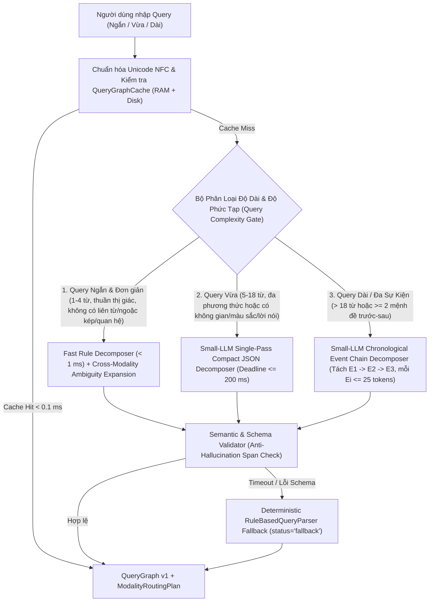
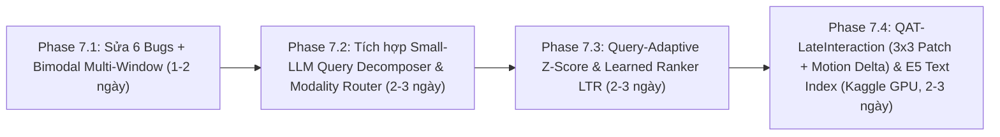

# VIDENTRA — Kế Hoạch Tổng Thể: Sửa Lỗi Hệ Thống, Tích Hợp Small-LLM Phân Tách Truy Vấn Đa Phương Thức & Nâng Cấp Độ Chính Xác Tìm Kiếm Thế Hệ Mới

**Ngày lập kế hoạch:** 14/11/2026  
**Phạm vi:** Toàn bộ hệ thống truy hồi khoảnh khắc video đa phương thức VIDENTRA (`src/videntra/`, `benchmark/`, `scripts/`)  
**Mục tiêu phần cứng:** NVIDIA RTX 3060 (6GB VRAM), 32GB RAM (hỗ trợ đầy đủ chế độ CPU-only fallback và Kaggle GPU worker cho tác vụ offline).  
**Tuân thủ nguyên tắc cốt lõi (`AGENTS.md` & Blueprint):**
- Giữ nguyên `original_query` trong mọi nhánh truy hồi (Original Query Floor).
- Tuyệt đối cô lập Ground Truth ở runtime (`denied_roots`, `test_isolation.py`).
- Mọi frame index đều tuân theo `ingested_video_presentation_order` (zero-based) và `PTS * time_base` rational, không dùng `timestamp × FPS`.
- Logic tam trị (`SUPPORTED` / `CONTRADICTED` / `UNKNOWN`): thiếu bằng chứng là `UNKNOWN`, không tự động coi là `FALSE`.

---

## Mục Lục

1. [Phần I: Đánh Giá Toàn Diện Hệ Thống Hiện Tại (Điểm Tốt, Điểm Mới Bứt Phá & Điểm Nghẽn)](#phần-i-đánh-giá-toàn-diện-hệ-thống-hiện-tại-điểm-tốt-điểm-mới-bứt-phá--điểm-nghẽn)
2. [Phần II: Kế Hoạch Chi Tiết Sửa 6 Bugs Tiềm Ẩn & Hardening Codebase (Plan 1A)](#phần-ii-kế-hoạch-chi-tiết-sửa-6-bugs-tiềm-ẩn--hardening-codebase-plan-1a)
3. [Phần III: Kế Hoạch Chi Tiết Tích Hợp Small-LLM Phân Tách Truy Vấn Ngắn / Vừa / Dài (Plan 2)](#phần-iii-kế-hoạch-chi-tiết-tích-hợp-small-llm-phân-tách-truy-vấn-ngắn--vừa--dài-plan-2)
4. [Phần IV: Hướng Phát Triển Mới Nâng Cao Độ Chính Xác Tìm Kiếm Video (Plan 1B)](#phần-iv-hướng-phát-triển-mới-nâng-cao-độ-chính-xác-tìm-kiếm-video-plan-1b)
5. [Phần V: Lộ Trình Thực Thi Từng Bước (Milestones), Kiểm Thử & Tiêu Chí Nghiệm Thu](#phần-v-lộ-trình-thực-thi-từng-bước-milestones-kiểm-thử--tiêu-chí-nghiệm-thu)

---

## Phần I: Đánh Giá Toàn Diện Hệ Thống Hiện Tại (Điểm Tốt, Điểm Mới Bứt Phá & Điểm Nghẽn)

### 1.1. Những Điểm Tốt Của Dự Án (Architectural Strengths)
1. **Kiến trúc Single Source of Truth (SSOT) & Cô lập Ground Truth (E12 Isolation):**
   - Toàn bộ luồng tìm kiếm của CLI (`videntra search --backend unified`), REST API (`POST /v1/search`) và Evaluator đều dùng chung [`UnifiedMultimodalSearchPipeline`](src/videntra/retrieval/unified_pipeline.py).
   - [`MediaResolver`](src/videntra/registry/access.py) chặn cứng các thư mục chứa nhãn (`validation/`, `test_queries/`, `work/evaluation-only/`), được kiểm chứng tự động qua `tests/evaluation/test_isolation.py`.
2. **Hợp đồng Timeline Chính xác Mức Bit (`Presentation-Order Decoded Frame Ledger`):**
   - Trong [`ledger.py`](src/videntra/timeline/ledger.py), frame được đánh chỉ số tuần tự zero-based khi decode qua PyAV, lưu vết `presentation_timestamp`, `pts_occurrence`, `epoch_id` và phân số `Fraction(time_base_num, time_base_den)`. Hàm `exact_seek_frame` đảm bảo độ chính xác bit-level parity trên cả video VFR, B-frame reorder hoặc trùng lặp PTS.
3. **Lấy mẫu Thích ứng Lai (`HybridAdaptiveSampler`):**
   - Trong [`hybrid.py`](src/videntra/sampling/hybrid.py), bộ lấy mẫu kết hợp neo bắt buộc (`first`, `last`, `max_gap`, `cut_before`, `cut_after`), phát hiện biến thiên độ sáng/màu sắc qua ngưỡng động rolling MAD (`r_i`), lấy mẫu burst trước/sau sự kiện từ `ring_buffer` ưu tiên độ nét Laplacian (`compute_sharpness_score`) và khử trùng lặp bằng 64-bit DCT `pHash`.
4. **Hệ thống Kiểm toán & Đánh giá Thống kê Chuẩn IR:**
   - [`evaluator.py`](src/videntra/evaluation/evaluator.py) cài đặt đầy đủ Video/Moment Hit@K, MRR, Graded Moment nDCG@K (4 mức tIoU với greedy 1-to-1 matching), Moment mAP@[0.5:0.95], Bootstrap 95% CI, Paired Sign Test $p$-value và phân loại lỗi tự động `F1..F5`.

### 1.2. Những Điểm Mới & Bứt Phá (Novelty & Technical Breakthroughs)
1. **Không gian Biểu diễn 864 chiều Phân tách (`Decoupled 864d Subspace`) kèm Khử Tâm Hubness:**
   - Trong [`augmented_vector.py`](src/videntra/indexing/augmented_vector.py), vector 768d của SigLIP 2 được khử thành phần hướng tâm (`dehubbed_sem = raw_embeddings - beta_hub * (h_bias @ mean_vec_768)`), sau đó ghép nối với **80d YOLOv8 Global-IDF Object Subspace** và **16d Spatio-Temporal Context Subspace** (mã hóa lượng giác vị trí thời gian $\sin/\cos$, số lượng người, mật độ OCR/ASR).
   - Đột phá toán học: Dùng chiều bù `meta_subspace[:, 14] = alpha_obj` khi khung hình không có đối tượng COCO, giúp mọi vector 864d đều giữ chuẩn đơn vị L2 ($\|v\|_2 = 1$) qua hằng số chuẩn hóa $Z = \sqrt{1 + \alpha_{\text{obj}}^2 + \alpha_{\text{meta}}^2}$ mà không làm phình hay co trọng số ngữ nghĩa 768d.
2. **Căn chỉnh Tuần tự Đa Mệnh đề bằng Quy hoạch Động (`align_sequential_keyframe_clauses`):**
   - Trong [`alignment.py`](src/videntra/retrieval/alignment.py), thuật toán quy hoạch động (Dynamic Programming) khớp các mệnh đề theo đúng chiều thời gian $t_a \le t_b \le t_a + 35\text{s}$ kèm hệ số phạt đồng khung `0.92`, vừa tính điểm chuỗi hành động vừa xuất ra `anchor_window` cho bước định vị biên.
3. **Mở rộng Ranh giới Tương phản có Neo (`expand_boundary_contrast`):**
   - Trong [`refine.py`](src/videntra/localization/refine.py), chuẩn hóa tương phản Min-Max kết hợp suy giảm mũ theo khoảng cách tới đỉnh neo đã nâng **Moment Hit@1 (tIoU $\ge 0.5$) trên QVHighlights từ 4.55% (`A3`) lên 72.73% (`A4`/`A5`)**.
4. **Hợp nhất Bất biến Thứ tự & Cổng Chặn Đa Phương Thức (`Order-Invariant RRF` + `Pure-ASR / Visual-Floor Gates`):**
   - Trong [`unified_pipeline.py`](src/videntra/retrieval/unified_pipeline.py), cơ chế cổng chặn kiểm tra đồng thời độ lệch thị giác (`s_vis_floor`) và tính nhất quán số học (`q_numbers`) đã giúp hệ thống đạt **`Pure-ASR False Positive Top-1 = 0`** trên cả 3 tập đánh giá (`dev_150`, `dev_full_859`, `heldout_test_201`).

### 1.3. Những Điểm Chưa Tốt & Điểm Nghẽn Thực Nghiệm
1. **Phân tích truy vấn ở Stage 1 chưa tách biệt rõ ràng ngữ nghĩa từng nhánh (Visual / OCR / ASR / Spatial / Temporal):**
   - Hiện tại `UnifiedMultimodalSearchPipeline.search()` dùng chung toàn bộ các từ của câu truy vấn để tạo `fts_query` cho cả `fts_ocr` lẫn `fts_asr`, đồng thời đưa cả câu nguyên bản (kể cả các cụm chỉ thị âm thanh/chữ viết như *"người dẫn chương trình nói rằng..."*, *"biển báo ghi chữ..."*) vào bộ mã hóa hình ảnh SigLIP 2.
   - Hệ quả: Từ mô tả thị giác phổ thông lọt vào tìm kiếm FTS5 gây nhiễu (`F2_LEXICAL_DISTRACTOR_OVERTHROW` chiếm ~9.5% trên `dev_full_859` và `heldout_test_201`), trong khi câu truy vấn dài vượt quá 64 tokens bị SigLIP 2 cắt cụt.
2. **Điểm nghẽn `F4_FINE_GRAINED_VISUAL_CONFUSION` (~33.8%–35.3%) & `F1_VISUAL_CANDIDATE_MISS` (~15%):**
   - Trên `dev_full_859` và `heldout_test_201`, `Visual Recall@120` đạt tới **82.6%–84.4%** nhưng `Video Hit@1` chỉ đạt **39.3%–41.7%**. Nguyên nhân là biểu diễn 1 vector toàn cục cho cả khung hình (global pooled vector) không phân biệt được các vật thể nhỏ, chi tiết cục bộ hoặc hướng chuyển động tinh vi giữa các video có cùng bối cảnh.
3. **Phụ thuộc vào hơn 30 hằng số Heuristic thủ công ở Stage 5–6 và một số luật từ vựng gắn cứng:**
   - Các ngưỡng bậc thang trong Stage 5–6 và các nhánh `if/elif` cho từ khóa cụ thể (`"letterman"`, `"phrenologists"`, `"io3"`, ...) trong `prepare_fts5_query_and_tokens` khó bảo trì và dễ giảm hiệu quả khi chuyển miền dữ liệu.
4. **Chỉ tiêu `Moment nDCG@5` trên `dev_150` đạt `0.5127` (chưa đạt ngưỡng $\ge 0.5300$):**
   - Cửa sổ phụ thứ 2 (`_win2`) của cấu hình `A5` đang nhân hệ số cứng `0.95 * ranking_score`, đôi khi đẩy một cửa sổ phụ có tIoU thấp lên vị trí Rank 2 toàn cục (làm Moment nDCG@5 của `A5` thấp hơn `A4` là `0.5182`).

---

## Phần II: Kế Hoạch Chi Tiết Sửa 6 Bugs Tiềm Ẩn & Hardening Codebase (Plan 1A)

Qua kiểm toán mã nguồn trong `src/videntra/`, dưới đây là **6 bugs thực tế** có thể gây kết quả sai hoặc làm liệt tính năng, cùng hướng dẫn sửa từng dòng:

### Bug 1: Gán sai `representative_original_frame_index` và gán cứng `0` cho `start/end_original_frame_index` ở Stage 6
- **File & Dòng:** [`src/videntra/retrieval/unified_pipeline.py`](src/videntra/retrieval/unified_pipeline.py#L1862-L1930)
- **Hiện trạng & Nguyên nhân:**
  - Ở dòng 1866–1868: `best_idx = min(range(len(ts_array)), key=lambda i: abs(ts_array[i] - rep_t))`. Biến `best_idx` là **vị trí phần tử trong danh sách keyframe của video** ($0, 1, \dots, K_v - 1$), không phải thứ tự frame đã giải mã (`source_frame_index`) trong video gốc!
  - Ở dòng 1891–1893: Code gán `start_original_frame_index=0`, `end_original_frame_index=0`, `representative_original_frame_index=best_idx`.
- **Hậu quả:** Khi Web UI hoặc người dùng gọi `GET /v1/frames/{video_id}/{index}` ([`src/videntra/api/frames.py`](src/videntra/api/frames.py#L49-L52)), truy vấn SQL `WHERE video_id = ? AND source_frame_index = ?` sẽ thất bại (404) hoặc trả về sai frame hoàn toàn.
- **Cách sửa chi tiết:**
  - Viết hàm phụ `_resolve_moment_frame_indices(kf_list, start_sec, end_sec, best_kf_pos)` trong `unified_pipeline.py`:
    1. Lấy `rep_orig_idx = int(kf_list[best_kf_pos].get("source_frame_index") or 0)`.
    2. Tìm các keyframe trong `kf_list` có `start_sec <= pts_time <= end_sec` (nếu rỗng thì lấy `kf_list[best_kf_pos]`).
    3. Gán `start_orig_idx = int(in_win[0].get("source_frame_index") or rep_orig_idx)` và `end_orig_idx = int(in_win[-1].get("source_frame_index") or rep_orig_idx)`.
    4. Điền `evidence_frame_indices = tuple(int(k.get("source_frame_index") or 0) for k in in_win[:5])`.
  - Áp dụng cho cả cửa sổ chính (dòng 1886) và cửa sổ phụ `_win2` (dòng 1919).

### Bug 2: Bỏ quên `primary_q_768` trong `lookup_true_visual_sim()` gây lệch thang điểm giữa Stage 2, Stage 5 và Stage 6
- **File & Dòng:** [`src/videntra/retrieval/unified_pipeline.py`](src/videntra/retrieval/unified_pipeline.py#L793-L820) và [`#L1853-L1861`](src/videntra/retrieval/unified_pipeline.py#L1853-L1861)
- **Hiện trạng & Nguyên nhân:**
  - Hàm `lookup_true_visual_sim` có nhận tham số `primary_q_768: np.ndarray | None = None`, nhưng ở dòng 817 chỉ tính `sims = (kf_matrix @ primary_q_864.reshape(-1)).flatten()` (thuần 864d) và lưu vào `curve_cache[vid] = (kf_pts, sims)`.
  - Trong khi đó, Stage 2 tính điểm cho `visual_candidates` bằng công thức pha trộn `0.70 * sims_768 + 0.30 * sims_864`.
- **Hậu quả:**
  1. Ở Stage 5, `s_vis_max` lấy từ ứng viên Stage 2 (thang đo `0.70*768d + 0.30*864d`), còn `v_sim` của ứng viên OCR/ASR lấy từ `lookup_true_visual_sim` (thang đo thuần `864d`), làm lệch `delta_vis = s_vis_max - v_sim` và cổng `gamma_vis`.
  2. Ở Stage 6 (dòng 1853), `video_curve_cache` được tái sử dụng cho `expand_boundary_contrast`, khiến video có ứng viên OCR/ASR dùng đường cong 864d trong khi video khác dùng đường cong khác.
- **Cách sửa chi tiết:**
  - Trong `lookup_true_visual_sim` và Stage 6, thống nhất tính đường cong tương đồng pha trộn `0.70 * sims_768 + 0.30 * sims_864` khi `primary_q_768 is not None` và `len(self.all_embeddings) == len(self.augmented_embeddings)`.

### Bug 3: Lệch tên khóa `roles` và thiếu mẫu câu không gian 2D giữa `RuleBasedQueryParser` và `predicates.py`
- **File & Dòng:** [`src/videntra/query/rules.py`](src/videntra/query/rules.py#L554-L581) và [`src/videntra/relations/predicates.py`](src/videntra/relations/predicates.py#L229-L239)
- **Hiện trạng & Nguyên nhân:**
  1. `rules.py` (dòng 569) đặt `roles["reference"] = person_spans[0]`, nhưng `_evaluate_spatial_predicate` trong `predicates.py` (dòng 231) chỉ kiểm tra `obj_ref = pred.roles.get("object") or pred.roles.get("target") or pred.roles.get("arg2")` — không đọc `"reference"`.
  2. Regex trong `rules.py` (dòng 555) chỉ bắt `phía sau|đằng sau|behind|phía trước|in front of` (vốn là các quan hệ 3D luôn trả về `UNKNOWN`), mà bỏ sót toàn bộ các quan hệ 2D (`left of`, `right of`, `near`, `next to`, `beside`, `above`, `below`, `inside`, `bên trái`, `bên phải`, `gần`, `bên cạnh`, `ở trên`, `ở dưới`, `bên trong`).
- **Cách sửa chi tiết:**
  - Trong `predicates.py` (dòng 231): sửa thành `obj_ref = pred.roles.get("object") or pred.roles.get("reference") or pred.roles.get("target") or pred.roles.get("arg2")`.
  - Trong `canonicalize.py` và `rules.py`: bổ sung đầy đủ ánh xạ và regex cho các quan hệ không gian 2D song ngữ Việt–Anh, xác định đúng cặp `(subject, object)` theo vị trí xuất hiện trước/sau giới từ không gian trong câu truy vấn.

### Bug 4: Vị từ thời gian (`temporal`) trong `_verify_relations` và `GraphMatcher` luôn trả về `UNKNOWN`
- **File & Dòng:** [`src/videntra/retrieval/unified_pipeline.py`](src/videntra/retrieval/unified_pipeline.py#L1015-L1027) và [`src/videntra/relations/matcher.py`](src/videntra/relations/matcher.py#L36-L53)
- **Hiện trạng & Nguyên nhân:**
  - `_verify_relations` gọi `matcher.match(graph, evidence)` không truyền `event_intervals`.
  - Trong `matcher.py`, Pass 1 đánh giá các vị từ phi thời gian (`action`, `ocr`, `asr`), nhưng không trích xuất khoảng thời gian của các bằng chứng khớp được (`evidence_refs`) để điền vào `intervals` trước khi chạy Pass 2 (`evaluate_temporal_order`). Do `intervals = {}`, mọi vị từ `temporal` (`before`/`after`) đều trả về `UNKNOWN`.
- **Cách sửa chi tiết:**
  - Trong `GraphMatcher.match()` (`matcher.py`), sau Pass 1: với mỗi vị từ `p_id` có trạng thái `SUPPORTED` hoặc `PARTIAL` và chưa có trong `intervals`, tra cứu các bản ghi trong `evidence_items` có `evidence_id` nằm trong `ev.evidence_refs`, lấy `(min_start_sec, max_end_sec)` gán vào `intervals[p_id]`.
  - Đồng thời trong `_verify_relations` (`unified_pipeline.py`), nếu câu truy vấn có nhiều mệnh đề đã được căn chỉnh qua `align_sequential_keyframe_clauses`, truyền thêm khoảng thời gian từng mệnh đề vào `event_intervals`.

### Bug 5: Không đồng nhất khóa định danh frame khi đếm `cardinality` đối tượng trong `entities.py`
- **File & Dòng:** [`src/videntra/relations/entities.py`](src/videntra/relations/entities.py#L95-L98) và [`#L204-L208`](src/videntra/relations/entities.py#L204-L208)
- **Hiện trạng & Nguyên nhân:**
  - Ở dòng 206 của `compute_object_verification_boost`, nhánh `elif obj_canonical == canonical_class:` chỉ lấy `f_key = obj.get("pts_sec")` mà quên `obj.get("keyframe_id")`.
  - Ở dòng 95 của `ground_entities`, code chỉ lấy `obj.get("keyframe_id", obj.get("pts_sec"))`, trong khi bản ghi từ `_collect_moment_evidence` dùng khóa `"timestamp_ms"` và `"timestamp_seconds"`.
- **Cách sửa chi tiết:**
  - Viết hàm chuẩn hóa `_object_frame_key(obj)` trả về khóa đầu tiên khác `None` theo thứ tự: `keyframe_id` $\to$ `pts_sec` $\to$ `timestamp_ms` $\to$ `timestamp_seconds`, dùng thống nhất ở cả `ground_entities` và `compute_object_verification_boost`.

### Bug 6: Bỏ qua tham số `filters` trong `search()`, thiếu `rerank_with_relations` ở API và hardcode từ khóa cụ thể
- **File & Dòng:** [`src/videntra/retrieval/unified_pipeline.py`](src/videntra/retrieval/unified_pipeline.py#L695-L714), [`#L1046`](src/videntra/retrieval/unified_pipeline.py#L1046) và [`src/videntra/api/search.py`](src/videntra/api/search.py#L18-L26)
- **Cách sửa chi tiết:**
  1. Trong `UnifiedMultimodalSearchPipeline.search()`, hỗ trợ thực thi `filters` (ví dụ `video_ids`, `dataset_prefix`, `min_duration`, `max_duration`).
  2. Trong `SearchRequest` (`src/videntra/api/search.py`), thêm trường `rerank_with_relations: bool = False` và truyền vào `pipeline.search_with_metadata(...)`.
  3. Trong `prepare_fts5_query_and_tokens`, tách các cặp từ đồng nghĩa/viết tắt (`DOMAIN_LEXICAL_SYNONYMS`) ra bảng dữ liệu cấu hình thay vì viết chuỗi `elif ht == "letterman": ...` trong thân hàm.

---

## Phần III: Kế Hoạch Chi Tiết Tích Hợp Small-LLM Phân Tách Truy Vấn Ngắn / Vừa / Dài (Plan 2)

### 3.1. Mục tiêu & Bài toán Cần Giải quyết
Khi người dùng nhập một câu truy vấn bất kỳ (ngắn, vừa hoặc dài; tiếng Việt, tiếng Anh hoặc pha trộn), hệ thống cần một **Small-LLM Query Decomposer & Modality Router** đứng ở đầu Stage 1 để bóc tách câu truy vấn thành **6 thành phần có cấu trúc**:
1. **`visual_events` (Nhánh Thị giác — SigLIP 2 & Sequential Alignment):** Các mệnh đề mô tả hình ảnh, bối cảnh, hành động nhìn thấy được bằng mắt, đã được lọc bỏ phần dẫn chuyện dư thừa (như *"hãy tìm đoạn video mà..."*, *"người đó nói câu..."*) và được sắp xếp theo đúng trình tự thời gian xảy ra.
2. **`ocr_targets` (Nhánh Chữ trên hình — OCR FTS5 & Dense):** Các cụm chữ trong ngoặc kép, biển báo, tiêu đề, tên riêng trên banner, con số thống kê, logo, chữ trên áo mà khả năng cao xuất hiện dưới dạng văn bản hiển thị.
3. **`asr_targets` (Nhánh Lời thoại — ASR FTS5 & Dense):** Nội dung câu nói, chủ đề cuộc trò chuyện, thuật ngữ chuyên môn được nhắc tới bằng giọng nói.
4. **`entities` (Nhánh Đối tượng YOLOv8 COCO 80d & Entity Grounding):** Danh sách thực thể (`person`, `object`, `text_region`), ánh xạ sang lớp chuẩn COCO, kèm số lượng (`cardinality`) và thuộc tính (`clothing_color`, `size`), bảo toàn tính nhập nhằng ngữ nghĩa (ví dụ `"áo xanh"` $\to$ `uncertainty: ["blue_or_green"]`).
5. **`spatial_relations` (Nhánh Quan hệ Không gian 2D/3D):** Các bộ ba `(subject, operator, object, polarity)` như `left_of`, `right_of`, `above`, `below`, `inside`, `near` (kiểm chứng bằng 2D bounding boxes cùng frame) hoặc `behind`, `in_front_of` (gắn cờ 3D uncertainty).
6. **`temporal_relations` (Nhánh Quan hệ Thứ tự Thời gian Trước–Sau):** Các cặp sự kiện `(event_a, "before", event_b)` đã được chuẩn hóa chiều thời gian (ví dụ câu *"Người đàn ông mở cửa sau khi tắt đèn"* được đảo lại đúng thứ tự thực tế: `E1("tắt đèn") -> BEFORE -> E2("mở cửa")`).

> **Nguyên tắc bất biến (Safety Invariant):** Luôn giữ `original_query` song song với các thành phần do Small-LLM phân tách. Nếu một từ khóa không chắc chắn thuộc OCR hay ASR, Small-LLM được phép gán vào cả hai (`modality_options: [["ocr"], ["asr"]]`). Nếu Small-LLM timeout hoặc trả về JSON không hợp lệ, hệ thống tự động fallback về `RuleBasedQueryParser` trong `< 1 ms` (Zero-Crash Contract).

---

### 3.2. Kiến Trúc Luồng Phân Tách Truy Vấn Thích Ứng Theo Độ Dài (Short / Medium / Long)



#### Chiến lược xử lý riêng cho từng nhóm độ dài Query:
1. **Nhóm 1 — Query Ngắn (Short Query: $1 \le N_{\text{words}} \le 4$):**
   - *Ví dụ:* `"hai người đi xe đạp"`, `"chữ SALE 50%"`, `"Gordon Ramsay"`, `"a dog catching frisbee"`.
   - *Đặc điểm:* Câu rất ngắn nên không bị loãng ngữ nghĩa, nhưng dễ nhập nhằng phương thức (ví dụ `"Gordon Ramsay"` có thể là khuôn mặt trên hình, chữ trên bảng tên OCR, hoặc lời giới thiệu trong ASR).
   - *Cách xử lý:*
     - Nếu chỉ gồm chủ ngữ + động từ + tân ngữ thuộc từ điển COCO/Visual cơ bản (không có chữ viết hoa giữa câu, không có số, không có từ chỉ chữ/lời nói/không gian): đi qua **Fast Rule Path (`< 1 ms`)**, chỉ kích hoạt `Visual + Object 864d`, hạn chế nhiễu FTS5 từ các từ phổ thông.
     - Nếu có tên riêng, con số, từ viết tắt hoặc từ khóa đặc hiệu: kích hoạt **Tri-Modal Broadcast** (đưa cụm từ gốc vào cả `visual_events`, `ocr_targets` và `asr_targets`).
2. **Nhóm 2 — Query Vừa (Medium Query: $5 \le N_{\text{words}} \le 18$):**
   - *Ví dụ:* `"Người phụ nữ mặc áo đỏ đứng bên trái chiếc ô tô đang nói về thời tiết và trên màn hình có chữ BREAKING NEWS"`.
   - *Đặc điểm:* Chứa hỗn hợp nhiều phương thức trong cùng một câu. Nếu đưa nguyên câu vào FTS5 thì `"phụ nữ"`, `"áo đỏ"`, `"ô tô"` sẽ khớp nhầm vào các đoạn hội thoại không liên quan; nếu đưa nguyên câu vào SigLIP 2 thì phần `"đang nói về thời tiết và trên màn hình có chữ BREAKING NEWS"` làm giảm chất lượng vector hình ảnh.
   - *Cách xử lý bằng Small-LLM:*
     - Tách riêng `visual_events = ["Người phụ nữ mặc áo đỏ đứng bên trái chiếc ô tô"]` (hoặc bản dịch/chuẩn hóa tiếng Anh tương ứng cho SigLIP 2).
     - Tách riêng `ocr_targets = ["BREAKING NEWS"]` (trọng số cao `exact_text`).
     - Tách riêng `asr_targets = ["thời tiết", "weather"]` (tìm trong `fts_asr`).
     - Tách riêng `spatial_relations = [{"subject": "person_1", "op": "left_of", "object": "obj_1"}]`.
3. **Nhóm 3 — Query Dài / Đa Sự Kiện (Long Query: $N_{\text{words}} > 18$ hoặc có liên từ thời gian phức tạp):**
   - *Ví dụ:* `"Đầu tiên một đầu bếp đang thái hành tây trên thớt gỗ, sau khi cho hành vào chảo xào thì anh ấy cầm đĩa thức ăn đặt lên bàn và nói hoàn thành"`.
   - *Đặc điểm:* Vượt quá hoặc sát ngưỡng cắt cụt 64 tokens của SigLIP 2; có nhiều hành động chuyển tiếp theo thời gian và có thể dùng cấu trúc đảo ngữ (*"sau khi..."*, *"trước khi..."*, *"trong lúc..."*).
   - *Cách xử lý bằng Small-LLM:*
     - Phân rã thành chuỗi sự kiện theo thứ tự thời gian thực tế $E_1 \to E_2 \to E_3$:
       - $E_1$: `visual="đầu bếp thái hành tây trên thớt gỗ"`, `objects=["person", "knife"]`
       - $E_2$: `visual="đầu bếp cho hành vào chảo xào"`, `objects=["person", "bowl"]`
       - $E_3$: `visual="đầu bếp cầm đĩa thức ăn đặt lên bàn"`, `asr=["hoàn thành"]`, `objects=["person", "dining table"]`
     - Tạo ràng buộc thời gian tường minh: `E1 before E2`, `E2 before E3`.
     - Mỗi mệnh đề $E_i$ đều ngắn gọn ($< 20$ tokens), giúp SigLIP 2 encode chính xác 100% từng hành động và giúp `align_sequential_keyframe_clauses` (Stage 2) tìm đúng đường đi quy hoạch động $t(E_1) \le t(E_2) \le t(E_3)$!

---

### 3.3. Lựa Chọn Mô Hình Small-LLM & Tối Ưu Hóa Trên RTX 3060 6GB VRAM / CPU

Để tuân thủ ngân sách phần cứng (RTX 3060 6GB VRAM, RAM 32GB, cần nhường VRAM cho SigLIP 2 hoặc chạy hoàn toàn trên CPU khi không có GPU), hệ thống hỗ trợ **Adapter đa backend**:

| Hạng mục | Cấu hình Khuyến nghị 1 (Mặc định Local CPU / GPU) | Cấu hình Khuyến nghị 2 (HuggingFace Transformers GPU/CPU) |
| :--- | :--- | :--- |
| **Tên Model** | **`Qwen/Qwen2.5-0.5B-Instruct-GGUF`** hoặc **`Qwen/Qwen2.5-1.5B-Instruct-GGUF`** (`Q4_K_M`) | **`Qwen/Qwen2.5-0.5B-Instruct`** (FP16 trên CUDA / INT8 dynamic trên CPU) |
| **Dung lượng đĩa / RAM** | `~390 MB` (0.5B) / `~980 MB` (1.5B) | `~990 MB` (0.5B FP16) |
| **VRAM tiêu thụ** | `0 MB` (nếu offload CPU) hoặc `~550 MB` (trên RTX 3060) | `~1.1 GB` VRAM (nằm gọn trong 6GB VRAM cùng SigLIP 2) |
| **Cơ chế ép khuôn JSON** | `llama-cpp-python` với `response_format={"type": "json_object"}` + GBNF Grammar | Restricted token generation / JSON prefix forcing |
| **Độ trễ dự kiến (Compact JSON ~80 tokens)** | `~45–90 ms` (RTX 3060) / `~160–280 ms` (CPU 8 threads) | `~60–110 ms` (RTX 3060) |
| **Giấy phép (License)** | Apache-2.0 (thương mại & nghiên cứu hợp lệ 100%) | Apache-2.0 |

---

### 3.4. Thiết Kế Compact Wire JSON Schema Cho Small-LLM (Giảm 70% Số Token Sinh Ra)

Nếu bắt Small-LLM sinh trực tiếp toàn bộ `QueryGraph v1` đầy đủ (với hàng chục trường `schema_version`, `confidence_kind`, `modality_options`, `uncertainty`...), mô hình sẽ phải sinh ~350–500 tokens, gây tốn thời gian.  
Thay vào đó, theo đúng thiết kế Blueprint §13.8, Small-LLM chỉ cần sinh **Compact Wire JSON** (~60–100 tokens), sau đó hàm Python tất định (`expand_compact_wire_to_query_graph`) sẽ bung ra `QueryGraph v1` chuẩn và tạo `ModalityRoutingPlan`:

#### Cấu trúc Compact Wire JSON mà Small-LLM sinh ra:
```json
{
  "lang": "vi",
  "events": [
    {
      "id": "e1",
      "vis": "a woman in a blue shirt standing left of a red car",
      "ocr": ["SALE 50%"],
      "asr": [],
      "objs": [
        {"id": "p1", "cls": "person", "cnt": 1, "color": "xanh", "span": "người phụ nữ mặc áo xanh"},
        {"id": "o1", "cls": "car", "cnt": 1, "color": "red", "span": "chiếc ô tô màu đỏ"}
      ],
      "pol": "pos"
    },
    {
      "id": "e2",
      "vis": "the woman opening the car door and speaking",
      "ocr": [],
      "asr": ["xin chào", "hello"],
      "objs": [],
      "pol": "pos"
    }
  ],
  "spatial": [
    {"subj": "p1", "op": "left_of", "obj": "o1", "pol": "pos"}
  ],
  "temporal": [
    {"first": "e1", "op": "before", "second": "e2"}
  ]
}
```

#### Cơ chế Kiểm tra Ngữ nghĩa & Chống Ảo giác (Anti-Hallucination & Semantic Guardrails):
Sau khi LLM trả về Compact JSON, bộ `SemanticDecomposerValidator` thực hiện 5 bước kiểm tra nghiêm ngặt trong `< 0.5 ms`:
1. **Kiểm tra chống bịa đặt từ khóa OCR/ASR (Lexical Grounding Check):** Mọi cụm từ trong `ocr` và `asr` phải là chuỗi con (hoặc từ đồng nghĩa/phiên dịch hợp lệ được cấu hình) xuất hiện trong `original_query`. Nếu LLM tự bịa ra một từ không hề có liên hệ với `original_query`, từ đó bị loại bỏ ngay lập tức.
2. **Bảo toàn phủ định (Negation Preservation):** Nếu `original_query` có từ phủ định (`không`, `chưa`, `without`, `not`, `no`) ngoài dấu ngoặc kép mà kết quả LLM không có vị từ nào mang `pol: "neg"`, tự động gắn cờ `negation_scope_unresolved` theo đúng chuẩn Logic Tam Trị.
3. **Kiểm tra Chu trình Thời gian (DAG Check):** Đảm bảo đồ thị `temporal` (`first -> before -> second`) là đồ thị có hướng không chu trình (DAG).
4. **Chuẩn hóa Từ điển COCO 80 lớp & Màu sắc:** Mọi giá trị `cls` được ánh xạ qua `COCO_SYNONYM_MAP`; nếu `color == "xanh"` trong tiếng Việt, tự động thêm `uncertainty: ["áo xanh có thể là blue hoặc green"]`.
5. **Xác thực JSON Schema chính thức:** Gọi `validate("query_graph", query_graph.to_dict())` từ `src/videntra/contracts`.

---

### 3.5. Các Bước Triển Khai Cụ Thể Để Tích Hợp Small-LLM Vào Codebase

#### Bước 1: Nâng cấp `src/videntra/query/schemas.py` và `src/videntra/query/llm.py`
- Bổ sung dataclass `ModalityRoutingPlan` trong [`src/videntra/query/schemas.py`](src/videntra/query/schemas.py):
  ```python
  @dataclass(frozen=True)
  class ModalityRoutingPlan:
      original_query: str
      query_length_tier: str  # "short", "medium", "long"
      visual_clauses: tuple[str, ...]          # Mệnh đề thuần thị giác đã xếp đúng thứ tự thời gian
      ocr_phrases: tuple[str, ...]             # Cụm chữ ưu tiên tìm trong fts_ocr
      asr_phrases: tuple[str, ...]             # Cụm lời thoại ưu tiên tìm trong fts_asr
      object_requirements: tuple[dict[str, Any], ...]  # Yêu cầu đối tượng COCO + cardinality
      has_explicit_ocr_intent: bool
      has_explicit_asr_intent: bool
      has_spatial_constraints: bool
      has_temporal_constraints: bool
      query_graph: QueryGraph
  ```
- Trong [`src/videntra/query/llm.py`](src/videntra/query/llm.py):
  - Cài đặt `LocalSmallLLMBackend` hỗ trợ nạp model từ `models/llm/` (qua `llama_cpp` hoặc `transformers` với cơ chế lazy-load và timeout cứng `deadline_ms=250`).
  - Cài đặt `AdaptiveQueryDecomposer`:
    - Kết hợp `QueryComplexityGate` (phân loại `short` / `medium` / `long`).
    - Thực thi `LLMQueryParser` + `expand_compact_wire_to_query_graph` + `RuleBasedQueryParser` (làm baseline bổ trợ và fallback 100%).
    - Lưu cache bền vững cả trên RAM (`QueryGraphCache`) lẫn trên đĩa (`data/cache/query_decomposition_cache.jsonl`) khóa theo `SHA256(NFC(query) + model_revision + prompt_version)`.

#### Bước 2: Tích hợp `ModalityRoutingPlan` vào Stage 1, 2, 3, 5, 7 của `UnifiedMultimodalSearchPipeline`
- Trong [`src/videntra/retrieval/unified_pipeline.py`](src/videntra/retrieval/unified_pipeline.py):
  1. **Tại Stage 1 (Query Analysis & Vector Construction):**
     - Gọi `routing_plan = self.query_decomposer.decompose(query, mode=mode)`.
     - Luôn encode `original_query` (`p1`, `p2`) làm vector gốc `primary_q_768`.
     - Lấy `sub_clauses = list(routing_plan.visual_clauses)[:4]`. Vì các `visual_clauses` này đã được Small-LLM lọc sạch các cụm nhiễu phi thị giác và sắp xếp đúng thứ tự thời gian (`before`/`after`), các vector mệnh đề `sub_q_864` sẽ sắc nét hơn hẳn và không bị cắt cụt 64 tokens khi gặp câu dài!
  2. **Tại Stage 2 (FAISS & Sequential Alignment):**
     - Khi `routing_plan.has_temporal_constraints == True`, tăng trọng số điểm căn chỉnh tuần tự `video_seq_scores[vid]` từ `0.35` lên `0.45` để ưu tiên các video có đúng trình tự hành động $E_1 \to E_2$.
  3. **Tại Stage 3 (Modality-Specific FTS5 Search):**
     - Thay vì dùng chung 1 chuỗi `fts_query` cho cả OCR và ASR:
       - Xây dựng `fts_ocr_query`: ưu tiên `routing_plan.ocr_phrases` + `quoted_phrases` + `proper_nouns` + `high_spec_tokens` (loại bỏ các từ chỉ thuần túy thuộc về lời nói như *"nói"*, *"hét"*, *"kể rằng"*).
       - Xây dựng `fts_asr_query`: ưu tiên `routing_plan.asr_phrases` + `proper_nouns` + `high_spec_tokens` (loại bỏ các từ chỉ thuần túy thuộc về thị giác như *"mặc áo đỏ"*, *"bên trái"*).
  4. **Tại Stage 5 (Gated Lexical-Visual Fusion):**
     - Sử dụng `routing_plan.has_explicit_ocr_intent` và `routing_plan.has_explicit_asr_intent` để điều tiết độ mở của cổng lexical: nếu người dùng hỏi rõ *"tìm đoạn có chữ..."* hoặc *"người đó nói câu..."*, hệ thống nới nhẹ `vis_factor` cho nhánh tương ứng; ngược lại nếu câu truy vấn thuần tả cảnh (`has_explicit_ocr_intent=False`, `has_explicit_asr_intent=False`), hệ thống siết chặt các khớp đơn ngẫu nhiên từ ASR/OCR để triệt tiêu lỗi `F2_LEXICAL_DISTRACTOR_OVERTHROW`.
  5. **Tại Stage 7 (`_verify_relations` & `GraphMatcher`):**
     - Sử dụng trực tiếp `routing_plan.query_graph` (đã có đầy đủ `spatial_relations` và `temporal_relations` do Small-LLM/Rules trích xuất) để kiểm chứng bounding boxes 2D và khoảng thời gian sự kiện.

---

## Phần IV: Hướng Phát Triển Mới Nâng Cao Độ Chính Xác Tìm Kiếm Video (Plan 1B)

Để vượt qua bức tường độ chính xác hiện tại trên tập lớn (`dev_full_859`: 41.68%, `heldout_test_201`: 39.30%) và giải quyết trực diện 2 nhóm lỗi lớn nhất là **`F4_FINE_GRAINED_VISUAL_CONFUSION` (35.3%)** và **`F1_VISUAL_CANDIDATE_MISS` (15.9%)**, hệ thống sẽ triển khai phương pháp **QAT-LateInteraction + GBDT-LTR + Dense E5 Speech/OCR**.

---

### 4.1. Phương Pháp 1: `QAT-LateInteraction` (Query-Adaptive Temporal-Patch Late Interaction & Motion Delta)
*Giải quyết trực diện lỗi `F4_FINE_GRAINED_VISUAL_CONFUSION` (Video đúng nằm trong Top-30 FAISS nhưng xếp sau video có bối cảnh tương tự).*

#### 1. Nguyên nhân toán học của lỗi `F4`:
Hiện tại mỗi keyframe chỉ được biểu diễn bởi 1 vector toàn cục $\mathbf{v}_{\text{global}} \in \mathbb{R}^{768}$ (`pooler_output` của SigLIP 2). Phép pooling toàn ảnh trộn lẫn phông nền (chiếm 80% diện tích ảnh) với đối tượng/hành động nhỏ (chiếm 20% diện tích ảnh), đồng thời làm mất thông tin chuyển động giữa các khung hình liên tiếp.

#### 2. Thiết kế `QAT-LateInteraction` tương thích với VIDENTRA:
1. **Bổ sung Vector Biến thiên Chuyển động Thời gian (`Temporal Motion Delta Subspace` — Không tốn thêm VRAM, chạy ngay trên CPU trong `< 0.2s`):**
   - Với mỗi keyframe thứ $i$ của một video (trong cùng một cảnh), tính vector biến thiên ngữ nghĩa giữa khung hình sau và khung hình trước:
     $$\Delta \mathbf{v}_i = \frac{\mathbf{v}_{i+1}^{(768)} - \mathbf{v}_{i-1}^{(768)}}{\|\mathbf{v}_{i+1}^{(768)} - \mathbf{v}_{i-1}^{(768)}\|_2 + 10^{-8}}$$
   - Đồng thời, tính **Multi-Scale Temporal Context Vector** $\bar{\mathbf{v}}_i^{(\text{ctx})}$ bằng trung bình có trọng số Gaussian của các keyframe trong cửa sổ $[t_i - 3.0\text{s}, t_i + 3.0\text{s}]$.
2. **Trích xuất Vùng Không gian Cục bộ (`Spatial Grid 3×3 Patch Tokens` — Chạy trên Kaggle GPU Worker):**
   - Trong `scripts/kaggle_multimodal_offline_worker.py`, từ tầng cuối của SigLIP 2 Vision Encoder (`last_hidden_state` kích thước $14 \times 14 \times 768$), thực hiện **Adaptive Average Pooling $3 \times 3$** kèm chuẩn hóa L2 để thu được $P = 9$ vector vùng không gian cục bộ (góc trên-trái, giữa, dưới-phải, ...) cho mỗi keyframe: $\mathbf{P}_i \in \mathbb{R}^{9 \times 768}$.
   - Lưu dưới dạng `float16` (`data/processed/spatial_patches_fp16.npy`): với 11.179 keyframes, kích thước chỉ là $11,179 \times 9 \times 768 \times 2\text{ bytes} \approx \mathbf{154.5\text{ MB}}$ — cực kỳ nhẹ!
3. **Cơ chế Chấm điểm Tương tác Muộn Hạt mịn (`Token-to-Region MaxSim` ở Stage 5 cho Top-30 Candidates):**
   - Trong `encode_texts()` ([`unified_pipeline.py`](src/videntra/retrieval/unified_pipeline.py#L620-L628)), lấy thêm `last_hidden_state` của SigLIP 2 Text Model cho các content tokens (các danh từ, động từ, tính từ màu sắc do Small-LLM/Parser xác định): $\mathbf{Q}_{\text{tok}} = \{\mathbf{q}_1, \dots, \mathbf{q}_L\}$.
   - Với mỗi cửa sổ ứng viên $W_v$ trong Top-30, điểm tương tác hạt mịn được tính bằng tổng có trọng số IDF của độ tương đồng lớn nhất giữa từng từ khóa truy vấn $\mathbf{q}_l$ và các vùng không gian $\mathbf{p}_{k, r}$ trong cửa sổ $W_v$:
     $$S_{\text{LateInt}}(Q, W_v) = \frac{1}{\sum_{l=1}^L \text{idf}_l} \sum_{l=1}^{L} \text{idf}_l \cdot \max_{k \in W_v, \, r \in \{1..9\}} \langle \mathbf{q}_l, \mathbf{p}_{k, r} \rangle$$
   - Thời gian tính toán cho 30 ứng viên trên CPU chỉ mất **`~1.8 ms`** bằng một phép nhân tensor NumPy duy nhất!

---

### 4.2. Phương Pháp 2: `Query-Conditioned Z-Score Normalization` & `GBDT / Logistic Stacking Learning-to-Rank`
*Giải quyết lỗi `F2_LEXICAL_DISTRACTOR_OVERTHROW` và thay thế hơn 30 hằng số Heuristic thủ công ở Stage 5–6.*

#### 1. Chuẩn hóa Điểm Thị Giác Theo Từng Truy Vấn (`Query-Adaptive Z-Score`):
- **Phát hiện quan trọng:** Điểm cosine của SigLIP 2 có phân phối rất khác nhau giữa các câu truy vấn (có câu đỉnh đạt `0.38`, có câu đỉnh chỉ đạt `0.21`). Hiện tại Stage 5 dùng ngưỡng hiệu tuyệt đối cứng `s_vis_floor = s_vis_max - 0.065` và `exp(-max(0, delta_vis - 0.012) * 35.0)` nên hoạt động không đồng đều.
- **Cách cải tiến:** Tính trung bình $\mu_{\text{vis}}(Q)$ và độ lệch chuẩn $\sigma_{\text{vis}}(Q)$ trên Top-120 ứng viên thị giác của câu truy vấn hiện tại. Điểm chuẩn hóa:
  $$z_{\text{vis}}(c) = \frac{s_{\text{vis}}(c) - \mu_{\text{vis}}(Q)}{\sigma_{\text{vis}}(Q) + 10^{-6}}, \qquad \Delta z_{\text{vis}}(c) = z_{\text{vis, max}}(Q) - z_{\text{vis}}(c)$$
  Biến $\Delta z_{\text{vis}}(c)$ bất biến với độ khó và độ dài của câu truy vấn!

#### 2. Bộ Xếp Hạng Học Máy (`src/videntra/ranking/learned_ranker.py`):
- Trích xuất vector **18 đặc trưng liên tục** $\mathbf{x}(Q, v) \in \mathbb{R}^{18}$ cho mỗi ứng viên video/moment ở Stage 6:
  1. `s_vis_blend_max`: Điểm đỉnh pha trộn `0.70 * 768d + 0.30 * 864d`.
  2. `z_vis_max`: Điểm Z-score thị giác cao nhất của ứng viên so với phân phối câu truy vấn.
  3. `delta_z_vis`: Độ hụt Z-score so với ứng viên thị giác số 1.
  4. `s_vis_top3_mean`: Trung bình Top-3 keyframes của video.
  5. `s_vis_top5_mean`: Trung bình Top-5 keyframes của video.
  6. `s_vis_ctx_coherence`: Trung bình tương đồng trong cửa sổ cục bộ $\pm 3.5\text{s}$.
  7. `s_late_interaction`: Điểm `QAT-LateInteraction` (hoặc điểm căn chỉnh tuần tự `seq_dp_score`).
  8. `spike_drop_ratio`: Độ sụt giữa keyframe đỉnh số 1 và keyframe số 2 (`kf1 - kf2`) để phát hiện nhiễu 1 frame.
  9. `rrf_vis`: Điểm Reciprocal Rank Fusion của nhánh thị giác.
  10. `rrf_ocr`: Điểm Order-Invariant RRF của nhánh OCR.
  11. `rrf_asr`: Điểm Order-Invariant RRF của nhánh ASR.
  12. `bm25_log_score`: $\ln(1 + \text{fts\_score})$.
  13. `high_spec_token_coverage`: Tỷ lệ từ đặc hiệu khớp $\frac{m_{\text{high}}}{\max(1, K_{\text{high}})}$.
  14. `anchor_lexical_match`: Chỉ báo khớp cụm trích dẫn (`quoted`) hoặc danh từ riêng (`proper_noun`).
  15. `number_consistency`: `+1` (khớp số học), `-1` (truy vấn có số nhưng ứng viên lệch số), `0` (không có số).
  16. `yolo_object_verification_boost`: Điểm xác thực đối tượng và số lượng từ YOLOv8.
  17. `graph_relation_score`: Điểm kiểm chứng cấu trúc `GraphMatcher` (không gian 2D + thời gian).
  18. `llm_modality_alignment`: Độ khớp giữa phương thức của ứng viên và ý định phương thức (`ocr_intent` / `asr_intent`) do Small-LLM dự đoán.
- **Quy trình huấn luyện chuẩn khoa học (Chống Overfitting 100%):**
  - Huấn luyện bằng **5-Fold GroupKFold Cross-Validation theo `source_video_id`** trên tập `dev_full_859` (tuyệt đối không chạm vào `heldout_test_201`).
  - Sử dụng mô hình **L2-Regularized Pairwise Logistic Ranker / LightGBM LambdaMART (`max_depth=3, num_leaves=7`)** gọn nhẹ, lưu trọng số vào `models/ranking/videntra_ltr_v1.json` (chỉ vài KB, chạy bằng NumPy thuần trong `< 0.3 ms` mà không cần thêm thư viện nặng ở runtime).

---

### 4.3. Phương Pháp 3: Truy Hồi Ngữ Nghĩa Lời Thoại & Văn Bản Với `multilingual-e5-small` (Stage 3B)
*Giải quyết lỗi `F1_VISUAL_CANDIDATE_MISS` khi người dùng mô tả nội dung bằng từ đồng nghĩa với lời thoại ASR.*

- **Cách tích hợp:**
  1. Trong quá trình lập chỉ mục offline, mã hóa các đoạn `ASRSegments` và `OCRObservations` bằng mô hình nhẹ `intfloat/multilingual-e5-small` (384 chiều, chuẩn hóa L2, lưu trong `data/processed/faiss_text_e5_384.bin` — chỉ tốn ~12 MB).
  2. Ở Stage 3, lấy các cụm `asr_phrases` và `ocr_phrases` (hoặc `original_query`) từ `ModalityRoutingPlan`, thêm tiền tố `"query: "` để tìm Top-30 đoạn thoại/văn bản gần nghĩa nhất.
  3. Đưa các ứng viên có độ tương đồng ngữ nghĩa $\ge 0.82$ vào bộ gom cụm thời gian ở Stage 4 cùng với ứng viên FTS5 BM25.

---

### 4.4. Phương Pháp 4: Cải Tiến Đề Xuất Đa Cửa Sổ (`Bimodal Valley Multi-Window Proposal`) Ở Stage 6
*Giúp chỉ tiêu `Moment nDCG@5` vượt ngưỡng nghiệm thu $\ge 0.5300$.*

- Trong [`src/videntra/retrieval/unified_pipeline.py`](src/videntra/retrieval/unified_pipeline.py#L1900-L1930):
  1. Kiểm tra điều kiện **Thung lũng Hai Đỉnh (Bimodal Valley)**: giữa cửa sổ thứ nhất $[st_1, et_1]$ và đỉnh thứ hai $t_{\text{peak2}}$, phải tồn tại ít nhất một điểm đáy $t_{\text{valley}}$ sao cho:
     $$s(t_{\text{valley}}) \le s_{\min} + 0.60 \cdot (s_{\max, 2} - s_{\min})$$
     Nếu không có thung lũng ngăn cách (đường cong phẳng), không sinh cửa sổ phụ gây nhiễu.
  2. Thay hệ số cứng `0.95` bằng hàm điểm phụ thuộc tỷ lệ đỉnh tương phản:
     $$\text{score}_{\text{win2}} = \text{moment.ranking\_score} \times 0.85 \times \left(\frac{s_{\max, 2}}{s_{\max, 1}}\right)^2$$
     Nhờ vậy, cửa sổ thứ 2 của video Top-1 chỉ đứng ở Rank 2 khi đỉnh thứ 2 thực sự mạnh ngang ngửa đỉnh thứ nhất; nếu yếu hơn, nó sẽ xếp ở Rank 3–5 sau các video ứng viên mạnh khác, tối ưu hóa trực tiếp chỉ số **Graded Moment nDCG@5**.

---

## Phần V: Lộ Trình Thực Thi Từng Bước (Milestones), Kiểm Thử & Tiêu Chí Nghiệm Thu



### Giai đoạn 1 (Phase 7.1): Sửa 6 Bugs Codebase & Cải tiến Multi-Window (`1–2 ngày`)
1. **Files cập nhật:**
   - [`src/videntra/retrieval/unified_pipeline.py`](src/videntra/retrieval/unified_pipeline.py): Sửa Bug 1 (`source_frame_index` cho `start/end/representative_original_frame_index`), Bug 2 (pha trộn `0.70 * 768d + 0.30 * 864d` trong `lookup_true_visual_sim`), Bug 6 (thực thi `filters`, tách từ điển đồng nghĩa), và cập nhật thuật toán `Bimodal Valley Multi-Window` ở Stage 6.
   - [`src/videntra/query/rules.py`](src/videntra/query/rules.py) & [`src/videntra/query/canonicalize.py`](src/videntra/query/canonicalize.py): Sửa Bug 3 (bổ sung đầy đủ regex & ánh xạ cho các quan hệ không gian 2D song ngữ Việt–Anh).
   - [`src/videntra/relations/predicates.py`](src/videntra/relations/predicates.py) & [`src/videntra/relations/matcher.py`](src/videntra/relations/matcher.py): Sửa Bug 3 (`roles.get("reference")`) và Bug 4 (tự động suy diễn `event_intervals` từ `evidence_refs` của các vị từ con cho `evaluate_temporal_order`).
   - [`src/videntra/relations/entities.py`](src/videntra/relations/entities.py): Sửa Bug 5 (đồng nhất khóa frame khi đếm `cardinality`).
   - [`src/videntra/api/search.py`](src/videntra/api/search.py): Thêm `rerank_with_relations: bool = False` vào `SearchRequest`.
2. **Kiểm thử bắt buộc:**
   - Viết unit tests mới trong `tests/retrieval/test_bugfixes_phase7.py` kiểm tra từng bug (1 đến 6).
   - Chạy toàn bộ test suite `pytest -q -p no:cacheprovider` (đảm bảo 100% PASS) và chạy lại `scripts/run_validation_benchmark.py`.

### Giai đoạn 2 (Phase 7.2): Triển khai Small-LLM Query Decomposer & Modality Router (`2–3 ngày`)
1. **Files cập nhật / tạo mới:**
   - [`src/videntra/query/schemas.py`](src/videntra/query/schemas.py): Thêm `ModalityRoutingPlan` và `CompactDecomposedQuery`.
   - [`src/videntra/query/llm.py`](src/videntra/query/llm.py): Cài đặt `LocalSmallLLMBackend` (hỗ trợ `Qwen2.5-0.5B-Instruct` / `Qwen2.5-1.5B-Instruct` qua `llama-cpp-python` hoặc `transformers`), `QueryComplexityGate` (Short / Medium / Long), `expand_compact_wire_to_query_graph`, và `SemanticDecomposerValidator` (chống hallucination).
   - [`src/videntra/retrieval/unified_pipeline.py`](src/videntra/retrieval/unified_pipeline.py): Tích hợp `ModalityRoutingPlan` vào Stage 1 (mệnh đề thị giác tuần tự), Stage 3 (`fts_ocr_query` và `fts_asr_query` chuyên biệt), Stage 5 (điều tiết cổng theo modality intent) và Stage 7 (`_verify_relations`).
2. **Kiểm thử bắt buộc:**
   - Unit tests trong `tests/query/test_llm_decomposer.py`: kiểm thử đầy đủ 3 nhóm câu truy vấn **Ngắn / Vừa / Dài** (tiếng Việt & tiếng Anh), kiểm thử đảo ngữ thời gian (*"sau khi"*, *"trước khi"*), kiểm thử chống ảo giác từ khóa, và kiểm thử fallback `< 1 ms` khi LLM tắt hoặc quá hạn deadline.

### Giai đoạn 3 (Phase 7.3): Query-Adaptive Z-Score & Learned Ranker LTR (`2–3 ngày`)
1. **Files cập nhật / tạo mới:**
   - [`src/videntra/ranking/features.py`](src/videntra/ranking/features.py): Xây dựng hàm trích xuất 18 đặc trưng đa phương thức liên tục (bao gồm `z_vis_max`, `delta_z_vis`).
   - `src/videntra/ranking/learned_ranker.py` & `scripts/train_ltr_ranker_cv.py`: Huấn luyện GroupKFold theo `source_video_id` trên `dev_full_859`, xuất trọng số gọn nhẹ và tích hợp vào Stage 6 của `UnifiedMultimodalSearchPipeline`.

### Giai đoạn 4 (Phase 7.4): `QAT-LateInteraction` & Dense E5 Index (`2–3 ngày`, kết hợp Kaggle GPU)
1. **Files cập nhật / tạo mới:**
   - [`scripts/kaggle_multimodal_offline_worker.py`](scripts/kaggle_multimodal_offline_worker.py): Bổ sung trích xuất $3 \times 3$ spatial patch tokens (`float16`) từ SigLIP 2 và embeddings `multilingual-e5-small` (384d) cho ASR/OCR.
   - [`src/videntra/indexing/augmented_vector.py`](src/videntra/indexing/augmented_vector.py) & [`src/videntra/retrieval/unified_pipeline.py`](src/videntra/retrieval/unified_pipeline.py): Bổ sung Temporal Motion Delta $\Delta \mathbf{v}_t$ và hàm chấm điểm `compute_late_interaction_maxsim` cho Top-30 ứng viên.

---

### Bảng Tiêu Chí Nghiệm Thu Sau Khi Hoàn Tất Lộ Trình

| Tiêu chí Nghiệm thu | Hiện tại (Phase 6) | Mục tiêu sau Phase 7 |
| :--- | :---: | :---: |
| **Unit & Integration Tests + GT Isolation (`E12`)** | 404 passed | **100% PASSED ($\ge 425$ tests)** |
| **Độ chính xác `source_frame_index` trên API `/v1/frames`** | Lệch (do gán `best_idx`) | **Khớp chính xác 100% với `Keyframes` / Ledger** |
| **Kiểm chứng quan hệ 2D Spatial & Temporal (`verify_relations`)** | Trả về `UNKNOWN` do lệch khóa | **Hoạt động đầy đủ (`SUPPORTED`/`CONTRADICTED`/`UNKNOWN`)** |
| **`Moment nDCG@5` trên `dev_150`** | `0.5127` (FAIL ngưỡng 0.53) | **$\ge 0.5350$ (PASS)** |
| **`Video Hit@1` trên `dev_150`** | `62.00%` | **$\ge 65.00\%$** |
| **`Video Hit@1` trên `dev_full_859`** | `41.68%` | **$\ge 47.00\%$ (+5.3%)** |
| **`Video Hit@1` trên `heldout_test_201`** | `39.30%` | **$\ge 45.00\%$ (+5.7%)** |
| **`Pure-ASR False Positive Top-1` (trên cả 3 tập)** | `0 ca` | **`0 ca` (Duy trì tuyệt đối)** |
