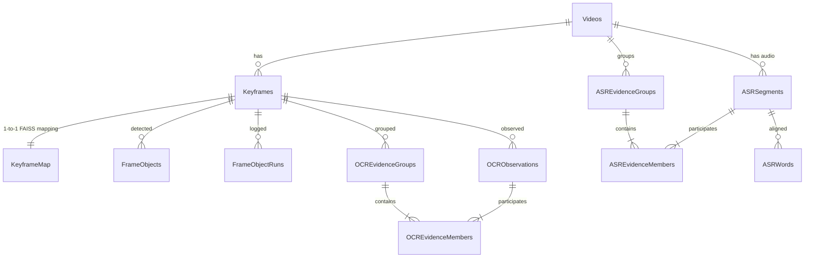

# VIDENTRA — Offline Storage & Data Architecture Specification

Tài liệu này mô tả kiến trúc lưu trữ, cấu trúc các bảng dữ liệu trong SQLite `metadata.db`, chỉ mục vector FAISS `faiss_index.bin` và cách liên kết dữ liệu đa phương thức trong quá trình xử lý ngoại tuyến (Offline Processing).

---

## 1. Sơ đồ Kiến trúc Lưu trữ Tổng thể

Hệ thống lưu trữ phân tầng theo 3 thành phần chính:

### Đường dẫn lưu trữ trên đĩa:
* **Dữ liệu thô ban đầu:** `data/raw/`
  * Video gốc: `data/raw/<dataset>/media/*.mp4`
  * Ground Truth & Annotations: `data/raw/<dataset>/GROUNDTRUTH/`
  * Keyframes trích xuất: `data/raw/keyframes/<video_id>/<frame_index>.jpg`
  * Thumbnails: `data/raw/thumbnails/<video_id>/<frame_index>.jpg`
* **Dữ liệu đã xử lý phục vụ tìm kiếm:** `data/processed/`
  * SQLite Metadata & Bằng chứng: `data/processed/metadata.db`
  * FAISS Vector Index (SigLIP 2): `data/processed/faiss_index.bin`
  * File xuất kết quả nộp bài: `data/processed/submission/`
* **Mô hình AI lưu trên máy local:** `models/`
  * Visual Embedding: `models/siglip2/`
  * Object Detection: `models/detection/yolov8n.pt`
  * OCR Models: `models/ocr/paddleocr_en/`, `models/ocr/vietocr/`
  * ASR Models: `models/asr/phowhisper_small/`

---

## 2. Chi tiết Cấu trúc các Bảng trong `metadata.db`

### 2.1. Quản lý Video & Keyframes

#### Bảng `Videos`
Lưu thông tin metadata kỹ thuật của video gốc:
* `video_id` (TEXT, PK): Mã định danh duy nhất của video (ví dụ: tên file không đuôi).
* `dataset` (TEXT): Tên bộ dữ liệu (`msrvtt`, `avc`, `qvhighlights`, `textvr`, `tvr`).
* `file_path` (TEXT): Đường dẫn tuyệt đối tới file video MP4.
* `duration_ms` (INTEGER): Thời lượng video (mili-giây).
* `fps` (REAL): Tốc độ khung hình thực tế.
* `time_base_num`, `time_base_den` (INTEGER): Phân số rational time base (ví dụ `1/1000` hoặc `1/90000`).
* `width`, `height` (INTEGER): Độ phân giải không gian.
* `total_frames` (INTEGER): Tổng số frame decoded theo presentation-order.
* `has_audio` (INTEGER): `1` nếu có audio stream, `0` nếu không có.
* `status` (TEXT): Trạng thái xử lý (`pending`, `ingested`, `completed`, `error`).

#### Bảng `Keyframes`
Lưu kết quả trích xuất khung hình từ thuật toán **Hybrid Dynamic Sampling**:
* `keyframe_id` (TEXT, PK): Định danh dạng `{video_id}__kf_{index:05d}`.
* `video_id` (TEXT, FK -> Videos): Video sở hữu keyframe.
* `keyframe_index` (INTEGER): Thứ tự keyframe được chọn trong video (0, 1, 2...).
* `source_frame_index` (INTEGER): Chỉ số frame gốc (0-based presentation order).
* `pts` (INTEGER): Presentation Timestamp nguyên bản.
* `time_base` (TEXT): Chuỗi rational time base.
* `timestamp_ms` (INTEGER): Thời điểm trình chiếu thực tế tính chính xác theo PTS.
* `keyframe_path` (TEXT): Đường dẫn file ảnh keyframe JPG.
* `thumbnail_path` (TEXT): Đường dẫn ảnh thu nhỏ.
* `faiss_id` (INTEGER, UNIQUE): Ánh xạ 1-1 với chỉ số dòng trong FAISS index.
* `phash` (TEXT): Chuỗi mã băm nhận thức perceptual hash 64-bit chống trùng lặp.
* `sampling_reason` (TEXT): Lý do lấy mẫu (`adaptive_luma`, `max_gap`, `shot_cut`, `burst`).

---

### 2.2. Ánh xạ Chỉ mục Vector FAISS (SigLIP 2)

#### Bảng `KeyframeMap`
Quy cách chuẩn tương thích AIC dùng để giải mã kết quả tìm kiếm vector của FAISS:
* `faiss_id` (INTEGER, PK): Chỉ số dòng của vector trong `faiss_index.bin` ($0, 1, \dots, N-1$).
* `keyframe_id` (TEXT, UNIQUE): Liên kết sang bảng `Keyframes`.
* `video_id` (TEXT): Mã video để hiển thị kết quả.
* `pts_time` (REAL): Thời gian trình chiếu (giây dạng số thực `pts * time_base`).
* `source_frame_index` (INTEGER): Chỉ số frame gốc.
* `keyframe_path` (TEXT): Đường dẫn ảnh thumbnail/keyframe.

#### Bảng `IndexManifest`
Quản lý phiên bản và tính toàn vẹn của file FAISS index:
* `manifest_id` (TEXT, PK): Định danh phiên bản index.
* `index_type` (TEXT): Cấu hình index (mặc định `IndexFlatIP`).
* `vector_dim` (INTEGER): Chiều của vector (768 với SigLIP 2 ViT Base).
* `metric` (TEXT): Phép đo tương đồng (`inner_product` / `cosine`).
* `total_vectors` (INTEGER): Tổng số vector được index.
* `model_id`, `model_version`, `weights_hash` (TEXT): Định danh model và mã băm trọng số.
* `index_file_path` (TEXT): Đường dẫn file `.bin`.
* `is_active` (INTEGER): `1` nếu là index đang phục vụ tìm kiếm hiện tại.

---

### 2.3. Nhận dạng Vật thể Offline (YOLO / DETR)

#### Bảng `FrameObjects`
* `detection_id` (TEXT, PK): Định danh bounding box phát hiện.
* `video_id`, `keyframe_id` (TEXT, FK): Liên kết video và keyframe.
* `timestamp_ms` (INTEGER): Thời điểm frame xuất hiện.
* `class_id` (INTEGER), `class_name` (TEXT): Nhãn vật thể (ví dụ: `car`, `person`, `traffic light`).
* `bbox_x1`, `bbox_y1`, `bbox_x2`, `bbox_y2` (REAL): Tọa độ hộp chuẩn hóa $[0.0, 1.0]$.
* `confidence` (REAL): Điểm tin cậy của detector ($0.0 - 1.0$).
* `image_width`, `image_height` (INTEGER): Kích thước gốc của frame.
* `model_id`, `model_version` (TEXT): Tên và phiên bản mô hình (ví dụ: `yolov8n`).

#### Bảng `FrameObjectRuns`
Ghi nhận nhật ký chạy detector trên keyframe (kể cả khi frame đó không có bất kỳ vật thể nào):
* `keyframe_id` (TEXT, PK), `video_id` (TEXT).
* `object_count` (INTEGER): Số lượng đối tượng tìm thấy.
* `model_id` (TEXT), `processed_at` (TEXT).

---

### 2.4. Bằng chứng Chữ cảnh (OCR) — Hai Model Độc Lập

#### Bảng `OCRObservations`
Lưu kết quả **nguyên bản** từ từng model (`PP-OCRv5` và `VietOCR`), tuyệt đối không ghi đè:
* `observation_id` (TEXT, PK): Định danh quan sát OCR.
* `video_id`, `keyframe_id` (TEXT, FK).
* `timestamp_ms` (INTEGER): Thời điểm xuất hiện chữ.
* `model_id` (TEXT): Model nhận dạng (`PP-OCRv5`, `VietOCR`).
* `raw_text` (TEXT): Chuỗi văn bản thô model xuất ra.
* `normalized_text` (TEXT): Chuỗi văn bản đã chuẩn hóa Unicode NFC.
* `bbox_x1`, `bbox_y1`, `bbox_x2`, `bbox_y2` (REAL): Vị trí hộp chữ.
* `confidence` (REAL): Độ tin cậy ($0.0 - 1.0$).
* `language` (TEXT): Mã ngôn ngữ (`vi`, `en`).

#### Bảng `OCREvidenceGroups` & `OCREvidenceMembers`
Gộp bằng chứng từ 2 model tại cùng một vùng không gian (IoU $\ge 0.35$):
* `group_id` (TEXT, PK): Định danh nhóm bằng chứng.
* `consensus_text` (TEXT): Văn bản đồng thuận tốt nhất.
* `status` (TEXT): Trạng thái đối chiếu:
  * `agreed`: Cả 2 model đều đọc được và có độ tương đồng văn bản $\ge 85\%$.
  * `partial`: 2 model đọc được nhưng có sự khác biệt một phần ($40\% - 85\%$).
  * `disputed`: Cùng vị trí nhưng 2 model đưa ra nội dung khác nhau ($< 40\%$).
  * `single_model`: Chỉ một trong hai model phát hiện được vùng chữ này.
* `models_involved` (TEXT): Danh sách model tham gia (ví dụ: `PP-OCRv5,VietOCR`).
* Bảng liên kết `OCREvidenceMembers(group_id, observation_id, model_id)` lưu vết từng quan sát gốc.

---

### 2.5. Bằng chứng Giọng nói (ASR) — Hai Model Độc Lập

#### Bảng `ASRSegments`
Lưu transcript **nguyên bản** từ từng model (`Faster-Whisper` và `PhoWhisper`):
* `segment_id` (TEXT, PK).
* `video_id` (TEXT, FK).
* `model_id` (TEXT): Tên model (`Faster-Whisper`, `PhoWhisper`).
* `start_ms`, `end_ms` (INTEGER): Đoạn thời gian lời thoại xuất hiện (mili-giây).
* `raw_text`, `normalized_text` (TEXT): Nội dung lời thoại (Unicode NFC).
* `confidence` (REAL), `speaker_id` (TEXT, có thể NULL nếu chưa diarization).

#### Bảng `ASREvidenceGroups` & `ASREvidenceMembers`
Gộp các đoạn lời thoại chồng lấn thời gian (Temporal Overlap $\ge 30\%$):
* `group_id` (TEXT, PK).
* `start_ms`, `end_ms` (INTEGER): Khung thời gian hợp nhất.
* `consensus_text` (TEXT): Lời thoại đồng thuận.
* `status` (TEXT): Trạng thái đối chiếu (`agreed`, `partial`, `disputed`, `single_model`).
* `temporal_overlap_ratio` (REAL), `text_similarity` (REAL).

---

### 2.6. Tìm kiếm Văn bản Toàn văn Siêu Tốc (SQLite FTS5)

Hệ thống tích hợp 2 bảng ảo SQLite FTS5 tự động đồng bộ:
1. `fts_ocr`: Lập chỉ mục `normalized_text` (có dấu) và `unaccented_text` (không dấu). Khi người dùng gõ *"Bệnh viện"* hay *"Benh vien"*, FTS5 đều trả về chính xác trong $< 1$ mili-giây và ánh xạ ngược về `group_id` $\rightarrow$ `keyframe_id` $\rightarrow$ `video_id`.
2. `fts_asr`: Lập chỉ mục lời thoại `normalized_text` và `unaccented_text` phục vụ tìm kiếm thoại tiếng Việt và tiếng Anh.

---

## 3. Kiểm Tra Tính Toàn Vẹn Dữ Liệu (Integrity Verification)

Hàm `verify_offline_storage_integrity(db_path, faiss_path)` tự động kiểm tra 5 tiêu chí:
1. **Đồng bộ FAISS và SQLite:** Số vector `ntotal` trong `faiss_index.bin` bắt buộc phải bằng chính xác số dòng trong `KeyframeMap` và số keyframe có `faiss_id IS NOT NULL`.
2. **Khóa ngoại hợp lệ (No Orphaned Records):** Mọi keyframe, object detection, OCR observation và ASR segment đều phải trỏ về video hợp lệ trong bảng `Videos`.
3. **Tính đơn điệu thời gian (Monotonic Timeline):** PTS của các keyframes trong cùng 1 video phải tăng dần liên tục theo `keyframe_index`.
4. **Tính toàn vẹn của Evidence Groups:** Mọi thành viên trong `OCREvidenceMembers` và `ASREvidenceMembers` phải liên kết đúng với observation/segment gốc.
5. **Khả năng truy vấn của FTS5:** Đảm bảo các bảng ảo `fts_ocr` và `fts_asr` không bị lỗi index và trả về kết quả chuẩn xác.
