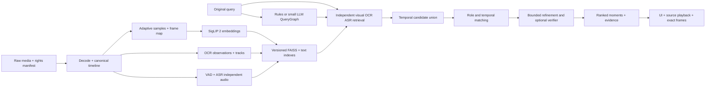

# VIDENTRA — Detailed implementation pipeline

**Blueprint v1.0 · 04/11/2026 · trạng thái: PROPOSED, chờ review thiết kế.** Đây là đặc tả, không phải hệ thống đã triển khai. Cấu hình mục tiêu do người dùng xác nhận: **RTX 3060 6 GB VRAM, RAM 32 GB**; CPU, SSD, TGP GPU và ngân sách lưu trữ chưa xác định. Mọi threshold và budget dưới đây là **giá trị khởi tạo cần kiểm chứng**, không phải kết quả benchmark.

Quy ước bằng chứng: `VERIFIED_SOURCE` = đã đọc nguồn; `VERIFIED_LOCAL` = đã kiểm tra file/receipt; `PROPOSED` = lựa chọn thiết kế; `NOT_MEASURED` = chưa đo; `SYNTHETIC` = dữ liệu minh họa. Experiment IDs E01–E14 được định nghĩa ở [08](08_BENCHMARK_AND_LATENCY_PLAN.md); quyết định D01–D14 ở [11](11_RISKS_AND_DECISION_LOG.md). Pipeline này là nguồn chuẩn khi tài liệu khác có diễn giải ngắn hơn.

## 13.1. System overview

### Mục tiêu và hợp đồng

Từ query Việt/Anh, tìm **moment** trong corpus trên 10.000 giờ, trả video, khoảng thời gian, frame gốc, score xếp hạng, evidence và media có thể xem. Phải phân biệt đúng video, đúng khoảng, đúng vai trò thực thể, đúng thứ tự sự kiện. Kết quả gần đúng vẫn được hiển thị với trạng thái `partial`; không gán “đã xác minh toàn bộ” cho quan hệ chỉ có co-occurrence.

Kiến trúc **B — Query-Aware Relation Retrieval** được chọn tạm thời: A là baseline bắt buộc; C là nhóm adapter thử nghiệm. B không mặc định chứa VLM lớn, scene graph trên toàn corpus, fine-tuning, RAG trả lời hoặc thuật toán EVOI của dự án cũ.

**Functional requirements:** ingest idempotent; timeline VFR; sampling thích ứng; visual/OCR/ASR truy hồi độc lập; query gốc luôn tồn tại; localization đa moment; relation assessment; Fast/Accurate; UI Top-5/10/20/50; seek/playback/frame navigation/export; incremental publish và rollback.

**Non-functional requirements:** kết quả tái lập theo snapshot; không truy cập labels khi inference; RAM process peak mục tiêu ≤24 GiB để còn headroom OS; GPU peak mục tiêu ≤5 GiB tổng worker active; deadline allocation Fast 2 s, Accurate 8 s là ngân sách thử nghiệm; mục tiêu warm p50 ≤1 s, p95 ≤3 s được đo riêng, chưa cam kết đạt. Tải khởi đầu một người dùng, một query active; benchmark thêm concurrency 2/4. Corpus không cần nằm toàn bộ trên SSD laptop; media tách khỏi index.

### Phân tách offline/online



Core modules: `ingestion`, `timeline`, `sampling`, `encoders`, `ocr`, `asr`, `evidence`, `indexing`, `query`, `retrieval`, `relations`, `localization`, `ranking`, `api`, `evaluation`, `ui`.

Giả định chưa kiểm chứng: phân bố ngôn ngữ, tỷ lệ speech/text, độ dài clip, bitrate, mật độ sample thực tế, phần trăm action quan sát được, tốc độ SSD/CPU. Không coi transcript đủ để biết ai nói. “Áo xanh” tiếng Việt có thể blue hoặc green; “phía sau” có thể là nền ảnh hoặc quan hệ chiều sâu. Parser phải giữ ambiguity.

Câu hỏi chưa đóng: sampler có giữ short events ở matched budget; B có cải thiện reversal pairs; 6 GB có chạy verifier đủ nhanh; lexical sharding có cần dịch vụ riêng; loại index nào đạt Recall target. Tất cả có go/no-go trong E01/E02/E05/E07/E08/E10.

## 13.2. Complete offline pipeline

Mọi stage có `stage_version`, `input_hashes`, `config_hash`, `model_revision`, `status`, `attempt`, `error_code`, `output_manifest_hash`. Cache key = SHA-256 của tuple canonical này; không cache theo filename đơn thuần. Mỗi shard ghi vào thư mục attempt mới, flush/fsync, kiểm tra checksum rồi mới atomic rename và cập nhật catalog transaction. Worker CPU có thể parallel; **chỉ một GPU-heavy stage active** trên 6 GB. Retry tối đa 2 lần cho lỗi transient, không retry vô hạn dữ liệu hỏng. `missing`, `failed`, `not_run`, `empty_observed` là bốn trạng thái khác nhau.

### O00 — Register and verify media

- **Purpose/input:** tiếp nhận URI được phép, bytes, source ID, dataset split và quyền sử dụng.
- **Algorithm/library:** SHA-256 streaming; ffprobe JSON streams/format; exact duplicate bằng bytes; near-duplicate pHash/audio fingerprint chỉ tạo cluster, không tự xóa.
- **Output/format/storage:** `MediaAsset` JSONL + SQLite catalog; media immutable ngoài Git, `data/raw/<sha256>/original.ext` hoặc object URI; registry `manifests/media/`.
- **Timestamp:** lưu container/stream start_time, time_base, edit metadata, source offset và basis; chưa gán time zero bằng nominal FPS.
- **Error/recovery:** inaccessible→retry; rights unknown→quarantine; hash thay đổi→asset version mới; container parse lỗi→quarantine có reason.
- **Cache/cost:** O(bytes) I/O; ffprobe cost đo E01. Không claim fingerprint phát hiện mọi duplicate.
- **Quality/acceptance:** ID unique; hash đọc lại khớp; không có URI trỏ tùy tiện từ query; 100% accepted assets có nguồn/quyền trạng thái xác định; rerun không tạo asset trùng.

### O01 — Decode and build canonical frame/audio maps

- **Purpose/input:** media O00 accepted; chọn video/audio stream tường minh.
- **Algorithm/library:** FFmpeg/PyAV decode tuần tự, presentation-order output; ledger toàn bộ frame kể cả frame không được chọn làm embedding. Counter không reset ở mỗi seek. Lưu raw PTS, best_effort_timestamp riêng, time_base rational và decode status.
- **Output/format/storage:** Parquet `timeline/<asset>/frames.parquet`, row-group theo 1–5 phút; audio chunk map JSONL. Chỉ giữ frame pixels trong ring buffer; không lưu mọi ảnh.
- **Timestamp:** mapping piecewise giữa media presentation time, clip-relative và source-relative; dùng rational arithmetic. Audio và video cùng một origin; không reset mỗi stream về zero riêng.
- **Error/recovery:** missing/repeated/backward PTS được ghi, không sửa ngầm; discontinuity tạo epoch; corruption có gap record. Decoder version khác phải tạo timeline revision mới.
- **Cache/cost:** O(F) decode, thường là phần không tránh được để bảo toàn global ordinal; 10.000 h ×30 fps = 1,08 tỷ frame, không phải 1,08 tỷ embedding.
- **Quality/acceptance:** fixture VFR/B-frame/nonzero origin/audio delay có round-trip đúng; frame lookup parity với decode tuần tự; không `round(seconds*fps)`. Media lỗi không được báo ready_full.

### O02 — Adaptive sampling and scene segmentation

- **Purpose/input:** frames O01, low-resolution analysis stream, PTS và optional codec motion vectors.
- **Algorithm/library:** hybrid tại §13.3; PySceneDetect AdaptiveDetector/ContentDetector là adapter tham khảo, timestamp chính thức vẫn từ O01.
- **Output/format/storage:** `samples.parquet`, `scenes.parquet`, selection reason bitset; frame pixels gửi thẳng O03/O04 hoặc bounded lossless cache.
- **Timestamp:** exact frame reference O01; scene boundary gắn PTS quan sát; cut time có bracket uncertainty.
- **Error/recovery:** detector lỗi→max-gap sampler, giữ flag; overload→không drop hard-gap/cut bắt buộc, ghi density overflow.
- **Cache/cost:** O(F×small_image) change detector; inference O(Nselected); optical flow chỉ ablation E02, không mandatory dense flow.
- **Quality/acceptance:** max gap ≤2 s cộng một inter-frame interval ở vùng decode được; first/last protected; kiểm tra event/text coverage trên human dev, không dùng GT chọn frame.

### O03 — Visual feature extraction

- **Purpose/input:** selected frame pixels + immutable model/processor revision.
- **Algorithm/library:** SigLIP 2 Base patch16-224; theo §13.4; batch khởi đầu 16, OOM giảm 8→4→1.
- **Output/format/storage:** normalized FP16 embeddings trong `features/visual/<model_hash>/<shard>.npy` hoặc contiguous binary + manifest; norm/statistics FP32; original IDs sidecar.
- **Timestamp:** không tạo timestamp mới; mỗi row trỏ sampled_frame_id. Clip pooling lưu member IDs.
- **Error/recovery:** invalid image→failure record; NaN/zero norm→reject; model mismatch→không trộn index.
- **Cache/cost:** N/r_embed seconds, r_embed NOT_MEASURED; FP16 storage 2Nd bytes.
- **Quality/acceptance:** FP16-vs-FP32 retrieval agreement đo E03; cùng ảnh trong batch khác cho similarity sai khác trong tolerance đã chốt; dim đúng config; zero nonfinite.

### O04 — OCR detection, routing, recognition and tracks

- **Purpose/input:** native-resolution selected frames **và** independent text-probe frames; không dùng resized SigLIP tensor.
- **Algorithm/library:** shared Paddle detector; PP-OCRv5 Latin/mobile reference, PP-OCRv6 small challenger; VietOCR fallback; VieSVTR v7 experimental sau rights gate. Chi tiết §13.5.
- **Output/format/storage:** OCRObservation + OCRTrack Parquet, crops optional LRU, model/confidence metadata, `evidence/ocr/<asset>/`.
- **Timestamp:** observation là instant; track có first/last observation, list intervals/brackets và holes; một observation không tạo persistence interval.
- **Error/recovery:** failed detector khác no_text; bad crop retry high-res; disagreement giữ hypotheses, không bỏ dấu để tự chọn “đúng”.
- **Cache/cost:** Nprobe/r_det + Ncrops/r_rec + Nfallback/r_vi; đo cả decode/crop I/O E04.
- **Quality/acceptance:** word polygons trong ảnh gốc; NFC round-trip; text-track không nối qua shot cut; báo CER và brief-text recall trên nhãn phù hợp.

### O05 — Audio extraction and VAD

- **Purpose/input:** audio stream O01, không phụ thuộc selected visual frames.
- **Algorithm/library:** FFmpeg PCM 16 kHz mono dùng cho recognizer; Silero VAD qua Faster-Whisper hoặc adapter riêng; lưu channel/downmix recipe. Speech chunks ≤30 s, overlap 0,5 s khi cắt utterance dài.
- **Output/format/storage:** VADSegment JSONL và chunk→original audio sample map; PCM chunk temporary bounded cache trong `work/audio/`.
- **Timestamp:** với chunk từ t0, output word offset cộng t0 sau khi quy đổi theo original audio origin; VAD concatenation phải lưu piecewise map.
- **Error/recovery:** no audio→missing; no speech→empty_observed; unsupported codec→failed; clipping/noise ghi quality flags.
- **Cache/cost:** O(audio duration); raw PCM toàn corpus 16k×2×36M =1,152 TB nếu giữ, nên stream/chunk rồi evict theo retention.
- **Quality/acceptance:** fixture có audio delay 350 ms giữ nguyên; sample count và conversion round-trip; VAD miss rate/segmentation edge đo E04.

### O06 — ASR routing and transcription

- **Purpose/input:** VAD chunks O05, language prior từ sample speech; không lấy tên dataset làm nhãn ngôn ngữ chắc chắn.
- **Algorithm/library:** Faster-Whisper small multilingual primary, PhoWhisper-small secondary; medium/large-v3-turbo là challenger theo E04. Route và disagreement ở §13.5.
- **Output/format/storage:** ASRSegment + optional words trong `evidence/asr/<asset>/`; text_original, text_nfc, variants, language, raw diagnostics, timestamp method.
- **Timestamp:** clip-relative intervals từ piecewise audio map; forced alignment optional, chỉ adapter/ngôn ngữ đã test; word timing null nếu không tin cậy.
- **Error/recovery:** empty/hallucinated speech flags; retry 1 lần với parameter đã định; GPU OOM giảm batch/CPU int8. Không suy ra speaker actor từ diarization ID.
- **Cache/cost:** speech_hours×RTF_primary + fallback_hours×RTF_secondary; RTF phải đo trên 3060, không lấy benchmark GPU khác.
- **Quality/acceptance:** vi/en/code-switch/noise strata; CER/WER kèm normalization; timestamp MAE riêng; transcript dài trong silence bị flag.

### O07 — Normalize, align and build evidence catalog

- **Purpose/input:** O01/O02/O04/O06 và model manifests.
- **Algorithm/library:** deterministic NFC/text variants, temporal interval join trong cùng asset/epoch; confidence lưu raw không gộp thành probability. Optional entity/track adapter chỉ chạy batch ngoại tuyến được cấp budget, không bắt buộc toàn corpus.
- **Output/format/storage:** typed evidence Parquet + per-shard SQLite read indexes, explicit foreign keys; `evidence/manifest.json`.
- **Timestamp:** dùng integer microseconds + original rational PTS; OCR instant không biến thành ASR interval; không tự nối media khác source.
- **Error/recovery:** dangling ref→quarantine shard; modality absent hợp lệ; conflicting observations được giữ với `conflict_group_id`.
- **Cache/cost:** O(E log E) sort/interval joins; metadata phụ thuộc E chứ không chỉ Nvisual.
- **Quality/acceptance:** 100% evidence traceable về bytes/model/frame hoặc audio samples; check no distant-text fusion với negative fixture.

### O08 — Build proposals and multilingual text features

- **Purpose/input:** frames/scenes, OCR tracks, ASR utterances; **không nhận annotation file**.
- **Algorithm/library:** scene-bounded 4/8/16/32 s proposal scales, stride L/2 sinh theo nhu cầu hoặc compact manifest; utterance/track-centered seeds; normalized mean clip vectors optional coarse auxiliary. E5-small 384-d cho OCR/ASR semantic branch.
- **Output/format/storage:** proposals with member evidence IDs; text docs 1 OCR track hoặc ASR segment/context chunk, token cap 128; `features/text/`.
- **Timestamp:** clip proposals là search region, không phải observed event boundary; source evidence span được giữ nguyên.
- **Error/recovery:** too-long query/text→sentence chunks, không silently truncate constraints; unsupported event length→warning và Accurate multi-event expansion.
- **Cache/cost:** O(Etext) text encode; không materialize mọi sliding-window embedding ở mọi scale nếu làm nổ index.
- **Quality/acceptance:** proposal coverage measured E06, not gold-seeded; query/passages E5 prefixes đúng; original text luôn giữ.

### O09 — Build immutable index snapshot

- **Purpose/input:** validated feature/evidence manifests + stable ID registry.
- **Algorithm/library:** FAISS CPU exact/IVF-PQ (§13.6); FTS5/BM25 OCR/ASR riêng; text dense optional, độc lập với visual.
- **Output/format/storage:** `indexes/<snapshot>/shard-*/visual.faiss`, text vectors/SQLite, ID mapping, checksums, tombstones, codebook revision.
- **Timestamp:** indexes chỉ giữ refs; metadata catalog trả timeline. Không serialize timestamp vào vector để đo similarity.
- **Error/recovery:** training fail→retain old index; out-of-memory→build sequential shards; interruption bỏ attempt incomplete khỏi serving.
- **Cache/cost:** ANN training/build/add measured E05; reserve old+new storage; FP32 training batches bounded.
- **Quality/acceptance:** ANN recall so exact, IDs bijective; no labels in builder dependencies; hash/row count consistent.

### O10 — Validate and publish

- **Purpose/input:** complete snapshot + deterministic canary queries không chứa gold retrieval IDs.
- **Algorithm/library:** integrity checks; compare expected manifest IDs/counts; reader lease; atomic catalog pointer switch sau tất cả shards ready.
- **Output/format/storage:** publish receipt, active snapshot ID; giữ snapshot trước đến hết reader lease/retention.
- **Timestamp:** timeline revision và evidence revision khóa cùng snapshot.
- **Error/recovery:** crash before pointer switch→old version vẫn hoạt động; mixed version load→503, không trả mapping sai.
- **Cache/cost:** O(index bytes) hash, load/warm costs đo riêng; warmup không tính là latency đã đạt.
- **Quality/acceptance:** kill-at-each-step test; query đang chạy dùng trọn một snapshot; restore old pointer có thể thực hiện không rebuild.

### O11 — Thumbnails and playable proxies

- **Purpose/input:** sample frames + media rights/playback compatibility.
- **Algorithm/library:** thumbnail WebP/JPEG ~320px; FFmpeg browser-compatible proxy nếu cần, giữ proxy→source frame/PTS map.
- **Output/format/storage:** `media/thumbs/`, optional `media/proxies/`, media manifest; content-addressed URLs qua API.
- **Timestamp:** playback proxy normalized origin riêng; source mapping tường minh; exact frame endpoint decode source O01.
- **Error/recovery:** thumbnail lỗi→placeholder có error, media fail→retry/proxy/source download nếu được phép; không generate giả video.
- **Cache/cost:** Nthumb×average bytes; thumbnail on demand + scene representatives giúp giảm dung lượng; proxy costs đo E09.
- **Quality/acceptance:** click correct video/start/end; frame-step parity; mở result không gọi lại OCR/ASR/LLM.

## 13.3. Dynamic sampling algorithm

### Formulation và threshold khởi tạo (E02)

Frame i có presentation time t_i; phân tích ảnh giảm cạnh dài 256 px. Tính:
- d_i = mean absolute luma difference /255 so frame trước; c_i = histogram HSV distance chuẩn hóa [0,1].
- h_i = Hamming distance pHash 64-bit với sample gần nhất, chỉ dedup pixel redundancy.
- m_i = median magnitude của sparse optical flow/diagonal ảnh; default **tắt** nếu chưa chứng minh incremental benefit; motion vectors codec là hint.
- r_i = robust change score d_i/(median_{2s}(d)+3×MAD_{2s}(d)+0.01).
- hard anchors: first/last frame, mỗi gap 2 s, shot cut bracket trước/sau. Soft events: r_i>3 và d_i>0.04; hoặc c_i>0.35; optional m_i>0.015.
- burst: giữ 0,5 s trước và 1 s sau trigger ở 4 fps; ring buffer lưu refs/ảnh cần thiết. Independent OCR probes mặc định 1 fps + cut/burst, được E04 điều chỉnh 0,5/1/2 fps; không phụ thuộc visual-selected list.

**Min/max:** hard gap tạo floor xấp xỉ 0,5 sample/s ở đoạn liên tục; burst soft cap 4/s và target rolling mean ≤1/s trên 60 s. Phần bắt buộc vượt cap thì **giữ anchors và ghi overflow**, không hứa bound tuyệt đối nếu video có nhiều cut. E02 so gap 1/2/4 s; 0,1 và 0,25 fps ở bảng scale là sensitivity scenarios, không phải cấu hình default đáp ứng gap 2 s.

```text
select(stream, G=2s, burst_rate=4/s, target_soft_rate=1/s):
    selected = ordered set; pending = []; ring = last 0.5s
    for frame in sequential_decode(stream):
        ledger.append(frame.pts, frame.ordinal, frame.time_base)
        if invalid_timeline(frame): record_gap(); continue
        hard = first(frame) or elapsed_since_last_selected(frame) >= G
        change = measure_lowres(frame)
        cut = scene_detector(change)
        if cut: mark(previous_frame, "cut_before", mandatory=True)
        if cut or trigger(change):
            pending += burst_grid(frame.t - 0.5s, frame.t + 1s)
        requested = hard or cut or nearest_available_frame_due(pending, frame)
        if requested:
            reason = all_trigger_reasons(frame)
            if mandatory(frame, reason):
                keep(frame, reason)
            elif phash_distance(last_selected, frame) > 4:
                offer_soft_sample(frame, reason)
        enforce_rolling_soft_quota_without_removing_hard_anchors()
        run_independent_ocr_probe_if_due(frame)
    keep(last_valid_frame, "last", mandatory=True)
    assert_gap_coverage_except_recorded_decode_gaps()
    return selected + all overflow/gap diagnostics
```

Các timestamp của burst grid được snap tới **frame đã decode thực**, không tạo frame giả. Duplicate dedup không được xóa hard-gap anchor kể cả cảnh hoàn toàn đứng yên: có thể dùng cùng embedding bytes qua content hash nhưng giữ nhiều observation rows. Không dedup qua scene bằng chỉ text/pHash nếu làm mất event occurrence.

**Không bảo đảm bắt mọi short action/text:** gap 2 s vẫn có thể bỏ sự kiện 100 ms; change detector thấp có thể bỏ tay đưa vật nhỏ; OCR probe 1 fps cũng có thể bỏ biển ngắn. Chỉ full decoding không đồng nghĩa đã nhận diện semantic mọi frame. Mitigation: burst/short-text probes, independent ASR/OCR entry points, query-time decode top candidates; nếu tất cả retrieval branches miss thì refinement không cứu được. Đo event visibility recall theo duration bins <0,5 /0,5–2 />2 s; event frame nào “đủ” do người gán nhãn, không bằng embedding score.

Uniform so sánh ở **cùng số frame và cùng tổng compute**; báo riêng decode cost, selection cost, embedding cost. Uniform dễ tái lập, coverage dự đoán được; scene-only bỏ sự kiện trong long shot; pHash-only bỏ semantic changes; full optical flow tốn compute và nhạy camera; learned event-aware sampler cần training/domain coverage, là challenger. Hybrid được chọn vì có coverage floor, explanation và throttling rõ ràng, **lợi ích quality chưa chứng minh**.

## 13.4. Visual embedding pipeline

Initial model `google/siglip2-base-patch16-224`, dim 768; benchmark Base-384 trước Large-256 dim1024/So400m-384 dim1152. Exact revisions lưu [model snapshot](../audit/model_revision_snapshot.json), không dùng mutable `main` cho run chính thức. [Nguồn model](https://huggingface.co/google/siglip2-base-patch16-224), [variant release](https://github.com/google-research/big_vision/blob/main/big_vision/configs/proj/image_text/README_siglip2.md).

Dùng AutoProcessor pinned: RGB, resize/rescale/normalize theo config; không tự crop mất chữ/vật nhỏ. Giữ original image dimensions và transform. `get_image_features`, FP32 L2 norm `z = x / max(||x||_2,1e-12)`; reject norm=0. Query dùng đúng paired text tower, tokenizer, padding/max_length theo revision (baseline 64 tokens); dài hơn thì giữ query gốc, sentence clauses có overlap và source spans, log truncation nếu bất kỳ encoder input bị cắt. Không coi average các mệnh đề là chứng minh quan hệ.

FP16 feature store; trước CPU FAISS cast FP32 và renormalize. Exact comparator có hai chuẩn: exact FP32 original để đo precision loss; exact reconstructed FP16 để tách ANN loss. Similarity là inner product trên unit vectors; không sigmoid rồi gọi probability.

Frame vector là atomic retrieval entry. Scene/window pooling là **auxiliary index**, không loại quyền truy hồi frame/text global. Pooling normalized mean bỏ order nên chỉ coarse score. Long video không bị gộp thành một vector duy nhất. New model revision yêu cầu feature/index namespace mới; registry mapping IDs giữ nguyên entity identity nhưng embedding record ID khác.

## 13.5. OCR and ASR pipelines

### OCR routing

Detect trên ảnh original hoặc tile khi cạnh dài >1920 px/small-text flag; bounding polygon inverse-transform về source coordinates. Khởi đầu detector cạnh dài 960 px, crop từ original; E04 so 960/1280/native tiles. Detection shared giữa recognizers, không gọi hai detectors chỉ vì dùng hai recognizers.

Primary reference PP-OCRv5 Latin mobile (phải đúng charset Vietnamese; bản English-only cũ chỉ là control). PP-OCRv6 small là challenger, **chưa dùng mặc định cho tiếng Việt**: probe dictionary hiện hành thiếu một số ký tự như ả, ạ, ớ, ở, ậ, ố; đây là kiểm tra mẫu charset, chưa phải inference benchmark. Upstream xác nhận vấn đề cần xử lý ở model/dictionary, không thay dictionary đơn thuần rồi coi đã sửa. Gate E04 phải kiểm tra đầy đủ charset, model/decoder alignment và CER trên VinText/video-text dev. Xem [issue upstream](https://github.com/PaddlePaddle/PaddleOCR/issues/18254) và [probe receipt](../audit/paddle_v6_charset_probe.json). VietOCR `vgg_transformer` là second recognizer; VieSVTR v7 ONNX là challenger có CC-BY-NC-4.0, không tự coi permissive hoặc mạnh hơn vì model card.

Fallback trên crop khi raw confidence <0,80, dấu/charset bất thường, text changes với crop gần giống hoặc expected-language ambiguity. Giá trị 0,80 **không so trực tiếp cross-model**; grid tune bằng dev ROC và coverage. Language routing dựa output/script và video metadata soft priors; Latin script không đủ phân biệt vi/en. Giới hạn initial fallback ≤20% crops theo priority; ghi skipped_fallback và đo oracle disagreement sample random 5% để phát hiện routing bỏ sót.

Dual outputs được giữ cùng crop_id, không cộng điểm như hai evidence độc lập. Chọn canonical bằng calibrated recognizer quality model trên dev, hoặc primary nếu chưa có calibrator, giữ alternative searchable với downweight. Unicode NFC giữ dấu; auxiliary unaccented index chỉ tăng recall; exact quote recheck trên NFC original. OCRTrack nối cùng scene, IoU≥0,5 và normalized edit similarity≥0,8, gap≤1 s; câu lặp ở phút khác là track khác. Track chứng minh text được quan sát nhiều lần, không khẳng định mọi frame ở giữa đều có text.

### ASR routing

VAD chunks độc lập; Whisper-small multilingual primary. Language decision từ nhiều chunks; `vi` high confidence và poor diagnostics→PhoWhisper-small; mixed/en→primary và optional alternate với suspected Vietnamese subspan. Không ép toàn clip code-switch thành vi. Controlled dual 5% random audit + uncertain/noisy chunks, cap initial 20% speech duration. Giữ all alternatives để audit; không chọn transcript theo query đang tìm vì gây query-conditioned hallucination.

Các fallback triggers sơ bộ: avg_logprob <−1, compression_ratio >2,4, no_speech_prob >0,6 với VAD disagreement, repeated loops; phải tune E04 và không gọi diagnostics probability đúng transcript. Speech chunks overlap dedup bằng aligned word/time overlap, không dùng text equality toàn video. Subtitle OCR và speech ASR là evidence khác loại.

PhoWhisper qua Transformers hoặc CTranslate2 conversion **sau parity test**; model card không chứng minh mọi converter version tương thích. Forced alignment chỉ cho candidate hoặc offline selected chunks; model Vietnamese và alignment dictionary phải được kiểm tra. Diarization “speaker_0” là acoustic cluster, không phải “người áo xanh”. Speaker binding cần audio-visual active-speaker evidence; thiếu thì speaker predicate `unknown`.

Comparison bắt buộc: primary-only, language-routing, confidence-fallback, controlled-dual; matched compute + separate quality/cost Pareto. Giữ thresholds/model revision trong recipe; không chạy cả hai models trên tất cả corpus theo mặc định.

## 13.6. Search index architecture

### Index choice

Baseline <100k vectors: `IndexIDMap2(IndexFlatIP(d))`. E05 thử Flat, HNSW32 + IDMap2, IVF-Flat, OPQ+IVF-PQ. Production starting hypothesis với d768: `OPQ96,IVF4096,PQ96x8`, metric IP, trained representative 200k–500k vectors từ train/index-distribution sample độc lập qrels; nprobe {8,16,32,64,128}. Đây là search grid, không best config đã đo. Shard ~1M vectors hoặc khi memory envelope vượt; IVF4096 không dùng nếu training rows không đủ centroid coverage. Incremental `delta Flat` ≤100k/shard, tombstone mask, merge rebuild khi >10% base hoặc drift.

[FAISS index guidance](https://github.com/facebookresearch/faiss/wiki/Guidelines-to-choose-an-index) hỗ trợ cân nhắc RAM/recall; HNSW không mặc định có remove trực tiếp. Với d768, Flat ~3072 bytes/vector; HNSW32 ~3328 + ID overhead; PQ96x8 + int64 ID ~104 bytes/vector, chưa gồm codebook, OPQ, coarse centroids, inverted-list overhead, direct maps và build peak.

**Stable IDs:** UUID/content identity cho asset, frame, evidence; `vector_id` là int64 dương do SQLite registry cấp theo transaction, không dùng row offset hoặc Python hash. Unique tuple (entity_id, encoder_revision, representation_kind). FAISS ID→registry→sample/clip→timeline row→media manifest. Tombstoned ID không tái dùng; rebuild không đánh lại ID. JavaScript serialize int64 lớn thành string.

### Text, metadata và sharding

OCR và ASR có FTS5 tables riêng: content text NFC với `unicode61 remove_diacritics 0`; auxiliary folded field phục vụ recall. FTS5 BM25 **giá trị nhỏ hơn tốt hơn**, transform rank trước RRF. Exact quote dùng phrase search rồi validate literal/NFC trên actual evidence. Trigram index optional cho OCR typos, không thay exact mode. [SQLite FTS5](https://sqlite.org/fts5.html).

Semantic text: E5-small dim384, prefix `query: ` / `passage: `, masked mean pooling + L2. CPU INT8 candidate để không chiếm VRAM online. Search independent OCR_dense/ASR_dense, không dùng SigLIP visual index cho mọi text. Dense text features d384×2E bytes; PQ32x8 option riêng vì khác dimensions/distribution. [E5 model card](https://huggingface.co/intfloat/multilingual-e5-small).

Catalog SQLite single-writer job service, WAL cho ingest; published shards immutable read-only. Parquet là archival bulk; SQLite giữ locator/interval/text phục vụ lookup, tránh đưa full 1,08 tỷ frame ledger vào hot RAM. RAM hot budget ban đầu 8 GiB ANN + 4 GiB metadata/FTS cache + 4 GiB encoder/rerank buffers + 8 GiB service/build headroom, **không phải số đo**. Tổng mục tiêu24 GiB, OS còn ~8.

Shard by hash(source_video_id), cùng source vào một shard để temporal join không tản; snapshot ghi routing map. Search fan-out mọi shard được phép với parallelism CPU≤4 ban đầu, merge top lists; không coarse-gate bỏ shard bằng visual-only. Global lexical BM25 không đồng nhất giữa shards: recompute BM25 trên shortlist bằng global df/versioned stats, hoặc RRF trong branch theo rank rồi benchmark; MVP một lexical DB loại vấn đề này. Qdrant chỉ xem xét khi distributed filtering/operations có lợi rõ rệt; không thay FAISS trước evidence.

Persistence: serving snapshot gồm feature IDs + text/metadata versions; API pin snapshot cho whole request. Incremental new assets READY chỉ khi required visual timeline ready; optional modalities có completeness flags. New evidence publish snapshot mới; query không nhìn half-updated FAISS/SQLite. Rollback dùng catalog pointer, old artifact immutable.

## 13.7. Full online pipeline

**Budgets khởi tạo:** Fast≤1.000 union proposals, rerank graph≤200, refine≤10 regions; Accurate≤3.000 proposals, graph≤500, refine≤30 regions, optional video verifier≤3 candidates. Mỗi logical modality branch (visual, OCR, ASR) lấy tối đa 200 hits Fast/600 Accurate tổng cộng. Lexical/dense trong cùng modality chia budget 50/50 ban đầu, quota thừa có thể chuyển cho nhánh còn lại; subqueries chia cùng budget. Original query tối thiểu40% visual branch budget; maximum8 subqueries và16 shards fanout workers bounded (shards có thể nhiều hơn, queue theo deadline).

| Step | Input → output; model/function | Decision/budget | Latency allocation Fast / Accurate (ms); fallback |
|---|---|---|---|
| Q00 | query/options → request context; validate_request | max4000 chars; TopK 5/10/20/50; snapshot pin | 20/20; 422 invalid |
| Q01 | original → QueryGraph; rules or Qwen3 | simple rules bypass LLM; full parse complex only | 250/700; deadline/invalid→fallback graph |
| Q02 | graph+original → branch plan/embeddings | query/paragraph cache; CPU text + GPU text tower bounded | 120/180; original-only |
| Q03 | embeddings/quotes → independent hit lists | visual + OCR lexical/dense + ASR lexical/dense | 280/450; branch timeout partial |
| Q04 | hits → temporal proposals; union/fusion | 1k/3k cap after branch reservation | 100/200; preserve exact phrase seeds |
| Q05 | proposals → relation features | 200/500 graph candidates | 250/600; unknown for missing adapters |
| Q06 | regions → refined boundaries/evidence | 10/30, total requested decode≤40/120s; max40/120 refined frames | 350/1400; coarse intervals retained |
| Q07 | ambiguous top → optional video verification | Fast disabled; Accurate≤3, total≤48 frames, one active model | 0/3000; skip on cold/OOM/deadline |
| Q08 | assessed → ranking/NMS/output | TopK, 3-state match status | 60/100; partial/no-supported-match |
| Q09 | API→cards | cached thumbs lazy media | 120/200; placeholders and replay retry |
| Reserve | scheduler/queue/network overhead | hard wall deadline | 450/1150 |
| **Total allocation** | **SLO, NOT_MEASURED** | **no sum-of-p95 claim** | **2000/8000** |

Deadline includes queue wait. Stages may overlap only khi resources độc lập; không giả định GPU tasks parallel miễn phí. Cold model loading báo riêng và thường bỏ optional verifier để trả partial trong deadline. Accurate có thể trả initial results rồi update theo request_id trong cùng8 s; cancel old request khi query mới. Time measurement `monotonic_ns`, CUDA synchronize ở benchmark; stage counters và end-to-end wall clock tách biệt.

Fast parser budget 250 ms ưu tiên rules/cache; không giả định sinh đủ QueryGraph bằng LLM trong thời gian này. Accurate 700 ms cũng là deadline allocation, không dự báo tốc độ sinh 512 tokens. E07/E10 đo tỉ lệ hoàn tất, fallback và end-to-end quality; nếu phần lớn complex queries timeout thì giảm workload hoặc điều chỉnh allocation qua review.

## 13.8. Small-LLM Query Graph

### Parser decision và structured output

Rules chỉ xử lý grammar đủ hiểu (exact OCR quote, ASR phrase, đơn cảnh); complex role/then/negation mới gọi Qwen3-0.6B hoặc1.7B. Benchmark FP16 vs GGUF Q4_K_M qua llama.cpp; constrained JSON grammar + JSON Schema validation; prompt token limit2048, response budget512 tokens cho compact wire form. Full schema được deterministic expander bổ sung null/empty fields từ compact graph; không thêm semantic predicates. Fast cache miss có thể dùng rules ngay; hết250 ms thì hủy parser và dùng fallback, không chờ generate toàn schema verbose.

Tắt thinking; prompt chỉ parsing, không trả lời sự thật về video. Không có gold/evidence database trong prompt. Output allowed operators theo ontology, source spans phải tìm thấy trong query. Cache key original NFC query + language + model/prompt/schema revision; prompt KV cache là optimization riêng, không đồng nghĩa result cache.

Fallback graph một `free_text` predicate giữ toàn câu + deterministic quoted phrases chắc chắn; routing rộng; `parser.status=fallback`, toàn original constraints vẫn active dưới dạng residual. Không bỏ một negation chỉ vì JSON parse thành công. Syntax valid chưa chứng minh vai trò đúng: semantic validator kiểm tra IDs, role constraints, source coverage, cyclic before, bound contradictions, unresolved references, topological logic, NOT arity1. Ambiguous graph không làm hard negative filtering.

### JSON Schema đầy đủ

Bản máy đọc được: [query_graph.schema.json](../schemas/query_graph.schema.json). `modality_options` là OR của các evidence recipes, mỗi recipe là AND. Ví dụ `[["asr","audio_visual"]]` yêu cầu transcript và actor binding; không suy ra ASR có sẵn chỉ vì query yêu cầu nói.

```json
{
  "$schema": "https://json-schema.org/draft/2020-12/schema",
  "$id": "https://videntra.local/schemas/query-graph.v1.json",
  "title": "VIDENTRA QueryGraph v1",
  "type": "object",
  "additionalProperties": false,
  "properties": {
    "schema_version": {
      "const": "1.0"
    },
    "original_query": {
      "type": "string",
      "minLength": 1,
      "maxLength": 4000
    },
    "language": {
      "enum": [
        "vi",
        "en",
        "mixed",
        "unknown"
      ]
    },
    "entities": {
      "type": "array",
      "items": {
        "$ref": "#/$defs/entity"
      },
      "maxItems": 16
    },
    "predicates": {
      "type": "array",
      "items": {
        "$ref": "#/$defs/predicate"
      },
      "maxItems": 32
    },
    "logic": {
      "type": "array",
      "items": {
        "$ref": "#/$defs/logic"
      },
      "maxItems": 16
    },
    "root_id": {
      "type": "string",
      "pattern": "^[a-z][a-z0-9_]*$"
    },
    "ambiguities": {
      "type": "array",
      "items": {
        "type": "string"
      },
      "maxItems": 16
    },
    "residual_constraints": {
      "type": "array",
      "items": {
        "type": "string"
      },
      "maxItems": 32
    },
    "parser": {
      "type": "object",
      "additionalProperties": false,
      "properties": {
        "status": {
          "enum": [
            "validated",
            "fallback"
          ]
        },
        "model_revision": {
          "type": [
            "string",
            "null"
          ]
        },
        "prompt_version": {
          "type": "string"
        },
        "confidence_kind": {
          "const": "uncalibrated"
        }
      },
      "required": [
        "status",
        "model_revision",
        "prompt_version",
        "confidence_kind"
      ]
    }
  },
  "required": [
    "schema_version",
    "original_query",
    "language",
    "entities",
    "predicates",
    "logic",
    "root_id",
    "ambiguities",
    "residual_constraints",
    "parser"
  ],
  "$defs": {
    "entity": {
      "type": "object",
      "additionalProperties": false,
      "properties": {
        "id": {
          "type": "string",
          "pattern": "^[a-z][a-z0-9_]*$"
        },
        "type": {
          "enum": [
            "person",
            "object",
            "text_region",
            "place",
            "unknown"
          ]
        },
        "mention": {
          "type": "string"
        },
        "attributes": {
          "type": "array",
          "items": {
            "type": "object",
            "additionalProperties": false,
            "properties": {
              "name": {
                "type": "string"
              },
              "value": {
                "type": "string"
              },
              "source_span": {
                "type": "string"
              }
            },
            "required": [
              "name",
              "value",
              "source_span"
            ]
          },
          "maxItems": 16
        },
        "coreference_of": {
          "type": [
            "string",
            "null"
          ]
        },
        "uncertainty": {
          "type": "array",
          "items": {
            "type": "string"
          },
          "maxItems": 8
        }
      },
      "required": [
        "id",
        "type",
        "mention",
        "attributes",
        "coreference_of",
        "uncertainty"
      ]
    },
    "predicate": {
      "type": "object",
      "additionalProperties": false,
      "properties": {
        "id": {
          "type": "string",
          "pattern": "^[a-z][a-z0-9_]*$"
        },
        "kind": {
          "enum": [
            "attribute",
            "action",
            "spatial",
            "temporal",
            "ocr",
            "asr",
            "identity",
            "free_text"
          ]
        },
        "operator": {
          "type": "string"
        },
        "roles": {
          "type": "object",
          "additionalProperties": false,
          "properties": {
            "subject": {
              "type": "string",
              "pattern": "^[a-z][a-z0-9_]*$"
            },
            "object": {
              "type": "string",
              "pattern": "^[a-z][a-z0-9_]*$"
            },
            "recipient": {
              "type": "string",
              "pattern": "^[a-z][a-z0-9_]*$"
            },
            "actor": {
              "type": "string",
              "pattern": "^[a-z][a-z0-9_]*$"
            },
            "reference": {
              "type": "string",
              "pattern": "^[a-z][a-z0-9_]*$"
            },
            "event_a": {
              "type": "string",
              "pattern": "^[a-z][a-z0-9_]*$"
            },
            "event_b": {
              "type": "string",
              "pattern": "^[a-z][a-z0-9_]*$"
            },
            "speaker": {
              "type": "string",
              "pattern": "^[a-z][a-z0-9_]*$"
            },
            "text_entity": {
              "type": "string",
              "pattern": "^[a-z][a-z0-9_]*$"
            }
          }
        },
        "value": {
          "type": [
            "string",
            "null"
          ]
        },
        "source_span": {
          "type": "string"
        },
        "polarity": {
          "enum": [
            "positive",
            "negative"
          ]
        },
        "modality_options": {
          "type": "array",
          "minItems": 1,
          "maxItems": 8,
          "items": {
            "type": "array",
            "minItems": 1,
            "uniqueItems": true,
            "items": {
              "enum": [
                "visual",
                "ocr",
                "asr",
                "audio_visual"
              ]
            }
          }
        },
        "scope": {
          "oneOf": [
            {
              "type": "null"
            },
            {
              "type": "object",
              "additionalProperties": false,
              "properties": {
                "anchor_predicate_id": {
                  "type": [
                    "string",
                    "null"
                  ]
                },
                "min_gap_ms": {
                  "type": [
                    "integer",
                    "null"
                  ],
                  "minimum": 0
                },
                "max_gap_ms": {
                  "type": [
                    "integer",
                    "null"
                  ],
                  "minimum": 0
                },
                "quantifier": {
                  "enum": [
                    "exists",
                    "forall_observed"
                  ]
                }
              },
              "required": [
                "anchor_predicate_id",
                "min_gap_ms",
                "max_gap_ms",
                "quantifier"
              ]
            }
          ]
        },
        "confidence": {
          "type": [
            "number",
            "null"
          ],
          "minimum": 0,
          "maximum": 1
        },
        "uncertainty": {
          "type": "array",
          "items": {
            "type": "string"
          },
          "maxItems": 8
        }
      },
      "required": [
        "id",
        "kind",
        "operator",
        "roles",
        "value",
        "source_span",
        "polarity",
        "modality_options",
        "scope",
        "confidence",
        "uncertainty"
      ]
    },
    "logic": {
      "type": "object",
      "additionalProperties": false,
      "properties": {
        "id": {
          "type": "string",
          "pattern": "^[a-z][a-z0-9_]*$"
        },
        "op": {
          "enum": [
            "AND",
            "OR",
            "NOT"
          ]
        },
        "children": {
          "type": "array",
          "minItems": 1,
          "maxItems": 32,
          "uniqueItems": true,
          "items": {
            "type": "string",
            "pattern": "^[a-z][a-z0-9_]*$"
          }
        }
      },
      "required": [
        "id",
        "op",
        "children"
      ]
    }
  }
}
```

Schema bảo vệ type/shape; semantic validation bổ sung: global unique IDs; root tồn tại; logic graph DAG; every child reachable; role subject/recipient reference entities, event_a/event_b reference predicates; scope anchor reference existing predicate; NOT đúng1child; min_gap≤max_gap; source_span exact substring; entity coreference cycle bị reject. Không cho `roles.speaker` trỏ một ASR predicate.

### Ví dụ Việt — SYNTHETIC, không phải output thực nghiệm

```json
{
  "schema_version": "1.0",
  "original_query": "Tìm người áo đỏ đưa túi cho người áo xanh, sau đó người áo xanh nói cảm ơn, phía sau có chữ SALE.",
  "language": "vi",
  "entities": [
    {
      "id": "a",
      "type": "person",
      "mention": "người áo đỏ",
      "attributes": [
        {
          "name": "clothing_color",
          "value": "red",
          "source_span": "áo đỏ"
        }
      ],
      "coreference_of": null,
      "uncertainty": []
    },
    {
      "id": "b",
      "type": "person",
      "mention": "người áo xanh",
      "attributes": [
        {
          "name": "clothing_color",
          "value": "blue",
          "source_span": "áo xanh"
        }
      ],
      "coreference_of": null,
      "uncertainty": [
        "áo xanh có thể blue hoặc green; cần giữ alternative nếu người dùng chưa xác định"
      ]
    },
    {
      "id": "bag",
      "type": "object",
      "mention": "túi",
      "attributes": [],
      "coreference_of": null,
      "uncertainty": []
    },
    {
      "id": "sign",
      "type": "text_region",
      "mention": "chữ SALE",
      "attributes": [],
      "coreference_of": null,
      "uncertainty": []
    }
  ],
  "predicates": [
    {
      "id": "give",
      "kind": "action",
      "operator": "give",
      "roles": {
        "subject": "a",
        "object": "bag",
        "recipient": "b"
      },
      "value": null,
      "source_span": "người áo đỏ đưa túi cho người áo xanh",
      "polarity": "positive",
      "modality_options": [
        [
          "visual"
        ]
      ],
      "scope": null,
      "confidence": null,
      "uncertainty": []
    },
    {
      "id": "speak",
      "kind": "asr",
      "operator": "semantic_phrase",
      "roles": {
        "speaker": "b"
      },
      "value": "cảm ơn",
      "source_span": "người áo xanh nói cảm ơn",
      "polarity": "positive",
      "modality_options": [
        [
          "asr",
          "audio_visual"
        ]
      ],
      "scope": null,
      "confidence": null,
      "uncertainty": []
    },
    {
      "id": "order",
      "kind": "temporal",
      "operator": "before",
      "roles": {
        "event_a": "give",
        "event_b": "speak"
      },
      "value": null,
      "source_span": "sau đó",
      "polarity": "positive",
      "modality_options": [
        [
          "visual",
          "asr"
        ]
      ],
      "scope": {
        "anchor_predicate_id": null,
        "min_gap_ms": 0,
        "max_gap_ms": null,
        "quantifier": "exists"
      },
      "confidence": null,
      "uncertainty": []
    },
    {
      "id": "sale",
      "kind": "ocr",
      "operator": "exact_text",
      "roles": {
        "text_entity": "sign"
      },
      "value": "SALE",
      "source_span": "chữ SALE",
      "polarity": "positive",
      "modality_options": [
        [
          "ocr"
        ]
      ],
      "scope": {
        "anchor_predicate_id": "give",
        "min_gap_ms": null,
        "max_gap_ms": null,
        "quantifier": "exists"
      },
      "confidence": null,
      "uncertainty": []
    },
    {
      "id": "behind",
      "kind": "spatial",
      "operator": "behind",
      "roles": {
        "subject": "sign",
        "reference": "a"
      },
      "value": null,
      "source_span": "phía sau",
      "polarity": "positive",
      "modality_options": [
        [
          "visual"
        ]
      ],
      "scope": {
        "anchor_predicate_id": "give",
        "min_gap_ms": null,
        "max_gap_ms": null,
        "quantifier": "exists"
      },
      "confidence": null,
      "uncertainty": []
    }
  ],
  "logic": [
    {
      "id": "all",
      "op": "AND",
      "children": [
        "give",
        "speak",
        "order",
        "sale",
        "behind"
      ]
    }
  ],
  "root_id": "all",
  "ambiguities": [
    "phía sau chưa chỉ rõ sau người nào hay nền cảnh; không chốt 3D behind",
    "áo xanh chưa phân biệt blue/green"
  ],
  "residual_constraints": [],
  "parser": {
    "status": "validated",
    "model_revision": "synthetic-example-not-model-output",
    "prompt_version": "qg-v1",
    "confidence_kind": "uncalibrated"
  }
}
```

Ví dụ trên cố ý giữ ambiguity “xanh” và “phía sau”. Giá trị blue chỉ là interpretation hypothesis; router tạo thêm green text expansion, relation matcher không loại green khi ambiguity chưa giải quyết. Hai interpretation hypotheses phải giữ riêng trong trace; không coi red/blue person association là human GT.

### Ví dụ English — SYNTHETIC

```json
{
  "schema_version": "1.0",
  "original_query": "Find a red-shirted man giving a bag to a blue-shirted man before the receiver says \"thank you\".",
  "language": "en",
  "entities": [
    {
      "id": "a",
      "type": "person",
      "mention": "a red-shirted man",
      "attributes": [
        {
          "name": "clothing_color",
          "value": "red",
          "source_span": "red-shirted"
        }
      ],
      "coreference_of": null,
      "uncertainty": []
    },
    {
      "id": "b",
      "type": "person",
      "mention": "a blue-shirted man",
      "attributes": [
        {
          "name": "clothing_color",
          "value": "blue",
          "source_span": "blue-shirted"
        }
      ],
      "coreference_of": null,
      "uncertainty": []
    },
    {
      "id": "bag",
      "type": "object",
      "mention": "a bag",
      "attributes": [],
      "coreference_of": null,
      "uncertainty": []
    }
  ],
  "predicates": [
    {
      "id": "give",
      "kind": "action",
      "operator": "give",
      "roles": {
        "subject": "a",
        "object": "bag",
        "recipient": "b"
      },
      "value": null,
      "source_span": "a red-shirted man giving a bag to a blue-shirted man",
      "polarity": "positive",
      "modality_options": [
        [
          "visual"
        ]
      ],
      "scope": null,
      "confidence": null,
      "uncertainty": []
    },
    {
      "id": "speak",
      "kind": "asr",
      "operator": "exact_phrase",
      "roles": {
        "speaker": "b"
      },
      "value": "thank you",
      "source_span": "the receiver says \"thank you\"",
      "polarity": "positive",
      "modality_options": [
        [
          "asr",
          "audio_visual"
        ]
      ],
      "scope": null,
      "confidence": null,
      "uncertainty": []
    },
    {
      "id": "order",
      "kind": "temporal",
      "operator": "before",
      "roles": {
        "event_a": "give",
        "event_b": "speak"
      },
      "value": null,
      "source_span": "before",
      "polarity": "positive",
      "modality_options": [
        [
          "visual",
          "asr"
        ]
      ],
      "scope": null,
      "confidence": null,
      "uncertainty": []
    }
  ],
  "logic": [
    {
      "id": "all",
      "op": "AND",
      "children": [
        "give",
        "speak",
        "order"
      ]
    }
  ],
  "root_id": "all",
  "ambiguities": [],
  "residual_constraints": [],
  "parser": {
    "status": "validated",
    "model_revision": "synthetic-example-not-model-output",
    "prompt_version": "qg-v1",
    "confidence_kind": "uncalibrated"
  }
}
```

### Conditional fine-tuning

So A original-only / B decomposition-only / C original+graph. C default thiết kế vì giữ recovery route. SFT/LoRA/QLoRA chỉ M9 sau khi parser là bottleneck thực, retrieval oracle-analysis cho thấy sửa parser có ích, có ≥1.000 query graph human-reviewed khởi đầu và test template/source disjoint. Đây là target dataset size, không số nhãn đang có. Học predicate/roles/negation, không học video IDs. PEFT+TRL SFTTrainer; LoRA rank8/16, seq≤2048, microbatch1 là starting search grid, không training plan đã chứng minh vừa6 GB. Synthetic teacher labels chỉ bootstrap và phải human review trước gọi gold. Báo Predicate F1, role accuracy, temporal/negation, hallucination, E2E Recall và latency, không tối ưu chỉ JSON validity.

## 13.9. Candidate retrieval and fusion

### Temporal entry points và branch reservation

Visual query gốc và subqueries đều tìm trên **mọi** visual shard. OCR/ASR tìm corpus text của chính modality, kể cả video không nằm visual Top-K. Quoted literals được lexical branch bảo vệ; semantic paraphrase có dense text retrieval. No-text/no-audio không bị drop toàn video. Với simple visual query, OCR/ASR optional nhưng uncertain routing có exploration floor20 hits/branch; explicit text/speech predicate không tắt branch tương ứng.

```text
retrieve(query, graph, snapshot, mode):
    plan = route_conservatively(query, graph)
    tasks = [
      search_visual(original=query, clauses=graph.visual_clauses,
                    original_budget_fraction=0.4),
      search_ocr_lexical(plan.ocr_terms),
      search_ocr_dense(plan.ocr_semantic),
      search_asr_lexical(plan.asr_terms),
      search_asr_dense(plan.asr_semantic)]
    hits = await_independent_branches_with_deadline(tasks, snapshot)
    verify_each_hit_id_and_snapshot(hits)
    seeds = []
    for hit in hits:
        if hit.modality == visual: seeds += multiscale_regions_around(hit.frame)
        if hit.modality == ocr: seeds += regions_around(hit.observation_or_track)
        if hit.modality == asr: seeds += regions_around(hit.utterance)
    seeds += bounded_temporal_joins_for_query_events(hits, graph)
    proposals = canonicalize_same_asset_epoch_and_region(seeds)
    # Branch nomination rank is best supporting hit; no near-duplicate vote multiplication.
    for moment in proposals:
        aligned = evidence_overlapping_or_validly_linked_to(moment, graph)
        moment.score = branch_grouped_RRF(aligned, k0=60)
    return reserve_per_active_modality_then_fill(
        proposals, per_modality=50 if mode.fast else 150, cap=mode.union_cap)
```

Quota union bảo vệ tối đa 50 proposals Fast/150 Accurate cho mỗi modality active trước khi fill theo RRF; thiếu hits thì lấy số thực có. Proposal chung chỉ tính một lần; mỗi nhánh chọn tiếp proposal chưa giữ để đủ quota nếu có. Đây là hypothesis E06, không bảo đảm recall không giảm sau cap. Candidate IDs dựa asset/epoch/interval/proposal version; group overlap khi cùng anchor/event, không gộp mọi moment của cùng video. Exact phrase hit có thể tạo region±4 s và L=4/8/16/32 s. Multi-event “then” dùng temporal join theo same source/scene chain, initial retrieval gap≤30 s; đây là **search budget**, không tự biến “then” thành semantic max_gap30 s. Accurate có expansion tới120 s cho top10 seeds khi evidence ở xa; UI báo bounded-search nếu chưa đủ.

Branch grouping chống modality double counting:
`R_mod(m)=max_r 1/(60+rank_r(m))` trong lexical/dense/subquery branches cùng modality, hoặc normalized mean được E06 test. `RRF(m)=sum_mod w_mod R_mod(m)`; w initial1, sum normalize chỉ theo active modalities. OCR và ASR từ cùng burned-in subtitle không được gọi hai independent confirmations; record potential shared origin. Raw BM25/cosine không cộng trực tiếp.

Ví dụ recovery: visual ranks video V ở vị trí2000 (ngoài200), OCR exact SALE đặt một observation V t=70s ở rank3; OCR seed vẫn vào union, sau đó lookup visual evidence gần70s và action rerank. Nếu SALE chỉ ở t=600s, không được cộng vào candidate t=70s. ASR recovery tương tự cho phrase absent visually.

So sánh strategy A visual-first chỉ làm ablation; B parallel union là baseline recall; C adaptive quotas chỉ promote khi Recall giảm≤1 điểm phần trăm so B ở mỗi modality stratum; D coarse→fine phải giữ global OCR/ASR và visual exploration bypass. Limit candidates áp dụng **sau** branch reservations; log candidate-drop reasons và temporal coverage loss.

## 13.10. Semantic relationship matching

### Đề xuất cụ thể

Dùng **typed query graph + localized evidence graph + bounded assignment/temporal search**, có model adapters cho predicates cần perceptual inference. Graph matcher là bộ quản lý binding và compatibility, **không phải bộ nhận diện action từ keyword**. B0 của M6 hỗ trợ validated attributes, 2D left/right, text co-timing, before/overlap khi event intervals đủ evidence. “Give A→B”, behind3D, active speaker và phủ định rộng có thể vẫn unknown. Chỉ mở capability sau benchmark tương ứng.

Evidence graph gồm nodes `EntityTrack`, `FrameObservation`, `OCRObservation/Track`, `ASRSegment`, `EventHypothesis`; edges có `predicate, roles, interval, support_refs, generator_revision, raw_score, assessment_state, uncertainty`. Không đặt tên nó theo kiến trúc cũ; reuse chỉ các primitive data-model hợp lý.

### Bằng chứng đủ ở mức operational (không bảo đảm chân lý)

| Relation | Evidence cần để promote supported | Chưa đủ / unknown |
|---|---|---|
| person wearing red | person region + clothing-region color/attribute classifier nhiều frame; track quality | màu toàn frame, nearby red object |
| A left_of B | cùng frame và image-coordinate convention; distinct localized instances; separation >uncertainty | khác frame, “trái của người” egocentric chưa resolve |
| behind/inside | suitable depth/occlusion/containment model đã kiểm chứng trên heldout; human annotation chỉ dùng đánh giá, không làm runtime evidence | bbox center/IoU alone |
| gives A→B | temporal sequence A holds bag→transfer/contact→B holds; stable A/B/bag tracks; role-aware action model hoặc target video verifier vượt gate | đứng cạnh túi, one frame holding, detector label |
| A then B | intervals của **đúng** event instances + uncertainty-aware ordering | hai peak cosine hoặc query words |
| OCR SALE in scene | actual OCR polygon/text at overlapping event time, track association nếu cần relation pointing/sign | SALE trong video khác hoặc phút khác |
| B says thank you | ASR text interval + active-speaker association B, sync checked | ASR + visible B; diarization alone |
| no vehicle / does not pick up | explicit bounded scope, coverage/detection sensitivity, counterexample checks; in practice unknown unless validated absence protocol | không có detection ở sampled frame |
| pronoun “he” | same binding/track across events; ambiguity tracked across cut | áo giống nhau, tracker ID reset |

State `supported/contradicted/unknown` là **model assessment**, UI không gọi human-verified. Contradiction cần actual opposite evidence có provenance; không tìm thấy evidence→unknown. Thừa nhận open-world absence. Tại shot cut, identity mặc định unlinked; re-ID chỉ tạo scored hypothesis, không hard merge.

### Matching objective

Với binding b từ query entities sang tracks và event choices z:
`J(b,z)=sum_p w_p support(p,b,z) - lambda_c sum_p contradiction(p,b,z) - lambda_u sum_p unknown(p,b,z) + lambda_t temporal_compatibility(z)`.

Trong objective trên, support/contradiction/unknown là các indicator không âm: mỗi trạng thái tương ứng nhận 1, hai trạng thái còn lại nhận 0; các lambda đều không âm. Vì vậy contradiction luôn bị trừ điểm, không bị cộng điểm do đổi dấu hai lần. Khởi đầu w_p=1, lambda_c=1, lambda_u=0,25, lambda_t=0,5; temporal_compatibility nằm trong [0,1] và chỉ dùng ordering chưa được đếm như atomic predicate. Đây là heuristic cần E08 kiểm chứng. Raw detector scores được lưu riêng, không coi là probability. Entity assignment injective cho thực thể được query nói là khác nhau; allow coreference explicit. Role-preserving matching: giver và receiver không hoán đổi để tăng score. K≤3 track hypotheses/entity, ≤8 entities active, beam width32; >8 entities/16 event predicates trả bounded-complexity warning, giữ original semantic retrieval.

Temporal `A before B`: supported nếu latest plausible end(A)≤earliest plausible start(B); contradicted nếu earliest start(A)≥latest end(B) và identity/event reliable; ambiguous overlaps→unknown. `during` cần containment, `overlap` cần positive intersection vượt timing error; `then` thêm optional proximity feature, không tự hard-code câu nói vào thời gian gần nhất.

```text
assess(graph, moment, evidence, deadline):
    entities = get_track_hypotheses(moment, max_per_entity=3)
    beam = [empty_binding]
    for query_entity in graph.distinct_entities:
        beam = best32(extend_injective_bindings(beam, entities, query_entity))
    answers = []
    for binding in beam:
        options = []
        for predicate in graph.atomic_predicates:
            candidates = adapter(predicate.kind).assess(
                predicate, binding, evidence, return_support_refs=True)
            options.append(candidates or [Unknown("missing_evidence")])
        assignments = temporal_beam_search(options, graph.temporal_edges,
                                           width=32, same_asset_epoch=True)
        for assignment in assignments:
            # Reuse same actor/bag IDs across event nodes.
            state = evaluate_AND_OR_NOT_three_valued(graph.logic, assignment)
            answers.append(score_features(binding, assignment, state))
        if deadline.exceeded: break
    best = deterministic_best(answers)
    if expensive_relation_unresolved(best) and mode_allows_verification:
        enqueue_top_bounded_verifier(best)
    return best or partial_unknown_record()
```

AND supported khi mọi child supported; contradicted nếu ít nhất1 child contradicted chắc chắn; còn lại unknown. OR supported nếu ít nhất1 child supported; contradicted khi tất cả contradicted; NOT unknown vẫn unknown. Complex graph search xấp xỉ có beam truncation; log `search_exhaustive=false`, không khẳng định unsatisfiable nếu hết beam.

### Các phương án thực hiện và điểm đánh đổi

1. Rule graph + detector/tracker: rẻ, inspectable cho 2D geometry; action recognition yếu; dùng làm B baseline. Candidate-only Grounding DINO tiny + ByteTrack là adapter thử nghiệm, phải kiểm tra code/weights/license và cost trước activation.
2. Scene graph generation offline toàn corpus: reuse nhanh online nhưng quan hệ hallucination/ontology và O(Nframes) cost cao; chưa chọn.
3. Action recognizer/video encoder: VideoMAE/SlowFast pretrained Kinetics cung cấp motion feature, không bảo đảm directional handover; cần role head và human contrast pairs. Không coi Kinetics label “giving” là binding A/B.
4. Temporal grounding adapter qua Lighthouse (Moment-DETR/QD-DETR/CG-DETR): dùng đúng native CLIP/SlowFast feature recipe và trained checkpoint. **Không cắm SigLIP vectors vào checkpoint trained CLIP dù dim bằng nhau.** Đây là C-localization arm, không tự thành corpus search.
5. Text cross-encoder: chỉ rerank transcript/OCR-context/query entailment, không thấy pixels nên không xác minh action. Multilingual model selection là E08 adapter gate; B vẫn chạy deterministic text matching.
6. Cross-modal relational graph learned/DeCo: gần bài toán compositional nhưng training/features/domain mismatch, code/weights có thể chưa ready; nghiên cứu E08, không critical path.
7. Qwen3-VL-2B-Instruct target verifier: cùng clip đưa timestamps/frame references, hỏi từng predicate và swapped-role counterfactual; JSON answer phải refer existing evidence IDs. Chỉ Accurate≤3, max16 frames/candidate; quantization và context cap thử trên3060. Model output là evidence hypothesis, cần heldout pair accuracy/calibration; không gán authority cho lời giải thích dài.

Rule-only có thể giúp ordering khi event detections đúng nhưng **không đủ** giải quyết toàn query handover+speaker. Nếu B không vượt A trên relation hard negatives, giữ A/B basic UI và ghi capability chưa đạt; không quảng cáo relationship-aware đã giải quyết. Promote C khi thêm quality đáng kể trên chính matched evaluation và SLO/resource constraints.

## 13.11. Temporal localization

Candidate proposals là regions để quan sát. Final predicted event intervals là output của localizer/refinement, có `boundary_method` và uncertainty. Không lấy nearest top visual frame làm toàn event.

1. Seed intervals theo §13.9, clamp vào decodable extent/epoch. Các scale4/8/16/32 s không giới hạn toàn dataset event length; long action có scene/full-utterance proposal và120s expansion.
2. Trong selected region decode thêm2–4 fps, tối đa frame budget chung; for very brief event dùng native-rate burst≤2s ở boundary nghi ngờ. Decoder seek về codec keyframe trước vùng rồi decode forward, ordinal lookup bằng ledger.
3. Visual score curve dùng query-conditioned local features, median smoothing≤0,5 s có ablation; hysteresis thresholds lấy dev, không GT. Action adapter/localizer cung cấp segment hypothesis và score; nếu không có reliable boundary, trả proposal kèm `coarse`.
4. Multi-event: beam/DP trên ordered event candidates, giữ entity bindings và max search horizon; answer interval là union envelope min start/max end các matched events, event subintervals vẫn trả riêng. Một event ở đầu và event khác ở cuối chưa đủ nếu bị identity break.
5. Snap display/seek tới observed PTS. Interval lưu [start,end); start_frame là frame có PTS đầu tiên ≥start, end_frame là frame có PTS cuối cùng <end (inclusive frame ID). Nếu không có frame trong interval→invalid hoặc audio-only nullable frame IDs.
6. NMS chỉ cùng video/epoch và event signature, tIoU>0,7 thì giảm duplicate score; không gộp disjoint occurrences. Diverse mode lấy best moment/video **sau** moment ranking; trả số video thực có, không lấp bằng duplicate.

Clip timeline: t_clip = pts×tb − origin; t_source = source_offset + t_clip với rate1 constant-offset clips đã xác minh. Edit/transcode/speed-change dùng piecewise map, không một offset giả. Source-video frame ordinal khác clip ordinal; trả null nếu không có source ledger. Xem exact conventions [06](06_DATA_SCHEMAS_AND_TIMESTAMPS.md).

## 13.12. Final ranking

Baseline RRF được chuẩn hóa theo theoretical maximum của active branches, không min-max riêng trên Top-K. Features: original visual similarity/rank, per-clause ranks, OCR literal vs semantic, ASR literal vs semantic, temporal compatibility, predicate supported/contradicted/unknown proportions, binding quality, modality coverage, boundary quality và decode-gap flags.

Initial heuristic:
`S=0.50*RRF_norm + 0.20*predicate_support + 0.15*temporal_support + 0.15*binding_support - 0.35*contradiction_fraction - 0.10*unknown_required_fraction`.
Tất cả coefficients **PROPOSED E08**, không calibrated confidence. Thành phần không áp dụng không bị tính là missing; renormalize positive weights trên applicable features rồi áp penalties. Không xóa candidate chỉ vì absent modality; negative evidence đáng tin có thể hạ mạnh. Với parser ambiguity, không hard-filter bằng interpretation chưa resolve.

MVP deterministic sort: assessment bucket (supported, partial, contradicted) **chỉ khi parser/capability gates đạt**; còn lại sort S và badge state riêng để tránh detector false positives đè recall. Tie-break score↓, source/video ID lexical↑, start_us↑, end_us↑, representative_frame_id↑. Learned LambdaMART/logistic ranking chỉ sau đủ judged train/dev; không fine-tune trên sealed test.

No-match: zero candidates→empty + retrieval_status; candidates nhưng no complete support→`no_supported_match`, vẫn cho partial matches. Không dựng “video chắc chắn không tồn tại” từ sampling/ANN misses. Calibration nếu cần dùng heldout calibration split, isotonic/Platt theo stratum, ECE/Brier/reliability + coverage; probability model-fit version độc lập ranking_score.

## 13.13. Output schema

Complete synthetic result dưới đây dùng **clip25fps chỉ để phép tính minh họa**, source offset210 s, raw first PTS1200/time_base1/1000. Không phải video thật hoặc benchmark; URI là API route minh họa. Trong production media_sha256 bắt buộc non-null, provenance.synthetic=false. Frame IDs **zero-based presentation-order ordinal của ingested video**, không phải sampled ordinal, không phải DTS packet index. `end_original_frame_index` inclusive; interval end exclusive. Source remote frame index null khi chưa ingest source.

```json
{
  "video_id": "syn_clip_001",
  "source_video_id": "syn_source_001",
  "moment_start_seconds": 12,
  "moment_end_seconds": 17.2,
  "start_original_frame_index": 300,
  "end_original_frame_index": 429,
  "representative_keyframe_id": "syn_kf_42",
  "representative_original_frame_index": 360,
  "representative_timestamp_seconds": 14.4,
  "ranking_score": 0.73,
  "score_type": "uncalibrated_ranking",
  "match_status": "partial",
  "unresolved_predicates": [
    "behind"
  ],
  "evidence": [
    {
      "evidence_id": "syn_event_give",
      "kind": "event",
      "start_us": 12000000,
      "end_us": 14800000,
      "roles": {
        "subject_track": "track_red",
        "object_track": "track_bag",
        "recipient_track": "track_blue"
      },
      "predicate": "give",
      "state": "supported",
      "basis": "synthetic multi-frame event annotation, not real model output",
      "frame_refs": [
        300,
        330,
        360,
        369
      ]
    },
    {
      "evidence_id": "syn_asr_7",
      "kind": "asr_segment",
      "start_us": 15200000,
      "end_us": 17200000,
      "text_original": "cảm ơn",
      "language": "vi",
      "speaker_cluster": "spk_1",
      "model_revision": "synthetic",
      "raw_confidence": null,
      "timestamp_method": "synthetic_manual"
    },
    {
      "evidence_id": "syn_bind_1",
      "kind": "speaker_binding",
      "start_us": 15200000,
      "end_us": 17200000,
      "speaker_cluster": "spk_1",
      "actor_track": "track_blue",
      "state": "supported",
      "basis": "synthetic audio-visual active-speaker evidence"
    },
    {
      "evidence_id": "syn_ocr_1",
      "kind": "ocr_observation",
      "timestamp_us": 14000000,
      "text_original": "SALE",
      "polygon": [
        [
          800,
          100
        ],
        [
          1000,
          100
        ],
        [
          1000,
          170
        ],
        [
          800,
          170
        ]
      ],
      "original_decoded_frame_index": 350,
      "model_revision": "synthetic",
      "raw_confidence": null
    },
    {
      "evidence_id": "syn_ocr_2",
      "kind": "ocr_observation",
      "timestamp_us": 14800000,
      "text_original": "SALE",
      "polygon": [
        [
          802,
          100
        ],
        [
          1002,
          100
        ],
        [
          1002,
          170
        ],
        [
          802,
          170
        ]
      ],
      "original_decoded_frame_index": 370,
      "model_revision": "synthetic",
      "raw_confidence": null
    },
    {
      "evidence_id": "syn_ocr_track",
      "kind": "ocr_track",
      "first_observed_us": 14000000,
      "last_observed_us": 14800000,
      "observation_ids": [
        "syn_ocr_1",
        "syn_ocr_2"
      ],
      "persistence_kind": "tracked_with_gaps",
      "holes": [],
      "boundary_uncertainty_us": 800000
    },
    {
      "evidence_id": "syn_order",
      "kind": "relation",
      "predicate": "before",
      "left": "syn_event_give",
      "right": "syn_asr_7",
      "state": "supported",
      "gap_us": 400000
    },
    {
      "evidence_id": "syn_behind",
      "kind": "relation",
      "predicate": "behind",
      "state": "unknown",
      "reason": "2D background location does not establish 3D depth"
    }
  ],
  "media_uri": "/v1/media/syn_clip_001",
  "thumbnail_uri": "/v1/thumbnails/syn_kf_42",
  "timing_metadata": {
    "frame_index_base": 0,
    "frame_index_scope": "ingested_video_presentation_order",
    "end_frame_inclusive": true,
    "interval_convention": "[start,end)",
    "coordinate_system": "clip_relative",
    "time_base": {
      "num": 1,
      "den": 1000
    },
    "first_video_pts": 1200,
    "representative_pts": 15600,
    "source_offset_seconds": 210,
    "source_start_seconds": 222,
    "source_end_seconds": 227.2,
    "untrimmed_source_frame_index": null,
    "proxy_to_clip_offset_seconds": 0,
    "timeline_revision": "syn_timeline_v1",
    "boundary_method": "synthetic_example",
    "boundary_uncertainty_seconds": 0.2
  },
  "provenance": {
    "synthetic": true,
    "index_snapshot": "syn_snapshot_v1",
    "model_manifest": "synthetic-only",
    "query_graph_version": "1.0",
    "media_sha256": null,
    "run_id": "illustration-not-experiment"
  }
}
```

Result này vẫn `partial`: chưa xác nhận behind. Giá trị0,73 chỉ minh họa shape, **không phải phép đo hoặc giá trị suy ra từ công thức cụ thể**. API trả thêm request-level `snapshot_id, parser_status, branch_statuses, total_elapsed_ms, truncated, warnings, next_cursor`. Actual output timestamps và IDs phải lấy từ ledger, không dùng constants trong ví dụ.

## 13.14. UI and backend communication

Backend đề xuất Python FastAPI, UI React+TypeScript (implementation M7); HTTP JSON versioned. API thiết kế, chưa endpoint nào chạy.

- `POST /v1/search`: body `{"query":"...","top_k":10,"mode":"fast","ranking_mode":"moment","filters":{},"client_request_id":"uuid"}`; validate top_k enum, query length; response `{request_id,snapshot_id,status,results:[Result],warnings,timings,next_cursor}`. Filters allowlisted video/dataset/language, không arbitrary SQL/path.
- `GET /v1/search/{request_id}/events`: optional SSE `initial,refined,complete,error`; result revisions dùng stable moment_id + version, không đổi thứ tự liên tục khi người đang chọn card; UI freeze selected item. `DELETE /v1/search/{request_id}` chỉ cancel compute.
- `GET /v1/media/{video_id}`: Range requests, correct MIME,206; proxy manifest nếu browser codec unsupported; URI resolve qua trusted registry. Query không chỉ định filesystem.
- `GET /v1/media/{video_id}/timeline?around_us=...`: nearby frame indices/PTS/proxy map; `GET /v1/frames/{video_id}/{original_frame_index}` trả exact source frame và headers timing/revision. Không video inference lại.
- `GET /v1/thumbnails/{sampled_frame_id}`: immutable cache key hash;304/ETag; no rights→403.
- `POST /v1/exports`: explicit selected moment IDs + snapshot + format generic_csv/generic_json; UTF-8 NFC, UTC export timestamp, frame base metadata. Competition-specific formatter chỉ sau official schema supplied và tests; không tự submit.

Errors `{error:{code,message,retryable,request_id,details}}`;400 bad enum,422 query invalid,404 media/frame unknown,409 stale snapshot/export mismatch,429 capacity,503 index unavailable. Partial branch failure là200 với warnings, không silent success. Detailed stack trace ở local logs, không UI.

## 13.15. Worked example — tất cả SYNTHETIC

Query: “Tìm người áo đỏ đưa túi cho người áo xanh, sau đó người áo xanh nói cảm ơn, phía sau có chữ SALE.”

1. Parser tạo graph §13.8: A(red), B(blue-or-green hypothesis), bag, sign; give(A,bag,B), speech(B,thank-you), before, OCR SALE và background ambiguity.
2. Router bật visual nguyên câu + handover clauses, OCR exact SALE, ASR semantic “cảm ơn/thank you”; bản dịch là expansion, không thay literal constraints người dùng trích rõ.
3. Synthetic candidate V1 visual rank72/OCR rank3/ASR rank8; V2 visual rank2/OCR rank1/ASR rank2; V3 không visualTop200 nhưng OCR rank5 nên được cứu.
4. V1 observations: give12,0–14,8; speech15,2–17,2; SALE14,0 và14,8; stable red/blue/bag tracks; speaker-B link được **giả định có evidence** để minh họa contract, không suy ra từ shirt color.
5. before gap0,4s vượt tổng timing uncertainty0,2s→supported; OCR có observation trong event, nhưng 2D image location chưa xác nhận depth behind→unknown.
6. V2 hard negative: blue gives bag to red, red speaks, SALE ở70s; mọi object/keyword đều có nhưng roles reversed, speaker wrong và text incompatible time. Bound matcher không đổi A↔B để tăng score.
7. V3 text đủ nhưng action absent observation→partial, không đánh contradiction chỉ vì sampling thiếu.
8. Reranker đưa V1 lên trên V2 nếu action/speaker evidence adapters đạt quality gate; V2 có contradiction penalties, V3 unknown penalties nhẹ hơn. Không claim exact rank hoặc measured gain.
9. Result §13.13 thể hiện V1: clip12,0–17,2; frame300–429; source222,0–227,2; đại diệnframe360/t14,4; rank score không probability.
10. Click result lấy media V1, seek, play/pause; exact frame-step dùng source ledger. Nếu chỉ ASR mà không audio-visual binding, cùng result phải đổi speak predicate thành unknown và hạ support coverage.

## 13.16. Failure analysis and recovery

| Failure | Detection | Recovery và giới hạn |
|---|---|---|
| Sampling misses short event | coverage audit/error review; không luôn detect online | burst/gap ablation, top-region refinement; mọi branch miss thì trả limitation, cần re-index density |
| OCR misses sign | detector/no-text flags; crop recall diagnostic | high-res/tile/secondary recognition chỉ khi đã detect; text-probe độc lập; recognizer không sửa detector miss |
| ASR Vietnamese wrong | disagreement/noise/low diagnostics | PhoWhisper, alternate transcript, fuzzy/semantic retrieval; không tự sửa thành query phrase |
| Parser swaps role/invalid JSON | schema+semantic tests, residuals; role error có thể lọt | original query branch; no destructive filtering; fallback; human parser corpus |
| Correct video outside visual TopK | branch-origin trace | OCR/ASR independent corpus union; no visual gating |
| Tracker identity lost | cut, low match score, ID switch flags | split track, unknown binding; bounded re-ID alternatives; không nối cùng áo tự động |
| Temporal conflict | interval/uncertainty joins fail | retain separate evidence; contradiction only reliable; do not merge far text |
| Modality absent | missing/failed/not_run/empty status | adaptive available branches; partial results; user sees coverage |
| ANN miss | E05 exact audit, nprobe sensitivity | increase nprobe/oversample; Flat audit sample; branch recovery; không exact-scan entire10k h under deadline |
| Media fails | HTTP/range/decode status | alternate proxy/retry; keep IDs/evidence; no synthetic substitute |
| GPU OOM | worker error & VRAM monitor | halve batch offline; unload models; CPU small/int8; skip optional verifier online |
| Query queue overload | queue age vs remaining deadline |429/cancel/partial; one GPU job; no hidden unbounded work |
| Frame PTS missing | O01 ledger flag | nullable timing; quarantine authoritative export; no nominal-FPS invention |
| Index metadata stale | snapshot/hash mismatch | rollback/load whole compatible snapshot,503 until consistent |
| Long actions beyond horizon | plan truncated flag | Accurate120s expansion/scene proposal; explicit search limit |

## 13.17. Latency and compute budget

§13.7 là allocation, **không measured p50/p95**. Offline-only: full decode, dense extraction, OCR/ASR primary, ANN training, snapshot builds. Online cached: text embeddings, parsed graph, candidate results per snapshot, thumbnails. Online bounded: ANN/FTS, interval joins, relation graph; optional expensive: local decode/detector/video verifier/forced alignment. Không online transcribe toàn corpus.

Mục tiêu gốc vẫn là warm p50 ≤1 s, p95 ≤3 s cho concurrency 1. Fast allocation 2 s là ngân sách thực thi đề xuất, không thay thế percentile SLO; Accurate 8 s báo riêng. Deadline không bảo đảm latency thực tế do scheduling/I/O; phải đo timeout và fallback. End-to-end measurement bao gồm query submit→first useful cards và query submit→final rank; playback start reported separately. Cold start, cache hit/miss, data on SSD/network, background ingest on/off là strata độc lập. Không cộng stage p95 rồi gọi system p95. Một query timeout cũng tính vào failure/latency report, không bỏ khỏi sample.

GPU scheduler trên3060: offline batch jobs độc quyền; competition session ưu tiên retrieval text tower, optional verifier chỉ nếu admission memory estimate+headroom đạt. Giới hạn5GiB là abort threshold phải calibrate trên driver/OS, không model theoretical size. Nếu detector/video verifier chậm, trả results chưa verify; không giữ promise full semantic proof trong2s. E10 đo peak allocated/reserved và NVML total, có CPU staging RAM.

10k h ingestion dự báo bằng **measured** r_decode/r_embed/r_ocr/RTF; dùng sensitivity arithmetic [02](02_PROJECT_REQUIREMENTS.md). Không có số throughput/p95 mới được đo trong planning.

## 13.18. Implementation contracts and acceptance tests

Interfaces dưới đây là contract đề xuất, không hàm đã tồn tại:

```python
register_media(uri: str, source: SourceRecord) -> MediaAsset
build_timeline(asset: MediaAsset, recipe: DecodeRecipe) -> TimelineManifest
select_samples(timeline: TimelineManifest, policy: SamplingPolicy) -> SampleManifest
encode_frames(samples: SampleManifest, model: ModelSpec) -> FeatureShard
extract_ocr(asset: MediaAsset, probes: ProbeManifest) -> OCRManifest
transcribe_audio(asset: MediaAsset, chunks: AudioManifest) -> ASRManifest
align_evidence(timeline: TimelineManifest, manifests: list[EvidenceManifest]) -> EvidenceShard
build_snapshot(shards: list[EvidenceShard], ids: VectorRegistry) -> IndexSnapshot
parse_query(original: str, deadline: Deadline) -> QueryGraph
retrieve_candidates(query: QueryGraph, snapshot: IndexSnapshot, budget: SearchBudget) -> CandidateSet
assess_relations(query: QueryGraph, candidates: CandidateSet, budget: SearchBudget) -> Assessments
refine_moments(assessments: Assessments, timeline: TimelineStore) -> list[Moment]
rank_results(moments: list[Moment], mode: RankingMode) -> SearchResponse
```

No interface inference accepts qrels/GT IDs/timestamps. Evaluator separate process/filesystem mount; prediction artifact finalized before evaluator reads labels. Typed result includes failure metadata; interfaces do not return empty list for all failures.

Dependency order: M0 manifests→M1 timeline/sampling→M2 visual baseline→M3 OCR/ASR→M4 independent union→M5 parser→M6 relations→M7 UI→M8 scale; UI basic can start M2 with fixed API. M9 conditional fine-tuning has no critical-path dependency.

Acceptance fixtures:
- VFR nonzero-origin+B-frames+audio offset, source clip offset, discontinuity; frame ordinal never generated from fps.
- Idempotent ingestion and crash restart at each O-stage; no duplicate vector IDs.
- OCR one instant remains instant; ASR not snapped to visual frames.
- Visual-miss but OCR-hit/ASR-hit reaches union.
- SALE in distant scene cannot support local action.
- Subject/object swap, color swap, wrong speaker, reverse order, coreference across cut, bounded absence.
- Invalid parser JSON, missing source clause, “orders coffee” modality alternatives, long query and code-switch.
- ANN exact parity at tiny scale, tombstones/rebuild stable IDs and atomic snapshot.
- 6GB admission/OOM fallback, branch deadline, media unavailable, keyboard frame-step/export semantics.
- Evaluation isolation: add poison qrel file denied to runtime; shuffled query order same predictions; provenance exposure checked before scoring.

Các CLI/tests được đặc tả chi tiết ở [10](10_IMPLEMENTATION_ROADMAP.md); chúng là **future contracts**, không ghi “pass” trước thực thi. Planning QA hiện tại chỉ kiểm tra tài liệu/schema/links/arithmetic/backup. Engineer có thể trace raw media→observations→indexes→query graph→candidates→assessments→timestamps→playback mà không phải tự chọn lại các primitive data contracts.


